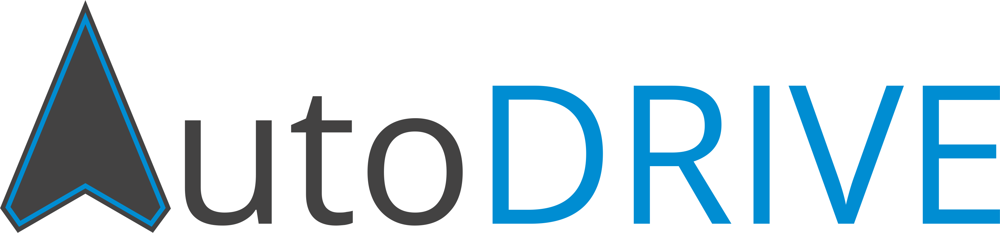
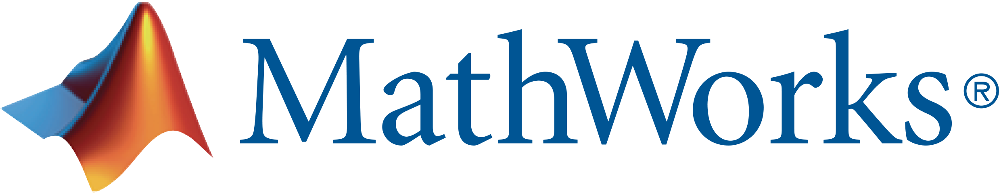
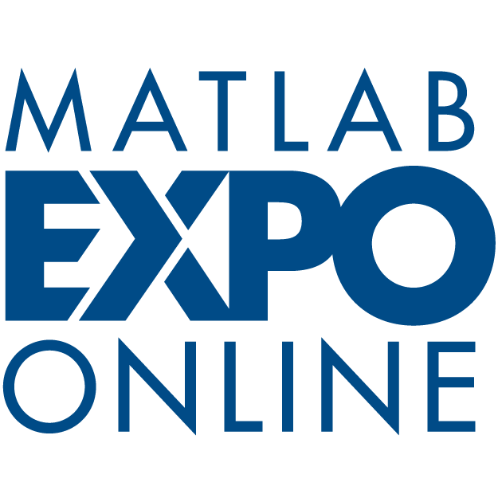
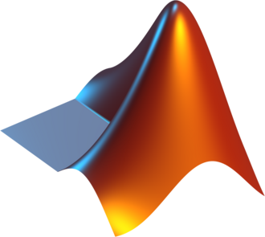

<p align="center">
 &nbsp;&nbsp;&nbsp;&nbsp;&nbsp; 
</p>

A comprehensive toolbox containing modular APIs and turnkey demos for autonomous driving using AutoDRIVE Ecosystem and MathWorks tool suite.

<p>
  <a href="https://www.mathworks.com/matlabcentral/fileexchange/183093-autodrive-toolbox"></a>&nbsp;
  <a href="https://github.com/AutoDRIVE-Ecosystem/AutoDRIVE-MathWorks"></a>&nbsp;
  &nbsp;
  &nbsp;
  
</p>

# MATLAB API

<p align="justify">
This section describes the MATLAB API for AutoDRIVE, which can be used to develop modular as well as end-to-end autonomous driving algorithms using textual programming. This API is primarily designed for "software engineers" who prefer a script/function-based workflow.
</p>

## SETUP

> [!NOTE]
> Please skip this setup if you have already installed the [`autodrive_simulink_api`](autodrive_simulink_api).

1. Install the Java library:
   - Place the [`WebSocket-1.0.0.jar`](autodrive_matlab_api/lib/target/WebSocket-1.0.0.jar) file on the static Java class path in MATLAB by editing the `javaclasspath.txt` file (create the file if it does not exist). Run the following in MATLAB Command Window:
     ```MATLAB
     edit(fullfile(prefdir,'javaclasspath.txt'))
     ```
     For example, if the location of the `jar` file is `C:\AutoDRIVE-MathWorks\autodrive_matlab_api\lib\target\WebSocket-1.0.0.jar`, then open the static class path file with the above command and add the full path to it. Make sure that there are no other lines with a `WebSocket-*` entry. You can refer to [MATLAB's Documentation](https://www.mathworks.com/help/matlab/matlab_external/static-path-of-java-class-path.html) for more information on the static Java class path.

     After having done this, **restart MATLAB** and check that the path was read by MATLAB properly by running the `javaclasspath` command. The newly added path should appear at the bottom of the list, before the `DYNAMIC JAVA PATH` entries. Note that seeing the entry here does not mean that MATLAB necessarily found the `jar` file properly. You must make sure that the actual `jar` file is indeed available at this location.
   - **[OPTIONAL]** To build the `jar` file yourself, it is recommended to use [Apache Maven](https://maven.apache.org/download.cgi) (tested with version 3.8.1) with [Java Development Kit](https://www.oracle.com/java/technologies/downloads/?er=221886#java8) (tested with version 8u411). Maven will automatically take care of downloading the [`Java-WebSocket`](https://github.com/TooTallNate/Java-WebSocket) library and neatly package everything into a single file (an "uber jar") based on the [`pom.xml`](autodrive_matlab_api/lib/pom.xml). Once the `mvn` command is on your path, simply `cd` to the `lib` directory and execute the `mvn package` command.
2. Add the `autodrive_matlab_api` directory to MATLAB path by right-clicking on it from MATLAB's file explorer and selecting `Add to Path` &rarr; `Selected Folders and Subfolders`.

## USAGE

1. Execute AutoDRIVE MATLAB API:
    ```MATLAB
    autodrive = example_{vehicle}(4567)
    ```
    Replace `{vehicle}` by one of the available objects (use the URL to download the corresponding vehicle-specific simulator):
    - `roboracer` for [RoboRacer (formerly F1Tenth)](https://github.com/AutoDRIVE-Ecosystem/AutoDRIVE-MathWorks/releases/download/v0.1.0/autodrive_roboracer_simulator.zip)
    - `hunter` for [AgileX Hunter SE](https://github.com/AutoDRIVE-Ecosystem/AutoDRIVE-MathWorks/releases/download/v0.3.0/autodrive_hunter_simulator.zip)
    - `husky` for [Clearpath Husky A200](https://github.com/AutoDRIVE-Ecosystem/AutoDRIVE-MathWorks/releases/download/v0.5.0/autodrive_husky_simulator.zip)
    - `rzr` for [Polaris RZR Pro R 4 Ultimate](https://github.com/AutoDRIVE-Ecosystem/AutoDRIVE-MathWorks/releases/download/v0.7.0/autodrive_rzr_simulator.zip)

2. Terminate AutoDRIVE MATLAB API:
    ```MATLAB
    autodrive.stop
    delete(autodrive)
    clear autodrive
    ```

# Simulink API

<p align="justify">
This section describes the Simulink API for AutoDRIVE, which can be used to develop modular as well as end-to-end autonomous driving algorithms using graphical programming. This API is primarily designed for "system engineers" who prefer an interactive MBD/MBSE toolchain.
</p>

## SETUP

> [!NOTE]
> Please skip this setup if you have already installed the [`autodrive_matlab_api`](autodrive_matlab_api).

1. Install the Java library:
   - Place the [`WebSocket-1.0.0.jar`](autodrive_simulink_api/lib/target/WebSocket-1.0.0.jar) file on the static Java class path in MATLAB by editing the `javaclasspath.txt` file (create the file if it does not exist). Run the following in MATLAB Command Window:
     ```MATLAB
     edit(fullfile(prefdir,'javaclasspath.txt'))
     ```
     For example, if the location of the `jar` file is `C:\AutoDRIVE-MathWorks\autodrive_simulink_api\lib\target\WebSocket-1.0.0.jar`, then open the static class path file with the above command and add the full path to it. Make sure that there are no other lines with a `WebSocket-*` entry. You can refer to [MATLAB's Documentation](https://www.mathworks.com/help/matlab/matlab_external/static-path-of-java-class-path.html) for more information on the static Java class path.

     After having done this, **restart MATLAB** and check that the path was read by MATLAB properly by running the `javaclasspath` command. The newly added path should appear at the bottom of the list, before the `DYNAMIC JAVA PATH` entries. Note that seeing the entry here does not mean that MATLAB necessarily found the `jar` file properly. You must make sure that the actual `jar` file is indeed available at this location.
   - **[OPTIONAL]** To build the `jar` file yourself, it is recommended to use [Apache Maven](https://maven.apache.org/download.cgi) (tested with version 3.8.1) with [Java Development Kit](https://www.oracle.com/java/technologies/downloads/?er=221886#java8) (tested with version 8u411). Maven will automatically take care of downloading the [`Java-WebSocket`](https://github.com/TooTallNate/Java-WebSocket) library and neatly package everything into a single file (an "uber jar") based on the [`pom.xml`](autodrive_simulink_api/lib/pom.xml). Once the `mvn` command is on your path, simply `cd` to the `lib` directory and execute the `mvn package` command.
2. Add the `autodrive_simulink_api` directory to MATLAB path by right-clicking on it from MATLAB's file explorer and selecting `Add to Path` &rarr; `Selected Folders and Subfolders`.

> [!NOTE]
> If you face issues installing/running the AutoDRIVE Simulink API or examples, check out the [Troubleshooting Guide](autodrive_simulink_api/troubleshooting/README.md) for helpful tips.

## USAGE

Run the vehicle-specific `example` file (the first URL) with the corresponding vehicle-specific simulator (the second URL):
- [`example_roboracer.slx`](autodrive_simulink_api/example_roboracer.slx) for [RoboRacer (formerly F1Tenth)](https://github.com/AutoDRIVE-Ecosystem/AutoDRIVE-MathWorks/releases/download/v0.2.0/autodrive_roboracer_simulator.zip)
- [`example_hunter.slx`](autodrive_simulink_api/example_hunter.slx) for [AgileX Hunter SE](https://github.com/AutoDRIVE-Ecosystem/AutoDRIVE-MathWorks/releases/download/v0.4.0/autodrive_hunter_simulator.zip)
- [`example_husky.slx`](autodrive_simulink_api/example_husky.slx) for [Clearpath Husky A200](https://github.com/AutoDRIVE-Ecosystem/AutoDRIVE-MathWorks/releases/download/v0.6.0/autodrive_husky_simulator.zip)
- [`example_rzr.slx`](autodrive_simulink_api/example_rzr.slx) for [Polaris RZR Pro R 4 Ultimate](https://github.com/AutoDRIVE-Ecosystem/AutoDRIVE-MathWorks/releases/download/v0.8.0/autodrive_rzr_simulator.zip)

> [!NOTE]
> The AutoDRIVE Simulink API, which is implemented as a Level-2 MATLAB S-Function, will automatically take care of creating a WebSocket server instance upon running the Simulink model and will ensure a graceful exit upon termination by stopping the server instance, deleting it, and clearing it from the memory.

# Turnkey Demos

<p align="justify">
This section describes various turnkey demos for modular as well as end-to-end autonomous driving algorithms developed using AutoDRIVE Ecosystem and MathWorks tool suite.
</p>

|                   |                    |
|:------------------|:-------------------|
|  | [**autodrive_rzr_aeb_mbd**](autodrive_turnkey_demos/autodrive_rzr_aeb_mbd)<br>- **Vehicle:** RZR Pro R 4 Ultimate<br>- **Sensors:** Camera + IMU + Encoders<br>- **Environment:** Handcrafted Dirt Road in Thick Vegetation<br>- **Task:** Autonomous Emergency Braking (AEB)<br>- **Approach:** Model-Based Design (MBD) using Simulink<br>- **Simulator:** [autodrive_rzr_simulator.zip](https://github.com/AutoDRIVE-Ecosystem/AutoDRIVE-MathWorks/releases/download/v1.0.0/autodrive_rzr_simulator.zip) |
|  | [**autodrive_rzr_aeb_mbse**](autodrive_turnkey_demos/autodrive_rzr_aeb_mbse)<br>- **Vehicle:** RZR Pro R 4 Ultimate<br>- **Sensors:** Camera + IMU + Encoders<br>- **Environment:** Handcrafted Dirt Road in Thick Vegetation<br>- **Task:** Autonomous Emergency Braking (AEB)<br>- **Approach:** Model-Based Systems Engineering (MBSE) using System Composer<br>- **Simulator:** [autodrive_rzr_simulator.zip](https://github.com/AutoDRIVE-Ecosystem/AutoDRIVE-MathWorks/releases/download/v1.1.0/autodrive_rzr_simulator.zip)<br>- **Artifacts:** [Research Paper](https://doi.org/10.1016/j.ifacol.2025.12.336), <a href="https://youtu.be/FsSTWJiiEWg">YouTube Video</a>, [MathWorks Success Slide](https://github.com/AutoDRIVE-Ecosystem/AutoDRIVE-MathWorks/blob/main/media/VIPR-GS%20%2B%20MathWorks%20Autonomous%20Systems%20Case%20Study%201.pdf), [MathWorks Success Story](https://www.mathworks.com/company/user_stories/scalable-digital-engineering-for-autonomous-vehicle-validation.html) |
|  | [**autodrive_husky_g2g_mbse**](autodrive_turnkey_demos/autodrive_husky_g2g_mbse)<br>- **Vehicle:** Husky A200<br>- **Sensors:** GNSS + IMU<br>- **Environment:** Procedurally Generated Uneven Terrain<br>- **Task:** Autonomous Go-to-Goal (G2G) Navigation<br>- **Approach:** Model-Based Systems Engineering (MBSE) using System Composer<br>- **Simulator:** [autodrive_husky_simulator.zip](https://github.com/AutoDRIVE-Ecosystem/AutoDRIVE-MathWorks/releases/download/v2.0.0/autodrive_husky_simulator.zip)<br>- **Artifacts:** [Research Paper](https://doi.org/10.1115/1.4069966), <a href="https://youtu.be/isLNbC_9I8Q">YouTube Video</a>, [MathWorks Success Slide](https://github.com/AutoDRIVE-Ecosystem/AutoDRIVE-MathWorks/blob/main/media/VIPR-GS%20%2B%20MathWorks%20Autonomous%20Systems%20Case%20Study%202.pdf) |
|  | [**autodrive_rzr_aeb_mbse_agentic_ai**](autodrive_turnkey_demos/autodrive_rzr_aeb_mbse/agentic_ai)<br>- **Vehicle:** RZR Pro R 4 Ultimate<br>- **Sensors:** Camera + IMU + Encoders<br>- **Environment:** Handcrafted Dirt Road in Thick Vegetation<br>- **Task:** Autonomous Emergency Braking (AEB)<br>- **Approach:** Agentic AI supercharges the digital thread using MATLAB MCP Server, MATLAB Agentic Toolkit, and Simulink Agentic Toolkit<br>- **Simulator:** [autodrive_rzr_simulator.zip](https://github.com/AutoDRIVE-Ecosystem/AutoDRIVE-MathWorks/releases/download/v1.1.0/autodrive_rzr_simulator.zip)<br>- **Artifacts:** <a href="https://youtu.be/Yg7cQWTt65I">YouTube Video</a> |
|                    |                     |

**Taxonomy & Nomenclature:**
- `*_alg`: Algorithm Development using [MATLAB](https://www.mathworks.com/products/matlab.html)
- `*_mbd`: Model-Based Design (MBD) using [Simulink](https://www.mathworks.com/products/simulink.html)
- `*_mbse`: Model-Based Systems Engineering (MBSE) using [System Composer](https://www.mathworks.com/products/system-composer.html)
- `*_agentic_ai`: Agentic AI using [MATLAB MCP Server](https://www.mathworks.com/products/matlab-mcp-server.html), [MATLAB Agentic Toolkit](https://www.mathworks.com/products/matlab-agentic-toolkit.html), and [Simulink Agentic Toolkit](https://www.mathworks.com/products/simulink-agentic-toolkit.html)

# Honors and Awards



**MATLAB EXPO Online:** Invited talk of project *"Digital Engineering Framework for Off-Road Autonomous Vehicles"* at [MATLAB EXPO Online 2026](https://eventsonline.mathworks.com/series/matlab-expo-online-2026-agenda/landing_page?q=Digital+Engineering+Framework+for+Off-Road+Autonomous+Vehicles)

*Tanmay Samak and Chinmay Samak*

<br />



**MathWorks Blog Series:** Interview for blog series *"Digital Engineering De-coded: Illuminating the Future of Engineering"* | [Part 1](https://blogs.mathworks.com/digitaleng/2026/10/06/part-1-why-digital-engineering-matters-real-examples-real-roi) | [Part 2](https://blogs.mathworks.com/digitaleng/2026/10/15/part-2-how-digital-engineering-scales-where-ad-hoc-workflows-fail) | [Part 3](https://blogs.mathworks.com/digitaleng/2026/10/21/part-3-when-digital-engineering-delivers-from-models-to-evidence) | [Part 4](https://blogs.mathworks.com/digitaleng/2026/10/29/post-4-getting-started-with-digital-engineering-beyond-just-tools) |

*Tanmay Samak and Chinmay Samak (with Kirsten McCane and Jason Ghidella)*

<br />


**MathWorks ART Forum:** Invited talk of research *"Autonomous Vehicles in the Age of AI: From Digital Twins to Physical AI"* at MathWorks Advanced Research & Technology (ART) Forum

*Tanmay Samak, Chinmay Samak and Venkat Krovi (with Akshay Rajhans)*

<br />


**MathWorks Research Summit:** Technology showcase of project *"Digital Engineering Framework for Off-Road Autonomous Vehicles"* at [MathWorks Research Summit 2026](https://www.mathworks.com/company/events/research-summit.html)

*Tanmay Samak, Chinmay Samak and Venkat Krovi (with Akshay Rajhans)*

<br />


**Simulink Student Challenge:** 1st Place for project *"Digital Engineering Framework for Off-Road Autonomous Vehicles"* at [Simulink Student Challenge 2025](https://www.mathworks.com/academia/student-challenge/simulink-student-challenge-2025.html)

*Tanmay Samak and Chinmay Samak*

<br />


**MathWorks Success Story:** [Building a Scalable Digital Engineering Framework for Autonomous Ground Vehicle Validation](https://www.mathworks.com/company/user_stories/scalable-digital-engineering-for-autonomous-vehicle-validation.html)

*Tanmay Samak, Chinmay Samak, Julia Brault, Cori Harber, Kirsten McCane, Jonathon Smereka, Mark Brudnak, David Gorsich, and Venkat Krovi*

<br />


**MathWorks Success Slide:** [Digital Engineering Accelerates Off-Road Ground Vehicle Development](https://github.com/AutoDRIVE-Ecosystem/AutoDRIVE-MathWorks/blob/main/media/VIPR-GS%20%2B%20MathWorks%20Autonomous%20Systems%20Case%20Study%201.pdf)

*Tanmay Samak, Chinmay Samak, Julia Brault, Cori Harber, Kirsten McCane, Jonathon Smereka, Mark Brudnak, David Gorsich, and Venkat Krovi*

<br />


**MathWorks Success Slide:** [Overcoming Complexity to Model and Optimize Complex Mission Scenarios](https://github.com/AutoDRIVE-Ecosystem/AutoDRIVE-MathWorks/blob/main/media/VIPR-GS%20%2B%20MathWorks%20Autonomous%20Systems%20Case%20Study%202.pdf)

*John Coleman, Jagadeesh Madinni, Tanmay Samak, Chinmay Samak, Kirsten McCane, Julia Brault, Cori Harber, Jonathon Smereka, Mark Brudnak, David Gorsich, and Venkat Krovi*

