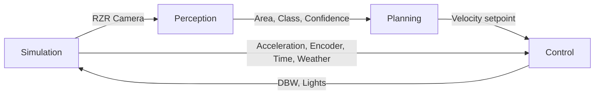
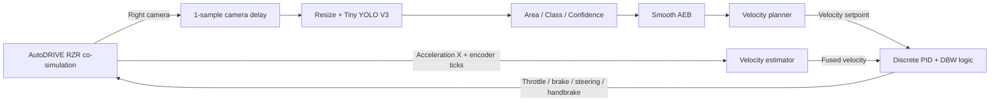

# autodrive_rzr_aeb_mbse

> What skills do you have?

I have these skill groups available:

- **Image generation and editing**
- **OpenAI documentation**
- **Skill and plugin creation/installation**
- **Document creation and editing**
- **Browser control**
- **MATLAB**
  - Data analysis and visualization
  - Signal, image, and audio processing
  - AI/model deployment
  - Robotics, GNSS, UAVs, and motion planning
  - Automotive, aerospace, and test hardware
  - Databases, reports, apps, and toolboxes
  - Debugging, modernization, optimization, and dependency analysis
- **Simulink**
  - Model and architecture building
  - Simulation inputs and Signal Data Inspector runs
  - Project and block-policy management
  - Compliance checks, Model Advisor checks, and testing
  - Requirements, fault injection, and safety analysis

I also have general coding and workspace capabilities: inspecting repositories, editing files, running commands and tests, researching the web, and generating visuals. If you describe a goal, I can identify the most relevant skills before starting.

> Use skills related to MBSE and project management.

<details><summary>3 previous messages</summary>

> I’ll use the `building-architecture-models` skill for MBSE and `managing-simulink-projects` for project structure, dependencies, and reproducible workflows. I’m loading their instructions now so the next task follows both correctly.
>
> The parallel file read hit a Windows process-launch restriction. I’m retrying the two instruction files sequentially; this doesn’t change the selected skills.
>
> <details><summary>Ran 3 commands</summary>
>
> - Ran `Get-Content -Raw -LiteralPath 'C:\Users\csamak\.matlab\agentic-toolkits\simulink\skills-catalog\model-based-system-engineering\building-architecture-models\SKILL.md'`
> - Ran `Get-Content -Raw -LiteralPath 'C:\Users\csamak\.matlab\agentic-toolkits\simulink\skills-catalog\model-based-system-engineering\building-architecture-models\SKILL.md'`
> - Ran `Get-Content -Raw -LiteralPath 'C:\Users\csamak\.matlab\agentic-toolkits\simulink\skills-catalog\model-based-design-core\managing-simulink-projects\SKILL.md'`
>
> </details>
</details>

I’ll use:

- `building-architecture-models` for MBSE: functional/logical/physical architecture, interfaces, allocations, stereotypes, views, and requirements traceability.
- `managing-simulink-projects` for project setup: paths, file registration, dependencies, source control, caching, and project health checks.

I’ll follow phased review points and verify each architecture layer and every project modification. Send me the system, requirements, or existing MATLAB/Simulink project you want to work on.

> Search the allocated Windows filesystem workspace and open the "autodrive_rzr_aeb_mbse.prj" project in a new MATLAB session.

<details><summary>6 previous messages</summary>

> I’m using the Simulink project-management skill because opening a `.prj` safely depends on correct project/session handling. I’ll locate the exact file within the allocated workspace, verify it, then launch it in a separate MATLAB process.
>
> <details><summary>Ran 2 commands</summary>
>
> - Ran `Get-Content -Raw -LiteralPath 'C:\Users\csamak\.matlab\agentic-toolkits\simulink\skills-catalog\model-based-design-core\managing-simulink-projects\SKILL.md'`
> - Ran `rg --files -uu -g 'autodrive_rzr_aeb_mbse.prj' 'C:\Users\csamak\Workspace\ChatGPT-Codex AI Workspace' 'C:\Users\csamak\.codex\visualizations\2026\07\29\019faf75-e7d7-71b1-bae2-c2a892ea5b34'`
>
> </details>
>
> The project was found at the workspace root’s `autodrive_rzr_aeb_mbse` folder. I’m verifying the project file and MATLAB executable before starting the new visible session.
>
> <details><summary>Ran 2 commands</summary>
>
> - Ran `$projectFile = Get-Item -LiteralPath 'C:\Users\csamak\Workspace\ChatGPT-Codex AI Workspace\autodrive_rzr_aeb_mbse\autodrive_rzr_aeb_mbse.prj'; $matlabCommand = Get-Command matlab -ErrorAction Stop; [PSCustomObject]@{Project=$projectFile.FullName; ProjectBytes=$projectFile.Length; Matlab=$matlabCommand.Source} | Format-List`
> - Ran `$matlabExe = 'C:\Program Files\MATLAB\R2026a\bin\matlab.exe'; $projectDir = 'C:\Users\csamak\Workspace\ChatGPT-Codex AI Workspace\autodrive_rzr_aeb_mbse'; $startupCommand = "openProject('autodrive_rzr_aeb_mbse.prj');"; $beforeIds = @(Get-Process -Name MATLAB -ErrorAction SilentlyContinue | ForEach-Object Id); $started = Start-Process -FilePath $matlabExe -WorkingDirectory $projectDir -ArgumentList @('-newInstance','-desktop','-r',$startupCommand) -PassThru; Start-Sleep -Seconds 8; $newProcesses = Get-Process -Name MATLAB -ErrorAction SilentlyContinue | Where-Object { $_.Id -notin $beforeIds }; [PSCustomObject]@{LauncherPid=$started.Id; NewMatlabPids=($newProcesses.Id -join ', '); WindowTitles=($newProcesses.MainWindowTitle -join ' | ')} | Format-List`
>
> </details>
>
> A separate MATLAB R2026a desktop process is running. I’m doing one final read-only check on its startup command to confirm it was launched with the requested project.
>
> <details><summary>Ran 2 commands</summary>
>
> - Ran `Get-CimInstance Win32_Process -Filter "Name = 'MATLAB.exe'" | Where-Object { $_.ProcessId -in @(2384,37016) } | Select-Object ProcessId,CommandLine | Format-List`
> - Ran `Get-CimInstance Win32_Process -Filter "Name = 'MATLAB.exe'" | Where-Object { $_.ProcessId -in @(2384,37016) } | Select-Object ProcessId,CommandLine | Format-List`
>
> </details>
</details>

Opened [autodrive_rzr_aeb_mbse.prj](<./autodrive_rzr_aeb_mbse/autodrive_rzr_aeb_mbse.prj>) in a new MATLAB R2026a desktop session. The new primary MATLAB process is PID `37016`.

> Are you able to access the MATLAB session via MCP Server?

<details><summary>2 previous messages</summary>

> I can access MATLAB through the connected MATLAB MCP server. I’ll run a harmless session query now to confirm which desktop instance the server is attached to.
>
> <details><summary>Called a tool</summary>
>
> MCP tool call
>
> matlab.evaluate_matlab_code
>
> ```json
> {
>   "code": "fprintf('MATLAB_VERSION=%s\\n', version);\nfprintf('MATLAB_PID=%d\\n', feature('getpid'));\nfprintf('PWD=%s\\n', pwd);\ntry\n    proj = currentProject;\n    fprintf('PROJECT_NAME=%s\\n', char(proj.Name));\n    fprintf('PROJECT_ROOT=%s\\n', char(proj.RootFolder));\ncatch ME\n    fprintf('PROJECT_STATUS=none (%s)\\n', ME.identifier);\nend"
> }
> ```
>
> ```text
> MATLAB_VERSION=26.1.0.3312084 (R2026a) Update 4
> MATLAB_PID=2384
> PWD=C:\Users\csamak\Workspace\ChatGPT-Codex AI Workspace\autodrive_rzr_aeb_mbse
> PROJECT_NAME=autodrive_rzr_aeb_mbse
> PROJECT_ROOT=C:\Users\csamak\Workspace\ChatGPT-Codex AI Workspace\autodrive_rzr_aeb_mbse
> ```
>
> </details>
</details>

Yes. The MATLAB MCP server is connected to the new session and reports:

- MATLAB R2026a Update 4
- Project: `autodrive_rzr_aeb_mbse`
- Project root: `C:\Users\csamak\Workspace\ChatGPT-Codex AI Workspace\autodrive_rzr_aeb_mbse`
- Connected MATLAB process: PID `2384`

I can now inspect models, execute MATLAB commands, analyze scripts, and run tests in that session.

> Open the "AutoDRIVE_RZR_AEB.slx" system architecture.

<details><summary>2 previous messages</summary>

> I’m using the `building-architecture-models` MBSE skill because this is a System Composer architecture artifact. I’ll resolve the model through the active project, open it in the connected MATLAB desktop, and verify the loaded file.
>
> <details><summary>Ran a command, called a tool</summary>
>
> - Ran `Get-Content -Raw -LiteralPath 'C:\Users\csamak\.matlab\agentic-toolkits\simulink\skills-catalog\model-based-system-engineering\building-architecture-models\SKILL.md'`
>
> MCP tool call
>
> matlab.evaluate_matlab_code
>
> ```json
> {
>   "code": "modelName = 'AutoDRIVE_RZR_AEB';\nmodelFile = which([modelName '.slx']);\nif isempty(modelFile)\n    error('AutoDRIVE:ModelNotFound', 'Could not resolve %s.slx on the active project path.', modelName);\nend\nopen_system(modelFile);\nfprintf('MODEL_FILE=%s\\n', modelFile);\nfprintf('MODEL_LOADED=%d\\n', bdIsLoaded(modelName));\ntry\n    architectureModel = systemcomposer.loadModel(modelName);\n    fprintf('ARCHITECTURE_CLASS=%s\\n', class(architectureModel));\ncatch ME\n    fprintf('ARCHITECTURE_API_STATUS=unavailable (%s: %s)\\n', ME.identifier, ME.message);\nend"
> }
> ```
>
> ```text
> MODEL_FILE=C:\Users\csamak\Workspace\ChatGPT-Codex AI Workspace\autodrive_rzr_aeb_mbse\AutoDRIVE_RZR_AEB.slx
> MODEL_LOADED=1
> ARCHITECTURE_CLASS=systemcomposer.arch.Model
> ```
>
> </details>
</details>

Opened `AutoDRIVE_RZR_AEB.slx` in the connected MATLAB desktop. It loaded successfully and was verified as a `systemcomposer.arch.Model` system architecture.

> Act as a systems engineer. Inspect the system architecture and produce a design review of your analysis with explainations. Base every conclusion on inspected model elements instead of assumptions.

<details><summary>10 previous messages</summary>

> I’m using the `building-architecture-models` MBSE skill to structure this as an evidence-based architecture review. I’ll inspect hierarchy, interfaces, connectivity, stereotypes/properties, allocations, requirements links, and model diagnostics; I won’t infer design intent where the model is silent.
>
> <details><summary>Ran a command, called a tool</summary>
>
> - Ran `Get-Content -Raw -LiteralPath 'C:\Users\csamak\.matlab\agentic-toolkits\simulink\skills-catalog\model-based-system-engineering\building-architecture-models\SKILL.md'; Get-Content -Raw -LiteralPath 'C:\Users\csamak\.matlab\agentic-toolkits\simulink\skills-catalog\model-based-system-engineering\building-architecture-models\references\system-composer-api.md'`
>
> MCP tool call
>
> matlab.model_overview
>
> ```json
> {
>   "detail": "full",
>   "model": "AutoDRIVE_RZR_AEB.slx",
>   "scope": "root"
> }
> ```
>
> ```text
> matlab error: Unrecognized function or variable 'model_overview'.
> ```
>
> </details>
>
> The high-level overview helper is unavailable in this MATLAB installation, so I’m switching to direct, read-only System Composer API inspection. This still lets me enumerate the actual components, ports, connectors, interfaces, stereotypes, and trace links from the loaded model.
>
> <details><summary>Called 8 tools</summary>
>
> MCP tool call
>
> matlab.evaluate_matlab_code
>
> ```json
> {
>   "code": "modelName = 'AutoDRIVE_RZR_AEB';\narchModel = systemcomposer.loadModel(modelName);\narch = archModel.Architecture;\nfprintf('MODEL_PROPERTIES=%s\\n', strjoin(properties(archModel), ','));\nfprintf('ARCH_PROPERTIES=%s\\n', strjoin(properties(arch), ','));\nif ~isempty(arch.Components)\n    fprintf('COMPONENT_PROPERTIES=%s\\n', strjoin(properties(arch.Components(1)), ','));\nend\nif ~isempty(arch.Ports)\n    fprintf('PORT_PROPERTIES=%s\\n', strjoin(properties(arch.Ports(1)), ','));\nend\nif ~isempty(arch.Connectors)\n    fprintf('CONNECTOR_PROPERTIES=%s\\n', strjoin(properties(arch.Connectors(1)), ','));\nend"
> }
> ```
>
> ```text
> MODEL_PROPERTIES=Name,SimulinkHandle,Architecture,Profiles,InterfaceDictionary,Views,Interactions
> ARCH_PROPERTIES=Name,Definition,Parent,Components,Ports,Connectors,Parameters,Model,SimulinkHandle,SimulinkModelHandle,UUID,ExternalUID
> COMPONENT_PROPERTIES=IsAdapterComponent,Architecture,ReferenceName,Name,Parent,Ports,OwnedPorts,OwnedArchitecture,Parameters,Position,Model,SimulinkHandle,SimulinkModelHandle,UUID,ExternalUID
> CONNECTOR_PROPERTIES=SourcePort,DestinationPort,SourceElement,DestinationElement,Name,Parent,Ports,Model,SimulinkHandle,SimulinkModelHandle,UUID,ExternalUID
> ```
>
> MCP tool call
>
> matlab.evaluate_matlab_code
>
> ```json
> {
>   "code": "archModel = systemcomposer.loadModel('AutoDRIVE_RZR_AEB');\narch = archModel.Architecture;\nfprintf('TOP_COMPONENT_COUNT=%d\\n', numel(arch.Components));\nfprintf('TOP_PORT_COUNT=%d\\n', numel(arch.Ports));\nfprintf('TOP_CONNECTOR_COUNT=%d\\n', numel(arch.Connectors));\nfor i = 1:numel(arch.Components)\n    c = arch.Components(i);\n    fprintf('TOP_COMPONENT|%d|%s|Reference=%s|Ports=%d|Children=%d|Connectors=%d|Definition=%s\\n', i, char(c.Name), char(c.ReferenceName), numel(c.Ports), numel(c.Architecture.Components), numel(c.Architecture.Connectors), char(c.Architecture.Definition));\n    if ~isempty(c.Ports)\n        fprintf('COMPONENT_PORT_PROPERTIES=%s\\n', strjoin(properties(c.Ports(1)), ','));\n        break;\n    end\nend"
> }
> ```
>
> ```text
> TOP_COMPONENT_COUNT=4
> TOP_PORT_COUNT=0
> TOP_CONNECTOR_COUNT=11
> TOP_COMPONENT|1|Control|Reference=Control|Ports=7|Children=0|Connectors=0|Definition=Behavior
> COMPONENT_PORT_PROPERTIES=Parent,ArchitecturePort,Name,Direction,InterfaceName,Interface,InheritsInterface,Connectors,Connected,Model,SimulinkHandle,SimulinkModelHandle,UUID,ExternalUID
> ```
>
> MCP tool call
>
> matlab.evaluate_matlab_code
>
> ```json
> {
>   "code": "archModel = systemcomposer.loadModel('AutoDRIVE_RZR_AEB');\narch = archModel.Architecture;\nfor i = 1:numel(arch.Components)\n    for j = 1:numel(arch.Components(i).Ports)\n        p = arch.Components(i).Ports(j);\n        fprintf('PORT_METHODS=%s\\n', strjoin(methods(p), ','));\n        if ~isempty(p.Interface)\n            fprintf('INTERFACE_CLASS=%s\\n', class(p.Interface));\n            fprintf('INTERFACE_PROPERTIES=%s\\n', strjoin(properties(p.Interface), ','));\n            fprintf('INTERFACE_METHODS=%s\\n', strjoin(methods(p.Interface), ','));\n            if isprop(p.Interface,'Elements') && ~isempty(p.Interface.Elements)\n                fprintf('ELEMENT_PROPERTIES=%s\\n', strjoin(properties(p.Interface.Elements(1)), ','));\n            end\n        end\n        break;\n    end\n    break;\nend"
> }
> ```
>
> ```text
> PORT_METHODS=addlistener,addprop,applyStereotype,changeStereotype,connect,createInterface,current,delete,eq,findobj,findprop,ge,get,getConnectorTo,getEvaluatedPropertyValue,getProperty,getPropertyValue,getStereotypeProperties,getStereotypes,gt,hasProperty,hasStereotype,isvalid,le,listener,lt,ne,notify,removeStereotype,set,setInterface,setName,setProperty
> ```
>
> MCP tool call
>
> matlab.evaluate_matlab_code
>
> ```json
> {
>   "code": "archModel = systemcomposer.loadModel('AutoDRIVE_RZR_AEB');\narch = archModel.Architecture;\nfound = false;\nfor i = 1:numel(arch.Components)\n    for j = 1:numel(arch.Components(i).Ports)\n        p = arch.Components(i).Ports(j);\n        fprintf('PORT_SAMPLE|%s.%s|Direction=%s|InterfaceName=%s|Inherits=%d|Connected=%d\\n', char(arch.Components(i).Name), char(p.Name), char(p.Direction), char(p.InterfaceName), p.InheritsInterface, p.Connected);\n        if ~isempty(p.Interface) && ~found\n            found = true;\n            fprintf('INTERFACE_CLASS=%s\\n', class(p.Interface));\n            fprintf('INTERFACE_PROPERTIES=%s\\n', strjoin(properties(p.Interface), ','));\n            fprintf('INTERFACE_METHODS=%s\\n', strjoin(methods(p.Interface), ','));\n            if isprop(p.Interface,'Elements') && ~isempty(p.Interface.Elements)\n                fprintf('ELEMENT_PROPERTIES=%s\\n', strjoin(properties(p.Interface.Elements(1)), ','));\n            end\n        end\n    end\nend\nfprintf('FOUND_NONEMPTY_INTERFACE=%d\\n', found);"
> }
> ```
>
> ```text
> PORT_SAMPLE|Control.Acceleration|Direction=Input|InterfaceName=|Inherits=1|Connected=1
> PORT_SAMPLE|Control.DBW|Direction=Output|InterfaceName=|Inherits=0|Connected=1
> INTERFACE_CLASS=systemcomposer.interface.DataInterface
> INTERFACE_PROPERTIES=Name,Description,Owner,Elements,Model,UUID,ExternalUID
> INTERFACE_METHODS=addElement,addlistener,addprop,applyStereotype,changeStereotype,delete,destroy,eq,findobj,findprop,ge,get,getElement,getEvaluatedPropertyValue,getProperty,getPropertyValue,getStereotypeProperties,getStereotypes,gt,hasProperty,hasStereotype,isvalid,le,listener,lt,moveInterface,ne,notify,removeElement,removeStereotype,set,setDescription,setName,setProperty
> ELEMENT_PROPERTIES=Name,Interface,Type,Description,Dimensions,UUID,ExternalUID
> PORT_SAMPLE|Control.Encoder|Direction=Input|InterfaceName=|Inherits=0|Connected=1
> PORT_SAMPLE|Control.Lights|Direction=Output|InterfaceName=|Inherits=1|Connected=1
> PORT_SAMPLE|Control.Time|Direction=Input|InterfaceName=|Inherits=1|Connected=1
> PORT_SAMPLE|Control.Velocity Setpoint|Direction=Input|InterfaceName=|Inherits=1|Connected=1
> PORT_SAMPLE|Control.Weather|Direction=Input|InterfaceName=|Inherits=0|Connected=1
> PORT_SAMPLE|Perception.Area|Direction=Output|InterfaceName=|Inherits=1|Connected=1
> PORT_SAMPLE|Perception.Camera|Direction=Input|InterfaceName=|Inherits=1|Connected=1
> PORT_SAMPLE|Perception.Class|Direction=Output|InterfaceName=|Inherits=1|Connected=1
> PORT_SAMPLE|Perception.Confidence|Direction=Output|InterfaceName=|Inherits=1|Connected=1
> PORT_SAMPLE|Planning.Area|Direction=Input|InterfaceName=|Inherits=1|Connected=1
> PORT_SAMPLE|Planning.Class|Direction=Input|InterfaceName=|Inherits=1|Connected=1
> PORT_SAMPLE|Planning.Confidence|Direction=Input|InterfaceName=|Inherits=1|Connected=1
> PORT_SAMPLE|Planning.Velocity|Direction=Output|InterfaceName=|Inherits=1|Connected=1
> PORT_SAMPLE|Simulation.RZR Acceleration|Direction=Output|InterfaceName=|Inherits=1|Connected=1
> PORT_SAMPLE|Simulation.RZR Camera|Direction=Output|InterfaceName=|Inherits=1|Connected=1
> PORT_SAMPLE|Simulation.RZR DBW|Direction=Input|InterfaceName=|Inherits=1|Connected=1
> PORT_SAMPLE|Simulation.RZR Encoder|Direction=Output|InterfaceName=|Inherits=1|Connected=1
> PORT_SAMPLE|Simulation.RZR Lights|Direction=Input|InterfaceName=|Inherits=1|Connected=1
> PORT_SAMPLE|Simulation.Time|Direction=Output|InterfaceName=|Inherits=1|Connected=1
> PORT_SAMPLE|Simulation.Weather|Direction=Output|InterfaceName=|Inherits=1|Connected=1
> FOUND_NONEMPTY_INTERFACE=1
> ```
>
> MCP tool call
>
> matlab.evaluate_matlab_code
>
> ```json
> {
>   "code": "modelName = 'AutoDRIVE_RZR_AEB';\narchModel = systemcomposer.loadModel(modelName);\narch = archModel.Architecture;\nfprintf('MODEL|Name=%s|Profiles=%d|Views=%d|InterfaceDictionary=%s\\n', char(archModel.Name), numel(archModel.Profiles), numel(archModel.Views), char(string(archModel.InterfaceDictionary)));\nfprintf('ARCH|Name=%s|Definition=%s|Components=%d|Ports=%d|Connectors=%d\\n', char(arch.Name), char(arch.Definition), numel(arch.Components), numel(arch.Ports), numel(arch.Connectors));\nfor i = 1:numel(arch.Components)\n    c = arch.Components(i);\n    fprintf('COMP|%s|Reference=%s|Definition=%s|Adapter=%d|Ports=%d|Children=%d|Connectors=%d|UUID=%s\\n', char(c.Name), char(c.ReferenceName), char(c.Architecture.Definition), c.IsAdapterComponent, numel(c.Ports), numel(c.Architecture.Components), numel(c.Architecture.Connectors), char(c.UUID));\n    for j = 1:numel(c.Ports)\n        p = c.Ports(j);\n        ifaceName = '';\n        ifaceClass = '';\n        elemSummary = '';\n        if ~isempty(p.Interface)\n            ifaceClass = class(p.Interface);\n            ifaceName = char(p.Interface.Name);\n            if isprop(p.Interface, 'Elements')\n                for k = 1:numel(p.Interface.Elements)\n                    e = p.Interface.Elements(k);\n                    item = sprintf('%s{Type=%s,Dimensions=%s}', char(e.Name), char(string(e.Type)), char(string(e.Dimensions)));\n                    if isempty(elemSummary), elemSummary = item; else, elemSummary = [elemSummary ';' item]; end\n                end\n            end\n        end\n        fprintf('PORT|%s.%s|Direction=%s|Connected=%d|Connectors=%d|Inherits=%d|InterfaceName=%s|InterfaceClass=%s|Elements=%s|UUID=%s\\n', char(c.Name), char(p.Name), char(p.Direction), p.Connected, numel(p.Connectors), p.InheritsInterface, ifaceName, ifaceClass, elemSummary, char(p.UUID));\n    end\nend\nfor i = 1:numel(arch.Connectors)\n    conn = arch.Connectors(i);\n    sp = conn.SourcePort;\n    dp = conn.DestinationPort;\n    if isa(sp.Parent, 'systemcomposer.arch.Component'), srcOwner = char(sp.Parent.Name); else, srcOwner = '<root>'; end\n    if isa(dp.Parent, 'systemcomposer.arch.Component'), dstOwner = char(dp.Parent.Name); else, dstOwner = '<root>'; end\n    fprintf('CONN|%d|%s.%s -> %s.%s|Name=%s|UUID=%s\\n', i, srcOwner, char(sp.Name), dstOwner, char(dp.Name), char(conn.Name), char(conn.UUID));\nend"
> }
> ```
>
> ```text
> matlab error: Error using string
> Conversion to string from systemcomposer.interface.Dictionary is not possible.
> ```
>
> MCP tool call
>
> matlab.evaluate_matlab_code
>
> ```json
> {
>   "code": "archModel = systemcomposer.loadModel('AutoDRIVE_RZR_AEB');\nif isempty(archModel.InterfaceDictionary)\n    fprintf('INTERFACE_DICTIONARY=empty\\n');\nelse\n    d = archModel.InterfaceDictionary;\n    fprintf('INTERFACE_DICTIONARY_CLASS=%s\\n', class(d));\n    fprintf('INTERFACE_DICTIONARY_PROPERTIES=%s\\n', strjoin(properties(d), ','));\nend\nfprintf('PROFILE_COUNT=%d\\n', numel(archModel.Profiles));\nfor i=1:numel(archModel.Profiles)\n    fprintf('PROFILE|%d|Class=%s\\n', i, class(archModel.Profiles(i)));\n    disp(archModel.Profiles(i));\nend\nfprintf('VIEW_COUNT=%d\\n', numel(archModel.Views));"
> }
> ```
>
> ```text
> INTERFACE_DICTIONARY_CLASS=systemcomposer.interface.Dictionary
> INTERFACE_DICTIONARY_PROPERTIES=Interfaces,Profiles,UUID,ExternalUID
> PROFILE_COUNT=0
> VIEW_COUNT=0
> ```
>
> MCP tool call
>
> matlab.evaluate_matlab_code
>
> ```json
> {
>   "code": "modelName = 'AutoDRIVE_RZR_AEB';\narchModel = systemcomposer.loadModel(modelName);\narch = archModel.Architecture;\nfprintf('MODEL|Name=%s|Profiles=%d|Views=%d|DictionaryInterfaces=%d\\n', char(archModel.Name), numel(archModel.Profiles), numel(archModel.Views), numel(archModel.InterfaceDictionary.Interfaces));\nfprintf('ARCH|Name=%s|Definition=%s|Components=%d|Ports=%d|Connectors=%d\\n', char(arch.Name), char(arch.Definition), numel(arch.Components), numel(arch.Ports), numel(arch.Connectors));\nfor i = 1:numel(arch.Components)\n    c = arch.Components(i);\n    fprintf('COMP|%s|Reference=%s|Definition=%s|Adapter=%d|Ports=%d|Children=%d|Connectors=%d|UUID=%s\\n', char(c.Name), char(c.ReferenceName), char(c.Architecture.Definition), c.IsAdapterComponent, numel(c.Ports), numel(c.Architecture.Components), numel(c.Architecture.Connectors), char(c.UUID));\n    for j = 1:numel(c.Ports)\n        p = c.Ports(j);\n        ifaceName = '';\n        ifaceClass = '';\n        elemSummary = '';\n        if ~isempty(p.Interface)\n            ifaceClass = class(p.Interface);\n            ifaceName = char(p.Interface.Name);\n            if isprop(p.Interface, 'Elements')\n                for k = 1:numel(p.Interface.Elements)\n                    e = p.Interface.Elements(k);\n                    typeText = regexprep(strtrim(evalc('disp(e.Type)')), '\\s+', ' ');\n                    dimText = regexprep(strtrim(evalc('disp(e.Dimensions)')), '\\s+', ' ');\n                    item = sprintf('%s{Type=%s,Dimensions=%s}', char(e.Name), typeText, dimText);\n                    if isempty(elemSummary), elemSummary = item; else, elemSummary = [elemSummary ';' item]; end\n                end\n            end\n        end\n        fprintf('PORT|%s.%s|Direction=%s|Connected=%d|Connectors=%d|Inherits=%d|InterfaceName=%s|InterfaceClass=%s|Elements=%s|UUID=%s\\n', char(c.Name), char(p.Name), char(p.Direction), p.Connected, numel(p.Connectors), p.InheritsInterface, ifaceName, ifaceClass, elemSummary, char(p.UUID));\n    end\nend\nfor i = 1:numel(arch.Connectors)\n    conn = arch.Connectors(i);\n    sp = conn.SourcePort;\n    dp = conn.DestinationPort;\n    if isa(sp.Parent, 'systemcomposer.arch.Component'), srcOwner = char(sp.Parent.Name); else, srcOwner = '<root>'; end\n    if isa(dp.Parent, 'systemcomposer.arch.Component'), dstOwner = char(dp.Parent.Name); else, dstOwner = '<root>'; end\n    fprintf('CONN|%d|%s.%s -> %s.%s|Name=%s|UUID=%s\\n', i, srcOwner, char(sp.Name), dstOwner, char(dp.Name), char(conn.Name), char(conn.UUID));\nend"
> }
> ```
>
> ```text
> MODEL|Name=AutoDRIVE_RZR_AEB|Profiles=0|Views=0|DictionaryInterfaces=0
> ARCH|Name=AutoDRIVE_RZR_AEB|Definition=Composition|Components=4|Ports=0|Connectors=11
> COMP|Control|Reference=Control|Definition=Behavior|Adapter=0|Ports=7|Children=0|Connectors=0|UUID=ff7ea486-e093-42fb-89e9-03868c250d60
> PORT|Control.Acceleration|Direction=Input|Connected=1|Connectors=1|Inherits=1|InterfaceName=|InterfaceClass=|Elements=|UUID=0dea132b-1155-419c-a06b-a6c7c30b22dc
> PORT|Control.DBW|Direction=Output|Connected=1|Connectors=1|Inherits=0|InterfaceName=|InterfaceClass=systemcomposer.interface.DataInterface|Elements=Throttle{Type=,Dimensions=1};Steering{Type=,Dimensions=1};Brake{Type=,Dimensions=1};Handbrake{Type=,Dimensions=1}|UUID=b6cb6673-02d7-4a0d-808f-038d641d931f
> PORT|Control.Encoder|Direction=Input|Connected=1|Connectors=1|Inherits=0|InterfaceName=|InterfaceClass=systemcomposer.ValueType|Elements=|UUID=eb07edd6-f233-4fe4-b83e-5c6a3a32d6ec
> PORT|Control.Lights|Direction=Output|Connected=1|Connectors=1|Inherits=1|InterfaceName=|InterfaceClass=|Elements=|UUID=adb26274-7899-453f-ae8e-46ed2dc33c83
> PORT|Control.Time|Direction=Input|Connected=1|Connectors=1|Inherits=1|InterfaceName=|InterfaceClass=|Elements=|UUID=23d9dc6a-04c0-4e74-9660-fe8780f82fd9
> PORT|Control.Velocity Setpoint|Direction=Input|Connected=1|Connectors=1|Inherits=1|InterfaceName=|InterfaceClass=|Elements=|UUID=b0558076-4e36-4563-b734-6b91741d863b
> PORT|Control.Weather|Direction=Input|Connected=1|Connectors=1|Inherits=0|InterfaceName=|InterfaceClass=systemcomposer.interface.DataInterface|Elements=ID{Type=<a href="matlab:helpPopup('systemcomposer.ValueType')" style="font-weight:bold">ValueType</a> with properties: Name: '' DataType: 'uint8' Dimensions: '1' Units: '' Complexity: 'real' Minimum: '[]' Maximum: '[]' Description: '' Owner: [1×1 systemcomposer.interface.DataElement] Model: [1×1 systemcomposer.arch.Model] UUID: '9c1e7c35-802d-4959-8867-4240e3d6d18a' ExternalUID: '',Dimensions=1};Fog{Type=,Dimensions=1}|UUID=9dfb8fdb-c010-4dac-b57a-da374207d390
> COMP|Perception|Reference=Perception|Definition=Behavior|Adapter=0|Ports=4|Children=0|Connectors=0|UUID=56259863-f6e3-4c5f-8d5e-401e87778c58
> PORT|Perception.Area|Direction=Output|Connected=1|Connectors=1|Inherits=0|InterfaceName=|InterfaceClass=systemcomposer.ValueType|Elements=|UUID=8a8ea098-c9bb-4851-89ef-9bdcec7b9cea
> PORT|Perception.Camera|Direction=Input|Connected=1|Connectors=1|Inherits=0|InterfaceName=|InterfaceClass=systemcomposer.ValueType|Elements=|UUID=139ae0d7-7586-4363-a958-15ec1a5c08db
> PORT|Perception.Class|Direction=Output|Connected=1|Connectors=1|Inherits=0|InterfaceName=|InterfaceClass=systemcomposer.ValueType|Elements=|UUID=e8edd76b-0bca-4c8d-a3f6-16831c2536da
> PORT|Perception.Confidence|Direction=Output|Connected=1|Connectors=1|Inherits=0|InterfaceName=|InterfaceClass=systemcomposer.ValueType|Elements=|UUID=6966c6eb-dc2c-4d2e-993b-9ce35623281b
> COMP|Planning|Reference=Planning|Definition=Behavior|Adapter=0|Ports=4|Children=0|Connectors=0|UUID=a88bb5f0-9704-4f46-8241-77d5756ab9ef
> PORT|Planning.Area|Direction=Input|Connected=1|Connectors=1|Inherits=0|InterfaceName=|InterfaceClass=systemcomposer.ValueType|Elements=|UUID=8f2e8319-2ed5-4353-a12e-5361d5be6899
> PORT|Planning.Class|Direction=Input|Connected=1|Connectors=1|Inherits=0|InterfaceName=|InterfaceClass=systemcomposer.ValueType|Elements=|UUID=1963d0a6-07ec-4042-9ee6-d4441b9edd49
> PORT|Planning.Confidence|Direction=Input|Connected=1|Connectors=1|Inherits=0|InterfaceName=|InterfaceClass=systemcomposer.ValueType|Elements=|UUID=18a127da-3c35-4282-a70d-264c8c24b6ac
> PORT|Planning.Velocity|Direction=Output|Connected=1|Connectors=1|Inherits=1|InterfaceName=|InterfaceClass=|Elements=|UUID=d2296cfa-b26a-416d-a725-6888ab092523
> COMP|Simulation|Reference=Simulation|Definition=Behavior|Adapter=0|Ports=7|Children=0|Connectors=0|UUID=9d59bd0e-c1b7-4797-bc94-b92641712eaf
> PORT|Simulation.RZR Acceleration|Direction=Output|Connected=1|Connectors=1|Inherits=1|InterfaceName=|InterfaceClass=|Elements=|UUID=5eb2c3f0-c2e6-4a1e-8261-afbd8ab2f1cf
> PORT|Simulation.RZR Camera|Direction=Output|Connected=1|Connectors=1|Inherits=1|InterfaceName=|InterfaceClass=|Elements=|UUID=7ccf2773-6afb-4ed8-83e4-86e1421f80b6
> PORT|Simulation.RZR DBW|Direction=Input|Connected=1|Connectors=1|Inherits=0|InterfaceName=|InterfaceClass=systemcomposer.interface.DataInterface|Elements=Throttle{Type=,Dimensions=1};Steering{Type=,Dimensions=1};Brake{Type=,Dimensions=1};Handbrake{Type=,Dimensions=1}|UUID=ed666ce2-b51e-4c32-adea-4cd15a0c8bcb
> PORT|Simulation.RZR Encoder|Direction=Output|Connected=1|Connectors=1|Inherits=0|InterfaceName=|InterfaceClass=systemcomposer.ValueType|Elements=|UUID=91cdfb25-f887-492b-8356-7f30ea390332
> PORT|Simulation.RZR Lights|Direction=Input|Connected=1|Connectors=1|Inherits=0|InterfaceName=|InterfaceClass=systemcomposer.ValueType|Elements=|UUID=8e440fb1-5982-4c36-af59-21bf615a928c
> PORT|Simulation.Time|Direction=Output|Connected=1|Connectors=1|Inherits=1|InterfaceName=|InterfaceClass=|Elements=|UUID=e2d6cbee-232a-4207-ab99-0fb76de9963f
> PORT|Simulation.Weather|Direction=Output|Connected=1|Connectors=1|Inherits=0|InterfaceName=|InterfaceClass=systemcomposer.interface.DataInterface|Elements=ID{Type=<a href="matlab:helpPopup('systemcomposer.ValueType')" style="font-weight:bold">ValueType</a> with properties: Name: '' DataType: 'uint8' Dimensions: '1' Units: '' Complexity: 'real' Minimum: '[]' Maximum: '[]' Description: '' Owner: [1×1 systemcomposer.interface.DataElement] Model: [1×1 systemcomposer.arch.Model] UUID: '4215d530-cce6-4042-b24e-923f1ac5d538' ExternalUID: '',Dimensions=1};Fog{Type=,Dimensions=1}|UUID=7d229b38-3316-4575-be58-fb0fff13aa7f
> CONN|1|Control.DBW -> Simulation.RZR DBW|Name=Conn|UUID=19f8d21e-b436-4a72-9de6-ad246a6bef88
> CONN|2|Simulation.RZR Camera -> Perception.Camera|Name=Conn|UUID=1f62caff-e825-413e-9e03-ae4e6e1a19a8
> CONN|3|Perception.Area -> Planning.Area|Name=Conn|UUID=a21edf8f-69d1-4e1a-a98b-2c9c17383dce
> CONN|4|Simulation.RZR Acceleration -> Control.Acceleration|Name=Conn|UUID=521c8758-5c22-4438-b461-d3191760b5e0
> CONN|5|Perception.Confidence -> Planning.Confidence|Name=Conn|UUID=53c3b69f-0eb7-447d-b8a8-82d0fd1d619a
> CONN|6|Simulation.RZR Encoder -> Control.Encoder|Name=Conn|UUID=66fd45a9-b428-405b-b359-b80ae515deaa
> CONN|7|Perception.Class -> Planning.Class|Name=Conn|UUID=a4eeff53-d486-40ab-8ab9-8689338449b8
> CONN|8|Simulation.Time -> Control.Time|Name=Conn|UUID=a891785d-d422-4371-b39f-54e23f169430
> CONN|9|Planning.Velocity -> Control.Velocity Setpoint|Name=Conn|UUID=b5acf00e-ad99-45b6-bc41-7fb3ef9aa115
> CONN|10|Simulation.Weather -> Control.Weather|Name=Conn|UUID=dc8ba47c-026c-4808-94ea-221d2430e2be
> CONN|11|Control.Lights -> Simulation.RZR Lights|Name=Conn|UUID=ff1ca2e2-89b8-4b95-ac4e-9c97130c406e
> ```
>
> MCP tool call
>
> matlab.evaluate_matlab_code
>
> ```json
> {
>   "code": "arch = systemcomposer.loadModel('AutoDRIVE_RZR_AEB').Architecture;\nfor i = 1:numel(arch.Components)\n    c = arch.Components(i);\n    for j = 1:numel(c.Ports)\n        p = c.Ports(j);\n        if isempty(p.Interface)\n            fprintf('TYPE|%s.%s|Interface=EMPTY|Inherits=%d\\n', char(c.Name), char(p.Name), p.InheritsInterface);\n        elseif isa(p.Interface, 'systemcomposer.ValueType')\n            vt = p.Interface;\n            fprintf('TYPE|%s.%s|ValueType|Name=%s|DataType=%s|Dimensions=%s|Units=%s|Complexity=%s|Min=%s|Max=%s|Description=%s\\n', char(c.Name), char(p.Name), char(vt.Name), char(vt.DataType), char(vt.Dimensions), char(vt.Units), char(vt.Complexity), char(string(vt.Minimum)), char(string(vt.Maximum)), regexprep(char(vt.Description),'[\\r\\n]+',' '));\n        elseif isa(p.Interface, 'systemcomposer.interface.DataInterface')\n            di = p.Interface;\n            fprintf('TYPE|%s.%s|DataInterface|Name=%s|Elements=%d|Description=%s\\n', char(c.Name), char(p.Name), char(di.Name), numel(di.Elements), regexprep(char(di.Description),'[\\r\\n]+',' '));\n            for k = 1:numel(di.Elements)\n                e = di.Elements(k);\n                if isempty(e.Type)\n                    fprintf('ELEMENT|%s.%s.%s|Type=EMPTY|Dimensions=%s|Description=%s\\n', char(c.Name), char(p.Name), char(e.Name), char(e.Dimensions), regexprep(char(e.Description),'[\\r\\n]+',' '));\n                else\n                    vt = e.Type;\n                    fprintf('ELEMENT|%s.%s.%s|TypeClass=%s|Name=%s|DataType=%s|Dimensions=%s|Units=%s|Complexity=%s|Min=%s|Max=%s|ElementDimensions=%s|Description=%s\\n', char(c.Name), char(p.Name), char(e.Name), class(vt), char(vt.Name), char(vt.DataType), char(vt.Dimensions), char(vt.Units), char(vt.Complexity), char(string(vt.Minimum)), char(string(vt.Maximum)), char(e.Dimensions), regexprep(char(e.Description),'[\\r\\n]+',' '));\n                end\n            end\n        else\n            fprintf('TYPE|%s.%s|InterfaceClass=%s\\n', char(c.Name), char(p.Name), class(p.Interface));\n        end\n    end\nend"
> }
> ```
>
> ```text
> TYPE|Control.Acceleration|Interface=EMPTY|Inherits=1
> TYPE|Control.DBW|DataInterface|Name=|Elements=4|Description=
> ELEMENT|Control.DBW.Throttle|Type=EMPTY|Dimensions=1|Description=
> ELEMENT|Control.DBW.Steering|Type=EMPTY|Dimensions=1|Description=
> ELEMENT|Control.DBW.Brake|Type=EMPTY|Dimensions=1|Description=
> ELEMENT|Control.DBW.Handbrake|Type=EMPTY|Dimensions=1|Description=
> TYPE|Control.Encoder|ValueType|Name=|DataType=int32|Dimensions=[]|Units=|Complexity=|Min=[]|Max=[]|Description=
> TYPE|Control.Lights|Interface=EMPTY|Inherits=1
> TYPE|Control.Time|Interface=EMPTY|Inherits=1
> TYPE|Control.Velocity Setpoint|Interface=EMPTY|Inherits=1
> TYPE|Control.Weather|DataInterface|Name=|Elements=2|Description=
> ELEMENT|Control.Weather.ID|TypeClass=systemcomposer.ValueType|Name=|DataType=uint8|Dimensions=1|Units=|Complexity=real|Min=[]|Max=[]|ElementDimensions=1|Description=
> ELEMENT|Control.Weather.Fog|Type=EMPTY|Dimensions=1|Description=
> TYPE|Perception.Area|ValueType|Name=|DataType=double|Dimensions=[10,1]|Units=|Complexity=|Min=[]|Max=[]|Description=
> TYPE|Perception.Camera|ValueType|Name=|DataType=uint8|Dimensions=[720,1280,3]|Units=|Complexity=|Min=[]|Max=[]|Description=
> TYPE|Perception.Class|ValueType|Name=|DataType=double|Dimensions=[10,1]|Units=|Complexity=|Min=[]|Max=[]|Description=
> TYPE|Perception.Confidence|ValueType|Name=|DataType=double|Dimensions=[10,1]|Units=|Complexity=|Min=[]|Max=[]|Description=
> TYPE|Planning.Area|ValueType|Name=|DataType=double|Dimensions=[10,1]|Units=|Complexity=|Min=[]|Max=[]|Description=
> TYPE|Planning.Class|ValueType|Name=|DataType=double|Dimensions=[10,1]|Units=|Complexity=|Min=[]|Max=[]|Description=
> TYPE|Planning.Confidence|ValueType|Name=|DataType=double|Dimensions=[10,1]|Units=|Complexity=|Min=[]|Max=[]|Description=
> TYPE|Planning.Velocity|Interface=EMPTY|Inherits=1
> TYPE|Simulation.RZR Acceleration|Interface=EMPTY|Inherits=1
> TYPE|Simulation.RZR Camera|Interface=EMPTY|Inherits=1
> TYPE|Simulation.RZR DBW|DataInterface|Name=|Elements=4|Description=
> ELEMENT|Simulation.RZR DBW.Throttle|Type=EMPTY|Dimensions=1|Description=
> ELEMENT|Simulation.RZR DBW.Steering|Type=EMPTY|Dimensions=1|Description=
> ELEMENT|Simulation.RZR DBW.Brake|Type=EMPTY|Dimensions=1|Description=
> ELEMENT|Simulation.RZR DBW.Handbrake|Type=EMPTY|Dimensions=1|Description=
> TYPE|Simulation.RZR Encoder|ValueType|Name=|DataType=int32|Dimensions=[]|Units=|Complexity=|Min=[]|Max=[]|Description=
> TYPE|Simulation.RZR Lights|ValueType|Name=|DataType=double|Dimensions=[]|Units=|Complexity=|Min=[]|Max=[]|Description=
> TYPE|Simulation.Time|Interface=EMPTY|Inherits=1
> TYPE|Simulation.Weather|DataInterface|Name=|Elements=2|Description=
> ELEMENT|Simulation.Weather.ID|TypeClass=systemcomposer.ValueType|Name=|DataType=uint8|Dimensions=1|Units=|Complexity=real|Min=[]|Max=[]|ElementDimensions=1|Description=
> ELEMENT|Simulation.Weather.Fog|Type=EMPTY|Dimensions=1|Description=
> ```
>
> </details>
>
> The top-level structure is now clear: four behavior components and eleven connectors, with every declared component port connected. I’m drilling into interface contracts and diagnostics next, especially where the model explicitly types signals versus leaving them inherited or unspecified.
>
> <details><summary>Called 3 tools</summary>
>
> MCP tool call
>
> matlab.model_read
>
> ```json
> {
>   "depth": "1",
>   "model": "AutoDRIVE_RZR_AEB.slx",
>   "scope": "root"
> }
> ```
>
> ```text
> matlab error: Unrecognized function or variable 'model_read'.
> ```
>
> MCP tool call
>
> matlab.model_check
>
> ```json
> {
>   "checks": "[\"unconnected_ports\",\"unconnected_lines\"]",
>   "model": "AutoDRIVE_RZR_AEB.slx",
>   "scope": "root"
> }
> ```
>
> ```text
> matlab error: Unrecognized function or variable 'model_check'.
> ```
>
> MCP tool call
>
> matlab.evaluate_matlab_code
>
> ```json
> {
>   "code": "modelName = 'AutoDRIVE_RZR_AEB';\ninitialDirty = get_param(modelName, 'Dirty');\nlastwarn('');\ntry\n    set_param(modelName, 'SimulationCommand', 'update');\n    [warnMsg, warnId] = lastwarn;\n    fprintf('UPDATE_STATUS=PASS\\n');\n    if isempty(warnMsg)\n        fprintf('UPDATE_WARNING=NONE\\n');\n    else\n        fprintf('UPDATE_WARNING_ID=%s\\n', warnId);\n        fprintf('UPDATE_WARNING=%s\\n', regexprep(warnMsg, '[\\r\\n]+', ' '));\n    end\ncatch ME\n    fprintf('UPDATE_STATUS=FAIL\\n');\n    fprintf('UPDATE_ERROR_ID=%s\\n', ME.identifier);\n    fprintf('UPDATE_ERROR=%s\\n', regexprep(ME.message, '[\\r\\n]+', ' '));\nend\nfprintf('DIRTY_BEFORE=%s\\n', initialDirty);\nfprintf('DIRTY_AFTER=%s\\n', get_param(modelName, 'Dirty'));"
> }
> ```
>
> ```text
> UPDATE_STATUS=PASS
> UPDATE_WARNING=NONE
> DIRTY_BEFORE=off
> DIRTY_AFTER=off
> ```
>
> </details>
>
> The architecture update completed successfully with no reported MATLAB warning, and the model remained unmodified (`Dirty=off`). I’m now checking the nonfunctional MBSE content—profiles, views, allocations, and requirements traceability—because those determine whether this is merely connected or also reviewable and traceable.
>
> <details><summary>Ran 2 commands, called 16 tools</summary>
>
> - Ran `Get-Content -Raw -LiteralPath 'C:\Users\csamak\.matlab\agentic-toolkits\simulink\skills-catalog\model-based-system-engineering\building-architecture-models\references\requirements-traceability-api.md'`
>
> - Ran `rg --files -uu -g '*.slreqx' -g '*.slmx' -g '*.mldatx' -g '*.xml' -g '*.sldd' -g '*.slx' 'C:\Users\csamak\Workspace\ChatGPT-Codex AI Workspace\autodrive_rzr_aeb_mbse'`
>
> MCP tool call
>
> matlab.evaluate_matlab_code
>
> ```json
> {
>   "code": "proj = currentProject;\nreqFile = fullfile(char(proj.RootFolder), 'Requirements.slreqx');\nreqSet = slreq.load(reqFile);\nreqs = reqSet.find('Type', 'Requirement');\nfprintf('REQ_SET|Name=%s|File=%s|Requirements=%d\\n', char(reqSet.Name), reqFile, numel(reqs));\nif ~isempty(reqs)\n    fprintf('REQ_PROPERTIES=%s\\n', strjoin(properties(reqs(1)), ','));\nend\nfor i = 1:numel(reqs)\n    r = reqs(i);\n    inL = r.inLinks();\n    outL = r.outLinks();\n    fprintf('REQ|%d|Id=%s|Summary=%s|Type=%s|InLinks=%d|OutLinks=%d|Description=%s\\n', i, char(r.Id), regexprep(char(r.Summary),'[\\r\\n|]+',' '), char(r.Type), numel(inL), numel(outL), regexprep(char(r.Description),'[\\r\\n|]+',' '));\nend\nlinkSets = slreq.find('Type', 'LinkSet');\nfprintf('LINK_SET_COUNT=%d\\n', numel(linkSets));\nfor i = 1:numel(linkSets)\n    ls = linkSets(i);\n    links = ls.getLinks();\n    fprintf('LINK_SET|%d|Artifact=%s|Links=%d\\n', i, char(ls.Artifact), numel(links));\n    if ~isempty(links)\n        fprintf('LINK_PROPERTIES=%s\\n', strjoin(properties(links(1)), ','));\n    end\nend"
> }
> ```
>
> ```text
> REQ_SET|Name=Requirements|File=C:\Users\csamak\Workspace\ChatGPT-Codex AI Workspace\autodrive_rzr_aeb_mbse\Requirements.slreqx|Requirements=4
> REQ_PROPERTIES=Type,Id,Summary,Description,Keywords,Rationale,CreatedOn,CreatedBy,ModifiedBy,IndexEnabled,IndexNumber,SID,FileRevision,ModifiedOn,Dirty,Comments,Index
> REQ|1|Id=4|Summary=Safety|Type=Functional|InLinks=1|OutLinks=0|Description=<!DOCTYPE HTML PUBLIC "-//W3C//DTD HTML 4.0//EN" "http://www.w3.org/TR/REC-html40/strict.dtd"> <html><head><meta name="qrichtext" content="1" /><style type="text/css"> p, li { white-space: pre-wrap; } </style></head><body align="left" style=" font-family:'MS Shell Dlg 2','MS Shell Dlg 2'; font-size:10pt; font-weight:400; font-style:normal;"> <p align="left" style=" margin-top:0px; margin-bottom:0px; margin-left:0px; margin-right:0px; -qt-block-indent:0; text-indent:0px;">The system shall prevent any collision under all valid scenarios within its operational limits. That is to say that the total number of collisions of the RZR shall be 0.</p></body></html>
> REQ|2|Id=2|Summary=Comfort|Type=Functional|InLinks=1|OutLinks=0|Description=<!DOCTYPE HTML PUBLIC "-//W3C//DTD HTML 4.0//EN" "http://www.w3.org/TR/REC-html40/strict.dtd"> <html><head><meta name="qrichtext" content="1" /><style type="text/css"> p, li { white-space: pre-wrap; } </style></head><body align="left" style=" font-family:'MS Shell Dlg 2','MS Shell Dlg 2'; font-size:10pt; font-weight:400; font-style:normal;"> <p align="left" style=" margin-top:0px; margin-bottom:0px; margin-left:0px; margin-right:0px; -qt-block-indent:0; text-indent:0px;">The planning sub-system shall ensure passenger comfort while ensuring effectiveness in stopping the vehicle. That is to say that the peak jerk experienced by the RZR shall be less than 6 m/s^3.</p></body></html>
> REQ|3|Id=3|Summary=Tracking|Type=Functional|InLinks=1|OutLinks=0|Description=<!DOCTYPE HTML PUBLIC "-//W3C//DTD HTML 4.0//EN" "http://www.w3.org/TR/REC-html40/strict.dtd"> <html><head><meta name="qrichtext" content="1" /><style type="text/css"> p, li { white-space: pre-wrap; } </style></head><body align="left" style=" font-family:'MS Shell Dlg 2','MS Shell Dlg 2'; font-size:10pt; font-weight:400; font-style:normal;"> <p align="left" style=" margin-top:0px; margin-bottom:0px; margin-left:0px; margin-right:0px; -qt-block-indent:0; text-indent:0px;">The control sub-system shall accurately track the prescribed velocity setpoint, with minimal deviation. That is to say that the average estimated velocity error shall be within acceptable bounds of ±1 m/s.</p></body></html>
> REQ|4|Id=1|Summary=Detection|Type=Functional|InLinks=1|OutLinks=0|Description=<!DOCTYPE HTML PUBLIC "-//W3C//DTD HTML 4.0//EN" "http://www.w3.org/TR/REC-html40/strict.dtd"> <html><head><meta name="qrichtext" content="1" /><style type="text/css"> p, li { white-space: pre-wrap; } </style></head><body align="left" style=" font-family:'MS Shell Dlg 2','MS Shell Dlg 2'; font-size:10pt; font-weight:400; font-style:normal;"> <p align="left" style=" margin-top:0px; margin-bottom:0px; margin-left:0px; margin-right:0px; -qt-block-indent:0; text-indent:0px;">The perception sub-system shall be able to detect various objects on the road ahead, classify them, and provide the confidence scores of the detections. That is to say that the number of detections throughout the test shall be greater than 1.</p></body></html>
> LINK_SET_COUNT=1
> LINK_SET|1|Artifact=C:\Users\csamak\Workspace\ChatGPT-Codex AI Workspace\autodrive_rzr_aeb_mbse\AutoDRIVE_RZR_AEB.slx|Links=4
> LINK_PROPERTIES=Type,Description,Keywords,Rationale,CreatedOn,CreatedBy,ModifiedOn,ModifiedBy,Revision,SID,Comments
> ```
>
> MCP tool call
>
> matlab.evaluate_matlab_code
>
> ```json
> {
>   "code": "linkSets = slreq.find('Type', 'LinkSet', 'Artifact', which('AutoDRIVE_RZR_AEB.slx'));\nif isempty(linkSets)\n    linkSets = slreq.find('Type', 'LinkSet');\nend\nfor i=1:numel(linkSets)\n    links = linkSets(i).getLinks();\n    for j=1:numel(links)\n        lnk = links(j);\n        fprintf('LINK|%d|Type=%s|Description=%s|SID=%s\\n', j, char(lnk.Type), regexprep(char(lnk.Description),'[\\r\\n|]+',' '), char(lnk.SID));\n        if j==1\n            fprintf('LINK_METHODS=%s\\n', strjoin(methods(lnk), ','));\n        end\n        disp(lnk);\n    end\nend"
> }
> ```
>
> ```text
> LINK|1|Type=Implement|Description=|SID=
> LINK_METHODS=Link,addComment,addlistener,clearChangeIssues,delete,destination,eq,findobj,findprop,ge,getAttribute,getChangeInformation,getDestinationLabel,getDestinationOpenCommand,getDestinationURL,getIncomingTypeLabel,getOutgoingTypeLabel,getReferenceInfo,getSourceLabel,getSourceOpenCommand,getSourceURL,gt,hasChangedDestination,hasChangedSource,isFilteredIn,isResolved,isResolvedDestination,isResolvedSource,isvalid,le,linkSet,listener,loadobj,lt,ne,notify,remove,saveobj,setAttribute,setDestination,setSource,source
>   Link with properties:
>
>            Type: 'Implement'
>     Description: ''
>        Keywords: {}
>       Rationale: ''
>       CreatedOn: 04-Oct-2024 01:15:04
>       CreatedBy: 'tsamak'
>      ModifiedOn: 06-Apr-2025 22:28:10
>      ModifiedBy: 'tsamak'
>        Revision: 10
>             SID: 1
>        Comments: [1×2 struct]
>
> LINK|2|Type=Implement|Description=|SID=
>   Link with properties:
>
>            Type: 'Implement'
>     Description: ''
>        Keywords: {}
>       Rationale: ''
>       CreatedOn: 20-Nov-2024 00:51:34
>       CreatedBy: 'tsamak'
>      ModifiedOn: 06-Apr-2025 22:28:10
>      ModifiedBy: 'tsamak'
>        Revision: 10
>             SID: 2
>        Comments: [1×2 struct]
>
> LINK|3|Type=Implement|Description=|SID=
>   Link with properties:
>
>            Type: 'Implement'
>     Description: ''
>        Keywords: {}
>       Rationale: ''
>       CreatedOn: 20-Nov-2024 01:05:07
>       CreatedBy: 'tsamak'
>      ModifiedOn: 06-Apr-2025 22:28:10
>      ModifiedBy: 'tsamak'
>        Revision: 10
>             SID: 3
>        Comments: [1×2 struct]
>
> LINK|4|Type=Implement|Description=|SID=
>   Link with properties:
>
>            Type: 'Implement'
>     Description: ''
>        Keywords: {}
>       Rationale: ''
>       CreatedOn: 20-Nov-2024 01:16:59
>       CreatedBy: 'tsamak'
>      ModifiedOn: 06-Apr-2025 22:28:10
>      ModifiedBy: 'tsamak'
>        Revision: 10
>             SID: 4
>        Comments: [1×2 struct]
> ```
>
> MCP tool call
>
> matlab.evaluate_matlab_code
>
> ```json
> {
>   "code": "linkSets = slreq.find('Type', 'LinkSet');\nfor i=1:numel(linkSets)\n    links = linkSets(i).getLinks();\n    for j=1:numel(links)\n        lnk=links(j);\n        src=lnk.source(); dst=lnk.destination();\n        fprintf('LINK_MAP|SID=%s|Type=%s|SourceLabel=%s|DestinationLabel=%s|ResolvedSource=%d|ResolvedDestination=%d\\n', char(string(lnk.SID)), char(lnk.Type), char(lnk.getSourceLabel()), char(lnk.getDestinationLabel()), lnk.isResolvedSource(), lnk.isResolvedDestination());\n        fprintf('SOURCE_CLASS=%s|DEST_CLASS=%s\\n', class(src), class(dst));\n        disp(src); disp(dst);\n    end\nend"
> }
> ```
>
> ```text
> LINK_MAP|SID=1|Type=Implement|SourceLabel=Simulation|DestinationLabel=4 Safety|ResolvedSource=1|ResolvedDestination=1
> SOURCE_CLASS=struct|DEST_CLASS=struct
>       domain: 'linktype_rmi_simulink'
>     artifact: 'C:\Users\csamak\Workspace\ChatGPT-Codex AI Workspace\autodrive_rzr_aeb_mbse\AutoDRIVE_RZR_AEB.slx'
>           id: ':1'
>
>          domain: 'linktype_rmi_slreq'
>        artifact: 'C:\Users\csamak\Workspace\ChatGPT-Codex AI Workspace\autodrive_rzr_aeb_mbse\Requirements.slreqx'
>              id: '4'
>         summary: 'Safety'
>          reqSet: 'Requirements.slreqx'
>             sid: 1
>     embeddedReq: 0
>
> LINK_MAP|SID=2|Type=Implement|SourceLabel=Planning|DestinationLabel=2 Comfort|ResolvedSource=1|ResolvedDestination=1
> SOURCE_CLASS=struct|DEST_CLASS=struct
>       domain: 'linktype_rmi_simulink'
>     artifact: 'C:\Users\csamak\Workspace\ChatGPT-Codex AI Workspace\autodrive_rzr_aeb_mbse\AutoDRIVE_RZR_AEB.slx'
>           id: ':113'
>
>          domain: 'linktype_rmi_slreq'
>        artifact: 'C:\Users\csamak\Workspace\ChatGPT-Codex AI Workspace\autodrive_rzr_aeb_mbse\Requirements.slreqx'
>              id: '2'
>         summary: 'Comfort'
>          reqSet: 'Requirements.slreqx'
>             sid: 2
>     embeddedReq: 0
>
> LINK_MAP|SID=3|Type=Implement|SourceLabel=Control|DestinationLabel=3 Tracking|ResolvedSource=1|ResolvedDestination=1
> SOURCE_CLASS=struct|DEST_CLASS=struct
>       domain: 'linktype_rmi_simulink'
>     artifact: 'C:\Users\csamak\Workspace\ChatGPT-Codex AI Workspace\autodrive_rzr_aeb_mbse\AutoDRIVE_RZR_AEB.slx'
>           id: ':12'
>
>          domain: 'linktype_rmi_slreq'
>        artifact: 'C:\Users\csamak\Workspace\ChatGPT-Codex AI Workspace\autodrive_rzr_aeb_mbse\Requirements.slreqx'
>              id: '3'
>         summary: 'Tracking'
>          reqSet: 'Requirements.slreqx'
>             sid: 3
>     embeddedReq: 0
>
> LINK_MAP|SID=4|Type=Implement|SourceLabel=Perception|DestinationLabel=1 Detection|ResolvedSource=1|ResolvedDestination=1
> SOURCE_CLASS=struct|DEST_CLASS=struct
>       domain: 'linktype_rmi_simulink'
>     artifact: 'C:\Users\csamak\Workspace\ChatGPT-Codex AI Workspace\autodrive_rzr_aeb_mbse\AutoDRIVE_RZR_AEB.slx'
>           id: ':6'
>
>          domain: 'linktype_rmi_slreq'
>        artifact: 'C:\Users\csamak\Workspace\ChatGPT-Codex AI Workspace\autodrive_rzr_aeb_mbse\Requirements.slreqx'
>              id: '1'
>         summary: 'Detection'
>          reqSet: 'Requirements.slreqx'
>             sid: 4
>     embeddedReq: 0
> ```
>
> MCP tool call
>
> matlab.evaluate_matlab_code
>
> ```json
> {
>   "code": "pkg = meta.package.fromName('systemcomposer.allocation');\nif isempty(pkg)\n    fprintf('ALLOCATION_PACKAGE=NOT_FOUND\\n');\nelse\n    fprintf('ALLOCATION_FUNCTIONS=%s\\n', strjoin({pkg.FunctionList.Name}, ','));\n    fprintf('ALLOCATION_CLASSES=%s\\n', strjoin({pkg.ClassList.Name}, ','));\nend\nproj = currentProject;\nfiles = proj.Files;\nfor i=1:numel(files)\n    [~,name,ext] = fileparts(char(files(i).Path));\n    if strcmpi(ext,'.mldatx')\n        fprintf('MLDATX_PROJECT_FILE=%s\\n', char(files(i).Path));\n    end\nend"
> }
> ```
>
> ```text
> ALLOCATION_FUNCTIONS=load,editor,createAllocationSet,open
> ALLOCATION_CLASSES=systemcomposer.allocation.Allocation,systemcomposer.allocation.AllocationScenario,systemcomposer.allocation.AllocationSet
> MLDATX_PROJECT_FILE=C:\Users\csamak\Workspace\ChatGPT-Codex AI Workspace\autodrive_rzr_aeb_mbse\TestResults.mldatx
> MLDATX_PROJECT_FILE=C:\Users\csamak\Workspace\ChatGPT-Codex AI Workspace\autodrive_rzr_aeb_mbse\Tests.mldatx
> ```
>
> MCP tool call
>
> matlab.evaluate_matlab_code
>
> ```json
> {
>   "code": "proj = currentProject;\ncandidates = {fullfile(char(proj.RootFolder),'Tests.mldatx'), fullfile(char(proj.RootFolder),'TestResults.mldatx')};\nfor i=1:numel(candidates)\n    f = candidates{i};\n    try\n        a = systemcomposer.allocation.load(f);\n        fprintf('ALLOCATION_LOAD|%s|SUCCESS|Class=%s|Name=%s|Scenarios=%d\\n', f, class(a), char(a.Name), numel(a.Scenarios));\n    catch ME\n        fprintf('ALLOCATION_LOAD|%s|NOT_ALLOCATION_SET|ErrorId=%s|Error=%s\\n', f, ME.identifier, regexprep(ME.message,'[\\r\\n]+',' '));\n    end\nend"
> }
> ```
>
> ```text
> ALLOCATION_LOAD|C:\Users\csamak\Workspace\ChatGPT-Codex AI Workspace\autodrive_rzr_aeb_mbse\Tests.mldatx|NOT_ALLOCATION_SET|ErrorId=SystemArchitecture:Allocation:InvalidAllocSetFile|Error='C:\Users\csamak\Workspace\ChatGPT-Codex AI Workspace\autodrive_rzr_aeb_mbse\Tests.mldatx' is not a valid allocation set MLDATX file.
> ALLOCATION_LOAD|C:\Users\csamak\Workspace\ChatGPT-Codex AI Workspace\autodrive_rzr_aeb_mbse\TestResults.mldatx|NOT_ALLOCATION_SET|ErrorId=SystemArchitecture:Allocation:InvalidAllocSetFile|Error='C:\Users\csamak\Workspace\ChatGPT-Codex AI Workspace\autodrive_rzr_aeb_mbse\TestResults.mldatx' is not a valid allocation set MLDATX file.
> ```
>
> MCP tool call
>
> matlab.evaluate_matlab_code
>
> ```json
> {
>   "code": "archModel = systemcomposer.loadModel('AutoDRIVE_RZR_AEB');\narch = archModel.Architecture;\nfprintf('ARCH_PARAMETERS=%d|MODEL_PROFILES=%d|MODEL_VIEWS=%d\\n', numel(arch.Parameters), numel(archModel.Profiles), numel(archModel.Views));\nfor i=1:numel(arch.Components)\n    c=arch.Components(i);\n    cSt = c.getStereotypes();\n    fprintf('STEREOTYPES|Component=%s|Count=%d|Parameters=%d\\n', char(c.Name), numel(cSt), numel(c.Parameters));\n    for j=1:numel(c.Ports)\n        pSt = c.Ports(j).getStereotypes();\n        if ~isempty(pSt)\n            fprintf('PORT_STEREOTYPES|%s.%s|Count=%d|Names=%s\\n', char(c.Name), char(c.Ports(j).Name), numel(pSt), strjoin(cellfun(@char,pSt,'UniformOutput',false),','));\n        end\n    end\nend\nfor i=1:numel(arch.Connectors)\n    st=arch.Connectors(i).getStereotypes();\n    if ~isempty(st)\n        fprintf('CONNECTOR_STEREOTYPES|%d|Count=%d\\n', i, numel(st));\n    end\nend"
> }
> ```
>
> ```text
> ARCH_PARAMETERS=0|MODEL_PROFILES=0|MODEL_VIEWS=0
> STEREOTYPES|Component=Control|Count=0|Parameters=0
> STEREOTYPES|Component=Perception|Count=0|Parameters=0
> STEREOTYPES|Component=Planning|Count=0|Parameters=0
> STEREOTYPES|Component=Simulation|Count=0|Parameters=0
> ```
>
> MCP tool call
>
> matlab.evaluate_matlab_code
>
> ```json
> {
>   "code": "modelName='AutoDRIVE_RZR_AEB';\nfprintf('MODEL_FILE=%s\\n', get_param(modelName,'FileName'));\nfprintf('MODEL_VERSION=%s\\n', get_param(modelName,'ModelVersion'));\nfprintf('MODEL_LAST_SAVED=%s\\n', get_param(modelName,'LastSavedDate'));\ntry, fprintf('MODEL_DESCRIPTION=%s\\n', regexprep(get_param(modelName,'Description'),'[\\r\\n|]+',' ')); catch, fprintf('MODEL_DESCRIPTION_PARAM=UNAVAILABLE\\n'); end\ntry, fprintf('MODEL_DOC=%s\\n', regexprep(get_param(modelName,'DocBlock'),'[\\r\\n|]+',' ')); catch, end\narch=systemcomposer.loadModel(modelName).Architecture;\nfor i=1:numel(arch.Components)\n    c=arch.Components(i);\n    try, desc=get_param(c.SimulinkHandle,'Description'); catch, desc=''; end\n    fprintf('COMP_DESCRIPTION|%s|%s\\n', char(c.Name), regexprep(char(desc),'[\\r\\n|]+',' '));\nend\nanns=find_system(modelName,'SearchDepth',1,'FindAll','on','Type','annotation');\nfprintf('TOP_ANNOTATION_COUNT=%d\\n',numel(anns));\nfor i=1:numel(anns)\n    try, txt=get_param(anns(i),'PlainText'); catch, txt=get_param(anns(i),'Text'); end\n    fprintf('ANNOTATION|%d|%s\\n',i,regexprep(char(txt),'[\\r\\n|]+',' '));\nend"
> }
> ```
>
> ```text
> matlab error: MODEL_FILE=C:\Users\csamak\Workspace\ChatGPT-Codex AI Workspace\autodrive_rzr_aeb_mbse\AutoDRIVE_RZR_AEB.slx
> MODEL_VERSION=4.1
> block_diagram does not have a parameter named 'LastSavedDate'
> ```
>
> MCP tool call
>
> matlab.evaluate_matlab_code
>
> ```json
> {
>   "code": "modelName='AutoDRIVE_RZR_AEB';\nobjParams=get_param(modelName,'ObjectParameters');\nmetaNames={'Description','ModelVersion','Creator','Created','ModifiedByFormat','ModifiedDateFormat','LastSavedDate','DocumentLink'};\nfor i=1:numel(metaNames)\n    n=metaNames{i};\n    if isfield(objParams,n)\n        try, v=get_param(modelName,n); fprintf('MODEL_META|%s=%s\\n',n,regexprep(char(string(v)),'[\\r\\n|]+',' ')); catch ME, fprintf('MODEL_META|%s=ERROR:%s\\n',n,ME.identifier); end\n    else\n        fprintf('MODEL_META|%s=UNAVAILABLE\\n',n);\n    end\nend\narch=systemcomposer.loadModel(modelName).Architecture;\nfor i=1:numel(arch.Components)\n    c=arch.Components(i);\n    bParams=get_param(c.SimulinkHandle,'ObjectParameters');\n    if isfield(bParams,'Description'), desc=get_param(c.SimulinkHandle,'Description'); else, desc=''; end\n    fprintf('COMP_DESCRIPTION|%s|%s\\n', char(c.Name), regexprep(char(desc),'[\\r\\n|]+',' '));\nend\nanns=find_system(modelName,'SearchDepth',1,'FindAll','on','Type','annotation');\nfprintf('TOP_ANNOTATION_COUNT=%d\\n',numel(anns));\nfor i=1:numel(anns)\n    aParams=get_param(anns(i),'ObjectParameters');\n    if isfield(aParams,'PlainText'), txt=get_param(anns(i),'PlainText'); elseif isfield(aParams,'Text'), txt=get_param(anns(i),'Text'); else, txt=''; end\n    fprintf('ANNOTATION|%d|%s\\n',i,regexprep(char(txt),'[\\r\\n|]+',' '));\nend"
> }
> ```
>
> ```text
> MODEL_META|Description=
> MODEL_META|ModelVersion=4.1
> MODEL_META|Creator=csamak
> MODEL_META|Created=Fri Sep 20 06:07:15 2024
> MODEL_META|ModifiedByFormat=%<Auto>
> MODEL_META|ModifiedDateFormat=%<Auto>
> MODEL_META|LastSavedDate=UNAVAILABLE
> MODEL_META|DocumentLink=UNAVAILABLE
> COMP_DESCRIPTION|Control|
> COMP_DESCRIPTION|Perception|
> COMP_DESCRIPTION|Planning|
> COMP_DESCRIPTION|Simulation|
> TOP_ANNOTATION_COUNT=1
> ANNOTATION|1|
> ```
>
> MCP tool call
>
> matlab.evaluate_matlab_code
>
> ```json
> {
>   "code": "arch=systemcomposer.loadModel('AutoDRIVE_RZR_AEB').Architecture;\ntotalPorts=0; inheritedPorts=0; explicitPorts=0; namedInterfaces=0; valueTypes=0; dataInterfaces=0; untypedElements=0; typedElements=0; emptyUnits=0; emptyRanges=0; emptyDescriptions=0;\nfor i=1:numel(arch.Components)\n    for j=1:numel(arch.Components(i).Ports)\n        p=arch.Components(i).Ports(j); totalPorts=totalPorts+1;\n        if p.InheritsInterface || isempty(p.Interface), inheritedPorts=inheritedPorts+1; else, explicitPorts=explicitPorts+1; end\n        if ~isempty(p.Interface)\n            if ~isempty(p.Interface.Name), namedInterfaces=namedInterfaces+1; end\n            if isa(p.Interface,'systemcomposer.ValueType')\n                valueTypes=valueTypes+1;\n                if isempty(p.Interface.Units), emptyUnits=emptyUnits+1; end\n                if isempty(p.Interface.Minimum) && isempty(p.Interface.Maximum), emptyRanges=emptyRanges+1; end\n                if isempty(p.Interface.Description), emptyDescriptions=emptyDescriptions+1; end\n            elseif isa(p.Interface,'systemcomposer.interface.DataInterface')\n                dataInterfaces=dataInterfaces+1;\n                if isempty(p.Interface.Description), emptyDescriptions=emptyDescriptions+1; end\n                for k=1:numel(p.Interface.Elements)\n                    if isempty(p.Interface.Elements(k).Type), untypedElements=untypedElements+1; else, typedElements=typedElements+1; end\n                end\n            end\n        end\n    end\nend\nfprintf('INTERFACE_STATS|TotalPorts=%d|InheritedOrEmpty=%d|Explicit=%d|Named=%d|ValueType=%d|DataInterface=%d|TypedDataElements=%d|UntypedDataElements=%d|ValueTypesWithoutUnits=%d|ValueTypesWithoutRanges=%d|ExplicitInterfacesWithoutDescription=%d\\n', totalPorts,inheritedPorts,explicitPorts,namedInterfaces,valueTypes,dataInterfaces,typedElements,untypedElements,emptyUnits,emptyRanges,emptyDescriptions);\nfor i=1:numel(arch.Connectors)\n    conn=arch.Connectors(i); pair={conn.SourcePort,conn.DestinationPort}; sig=cell(1,2);\n    for q=1:2\n        p=pair{q};\n        if isempty(p.Interface)\n            sig{q}=sprintf('INHERITED=%d',p.InheritsInterface);\n        elseif isa(p.Interface,'systemcomposer.ValueType')\n            vt=p.Interface; sig{q}=sprintf('VT:%s:%s:%s',char(vt.DataType),char(vt.Dimensions),char(vt.Units));\n        elseif isa(p.Interface,'systemcomposer.interface.DataInterface')\n            di=p.Interface; s='DI:';\n            for k=1:numel(di.Elements)\n                e=di.Elements(k);\n                if isempty(e.Type), t='<empty>'; else, t=sprintf('%s,%s,%s',char(e.Type.DataType),char(e.Type.Dimensions),char(e.Type.Units)); end\n                s=[s sprintf('%s[%s;%s]|',char(e.Name),t,char(e.Dimensions))];\n            end\n            sig{q}=s;\n        else\n            sig{q}=class(p.Interface);\n        end\n    end\n    sp=conn.SourcePort; dp=conn.DestinationPort;\n    fprintf('CONTRACT_PAIR|%s.%s -> %s.%s|Source=%s|Destination=%s|SameExplicitSignature=%d\\n',char(sp.Parent.Name),char(sp.Name),char(dp.Parent.Name),char(dp.Name),sig{1},sig{2},strcmp(sig{1},sig{2}));\nend"
> }
> ```
>
> ```text
> INTERFACE_STATS|TotalPorts=22|InheritedOrEmpty=8|Explicit=14|Named=0|ValueType=10|DataInterface=4|TypedDataElements=2|UntypedDataElements=10|ValueTypesWithoutUnits=10|ValueTypesWithoutRanges=0|ExplicitInterfacesWithoutDescription=14
> CONTRACT_PAIR|Control.DBW -> Simulation.RZR DBW|Source=DI:Throttle[<empty>;1]|Steering[<empty>;1]|Brake[<empty>;1]|Handbrake[<empty>;1]||Destination=DI:Throttle[<empty>;1]|Steering[<empty>;1]|Brake[<empty>;1]|Handbrake[<empty>;1]||SameExplicitSignature=1
> CONTRACT_PAIR|Simulation.RZR Camera -> Perception.Camera|Source=INHERITED=1|Destination=VT:uint8:[720,1280,3]:|SameExplicitSignature=0
> CONTRACT_PAIR|Perception.Area -> Planning.Area|Source=VT:double:[10,1]:|Destination=VT:double:[10,1]:|SameExplicitSignature=1
> CONTRACT_PAIR|Simulation.RZR Acceleration -> Control.Acceleration|Source=INHERITED=1|Destination=INHERITED=1|SameExplicitSignature=1
> CONTRACT_PAIR|Perception.Confidence -> Planning.Confidence|Source=VT:double:[10,1]:|Destination=VT:double:[10,1]:|SameExplicitSignature=1
> CONTRACT_PAIR|Simulation.RZR Encoder -> Control.Encoder|Source=VT:int32:[]:|Destination=VT:int32:[]:|SameExplicitSignature=1
> CONTRACT_PAIR|Perception.Class -> Planning.Class|Source=VT:double:[10,1]:|Destination=VT:double:[10,1]:|SameExplicitSignature=1
> CONTRACT_PAIR|Simulation.Time -> Control.Time|Source=INHERITED=1|Destination=INHERITED=1|SameExplicitSignature=1
> CONTRACT_PAIR|Planning.Velocity -> Control.Velocity Setpoint|Source=INHERITED=1|Destination=INHERITED=1|SameExplicitSignature=1
> CONTRACT_PAIR|Simulation.Weather -> Control.Weather|Source=DI:ID[uint8,1,;1]|Fog[<empty>;1]||Destination=DI:ID[uint8,1,;1]|Fog[<empty>;1]||SameExplicitSignature=1
> CONTRACT_PAIR|Control.Lights -> Simulation.RZR Lights|Source=INHERITED=1|Destination=VT:double:[]:|SameExplicitSignature=0
> ```
>
> MCP tool call
>
> matlab.evaluate_matlab_code
>
> ```json
> {
>   "code": "arch=systemcomposer.loadModel('AutoDRIVE_RZR_AEB').Architecture;\nfor i=1:numel(arch.Components)\n    c=arch.Components(i); ref=char(c.ReferenceName); refFile=which([ref '.slx']);\n    if isempty(refFile)\n        fprintf('BEHAVIOR|%s|Resolved=0\\n',ref); continue;\n    end\n    load_system(refFile);\n    dd=''; try, dd=get_param(ref,'DataDictionary'); catch, end\n    inports=find_system(ref,'SearchDepth',1,'BlockType','Inport');\n    outports=find_system(ref,'SearchDepth',1,'BlockType','Outport');\n    inNames=cellfun(@(x)get_param(x,'Name'),inports,'UniformOutput',false);\n    outNames=cellfun(@(x)get_param(x,'Name'),outports,'UniformOutput',false);\n    fprintf('BEHAVIOR|%s|Resolved=1|File=%s|DataDictionary=%s|Inports=%d:%s|Outports=%d:%s|Dirty=%s\\n',ref,refFile,char(dd),numel(inNames),strjoin(inNames,','),numel(outNames),strjoin(outNames,','),get_param(ref,'Dirty'));\nend\nfprintf('ARCH_DATA_DICTIONARY=%s\\n',get_param('AutoDRIVE_RZR_AEB','DataDictionary'));\nfprintf('CONFIG|SolverType=%s|Solver=%s|FixedStep=%s|StopTime=%s\\n',get_param('AutoDRIVE_RZR_AEB','SolverType'),get_param('AutoDRIVE_RZR_AEB','Solver'),get_param('AutoDRIVE_RZR_AEB','FixedStep'),get_param('AutoDRIVE_RZR_AEB','StopTime'));"
> }
> ```
>
> ```text
> BEHAVIOR|Control|Resolved=1|File=C:\Users\csamak\Workspace\ChatGPT-Codex AI Workspace\autodrive_rzr_aeb_mbse\Control.slx|DataDictionary=DataDictionary.sldd|Inports=6:Bus Element In1,Bus Element In2,BusElementIn,BusElementIn1,Bus Element In3,Bus Element In4|Outports=5:Bus Element Out1,BusElementOut,BusElementOut1,BusElementOut2,Bus Element Out2|Dirty=off
> BEHAVIOR|Perception|Resolved=1|File=C:\Users\csamak\Workspace\ChatGPT-Codex AI Workspace\autodrive_rzr_aeb_mbse\Perception.slx|DataDictionary=DataDictionary.sldd|Inports=1:Bus Element In1|Outports=3:Bus Element Out1,Bus Element Out2,Bus Element Out3|Dirty=off
> BEHAVIOR|Planning|Resolved=1|File=C:\Users\csamak\Workspace\ChatGPT-Codex AI Workspace\autodrive_rzr_aeb_mbse\Planning.slx|DataDictionary=DataDictionary.sldd|Inports=3:Bus Element In2,Bus Element In3,Bus Element In4|Outports=1:Bus Element Out1|Dirty=off
> BEHAVIOR|Simulation|Resolved=1|File=C:\Users\csamak\Workspace\ChatGPT-Codex AI Workspace\autodrive_rzr_aeb_mbse\Simulation.slx|DataDictionary=DataDictionary.sldd|Inports=5:BusElementIn,BusElementIn1,BusElementIn2,BusElementIn3,In Bus Element1|Outports=6:Out Bus Element,Out Bus Element1,BusElementOut,Out Bus Element2,Out Bus Element3,Out Bus Element4|Dirty=off
> ARCH_DATA_DICTIONARY=DataDictionary.sldd
> CONFIG|SolverType=Fixed-step|Solver=FixedStepAuto|FixedStep=auto|StopTime=30
> ```
>
> MCP tool call
>
> matlab.evaluate_matlab_code
>
> ```json
> {
>   "code": "ddFile=which('DataDictionary.sldd');\ndd=Simulink.data.dictionary.open(ddFile);\nsections={'Design Data','Configurations','Other Data'};\nfprintf('DATA_DICTIONARY=%s\\n',ddFile);\nfor s=1:numel(sections)\n    try\n        sec=getSection(dd,sections{s}); entries=find(sec);\n        fprintf('DD_SECTION|%s|Entries=%d\\n',sections{s},numel(entries));\n        for i=1:numel(entries)\n            e=entries(i); v=getValue(e);\n            fprintf('DD_ENTRY|Section=%s|Name=%s|Class=%s\\n',sections{s},char(e.Name),class(v));\n            if isa(v,'Simulink.Bus')\n                for k=1:numel(v.Elements)\n                    be=v.Elements(k);\n                    fprintf('BUS_ELEMENT|Bus=%s|Name=%s|DataType=%s|Dimensions=%s|Unit=%s|Min=%s|Max=%s|Description=%s\\n',char(e.Name),char(be.Name),char(be.DataType),mat2str(be.Dimensions),char(be.Unit),char(string(be.Min)),char(string(be.Max)),regexprep(char(be.Description),'[\\r\\n|]+',' '));\n                end\n            elseif isa(v,'Simulink.Signal')\n                fprintf('SIGNAL_DEF|Name=%s|DataType=%s|Dimensions=%s|Unit=%s|Min=%s|Max=%s|Description=%s\\n',char(e.Name),char(v.DataType),mat2str(v.Dimensions),char(v.Unit),char(string(v.Min)),char(string(v.Max)),regexprep(char(v.Description),'[\\r\\n|]+',' '));\n            end\n        end\n    catch ME\n        fprintf('DD_SECTION|%s|ERROR=%s\\n',sections{s},ME.identifier);\n    end\nend"
> }
> ```
>
> ```text
> DATA_DICTIONARY=C:\Users\csamak\Workspace\ChatGPT-Codex AI Workspace\autodrive_rzr_aeb_mbse\DataDictionary.sldd
> DD_SECTION|Design Data|Entries=3
> DD_ENTRY|Section=Design Data|Name=PERCEIVER|Class=Simulink.VariantControl
> DD_ENTRY|Section=Design Data|Name=CONTROLLER|Class=Simulink.VariantControl
> DD_ENTRY|Section=Design Data|Name=PLANNER|Class=Simulink.VariantControl
> DD_SECTION|Configurations|Entries=1
> DD_ENTRY|Section=Configurations|Name=Variants|Class=Simulink.VariantConfigurationData
> DD_SECTION|Other Data|Entries=0
> ```
>
> MCP tool call
>
> matlab.evaluate_matlab_code
>
> ```json
> {
>   "code": "dd=Simulink.data.dictionary.open(which('DataDictionary.sldd'));\nsec=getSection(dd,'Design Data');\nfor name={'PERCEIVER','CONTROLLER','PLANNER'}\n    v=getValue(getEntry(sec,name{1}));\n    fprintf('VARIANT_CONTROL|%s|ValueClass=%s|Value=',name{1},class(v.Value)); disp(v.Value);\nend\ncfgSec=getSection(dd,'Configurations');\nvcd=getValue(getEntry(cfgSec,'Variants'));\nfprintf('VCD_CLASS=%s\\n',class(vcd));\nfprintf('VCD_METHODS=%s\\n',strjoin(methods(vcd),','));\ndisp(vcd);"
> }
> ```
>
> ```text
> VARIANT_CONTROL|PERCEIVER|ValueClass=double|Value=     2
>
> VARIANT_CONTROL|CONTROLLER|ValueClass=double|Value=     2
>
> VARIANT_CONTROL|PLANNER|ValueClass=double|Value=     2
>
> VCD_CLASS=Simulink.VariantConfigurationData
> VCD_METHODS=VariantConfigurationData,addComponentConfiguration,addConfiguration,addConstraint,addControlVariables,addCopyOfConfiguration,addlistener,copy,delete,eq,findobj,findprop,ge,getComponentConfigurationName,getConfiguration,getDialogSchema,getPreferredConfiguration,gt,isConfigActive,isvalid,le,listener,lt,ne,notify,removeComponentConfiguration,removeConfiguration,removeConstraint,removeControlVariable,setPreferredConfiguration
>   VariantConfigurationData with properties:
>
>             Configurations: [1×24 struct]
>                Constraints: [1×0 struct]
>     PreferredConfiguration: ''
> ```
>
> MCP tool call
>
> matlab.evaluate_matlab_code
>
> ```json
> {
>   "code": "dd=Simulink.data.dictionary.open(which('DataDictionary.sldd'));\nvcd=getValue(getEntry(getSection(dd,'Configurations'),'Variants'));\nfprintf('CONFIG_FIELDS=%s\\n',strjoin(fieldnames(vcd.Configurations),','));\nfor i=1:numel(vcd.Configurations)\n    cfg=vcd.Configurations(i);\n    fprintf('VARIANT_CONFIG|%d|Name=%s',i,char(cfg.Name));\n    if isfield(cfg,'ControlVariables')\n        cv=cfg.ControlVariables;\n        for j=1:numel(cv)\n            fprintf('|%s=%s',char(cv(j).Name),regexprep(strtrim(evalc('disp(cv(j).Value)')),'\\s+',' '));\n        end\n    end\n    if isfield(cfg,'Description'), fprintf('|Description=%s',regexprep(char(cfg.Description),'[\\r\\n|]+',' ')); end\n    fprintf('\\n');\nend\nfprintf('PREFERRED_CONFIG=%s\\n',char(vcd.PreferredConfiguration));\nfprintf('CONSTRAINT_COUNT=%d\\n',numel(vcd.Constraints));"
> }
> ```
>
> ```text
> CONFIG_FIELDS=Name,Description,ControlVariables
> VARIANT_CONFIG|1|Name=VConfig1|CONTROLLER=<a href="matlab:helpPopup('Simulink.VariantControl')" style="font-weight:bold">VariantControl</a> with properties: Value: 1 ActivationTime: 'update diagram'|PERCEIVER=<a href="matlab:helpPopup('Simulink.VariantControl')" style="font-weight:bold">VariantControl</a> with properties: Value: 1 ActivationTime: 'update diagram'|PLANNER=<a href="matlab:helpPopup('Simulink.VariantControl')" style="font-weight:bold">VariantControl</a> with properties: Value: 1 ActivationTime: 'update diagram'|Description=This is an auto-generated configuration.
> VARIANT_CONFIG|2|Name=VConfig2|CONTROLLER=<a href="matlab:helpPopup('Simulink.VariantControl')" style="font-weight:bold">VariantControl</a> with properties: Value: 1 ActivationTime: 'update diagram'|PERCEIVER=<a href="matlab:helpPopup('Simulink.VariantControl')" style="font-weight:bold">VariantControl</a> with properties: Value: 1 ActivationTime: 'update diagram'|PLANNER=<a href="matlab:helpPopup('Simulink.VariantControl')" style="font-weight:bold">VariantControl</a> with properties: Value: 2 ActivationTime: 'update diagram'|Description=This is an auto-generated configuration.
> VARIANT_CONFIG|3|Name=VConfig3|CONTROLLER=<a href="matlab:helpPopup('Simulink.VariantControl')" style="font-weight:bold">VariantControl</a> with properties: Value: 1 ActivationTime: 'update diagram'|PERCEIVER=<a href="matlab:helpPopup('Simulink.VariantControl')" style="font-weight:bold">VariantControl</a> with properties: Value: 2 ActivationTime: 'update diagram'|PLANNER=<a href="matlab:helpPopup('Simulink.VariantControl')" style="font-weight:bold">VariantControl</a> with properties: Value: 1 ActivationTime: 'update diagram'|Description=This is an auto-generated configuration.
> VARIANT_CONFIG|4|Name=VConfig4|CONTROLLER=<a href="matlab:helpPopup('Simulink.VariantControl')" style="font-weight:bold">VariantControl</a> with properties: Value: 1 ActivationTime: 'update diagram'|PERCEIVER=<a href="matlab:helpPopup('Simulink.VariantControl')" style="font-weight:bold">VariantControl</a> with properties: Value: 2 ActivationTime: 'update diagram'|PLANNER=<a href="matlab:helpPopup('Simulink.VariantControl')" style="font-weight:bold">VariantControl</a> with properties: Value: 2 ActivationTime: 'update diagram'|Description=This is an auto-generated configuration.
> VARIANT_CONFIG|5|Name=VConfig5|CONTROLLER=<a href="matlab:helpPopup('Simulink.VariantControl')" style="font-weight:bold">VariantControl</a> with properties: Value: 1 ActivationTime: 'update diagram'|PERCEIVER=<a href="matlab:helpPopup('Simulink.VariantControl')" style="font-weight:bold">VariantControl</a> with properties: Value: 3 ActivationTime: 'update diagram'|PLANNER=<a href="matlab:helpPopup('Simulink.VariantControl')" style="font-weight:bold">VariantControl</a> with properties: Value: 1 ActivationTime: 'update diagram'|Description=This is an auto-generated configuration.
> VARIANT_CONFIG|6|Name=VConfig6|CONTROLLER=<a href="matlab:helpPopup('Simulink.VariantControl')" style="font-weight:bold">VariantControl</a> with properties: Value: 1 ActivationTime: 'update diagram'|PERCEIVER=<a href="matlab:helpPopup('Simulink.VariantControl')" style="font-weight:bold">VariantControl</a> with properties: Value: 3 ActivationTime: 'update diagram'|PLANNER=<a href="matlab:helpPopup('Simulink.VariantControl')" style="font-weight:bold">VariantControl</a> with properties: Value: 2 ActivationTime: 'update diagram'|Description=This is an auto-generated configuration.
> VARIANT_CONFIG|7|Name=VConfig7|CONTROLLER=<a href="matlab:helpPopup('Simulink.VariantControl')" style="font-weight:bold">VariantControl</a> with properties: Value: 1 ActivationTime: 'update diagram'|PERCEIVER=<a href="matlab:helpPopup('Simulink.VariantControl')" style="font-weight:bold">VariantControl</a> with properties: Value: 4 ActivationTime: 'update diagram'|PLANNER=<a href="matlab:helpPopup('Simulink.VariantControl')" style="font-weight:bold">VariantControl</a> with properties: Value: 1 ActivationTime: 'update diagram'|Description=This is an auto-generated configuration.
> VARIANT_CONFIG|8|Name=VConfig8|CONTROLLER=<a href="matlab:helpPopup('Simulink.VariantControl')" style="font-weight:bold">VariantControl</a> with properties: Value: 1 ActivationTime: 'update diagram'|PERCEIVER=<a href="matlab:helpPopup('Simulink.VariantControl')" style="font-weight:bold">VariantControl</a> with properties: Value: 4 ActivationTime: 'update diagram'|PLANNER=<a href="matlab:helpPopup('Simulink.VariantControl')" style="font-weight:bold">VariantControl</a> with properties: Value: 2 ActivationTime: 'update diagram'|Description=This is an auto-generated configuration.
> VARIANT_CONFIG|9|Name=VConfig9|CONTROLLER=<a href="matlab:helpPopup('Simulink.VariantControl')" style="font-weight:bold">VariantControl</a> with properties: Value: 1 ActivationTime: 'update diagram'|PERCEIVER=<a href="matlab:helpPopup('Simulink.VariantControl')" style="font-weight:bold">VariantControl</a> with properties: Value: 5 ActivationTime: 'update diagram'|PLANNER=<a href="matlab:helpPopup('Simulink.VariantControl')" style="font-weight:bold">VariantControl</a> with properties: Value: 1 ActivationTime: 'update diagram'|Description=This is an auto-generated configuration.
> VARIANT_CONFIG|10|Name=VConfig10|CONTROLLER=<a href="matlab:helpPopup('Simulink.VariantControl')" style="font-weight:bold">VariantControl</a> with properties: Value: 1 ActivationTime: 'update diagram'|PERCEIVER=<a href="matlab:helpPopup('Simulink.VariantControl')" style="font-weight:bold">VariantControl</a> with properties: Value: 5 ActivationTime: 'update diagram'|PLANNER=<a href="matlab:helpPopup('Simulink.VariantControl')" style="font-weight:bold">VariantControl</a> with properties: Value: 2 ActivationTime: 'update diagram'|Description=This is an auto-generated configuration.
> VARIANT_CONFIG|11|Name=VConfig11|CONTROLLER=<a href="matlab:helpPopup('Simulink.VariantControl')" style="font-weight:bold">VariantControl</a> with properties: Value: 1 ActivationTime: 'update diagram'|PERCEIVER=<a href="matlab:helpPopup('Simulink.VariantControl')" style="font-weight:bold">VariantControl</a> with properties: Value: 6 ActivationTime: 'update diagram'|PLANNER=<a href="matlab:helpPopup('Simulink.VariantControl')" style="font-weight:bold">VariantControl</a> with properties: Value: 1 ActivationTime: 'update diagram'|Description=This is an auto-generated configuration.
> VARIANT_CONFIG|12|Name=VConfig12|CONTROLLER=<a href="matlab:helpPopup('Simulink.VariantControl')" style="font-weight:bold">VariantControl</a> with properties: Value: 1 ActivationTime: 'update diagram'|PERCEIVER=<a href="matlab:helpPopup('Simulink.VariantControl')" style="font-weight:bold">VariantControl</a> with properties: Value: 6 ActivationTime: 'update diagram'|PLANNER=<a href="matlab:helpPopup('Simulink.VariantControl')" style="font-weight:bold">VariantControl</a> with properties: Value: 2 ActivationTime: 'update diagram'|Description=This is an auto-generated configuration.
> VARIANT_CONFIG|13|Name=VConfig13|CONTROLLER=<a href="matlab:helpPopup('Simulink.VariantControl')" style="font-weight:bold">VariantControl</a> with properties: Value: 2 ActivationTime: 'update diagram'|PERCEIVER=<a href="matlab:helpPopup('Simulink.VariantControl')" style="font-weight:bold">VariantControl</a> with properties: Value: 1 ActivationTime: 'update diagram'|PLANNER=<a href="matlab:helpPopup('Simulink.VariantControl')" style="font-weight:bold">VariantControl</a> with properties: Value: 1 ActivationTime: 'update diagram'|Description=This is an auto-generated configuration.
> VARIANT_CONFIG|14|Name=VConfig14|CONTROLLER=<a href="matlab:helpPopup('Simulink.VariantControl')" style="font-weight:bold">VariantControl</a> with properties: Value: 2 ActivationTime: 'update diagram'|PERCEIVER=<a href="matlab:helpPopup('Simulink.VariantControl')" style="font-weight:bold">VariantControl</a> with properties: Value: 1 ActivationTime: 'update diagram'|PLANNER=<a href="matlab:helpPopup('Simulink.VariantControl')" style="font-weight:bold">VariantControl</a> with properties: Value: 2 ActivationTime: 'update diagram'|Description=This is an auto-generated configuration.
> VARIANT_CONFIG|15|Name=VConfig15|CONTROLLER=<a href="matlab:helpPopup('Simulink.VariantControl')" style="font-weight:bold">VariantControl</a> with properties: Value: 2 ActivationTime: 'update diagram'|PERCEIVER=<a href="matlab:helpPopup('Simulink.VariantControl')" style="font-weight:bold">VariantControl</a> with properties: Value: 2 ActivationTime: 'update diagram'|PLANNER=<a href="matlab:helpPopup('Simulink.VariantControl')" style="font-weight:bold">VariantControl</a> with properties: Value: 1 ActivationTime: 'update diagram'|Description=This is an auto-generated configuration.
> VARIANT_CONFIG|16|Name=VConfig16|CONTROLLER=<a href="matlab:helpPopup('Simulink.VariantControl')" style="font-weight:bold">VariantControl</a> with properties: Value: 2 ActivationTime: 'update diagram'|PERCEIVER=<a href="matlab:helpPopup('Simulink.VariantControl')" style="font-weight:bold">VariantControl</a> with properties: Value: 2 ActivationTime: 'update diagram'|PLANNER=<a href="matlab:helpPopup('Simulink.VariantControl')" style="font-weight:bold">VariantControl</a> with properties: Value: 2 ActivationTime: 'update diagram'|Description=This is an auto-generated configuration.
> VARIANT_CONFIG|17|Name=VConfig17|CONTROLLER=<a href="matlab:helpPopup('Simulink.VariantControl')" style="font-weight:bold">VariantControl</a> with properties: Value: 2 ActivationTime: 'update diagram'|PERCEIVER=<a href="matlab:helpPopup('Simulink.VariantControl')" style="font-weight:bold">VariantControl</a> with properties: Value: 3 ActivationTime: 'update diagram'|PLANNER=<a href="matlab:helpPopup('Simulink.VariantControl')" style="font-weight:bold">VariantControl</a> with properties: Value: 1 ActivationTime: 'update diagram'|Description=This is an auto-generated configuration.
> VARIANT_CONFIG|18|Name=VConfig18|CONTROLLER=<a href="matlab:helpPopup('Simulink.VariantControl')" style="font-weight:bold">VariantControl</a> with properties: Value: 2 ActivationTime: 'update diagram'|PERCEIVER=<a href="matlab:helpPopup('Simulink.VariantControl')" style="font-weight:bold">VariantControl</a> with properties: Value: 3 ActivationTime: 'update diagram'|PLANNER=<a href="matlab:helpPopup('Simulink.VariantControl')" style="font-weight:bold">VariantControl</a> with properties: Value: 2 ActivationTime: 'update diagram'|Description=This is an auto-generated configuration.
> VARIANT_CONFIG|19|Name=VConfig19|CONTROLLER=<a href="matlab:helpPopup('Simulink.VariantControl')" style="font-weight:bold">VariantControl</a> with properties: Value: 2 ActivationTime: 'update diagram'|PERCEIVER=<a href="matlab:helpPopup('Simulink.VariantControl')" style="font-weight:bold">VariantControl</a> with properties: Value: 4 ActivationTime: 'update diagram'|PLANNER=<a href="matlab:helpPopup('Simulink.VariantControl')" style="font-weight:bold">VariantControl</a> with properties: Value: 1 ActivationTime: 'update diagram'|Description=This is an auto-generated configuration.
> VARIANT_CONFIG|20|Name=VConfig20|CONTROLLER=<a href="matlab:helpPopup('Simulink.VariantControl')" style="font-weight:bold">VariantControl</a> with properties: Value: 2 ActivationTime: 'update diagram'|PERCEIVER=<a href="matlab:helpPopup('Simulink.VariantControl')" style="font-weight:bold">VariantControl</a> with properties: Value: 4 ActivationTime: 'update diagram'|PLANNER=<a href="matlab:helpPopup('Simulink.VariantControl')" style="font-weight:bold">VariantControl</a> with properties: Value: 2 ActivationTime: 'update diagram'|Description=This is an auto-generated configuration.
> VARIANT_CONFIG|21|Name=VConfig21|CONTROLLER=<a href="matlab:helpPopup('Simulink.VariantControl')" style="font-weight:bold">VariantControl</a> with properties: Value: 2 ActivationTime: 'update diagram'|PERCEIVER=<a href="matlab:helpPopup('Simulink.VariantControl')" style="font-weight:bold">VariantControl</a> with properties: Value: 5 ActivationTime: 'update diagram'|PLANNER=<a href="matlab:helpPopup('Simulink.VariantControl')" style="font-weight:bold">VariantControl</a> with properties: Value: 1 ActivationTime: 'update diagram'|Description=This is an auto-generated configuration.
> VARIANT_CONFIG|22|Name=VConfig22|CONTROLLER=<a href="matlab:helpPopup('Simulink.VariantControl')" style="font-weight:bold">VariantControl</a> with properties: Value: 2 ActivationTime: 'update diagram'|PERCEIVER=<a href="matlab:helpPopup('Simulink.VariantControl')" style="font-weight:bold">VariantControl</a> with properties: Value: 5 ActivationTime: 'update diagram'|PLANNER=<a href="matlab:helpPopup('Simulink.VariantControl')" style="font-weight:bold">VariantControl</a> with properties: Value: 2 ActivationTime: 'update diagram'|Description=This is an auto-generated configuration.
> VARIANT_CONFIG|23|Name=VConfig23|CONTROLLER=<a href="matlab:helpPopup('Simulink.VariantControl')" style="font-weight:bold">VariantControl</a> with properties: Value: 2 ActivationTime: 'update diagram'|PERCEIVER=<a href="matlab:helpPopup('Simulink.VariantControl')" style="font-weight:bold">VariantControl</a> with properties: Value: 6 ActivationTime: 'update diagram'|PLANNER=<a href="matlab:helpPopup('Simulink.VariantControl')" style="font-weight:bold">VariantControl</a> with properties: Value: 1 ActivationTime: 'update diagram'|Description=This is an auto-generated configuration.
> VARIANT_CONFIG|24|Name=VConfig24|CONTROLLER=<a href="matlab:helpPopup('Simulink.VariantControl')" style="font-weight:bold">VariantControl</a> with properties: Value: 2 ActivationTime: 'update diagram'|PERCEIVER=<a href="matlab:helpPopup('Simulink.VariantControl')" style="font-weight:bold">VariantControl</a> with properties: Value: 6 ActivationTime: 'update diagram'|PLANNER=<a href="matlab:helpPopup('Simulink.VariantControl')" style="font-weight:bold">VariantControl</a> with properties: Value: 2 ActivationTime: 'update diagram'|Description=This is an auto-generated configuration.
> PREFERRED_CONFIG=
> CONSTRAINT_COUNT=0
> ```
>
> MCP tool call
>
> matlab.evaluate_matlab_code
>
> ```json
> {
>   "code": "dd=Simulink.data.dictionary.open(which('DataDictionary.sldd'));\nvcd=getValue(getEntry(getSection(dd,'Configurations'),'Variants'));\nfor i=1:numel(vcd.Configurations)\n    name=char(vcd.Configurations(i).Name);\n    try\n        active=vcd.isConfigActive(name);\n        if active, fprintf('ACTIVE_VARIANT_CONFIG=%s\\n',name); end\n    catch ME\n        if i==1, fprintf('ACTIVE_CHECK_ERROR=%s\\n',ME.identifier); end\n    end\nend"
> }
> ```
>
> ```text
> ACTIVE_VARIANT_CONFIG=VConfig16
> ```
>
> MCP tool call
>
> matlab.evaluate_matlab_code
>
> ```json
> {
>   "code": "m=systemcomposer.loadModel('AutoDRIVE_RZR_AEB');\nfprintf('INTERACTION_COUNT=%d\\n',numel(m.Interactions));\nfor i=1:numel(m.Interactions)\n    fprintf('INTERACTION|%d|Class=%s\\n',i,class(m.Interactions(i)));\n    disp(m.Interactions(i));\nend\nfprintf('VIEW_COUNT=%d\\n',numel(m.Views));"
> }
> ```
>
> ```text
> INTERACTION_COUNT=0
> VIEW_COUNT=0
> ```
>
> MCP tool call
>
> matlab.model_read_diagnostics
>
> ```json
> {
>   "detail": "summary",
>   "limit": "50",
>   "message_id": "",
>   "model": "AutoDRIVE_RZR_AEB.slx",
>   "offset": "0",
>   "scope": "root",
>   "severity": "[\"error\",\"warning\"]",
>   "sort_by": "severity",
>   "token_limit": "5000"
> }
> ```
>
> ```text
> matlab error: Unrecognized function or variable 'model_read_diagnostics'.
> ```
>
> </details>
>
> The evidence set is complete. The architecture is structurally sound and trace-linked, but the review uncovered important gaps in system-boundary definition, interface-contract completeness, safety allocation, and variant governance. I’m consolidating those into a prioritized design-review disposition now.
>
> <details><summary>Plan</summary>
>
> Completed direct inspection of profiles, views, interactions, parameters, allocation artifacts, requirements and Implement links, variant configurations, referenced behavior bindings, data dictionary contents, and update-diagram status.
>
> - [x] Load the MBSE review guidance and relevant System Composer API reference
> - [x] Inspect architecture hierarchy, ports, interfaces, connections, and model metadata
> - [x] Inspect stereotypes, allocations, requirements traceability, and diagnostic findings
> - [x] Synthesize an evidence-backed systems design review with strengths, risks, and recommendations
>
> </details>
</details>

# System Architecture Design Review

**Disposition:** Conditional pass as a closed-loop simulation integration architecture. It is structurally connected and trace-linked, but it is not yet strong enough to serve as the authoritative AEB safety/MBSE architecture baseline. The main gaps are system-boundary definition, incomplete interface contracts, and safety traceability semantics.

Reviewed artifacts: [AutoDRIVE_RZR_AEB.slx](<./autodrive_rzr_aeb_mbse/AutoDRIVE_RZR_AEB.slx>), [Requirements.slreqx](<./autodrive_rzr_aeb_mbse/Requirements.slreqx>), and [DataDictionary.sldd](<./autodrive_rzr_aeb_mbse/DataDictionary.sldd>).

## Inspected architecture

The model is one System Composer `Composition` containing four referenced behavior components:

- `Simulation`
- `Perception`
- `Planning`
- `Control`

Each resolves to its corresponding `.slx` behavior model. None contains further System Composer decomposition at this architecture level.



This reflects all eleven inspected connectors.

## Positive findings

- **Connectivity is complete.** All 22 component ports reported `Connected=1`; each has exactly one connector. Every connector has a valid source and destination.
- **The end-to-end control loop is clear.** Camera data flows through perception and planning into control, while vehicle state reaches control directly from simulation and actuation returns to simulation.
- **Behavior references resolve correctly.** `Control.slx`, `Perception.slx`, `Planning.slx`, and `Simulation.slx` all loaded successfully and remained unmodified.
- **Several important contracts are explicit and consistent.**
  - Camera input at Perception: `uint8[720,1280,3]`
  - Area, Class, and Confidence: `double[10,1]`
  - Encoder: `int32`
  - DBW contains Throttle, Steering, Brake, and Handbrake
  - Weather contains ID and Fog
- **The architecture updates successfully.** Update Diagram passed without an error or reported MATLAB warning, and the model remained `Dirty=off`.
- **Architecture-to-requirement links resolve.** Four requirements each have one resolved `Implement` link:
  - Perception → Detection
  - Planning → Comfort
  - Control → Tracking
  - Simulation → Safety

## Prioritized findings

| Priority | Finding | Inspected evidence and explanation |
|---|---|---|
| High | The system boundary mixes the system of interest with its simulation environment. | The root architecture has zero external ports. `Simulation` is inside the composition and supplies Camera, Acceleration, Encoder, Time, and Weather while receiving DBW and Lights. Therefore, the model represents a closed-loop integration configuration rather than an explicit AEB system/context boundary. |
| High | Interface contracts are incomplete. | Of 22 ports, eight inherit or expose no architecture interface. Fourteen have explicit interfaces, but none is named, all descriptions are blank, and the System Composer interface dictionary contains zero reusable interfaces. |
| High | Safety allocation semantics are questionable. | The system-level Safety requirement—zero collisions under valid scenarios—is linked with type `Implement` only to `Simulation`. The other three components participate directly in the collision-avoidance loop, yet have no safety-derived requirement links. As modeled, the simulation component appears responsible for implementing the whole-system safety outcome. |
| High | DBW commands lack defined engineering semantics. | Throttle, Steering, Brake, and Handbrake exist on both DBW endpoints, but all eight corresponding DataInterface elements have empty types. No units, ranges, polarity, saturation behavior, or descriptions are modeled. |
| High | No architectural health or fault-control path is present. | The complete top-level port inventory contains no validity, freshness, health, fault, degradation, watchdog, arbitration, or override signal. No separate safety-monitor component appears among the four components. Such behavior may exist internally, but it is not represented or reviewable at the architecture level. |
| Medium | The perception contract lacks semantic constraints. | `Class`, `Confidence`, and `Area` are all `double[10,1]`. There is no class enumeration, confidence range, area unit, validity count, or description. The Detection requirement only requires more than one detection and does not specify classification accuracy or a confidence threshold. |
| Medium | Two connections have asymmetric interface declarations. | `Simulation.RZR Camera` inherits its interface while `Perception.Camera` explicitly declares `uint8[720,1280,3]`. `Control.Lights` inherits while `Simulation.RZR Lights` declares `double`. Update Diagram resolved them, but the architecture contract is defined from only one endpoint. |
| Medium | Nonfunctional architecture data is absent. | The model has zero profiles, stereotypes, architecture parameters, views, and interactions. Consequently, it contains no inspectable latency, execution-rate, safety classification, resource, reliability, or data-freshness budgets. |
| Medium | No MBSE layer allocations are present. | The model is a single composition, and no valid System Composer allocation-set artifact was found. The project’s two `.mldatx` files were verified as test artifacts rather than allocation sets. Therefore, the project provides no inspected evidence of functional-to-logical-to-physical allocation. |
| Medium | Variant governance is weak. | The shared data dictionary defines 24 configurations from two controller choices, six perceiver choices, and two planner choices. They are generically named `VConfig1` through `VConfig24`, have auto-generated descriptions, no constraints, and no preferred configuration. The current active selection is `VConfig16`, with all three control variables set to `2`. |
| Low | Architecture documentation is sparse. | The model description and all four component descriptions are blank. All eleven connectors are named `Conn`, and requirement-link descriptions and rationales are blank. |
| Low | Timing configuration is not explicitly baselined. | The root model uses a fixed-step solver and a 30-second stop time, but `FixedStep` is `auto`. The architecture also has no timing stereotype or interface-rate property. |

## Requirements review

- **Detection:** Linked correctly to Perception, but “number of detections greater than 1” does not assess whether `Class`, `Confidence`, or `Area` outputs are correct.
- **Comfort:** Linked to Planning and gives a measurable peak-jerk limit below `6 m/s³`.
- **Tracking:** Linked to Control and gives an error bound of `±1 m/s`, but the inspected text does not define the averaging interval or scenario population.
- **Safety:** Defines zero collisions but refers to “all valid scenarios within operational limits” without enumerating those scenarios or limits in the inspected architecture or requirement set.

## Recommended actions

1. Separate the AEB system-of-interest from `Simulation`, exposing explicit sensor, vehicle-state, actuation, and environment boundary ports or creating a separate context/integration architecture.
2. Create named System Composer interfaces and fully define DBW, Weather, detection, velocity, acceleration, time, encoder, camera, and light contracts—including types, units, dimensions, ranges, validity, and descriptions.
3. Rework safety traceability: retain a system-level safety allocation, derive component-level safety requirements, and use `Verify` links for tests or simulation evidence rather than representing Simulation as the sole implementer.
4. Add explicit diagnostic and fail-safe architecture elements or ports where applicable.
5. Add profiles and views for safety, latency/data age, operating modes, and interface ownership.
6. Give variant configurations descriptive names, select a preferred baseline, define invalid-combination constraints, and trace configurations to requirements and tests.
7. Replace generic connector names and blank descriptions with functional signal-flow terminology.

This review establishes structural and traceability quality only; it does not establish algorithm correctness, safety-case sufficiency, or test-result compliance.

> Explain the MBD implementations of each component of the architecture.

<details><summary>10 previous messages</summary>

> I’m using the `building-simulink-models` skill for this implementation-level review. I’ll inspect the actual block hierarchies, active variants, equations/parameters, Stateflow content, and data paths inside `Control`, `Perception`, `Planning`, and `Simulation`, then explain only what those elements demonstrate.
>
> <details><summary>Ran a command</summary>
>
> - Ran `Get-Content -Raw -LiteralPath 'C:\Users\csamak\.matlab\agentic-toolkits\simulink\skills-catalog\model-based-design-core\building-simulink-models\SKILL.md'`
>
> </details>
>
> The Simulink skill requires a library-policy gate before implementation inspection. I’m checking the project’s reuse-library declaration, block policy, and library knowledge index together; this is read-only and determines how custom blocks must be interpreted.
>
> <details><summary>Ran a command</summary>
>
> - Ran `$files = @('C:\Users\csamak\Workspace\ChatGPT-Codex AI Workspace\autodrive_rzr_aeb_mbse\.satk\reuse-libraries.json','C:\Users\csamak\Workspace\ChatGPT-Codex AI Workspace\autodrive_rzr_aeb_mbse\.satk\block-policy.json','C:\Users\csamak\Workspace\ChatGPT-Codex AI Workspace\autodrive_rzr_aeb_mbse\.satk\library-kg\index.md'); foreach ($file in $files) { Write-Output "FILE=$file"; if (Test-Path -LiteralPath $file) { Get-Content -Raw -LiteralPath $file } else { Write-Output 'STATUS=MISSING' } }`
>
> </details>
>
> All three project-local gate files are missing, and the skill’s prescribed `setup-custom-libraries` helper is not installed in this session. Because this is a read-only explanation rather than a model edit, I’ll first check whether the workspace already holds an applicable parent policy; if not, I’ll continue conservatively and treat linked-library blocks by their inspected reference paths only.
>
> <details><summary>Ran a command, called a tool</summary>
>
> - Ran `rg --files -uu -g 'reuse-libraries.json' -g 'block-policy.json' -g 'index.md' 'C:\Users\csamak\Workspace\ChatGPT-Codex AI Workspace'`
>
> MCP tool call
>
> matlab.evaluate_matlab_code
>
> ```json
> {
>   "code": "models={'Control','Perception','Planning','Simulation'};\nfor m=1:numel(models)\n    mdl=models{m}; open_system(mdl);\n    blocks=find_system(mdl,'SearchDepth',1,'Type','Block');\n    fprintf('\\n===MODEL|%s|TopBlocks=%d===\\n',mdl,numel(blocks)-1);\n    for i=2:numel(blocks)\n        b=blocks{i}; bt=get_param(b,'BlockType'); sid=Simulink.ID.getSID(b); name=get_param(b,'Name');\n        op=get_param(b,'ObjectParameters');\n        mask=''; ref=''; link=''; variant=''; active='';\n        if isfield(op,'MaskType'), mask=get_param(b,'MaskType'); end\n        if isfield(op,'ReferenceBlock'), ref=get_param(b,'ReferenceBlock'); end\n        if isfield(op,'LinkStatus'), link=get_param(b,'LinkStatus'); end\n        if isfield(op,'VariantControl'), variant=get_param(b,'VariantControl'); end\n        if isfield(op,'LabelModeActiveChoice'), active=get_param(b,'LabelModeActiveChoice'); end\n        fprintf('BLOCK|%s|SID=%s|Name=%s|Type=%s|Mask=%s|Reference=%s|Link=%s|Variant=%s|Active=%s\\n',mdl,sid,regexprep(name,'[\\r\\n|]+',' '),bt,regexprep(mask,'[\\r\\n|]+',' '),regexprep(ref,'[\\r\\n|]+',' '),link,regexprep(variant,'[\\r\\n|]+',' '),active);\n    end\n    lines=find_system(mdl,'SearchDepth',1,'FindAll','on','Type','line');\n    fprintf('TOP_LINE_COUNT|%s|%d\\n',mdl,numel(lines));\n    for i=1:numel(lines)\n        sh=get_param(lines(i),'SrcBlockHandle'); dh=get_param(lines(i),'DstBlockHandle');\n        if sh>0, sn=get_param(sh,'Name'); else, sn='<none>'; end\n        if isempty(dh), dn='<none>'; elseif numel(dh)>1, dn=strjoin(arrayfun(@(h)get_param(h,'Name'),dh,'UniformOutput',false),','); else, dn=get_param(dh,'Name'); end\n        fprintf('LINE|%s|%s -> %s|Name=%s\\n',mdl,regexprep(sn,'[\\r\\n|]+',' '),regexprep(dn,'[\\r\\n|]+',' '),regexprep(get_param(lines(i),'Name'),'[\\r\\n|]+',' '));\n    end\nend"
> }
> ```
>
> ```text
>
> ===MODEL|Control|TopBlocks=29===
> BLOCK|Control|SID=Control:2|Name=Bus Element In2|Type=Inport|Mask=|Reference=|Link=none|Variant=|Active=
> BLOCK|Control|SID=Control:10|Name=BusElementIn|Type=Inport|Mask=|Reference=|Link=none|Variant=|Active=
> BLOCK|Control|SID=Control:11|Name=BusElementIn1|Type=Inport|Mask=|Reference=|Link=none|Variant=|Active=
> BLOCK|Control|SID=Control:20|Name=Bus Element In3|Type=Inport|Mask=|Reference=|Link=none|Variant=|Active=
> BLOCK|Control|SID=Control:94|Name=Bus Element In4|Type=Inport|Mask=|Reference=|Link=none|Variant=|Active=
> BLOCK|Control|SID=Control:111|Name=Data Type Conversion|Type=DataTypeConversion|Mask=|Reference=|Link=none|Variant=|Active=
> BLOCK|Control|SID=Control:24|Name=Discrete Derivative|Type=SubSystem|Mask=Discrete Derivative|Reference=simulink/Discrete/Discrete Derivative|Link=resolved|Variant=|Active=
> BLOCK|Control|SID=Control:108|Name=Discrete Derivative1|Type=SubSystem|Mask=Discrete Derivative|Reference=simulink/Discrete/Discrete Derivative|Link=resolved|Variant=|Active=
> BLOCK|Control|SID=Control:23|Name=Discrete-Time Integrator|Type=DiscreteIntegrator|Mask=|Reference=|Link=none|Variant=|Active=
> BLOCK|Control|SID=Control:107|Name=Display|Type=Display|Mask=|Reference=|Link=none|Variant=|Active=
> BLOCK|Control|SID=Control:7|Name=Lights Controller|Type=SubSystem|Mask=|Reference=|Link=none|Variant=|Active=
> BLOCK|Control|SID=Control:102|Name=Moving Average|Type=MATLABSystem|Mask=dsp.simulink.MovingAverage|Reference=dspstat3/Moving Average|Link=resolved|Variant=|Active=
> BLOCK|Control|SID=Control:110|Name=Moving Average1|Type=MATLABSystem|Mask=dsp.simulink.MovingAverage|Reference=dspstat3/Moving Average|Link=resolved|Variant=|Active=
> BLOCK|Control|SID=Control:83|Name=Rate Transition1|Type=RateTransition|Mask=|Reference=|Link=none|Variant=|Active=
> BLOCK|Control|SID=Control:82|Name=Rate Transition2|Type=RateTransition|Mask=|Reference=|Link=none|Variant=|Active=
> BLOCK|Control|SID=Control:81|Name=Rate Transition3|Type=RateTransition|Mask=|Reference=|Link=none|Variant=|Active=
> BLOCK|Control|SID=Control:98|Name=Rate Transition4|Type=RateTransition|Mask=|Reference=|Link=none|Variant=|Active=
> BLOCK|Control|SID=Control:99|Name=Rate Transition5|Type=RateTransition|Mask=|Reference=|Link=none|Variant=|Active=
> BLOCK|Control|SID=Control:76|Name=Rate Transition6|Type=RateTransition|Mask=|Reference=|Link=none|Variant=|Active=
> BLOCK|Control|SID=Control:77|Name=Rate Transition7|Type=RateTransition|Mask=|Reference=|Link=none|Variant=|Active=
> BLOCK|Control|SID=Control:78|Name=Rate Transition8|Type=RateTransition|Mask=|Reference=|Link=none|Variant=|Active=
> BLOCK|Control|SID=Control:79|Name=Rate Transition9|Type=RateTransition|Mask=|Reference=|Link=none|Variant=|Active=
> BLOCK|Control|SID=Control:27|Name=Variant Subsystem|Type=SubSystem|Mask=|Reference=|Link=none|Variant=|Active=
> BLOCK|Control|SID=Control:109|Name=Velocity Estimator|Type=SubSystem|Mask=|Reference=|Link=none|Variant=|Active=
> BLOCK|Control|SID=Control:4|Name=Bus Element Out1|Type=Outport|Mask=|Reference=|Link=none|Variant=|Active=
> BLOCK|Control|SID=Control:12|Name=BusElementOut|Type=Outport|Mask=|Reference=|Link=none|Variant=|Active=
> BLOCK|Control|SID=Control:13|Name=BusElementOut1|Type=Outport|Mask=|Reference=|Link=none|Variant=|Active=
> BLOCK|Control|SID=Control:14|Name=BusElementOut2|Type=Outport|Mask=|Reference=|Link=none|Variant=|Active=
> BLOCK|Control|SID=Control:5|Name=Bus Element Out2|Type=Outport|Mask=|Reference=|Link=none|Variant=|Active=
> TOP_LINE_COUNT|Control|33
> LINE|Control|Data Type Conversion -> Moving Average1|Name=
> LINE|Control|Moving Average1 -> Velocity Estimator|Name=
> LINE|Control|Velocity Estimator -> Variant Subsystem|Name=Velocity
> LINE|Control|Bus Element In4 -> Discrete Derivative1|Name=
> LINE|Control|Discrete Derivative1 -> Rate Transition5|Name=
> LINE|Control|Variant Subsystem -> Display|Name=Tracking Error
> LINE|Control|Rate Transition2 -> Moving Average|Name=
> LINE|Control|Moving Average -> Velocity Estimator|Name=
> LINE|Control|Rate Transition5 -> Variant Subsystem|Name=Encoder Rate
> LINE|Control|Rate Transition5 -> Data Type Conversion|Name=Encoder Rate
> LINE|Control|Rate Transition5 -> Data Type Conversion,Variant Subsystem|Name=Encoder Rate
> LINE|Control|Rate Transition4 -> Variant Subsystem|Name=Jerk
> LINE|Control|Rate Transition6 -> Bus Element Out1|Name=
> LINE|Control|Rate Transition9 -> BusElementOut2|Name=
> LINE|Control|Rate Transition8 -> BusElementOut1|Name=
> LINE|Control|Rate Transition7 -> BusElementOut|Name=
> LINE|Control|Rate Transition3 -> Variant Subsystem|Name=Acceleration
> LINE|Control|Rate Transition1 -> Variant Subsystem|Name=
> LINE|Control|Bus Element In1 -> Rate Transition1|Name=
> LINE|Control|Variant Subsystem -> Rate Transition9|Name=Handbrake
> LINE|Control|Variant Subsystem -> Rate Transition8|Name=Brake
> LINE|Control|Variant Subsystem -> Rate Transition7|Name=Steering
> LINE|Control|Discrete Derivative -> Rate Transition4|Name=
> LINE|Control|Discrete-Time Integrator -> Rate Transition2|Name=
> LINE|Control|Bus Element In3 -> Discrete-Time Integrator|Name=
> LINE|Control|Bus Element In3 -> Rate Transition3|Name=
> LINE|Control|Bus Element In3 -> Discrete Derivative|Name=
> LINE|Control|Bus Element In3 -> Discrete Derivative,Rate Transition3,Discrete-Time Integrator|Name=
> LINE|Control|Variant Subsystem -> Rate Transition6|Name=Throttle
> LINE|Control|BusElementIn1 -> Lights Controller|Name=
> LINE|Control|BusElementIn -> Lights Controller|Name=
> LINE|Control|Lights Controller -> Bus Element Out2|Name=
> LINE|Control|Bus Element In2 -> Lights Controller|Name=
>
> ===MODEL|Perception|TopBlocks=12===
> BLOCK|Perception|SID=Perception:3|Name=Delay|Type=Delay|Mask=|Reference=|Link=none|Variant=|Active=
> BLOCK|Perception|SID=Perception:111|Name=Delay1|Type=Delay|Mask=|Reference=|Link=none|Variant=|Active=
> BLOCK|Perception|SID=Perception:110|Name=Display|Type=Display|Mask=|Reference=|Link=none|Variant=|Active=
> BLOCK|Perception|SID=Perception:20|Name=Object Detection Annotater|Type=SubSystem|Mask=|Reference=|Link=none|Variant=|Active=
> BLOCK|Perception|SID=Perception:21|Name=Perception|Type=SubSystem|Mask=|Reference=|Link=none|Variant=|Active=
> BLOCK|Perception|SID=Perception:5|Name=Resize|Type=S-Function|Mask=Resize|Reference=visiongeotforms/Resize|Link=resolved|Variant=|Active=
> BLOCK|Perception|SID=Perception:22|Name=To Simulink Image 3|Type=ToImage|Mask=|Reference=|Link=none|Variant=|Active=
> BLOCK|Perception|SID=Perception:32|Name=Variant Subsystem|Type=SubSystem|Mask=|Reference=|Link=none|Variant=|Active=
> BLOCK|Perception|SID=Perception:18|Name=Visual Servoing|Type=VideoViewer|Mask=|Reference=|Link=none|Variant=|Active=
> BLOCK|Perception|SID=Perception:23|Name=Bus Element Out1|Type=Outport|Mask=|Reference=|Link=none|Variant=|Active=
> BLOCK|Perception|SID=Perception:24|Name=Bus Element Out2|Type=Outport|Mask=|Reference=|Link=none|Variant=|Active=
> BLOCK|Perception|SID=Perception:25|Name=Bus Element Out3|Type=Outport|Mask=|Reference=|Link=none|Variant=|Active=
> TOP_LINE_COUNT|Perception|26
> LINE|Perception|Delay1 -> Perception|Name=
> LINE|Perception|Perception -> Display|Name=Detection Count
> LINE|Perception|Perception -> Delay1|Name=Detection Count
> LINE|Perception|Perception -> Delay1,Display|Name=Detection Count
> LINE|Perception|Variant Subsystem -> Perception|Name=
> LINE|Perception|Variant Subsystem -> Object Detection Annotater|Name=
> LINE|Perception|Variant Subsystem -> Object Detection Annotater,Perception|Name=
> LINE|Perception|Variant Subsystem -> Perception|Name=
> LINE|Perception|Variant Subsystem -> Object Detection Annotater|Name=
> LINE|Perception|Variant Subsystem -> Object Detection Annotater,Perception|Name=
> LINE|Perception|Variant Subsystem -> Perception|Name=
> LINE|Perception|Variant Subsystem -> Object Detection Annotater|Name=
> LINE|Perception|Variant Subsystem -> Object Detection Annotater,Perception|Name=
> LINE|Perception|Perception -> Bus Element Out1|Name=
> LINE|Perception|Perception -> Bus Element Out2|Name=
> LINE|Perception|Object Detection Annotater -> To Simulink Image 3|Name=
> LINE|Perception|Perception -> Bus Element Out3|Name=
> LINE|Perception|To Simulink Image 3 -> Visual Servoing|Name=
> LINE|Perception|Resize -> Object Detection Annotater|Name=
> LINE|Perception|Resize -> Variant Subsystem|Name=
> LINE|Perception|Resize -> Variant Subsystem,Object Detection Annotater|Name=
> LINE|Perception|Bus Element In1 -> Delay|Name=
> LINE|Perception|Bus Element In1 -> To Simulink Image 2|Name=
> LINE|Perception|Bus Element In1 -> To Simulink Image 2,Delay|Name=
> LINE|Perception|To Simulink Image 2 -> Raw Frame|Name=
> LINE|Perception|Delay -> Resize|Name=
>
> ===MODEL|Planning|TopBlocks=6===
> BLOCK|Planning|SID=Planning:31|Name=Bus Element In3|Type=Inport|Mask=|Reference=|Link=none|Variant=|Active=
> BLOCK|Planning|SID=Planning:32|Name=Bus Element In4|Type=Inport|Mask=|Reference=|Link=none|Variant=|Active=
> BLOCK|Planning|SID=Planning:104|Name=Rate Transition|Type=RateTransition|Mask=|Reference=|Link=none|Variant=|Active=
> BLOCK|Planning|SID=Planning:34|Name=Variant Subsystem|Type=SubSystem|Mask=|Reference=|Link=none|Variant=|Active=
> BLOCK|Planning|SID=Planning:103|Name=Velocity Planner|Type=SubSystem|Mask=|Reference=|Link=none|Variant=|Active=
> BLOCK|Planning|SID=Planning:23|Name=Bus Element Out1|Type=Outport|Mask=|Reference=|Link=none|Variant=|Active=
> TOP_LINE_COUNT|Planning|6
> LINE|Planning|Rate Transition -> Bus Element Out1|Name=Velocity Setpoint
> LINE|Planning|Velocity Planner -> Rate Transition|Name=
> LINE|Planning|Bus Element In2 -> Variant Subsystem|Name=
> LINE|Planning|Bus Element In3 -> Variant Subsystem|Name=
> LINE|Planning|Bus Element In4 -> Variant Subsystem|Name=
> LINE|Planning|Variant Subsystem -> Velocity Planner|Name=AEB
>
> ===MODEL|Simulation|TopBlocks=50===
> BLOCK|Simulation|SID=Simulation:60|Name=BusElementIn1|Type=Inport|Mask=|Reference=|Link=none|Variant=|Active=
> BLOCK|Simulation|SID=Simulation:61|Name=BusElementIn2|Type=Inport|Mask=|Reference=|Link=none|Variant=|Active=
> BLOCK|Simulation|SID=Simulation:62|Name=BusElementIn3|Type=Inport|Mask=|Reference=|Link=none|Variant=|Active=
> BLOCK|Simulation|SID=Simulation:52|Name=In Bus Element1|Type=Inport|Mask=|Reference=|Link=none|Variant=|Active=
> BLOCK|Simulation|SID=Simulation:1|Name=Angular Velocity Scope|Type=Scope|Mask=|Reference=|Link=none|Variant=|Active=
> BLOCK|Simulation|SID=Simulation:3|Name=Auto-Time|Type=Constant|Mask=|Reference=|Link=none|Variant=|Active=
> BLOCK|Simulation|SID=Simulation:4|Name=AutoDRIVE RZR|Type=M-S-Function|Mask=|Reference=|Link=none|Variant=|Active=
> BLOCK|Simulation|SID=Simulation:5|Name=Brake Feedback Scope|Type=Scope|Mask=|Reference=|Link=none|Variant=|Active=
> BLOCK|Simulation|SID=Simulation:6|Name=Cloud|Type=Constant|Mask=|Reference=|Link=none|Variant=|Active=
> BLOCK|Simulation|SID=Simulation:7|Name=Co-Sim Mode|Type=Constant|Mask=|Reference=|Link=none|Variant=|Active=
> BLOCK|Simulation|SID=Simulation:8|Name=Collisions|Type=Display|Mask=|Reference=|Link=none|Variant=|Active=
> BLOCK|Simulation|SID=Simulation:80|Name=DTC|Type=Display|Mask=|Reference=|Link=none|Variant=|Active=
> BLOCK|Simulation|SID=Simulation:65|Name=Data Type Conversion|Type=DataTypeConversion|Mask=|Reference=|Link=none|Variant=|Active=
> BLOCK|Simulation|SID=Simulation:11|Name=Demux1|Type=Demux|Mask=|Reference=|Link=none|Variant=|Active=
> BLOCK|Simulation|SID=Simulation:12|Name=Demux2|Type=Demux|Mask=|Reference=|Link=none|Variant=|Active=
> BLOCK|Simulation|SID=Simulation:13|Name=Demux3|Type=Demux|Mask=|Reference=|Link=none|Variant=|Active=
> BLOCK|Simulation|SID=Simulation:14|Name=Demux4|Type=Demux|Mask=|Reference=|Link=none|Variant=|Active=
> BLOCK|Simulation|SID=Simulation:15|Name=Demux5|Type=Demux|Mask=|Reference=|Link=none|Variant=|Active=
> BLOCK|Simulation|SID=Simulation:16|Name=Demux6|Type=Demux|Mask=|Reference=|Link=none|Variant=|Active=
> BLOCK|Simulation|SID=Simulation:17|Name=Encoder Angles Scope|Type=Scope|Mask=|Reference=|Link=none|Variant=|Active=
> BLOCK|Simulation|SID=Simulation:18|Name=Encoder Ticks Scope|Type=Scope|Mask=|Reference=|Link=none|Variant=|Active=
> BLOCK|Simulation|SID=Simulation:19|Name=Fog|Type=Constant|Mask=|Reference=|Link=none|Variant=|Active=
> BLOCK|Simulation|SID=Simulation:20|Name=Handbrake Feedback Scope|Type=Scope|Mask=|Reference=|Link=none|Variant=|Active=
> BLOCK|Simulation|SID=Simulation:21|Name=ID|Type=Display|Mask=|Reference=|Link=none|Variant=|Active=
> BLOCK|Simulation|SID=Simulation:23|Name=Linear Acceleration Scope|Type=Scope|Mask=|Reference=|Link=none|Variant=|Active=
> BLOCK|Simulation|SID=Simulation:79|Name=MATLAB Function|Type=SubSystem|Mask=|Reference=|Link=none|Variant=|Active=
> BLOCK|Simulation|SID=Simulation:28|Name=Orientation Quaternion|Type=Display|Mask=|Reference=|Link=none|Variant=|Active=
> BLOCK|Simulation|SID=Simulation:29|Name=Orientation Scope|Type=Scope|Mask=|Reference=|Link=none|Variant=|Active=
> BLOCK|Simulation|SID=Simulation:30|Name=Pos X|Type=Constant|Mask=|Reference=|Link=none|Variant=|Active=
> BLOCK|Simulation|SID=Simulation:31|Name=Pos Y|Type=Constant|Mask=|Reference=|Link=none|Variant=|Active=
> BLOCK|Simulation|SID=Simulation:32|Name=Pos Z|Type=Constant|Mask=|Reference=|Link=none|Variant=|Active=
> BLOCK|Simulation|SID=Simulation:34|Name=Position Scope|Type=Scope|Mask=|Reference=|Link=none|Variant=|Active=
> BLOCK|Simulation|SID=Simulation:35|Name=Rain|Type=Constant|Mask=|Reference=|Link=none|Variant=|Active=
> BLOCK|Simulation|SID=Simulation:38|Name=Rot W|Type=Constant|Mask=|Reference=|Link=none|Variant=|Active=
> BLOCK|Simulation|SID=Simulation:39|Name=Rot X|Type=Constant|Mask=|Reference=|Link=none|Variant=|Active=
> BLOCK|Simulation|SID=Simulation:40|Name=Rot Y|Type=Constant|Mask=|Reference=|Link=none|Variant=|Active=
> BLOCK|Simulation|SID=Simulation:41|Name=Rot Z|Type=Constant|Mask=|Reference=|Link=none|Variant=|Active=
> BLOCK|Simulation|SID=Simulation:42|Name=Snow|Type=Constant|Mask=|Reference=|Link=none|Variant=|Active=
> BLOCK|Simulation|SID=Simulation:43|Name=Steering Feedback Scope|Type=Scope|Mask=|Reference=|Link=none|Variant=|Active=
> BLOCK|Simulation|SID=Simulation:64|Name=Terminator|Type=Terminator|Mask=|Reference=|Link=none|Variant=|Active=
> BLOCK|Simulation|SID=Simulation:44|Name=Throttle Feedback Scope|Type=Scope|Mask=|Reference=|Link=none|Variant=|Active=
> BLOCK|Simulation|SID=Simulation:45|Name=Time Scale|Type=Constant|Mask=|Reference=|Link=none|Variant=|Active=
> BLOCK|Simulation|SID=Simulation:46|Name=Time of Day|Type=Constant|Mask=|Reference=|Link=none|Variant=|Active=
> BLOCK|Simulation|SID=Simulation:50|Name=Weather ID|Type=Constant|Mask=|Reference=|Link=none|Variant=|Active=
> BLOCK|Simulation|SID=Simulation:55|Name=Out Bus Element|Type=Outport|Mask=|Reference=|Link=none|Variant=|Active=
> BLOCK|Simulation|SID=Simulation:56|Name=Out Bus Element1|Type=Outport|Mask=|Reference=|Link=none|Variant=|Active=
> BLOCK|Simulation|SID=Simulation:63|Name=BusElementOut|Type=Outport|Mask=|Reference=|Link=none|Variant=|Active=
> BLOCK|Simulation|SID=Simulation:57|Name=Out Bus Element2|Type=Outport|Mask=|Reference=|Link=none|Variant=|Active=
> BLOCK|Simulation|SID=Simulation:67|Name=Out Bus Element3|Type=Outport|Mask=|Reference=|Link=none|Variant=|Active=
> BLOCK|Simulation|SID=Simulation:78|Name=Out Bus Element4|Type=Outport|Mask=|Reference=|Link=none|Variant=|Active=
> TOP_LINE_COUNT|Simulation|72
> LINE|Simulation|MATLAB Function -> DTC|Name=DTC
> LINE|Simulation|Data Type Conversion -> AutoDRIVE RZR|Name=
> LINE|Simulation|AutoDRIVE RZR -> Terminator|Name=
> LINE|Simulation|Time of Day -> AutoDRIVE RZR|Name=
> LINE|Simulation|Time of Day -> Out Bus Element1|Name=
> LINE|Simulation|Time of Day -> Out Bus Element1,AutoDRIVE RZR|Name=
> LINE|Simulation|AutoDRIVE RZR -> Out Bus Element|Name=
> LINE|Simulation|AutoDRIVE RZR -> Demux3|Name=
> LINE|Simulation|AutoDRIVE RZR -> ID|Name=
> LINE|Simulation|AutoDRIVE RZR -> Demux1|Name=
> LINE|Simulation|AutoDRIVE RZR -> Brake Feedback Scope|Name=
> LINE|Simulation|Pos Y -> AutoDRIVE RZR|Name=
> LINE|Simulation|Demux2 -> Encoder Angles Scope|Name=
> LINE|Simulation|Demux4 -> Orientation Scope|Name=Pitch
> LINE|Simulation|Demux6 -> Out Bus Element3|Name=Acc X
> LINE|Simulation|Demux6 -> Linear Acceleration Scope|Name=Acc X
> LINE|Simulation|Demux6 -> Linear Acceleration Scope,Out Bus Element3|Name=Acc X
> LINE|Simulation|Rot Z -> AutoDRIVE RZR|Name=
> LINE|Simulation|AutoDRIVE RZR -> Demux6|Name=
> LINE|Simulation|Demux2 -> Encoder Angles Scope|Name=
> LINE|Simulation|In Bus Element1 -> Data Type Conversion|Name=
> LINE|Simulation|Co-Sim Mode -> AutoDRIVE RZR|Name=
> LINE|Simulation|Demux6 -> Linear Acceleration Scope|Name=Acc Z
> LINE|Simulation|Weather ID -> AutoDRIVE RZR|Name=
> LINE|Simulation|Weather ID -> BusElementOut|Name=
> LINE|Simulation|Weather ID -> BusElementOut,AutoDRIVE RZR|Name=
> LINE|Simulation|Rot Y -> AutoDRIVE RZR|Name=
> LINE|Simulation|Demux5 -> Angular Velocity Scope|Name=Roll Rate
> LINE|Simulation|AutoDRIVE RZR -> Orientation Quaternion|Name=
> LINE|Simulation|Demux3 -> Position Graph|Name=X
> LINE|Simulation|Demux3 -> Position Scope|Name=X
> LINE|Simulation|Demux3 -> Position Scope,Position Graph|Name=X
> LINE|Simulation|Demux3 -> MATLAB Function|Name=X
> LINE|Simulation|Demux3 -> MATLAB Function,Position Scope,Position Graph|Name=X
> LINE|Simulation|Demux5 -> Angular Velocity Scope|Name=Yaw Rate
> LINE|Simulation|Demux1 -> Encoder Ticks Scope|Name=
> LINE|Simulation|Demux1 -> Out Bus Element4|Name=
> LINE|Simulation|Demux1 -> Out Bus Element4,Encoder Ticks Scope|Name=
> LINE|Simulation|AutoDRIVE RZR -> Handbrake Feedback Scope|Name=
> LINE|Simulation|AutoDRIVE RZR -> Collisions|Name=Collision Count
> LINE|Simulation|Demux1 -> Encoder Ticks Scope|Name=
> LINE|Simulation|Demux6 -> Linear Acceleration Scope|Name=Acc Y
> LINE|Simulation|AutoDRIVE RZR -> Demux2|Name=
> LINE|Simulation|Fog -> AutoDRIVE RZR|Name=
> LINE|Simulation|Fog -> Out Bus Element2|Name=
> LINE|Simulation|Fog -> Out Bus Element2,AutoDRIVE RZR|Name=
> LINE|Simulation|Pos X -> AutoDRIVE RZR|Name=
> LINE|Simulation|Auto-Time -> AutoDRIVE RZR|Name=
> LINE|Simulation|Rot W -> AutoDRIVE RZR|Name=
> LINE|Simulation|Pos Z -> AutoDRIVE RZR|Name=
> LINE|Simulation|Cloud -> AutoDRIVE RZR|Name=
> LINE|Simulation|BusElementIn2 -> AutoDRIVE RZR|Name=
> LINE|Simulation|AutoDRIVE RZR -> Demux4|Name=
> LINE|Simulation|Snow -> AutoDRIVE RZR|Name=
> LINE|Simulation|BusElementIn3 -> AutoDRIVE RZR|Name=
> LINE|Simulation|Demux5 -> Angular Velocity Scope|Name=Pitch Rate
> LINE|Simulation|Demux3 -> Position Graph|Name=Y
> LINE|Simulation|Demux3 -> Position Scope|Name=Y
> LINE|Simulation|Demux3 -> Position Scope,Position Graph|Name=Y
> LINE|Simulation|Demux3 -> MATLAB Function|Name=Y
> LINE|Simulation|Demux3 -> MATLAB Function,Position Scope,Position Graph|Name=Y
> LINE|Simulation|BusElementIn -> AutoDRIVE RZR|Name=
> LINE|Simulation|AutoDRIVE RZR -> Demux5|Name=
> LINE|Simulation|Demux4 -> Orientation Scope|Name=Roll
> LINE|Simulation|Rain -> AutoDRIVE RZR|Name=
> LINE|Simulation|Demux4 -> Orientation Scope|Name=Yaw
> LINE|Simulation|AutoDRIVE RZR -> Steering Feedback Scope|Name=
> LINE|Simulation|Demux3 -> Position Scope|Name=
> LINE|Simulation|AutoDRIVE RZR -> Throttle Feedback Scope|Name=
> LINE|Simulation|BusElementIn1 -> AutoDRIVE RZR|Name=
> LINE|Simulation|Rot X -> AutoDRIVE RZR|Name=
> LINE|Simulation|Time Scale -> AutoDRIVE RZR|Name=
> ```
>
> </details>
>
> The implementation inventory shows a classic referenced-model MBD structure: variant algorithms in Perception, Planning, and Control, wrapped by rate transitions and estimator/planner logic, plus a co-simulation plant model. I’m now resolving the active variant choices and the mathematics inside those wrappers.
>
> <details><summary>Ran 6 commands, called 13 tools</summary>
>
> MCP tool call
>
> matlab.evaluate_matlab_code
>
> ```json
> {
>   "code": "variantSIDs={'Control:27','Perception:32','Planning:34'};\nfor v=1:numel(variantSIDs)\n    sid=variantSIDs{v}; path=Simulink.ID.getFullName(sid); mdl=bdroot(path);\n    fprintf('\\n===VARIANT_WRAPPER|%s|Path=%s===\\n',sid,regexprep(path,'[\\r\\n|]+',' '));\n    op=get_param(path,'ObjectParameters'); names=fieldnames(op);\n    for i=1:numel(names)\n        if ~isempty(regexpi(names{i},'variant|choice|label'))\n            try\n                val=get_param(path,names{i});\n                if ischar(val) || isstring(val), txt=char(val); elseif isnumeric(val) || islogical(val), txt=mat2str(val); else, txt=class(val); end\n                fprintf('WRAPPER_PARAM|%s=%s\\n',names{i},regexprep(txt,'[\\r\\n|]+',' '));\n            catch\n            end\n        end\n    end\n    kids=find_system(path,'SearchDepth',1,'Type','Block');\n    for i=1:numel(kids)\n        if strcmp(kids{i},path), continue; end\n        b=kids{i}; bop=get_param(b,'ObjectParameters'); vc='';\n        if isfield(bop,'VariantControl'), vc=get_param(b,'VariantControl'); end\n        fprintf('VARIANT_CHOICE|%s|SID=%s|Name=%s|Type=%s|Control=%s|Commented=%s\\n',mdl,Simulink.ID.getSID(b),regexprep(get_param(b,'Name'),'[\\r\\n|]+',' '),get_param(b,'BlockType'),regexprep(char(vc),'[\\r\\n|]+',' '),get_param(b,'Commented'));\n    end\nend"
> }
> ```
>
> ```text
>
> ===VARIANT_WRAPPER|Control:27|Path=Control/Variant Subsystem===
> WRAPPER_PARAM|CompiledVariantInfo=struct
> WRAPPER_PARAM|ShowPortLabels=FromPortIcon
> WRAPPER_PARAM|BlockChoice=
> WRAPPER_PARAM|Variant=on
> WRAPPER_PARAM|VariantChoicesSpecifier=
> WRAPPER_PARAM|VariantChoicesEnumeration=
> WRAPPER_PARAM|VariantControlVariable=
> WRAPPER_PARAM|VariantChoices=struct
> WRAPPER_PARAM|VariantControlMode=expression
> WRAPPER_PARAM|VariantControl=
> WRAPPER_PARAM|LabelModeActiveChoice=
> WRAPPER_PARAM|VariantActivationTime=inherit from Simulink.VariantControl
> WRAPPER_PARAM|EmptyChoice=off
> WRAPPER_PARAM|PropagateVariantConditions=off
> WRAPPER_PARAM|TreatAsGroupedWhenPropagatingVariantConditions=on
> Warning: Using find_system without the 'Variants' argument skips inactive Variant Subsystem blocks in the search. This behavior will change in a future release to look at all
> choices of the Variant Subsystem. To find blocks that are active in simulation or code generation, compile the model and use the built-in variant filters with the 'MatchFilter'
> option. To find all blocks use filter '@Simulink.match.allVariants' with the 'MatchFilter' option. 
> VARIANT_CHOICE|Control|SID=Control:28|Name=velocity_setpoint|Type=Inport|Control=|Commented=off
> VARIANT_CHOICE|Control|SID=Control:29|Name=velocity_feedback|Type=Inport|Control=|Commented=off
> VARIANT_CHOICE|Control|SID=Control:30|Name=acceleration|Type=Inport|Control=|Commented=off
> VARIANT_CHOICE|Control|SID=Control:92|Name=jerk|Type=Inport|Control=|Commented=off
> VARIANT_CHOICE|Control|SID=Control:97|Name=encoder_rate|Type=Inport|Control=|Commented=off
> VARIANT_CHOICE|Control|SID=Control:53|Name=PID Controller|Type=SubSystem|Control=CONTROLLER==2|Commented=off
> VARIANT_CHOICE|Control|SID=Control:47|Name=throttle_cmd|Type=Outport|Control=|Commented=off
> VARIANT_CHOICE|Control|SID=Control:64|Name=steering_cmd|Type=Outport|Control=|Commented=off
> VARIANT_CHOICE|Control|SID=Control:65|Name=brake_cmd|Type=Outport|Control=|Commented=off
> VARIANT_CHOICE|Control|SID=Control:66|Name=handbrake_cmd|Type=Outport|Control=|Commented=off
> VARIANT_CHOICE|Control|SID=Control:106|Name=tracking_error|Type=Outport|Control=|Commented=off
>
> ===VARIANT_WRAPPER|Perception:32|Path=Perception/Variant Subsystem===
> WRAPPER_PARAM|CompiledVariantInfo=struct
> WRAPPER_PARAM|ShowPortLabels=FromPortIcon
> WRAPPER_PARAM|BlockChoice=
> WRAPPER_PARAM|Variant=on
> WRAPPER_PARAM|VariantChoicesSpecifier=
> WRAPPER_PARAM|VariantChoicesEnumeration=
> WRAPPER_PARAM|VariantControlVariable=
> WRAPPER_PARAM|VariantChoices=struct
> WRAPPER_PARAM|VariantControlMode=expression
> WRAPPER_PARAM|VariantControl=
> WRAPPER_PARAM|LabelModeActiveChoice=
> WRAPPER_PARAM|VariantActivationTime=inherit from Simulink.VariantControl
> WRAPPER_PARAM|EmptyChoice=off
> WRAPPER_PARAM|PropagateVariantConditions=off
> WRAPPER_PARAM|TreatAsGroupedWhenPropagatingVariantConditions=on
> Warning: Using find_system without the 'Variants' argument skips inactive Variant Subsystem blocks in the search. This behavior will change in a future release to look at all
> choices of the Variant Subsystem. To find blocks that are active in simulation or code generation, compile the model and use the built-in variant filters with the 'MatchFilter'
> option. To find all blocks use filter '@Simulink.match.allVariants' with the 'MatchFilter' option. 
> VARIANT_CHOICE|Perception|SID=Perception:33|Name=In1|Type=Inport|Control=|Commented=off
> VARIANT_CHOICE|Perception|SID=Perception:51|Name=Tiny YOLO V3|Type=SubSystem|Control=PERCEIVER==2|Commented=off
> VARIANT_CHOICE|Perception|SID=Perception:40|Name=bboxes|Type=Outport|Control=|Commented=off
> VARIANT_CHOICE|Perception|SID=Perception:49|Name=labels|Type=Outport|Control=|Commented=off
> VARIANT_CHOICE|Perception|SID=Perception:50|Name=scores|Type=Outport|Control=|Commented=off
>
> ===VARIANT_WRAPPER|Planning:34|Path=Planning/Variant Subsystem===
> WRAPPER_PARAM|CompiledVariantInfo=struct
> WRAPPER_PARAM|ShowPortLabels=FromPortIcon
> WRAPPER_PARAM|BlockChoice=
> WRAPPER_PARAM|Variant=on
> WRAPPER_PARAM|VariantChoicesSpecifier=
> WRAPPER_PARAM|VariantChoicesEnumeration=
> WRAPPER_PARAM|VariantControlVariable=
> WRAPPER_PARAM|VariantChoices=struct
> WRAPPER_PARAM|VariantControlMode=expression
> WRAPPER_PARAM|VariantControl=
> WRAPPER_PARAM|LabelModeActiveChoice=
> WRAPPER_PARAM|VariantActivationTime=inherit from Simulink.VariantControl
> WRAPPER_PARAM|EmptyChoice=off
> WRAPPER_PARAM|PropagateVariantConditions=off
> WRAPPER_PARAM|TreatAsGroupedWhenPropagatingVariantConditions=on
> Warning: Using find_system without the 'Variants' argument skips inactive Variant Subsystem blocks in the search. This behavior will change in a future release to look at all
> choices of the Variant Subsystem. To find blocks that are active in simulation or code generation, compile the model and use the built-in variant filters with the 'MatchFilter'
> option. To find all blocks use filter '@Simulink.match.allVariants' with the 'MatchFilter' option. 
> VARIANT_CHOICE|Planning|SID=Planning:35|Name=area|Type=Inport|Control=|Commented=off
> VARIANT_CHOICE|Planning|SID=Planning:93|Name=class|Type=Inport|Control=|Commented=off
> VARIANT_CHOICE|Planning|SID=Planning:94|Name=confidence|Type=Inport|Control=|Commented=off
> VARIANT_CHOICE|Planning|SID=Planning:95|Name=Smooth AEB|Type=SubSystem|Control=PLANNER==2|Commented=off
> VARIANT_CHOICE|Planning|SID=Planning:84|Name=aeb|Type=Outport|Control=|Commented=off
> ```
>
> MCP tool call
>
> matlab.evaluate_matlab_code
>
> ```json
> {
>   "code": "variantSIDs={'Control:27','Perception:32','Planning:34'};\nfor v=1:numel(variantSIDs)\n    path=Simulink.ID.getFullName(variantSIDs{v}); mdl=bdroot(path);\n    kids=find_system(path,'SearchDepth',1,'MatchFilter',@Simulink.match.allVariants,'Type','Block');\n    fprintf('\\nALL_VARIANTS|%s\\n',mdl);\n    for i=1:numel(kids)\n        b=kids{i}; if strcmp(b,path),continue;end\n        if ~strcmp(get_param(b,'BlockType'),'SubSystem'),continue;end\n        op=get_param(b,'ObjectParameters'); vc='';\n        if isfield(op,'VariantControl'),vc=get_param(b,'VariantControl');end\n        fprintf('CHOICE|SID=%s|Name=%s|Control=%s|Link=%s|Reference=%s\\n',Simulink.ID.getSID(b),regexprep(get_param(b,'Name'),'[\\r\\n|]+',' '),regexprep(char(vc),'[\\r\\n|]+',' '),get_param(b,'LinkStatus'),regexprep(get_param(b,'ReferenceBlock'),'[\\r\\n|]+',' '));\n    end\nend"
> }
> ```
>
> ```text
>
> ALL_VARIANTS|Control
> CHOICE|SID=Control:31|Name=Bang-Bang Controller|Control=CONTROLLER==1|Link=none|Reference=
> CHOICE|SID=Control:53|Name=PID Controller|Control=CONTROLLER==2|Link=none|Reference=
>
> ALL_VARIANTS|Perception
> CHOICE|SID=Perception:34|Name=Tiny YOLO V2|Control=PERCEIVER==1|Link=none|Reference=
> CHOICE|SID=Perception:51|Name=Tiny YOLO V3|Control=PERCEIVER==2|Link=none|Reference=
> CHOICE|SID=Perception:57|Name=Tiny YOLO V4|Control=PERCEIVER==3|Link=none|Reference=
> CHOICE|SID=Perception:63|Name=YOLO V2|Control=PERCEIVER==4|Link=none|Reference=
> CHOICE|SID=Perception:69|Name=YOLO V3|Control=PERCEIVER==5|Link=none|Reference=
> CHOICE|SID=Perception:75|Name=YOLO V4|Control=PERCEIVER==6|Link=none|Reference=
>
> ALL_VARIANTS|Planning
> CHOICE|SID=Planning:36|Name=Abrupt AEB|Control=PLANNER==1|Link=none|Reference=
> CHOICE|SID=Planning:95|Name=Smooth AEB|Control=PLANNER==2|Link=none|Reference=
> ```
>
> MCP tool call
>
> matlab.evaluate_matlab_code
>
> ```json
> {
>   "code": "scopes={'Control:53','Control:109','Control:7','Perception:51','Perception:21','Perception:20','Planning:95','Planning:103','Simulation:79'};\nfor s=1:numel(scopes)\n    root=Simulink.ID.getFullName(scopes{s}); mdl=bdroot(root);\n    blocks=find_system(root,'Type','Block');\n    fprintf('\\n===SCOPE|%s|Path=%s|Blocks=%d===\\n',scopes{s},regexprep(root,'[\\r\\n|]+',' '),numel(blocks));\n    for i=1:numel(blocks)\n        b=blocks{i}; if strcmp(b,root),continue;end\n        bt=get_param(b,'BlockType'); rel=erase(b,[mdl '/']); sid=Simulink.ID.getSID(b); op=get_param(b,'ObjectParameters');\n        mask=''; ref='';\n        if isfield(op,'MaskType'),mask=get_param(b,'MaskType');end\n        if isfield(op,'ReferenceBlock'),ref=get_param(b,'ReferenceBlock');end\n        fprintf('INNER|SID=%s|Path=%s|Type=%s|Mask=%s|Reference=%s\\n',sid,regexprep(rel,'[\\r\\n|]+','/'),bt,regexprep(mask,'[\\r\\n|]+',' '),regexprep(ref,'[\\r\\n|]+',' '));\n    end\nend"
> }
> ```
>
> ```text
>
> ===SCOPE|Control:53|Path=Control/Variant Subsystem/PID Controller|Blocks=14===
> INNER|SID=Control:54|Path=Variant Subsystem/PID Controller/velocity_setpoint|Type=Inport|Mask=|Reference=
> INNER|SID=Control:55|Path=Variant Subsystem/PID Controller/velocity_feedback|Type=Inport|Mask=|Reference=
> INNER|SID=Control:56|Path=Variant Subsystem/PID Controller/acceleration|Type=Inport|Mask=|Reference=
> INNER|SID=Control:91|Path=Variant Subsystem/PID Controller/jerk|Type=Inport|Mask=|Reference=
> INNER|SID=Control:95|Path=Variant Subsystem/PID Controller/encoder_rate|Type=Inport|Mask=|Reference=
> INNER|SID=Control:58|Path=Variant Subsystem/PID Controller/DBW Controller|Type=SubSystem|Mask=|Reference=
> INNER|SID=Control:67|Path=Variant Subsystem/PID Controller/Discrete PID Controller|Type=SubSystem|Mask=PID 1dof|Reference=slpidlib/PID Controller
> INNER|SID=Control:68|Path=Variant Subsystem/PID Controller/Sum|Type=Sum|Mask=|Reference=
> INNER|SID=Control:60|Path=Variant Subsystem/PID Controller/throttle_cmd|Type=Outport|Mask=|Reference=
> INNER|SID=Control:61|Path=Variant Subsystem/PID Controller/steering_cmd|Type=Outport|Mask=|Reference=
> INNER|SID=Control:62|Path=Variant Subsystem/PID Controller/brake_cmd|Type=Outport|Mask=|Reference=
> INNER|SID=Control:63|Path=Variant Subsystem/PID Controller/handbrake_cmd|Type=Outport|Mask=|Reference=
> INNER|SID=Control:104|Path=Variant Subsystem/PID Controller/tracking_error|Type=Outport|Mask=|Reference=
>
> ===SCOPE|Control:109|Path=Control/Velocity Estimator|Blocks=1===
>
> ===SCOPE|Control:7|Path=Control/Lights Controller|Blocks=1===
>
> ===SCOPE|Perception:51|Path=Perception/Variant Subsystem/Tiny YOLO V3|Blocks=6===
> INNER|SID=Perception:52|Path=Variant Subsystem/Tiny YOLO V3/In1|Type=Inport|Mask=|Reference=
> INNER|SID=Perception:53|Path=Variant Subsystem/Tiny YOLO V3/Deep Learning Object Detector|Type=SubSystem|Mask=Deep Learning Object Detector|Reference=visionanalysis/Deep Learning Object Detector
> INNER|SID=Perception:54|Path=Variant Subsystem/Tiny YOLO V3/bboxes|Type=Outport|Mask=|Reference=
> INNER|SID=Perception:55|Path=Variant Subsystem/Tiny YOLO V3/labels|Type=Outport|Mask=|Reference=
> INNER|SID=Perception:56|Path=Variant Subsystem/Tiny YOLO V3/scores|Type=Outport|Mask=|Reference=
>
> ===SCOPE|Perception:21|Path=Perception/Perception|Blocks=1===
>
> ===SCOPE|Perception:20|Path=Perception/Object Detection Annotater|Blocks=1===
>
> ===SCOPE|Planning:95|Path=Planning/Variant Subsystem/Smooth AEB|Blocks=6===
> INNER|SID=Planning:96|Path=Variant Subsystem/Smooth AEB/area|Type=Inport|Mask=|Reference=
> INNER|SID=Planning:97|Path=Variant Subsystem/Smooth AEB/class|Type=Inport|Mask=|Reference=
> INNER|SID=Planning:98|Path=Variant Subsystem/Smooth AEB/confidence|Type=Inport|Mask=|Reference=
> INNER|SID=Planning:99|Path=Variant Subsystem/Smooth AEB/AEB Planner|Type=SubSystem|Mask=|Reference=
> INNER|SID=Planning:102|Path=Variant Subsystem/Smooth AEB/aeb|Type=Outport|Mask=|Reference=
>
> ===SCOPE|Planning:103|Path=Planning/Velocity Planner|Blocks=1===
>
> ===SCOPE|Simulation:79|Path=Simulation/MATLAB Function|Blocks=1===
> ```
>
> MCP tool call
>
> matlab.evaluate_matlab_code
>
> ```json
> {
>   "code": "rt=sfroot;\nmodels={'Control','Perception','Planning','Simulation'};\nfor m=1:numel(models)\n    mach=rt.find('-isa','Stateflow.Machine','Name',models{m});\n    fprintf('\\nSTATEFLOW_MODEL|%s|Machines=%d\\n',models{m},numel(mach));\n    if isempty(mach),continue;end\n    charts=mach.find('-isa','Stateflow.Chart');\n    fprintf('CHART_COUNT=%d\\n',numel(charts));\n    for i=1:numel(charts)\n        ch=charts(i);\n        fprintf('CHART|Class=%s|Path=%s|Name=%s|Id=%d\\n',class(ch),regexprep(char(ch.Path),'[\\r\\n|]+','/'),regexprep(char(ch.Name),'[\\r\\n|]+',' '),ch.Id);\n        if isprop(ch,'Script')\n            fprintf('SCRIPT_BEGIN\\n%s\\nSCRIPT_END\\n',char(ch.Script));\n        elseif isprop(ch,'LabelString')\n            fprintf('LABEL=%s\\n',regexprep(char(ch.LabelString),'[\\r\\n|]+',' '));\n        end\n        data=ch.find('-isa','Stateflow.Data');\n        for j=1:numel(data)\n            d=data(j);\n            fprintf('DATA|Name=%s|Scope=%s|Type=%s|Size=%s|Initial=%s\\n',char(d.Name),char(d.Scope),char(d.Props.Type.Method),char(d.Props.Array.Size),regexprep(char(d.Props.InitialValue),'[\\r\\n|]+',' '));\n        end\n    end\nend"
> }
> ```
>
> ```text
>
> STATEFLOW_MODEL|Control|Machines=1
> CHART_COUNT=0
>
> STATEFLOW_MODEL|Perception|Machines=1
> CHART_COUNT=0
>
> STATEFLOW_MODEL|Planning|Machines=1
> CHART_COUNT=0
>
> STATEFLOW_MODEL|Simulation|Machines=1
> CHART_COUNT=0
> ```
>
> MCP tool call
>
> matlab.evaluate_matlab_code
>
> ```json
> {
>   "code": "rt=sfroot;\nmodels={'Control','Perception','Planning','Simulation'};\nfor m=1:numel(models)\n    mach=rt.find('-isa','Stateflow.Machine','Name',models{m});\n    objs=mach.find;\n    cls=cellfun(@class,num2cell(objs),'UniformOutput',false);\n    [u,~,idx]=unique(cls);\n    fprintf('SF_CLASSES|%s\\n',models{m});\n    for i=1:numel(u),fprintf('%s=%d\\n',u{i},sum(idx==i));end\nend"
> }
> ```
>
> ```text
> SF_CLASSES|Control
> Simulink.Annotation=12
> Simulink.BlockDiagram=1
> Simulink.Configurations=1
> Simulink.Constant=25
> Simulink.DataTypeConversion=10
> Simulink.DataTypeDuplicate=5
> Simulink.DeadZone=4
> Simulink.Delay=1
> Simulink.Demux=4
> Simulink.DiscreteIntegrator=4
> Simulink.DiscreteTransferFcn=4
> Simulink.Display=3
> Simulink.Gain=12
> Simulink.Ground=22
> Simulink.Inport=401
> Simulink.Integrator=3
> Simulink.Line=664
> Simulink.Logic=14
> Simulink.MATLABSystem=2
> Simulink.Math=2
> Simulink.Memory=2
> Simulink.Mux=4
> Simulink.Outport=170
> Simulink.Product=18
> Simulink.RateTransition=9
> Simulink.Reference=4
> Simulink.RelationalOperator=18
> Simulink.SFunction=6
> Simulink.SampleTimeMath=7
> Simulink.Saturate=2
> Simulink.SignalSpecification=63
> Simulink.Signum=5
> Simulink.SubSystem=162
> Simulink.Sum=23
> Simulink.Switch=13
> Simulink.Terminator=128
> Simulink.UnaryMinus=3
> Simulink.UnitDelay=2
> Stateflow.Data=27
> Stateflow.EMChart=4
> Stateflow.Machine=1
> Stateflow.Target=1
> SF_CLASSES|Perception
> Simulink.Annotation=1
> Simulink.BlockDiagram=1
> Simulink.Configurations=1
> Simulink.Constant=6
> Simulink.Delay=2
> Simulink.Demux=8
> Simulink.Display=7
> Simulink.Inport=28
> Simulink.Line=121
> Simulink.Outport=65
> Simulink.SFunction=9
> Simulink.SubSystem=21
> Simulink.Terminator=8
> Simulink.ToImage=2
> Simulink.VideoViewer=2
> Stateflow.Data=37
> Stateflow.EMChart=8
> Stateflow.Machine=1
> Stateflow.Target=1
> SF_CLASSES|Planning
> Simulink.Annotation=1
> Simulink.BlockDiagram=1
> Simulink.Configurations=1
> Simulink.Constant=2
> Simulink.Demux=3
> Simulink.Display=2
> Simulink.Inport=19
> Simulink.Line=32
> Simulink.Outport=7
> Simulink.RateTransition=1
> Simulink.SFunction=3
> Simulink.SubSystem=6
> Simulink.Terminator=3
> Stateflow.Data=10
> Stateflow.EMChart=3
> Stateflow.Machine=1
> Stateflow.Target=1
> SF_CLASSES|Simulation
> Simulink.BlockDiagram=1
> Simulink.Configurations=1
> Simulink.Constant=16
> Simulink.DataTypeConversion=1
> Simulink.Demux=7
> Simulink.Display=4
> Simulink.Inport=7
> Simulink.Line=59
> Simulink.MSFunction=1
> Simulink.Outport=7
> Simulink.Record=1
> Simulink.SFunction=1
> Simulink.Scope=10
> Simulink.SubSystem=1
> Simulink.Terminator=2
> Stateflow.Data=3
> Stateflow.EMChart=1
> Stateflow.Machine=1
> Stateflow.Target=1
> ```
>
> MCP tool call
>
> matlab.evaluate_matlab_code
>
> ```json
> {
>   "code": "rt=sfroot; models={'Control','Perception','Planning','Simulation'};\nfor m=1:numel(models)\n    mach=rt.find('-isa','Stateflow.Machine','Name',models{m}); charts=mach.find('-isa','Stateflow.EMChart');\n    fprintf('\\n===EMCHARTS|%s|Count=%d===\\n',models{m},numel(charts));\n    for i=1:numel(charts)\n        ch=charts(i);\n        fprintf('EMCHART|%d|Path=%s|Name=%s\\n',i,regexprep(char(ch.Path),'[\\r\\n|]+','/'),regexprep(char(ch.Name),'[\\r\\n|]+',' '));\n        fprintf('SCRIPT_BEGIN\\n%s\\nSCRIPT_END\\n',char(ch.Script));\n        data=ch.find('-isa','Stateflow.Data');\n        for j=1:numel(data)\n            d=data(j); sz=''; typ=''; init='';\n            try,sz=char(d.Props.Array.Size);catch,end\n            try,typ=char(d.DataType);catch,try,typ=char(d.Props.Type.Method);catch,end,end\n            try,init=char(d.Props.InitialValue);catch,end\n            fprintf('DATA|Name=%s|Scope=%s|Type=%s|Size=%s|Initial=%s\\n',char(d.Name),char(d.Scope),typ,sz,regexprep(init,'[\\r\\n|]+',' '));\n        end\n    end\nend"
> }
> ```
>
> ```text
>
> ===EMCHARTS|Control|Count=4===
> EMCHART|1|Path=Control/Lights Controller|Name=Lights Controller
> SCRIPT_BEGIN
> function lights_cmd  = LIGHTS(time_of_day,weather_id,fog_intensity)
>     if (((0 <= time_of_day) && (time_of_day <= 420)) || ((1080 <= time_of_day) && (time_of_day <= 1440))) % Night
>         if (weather_id~=1 || weather_id~=2 || (weather_id==0 && fog_intensity ~= 0)) % Foggy night
>             lights_cmd = 3; % Vehicle headlights command [0 = Disabled, 1 = Enabled, 2 = Signature Lights, 3 = 1+2]
>         else % Clear night
>             lights_cmd = 3; % Vehicle headlights command [0 = Disabled, 1 = Enabled, 2 = Signature Lights, 3 = 1+2]
>         end
>     elseif (weather_id~=1 || weather_id~=2 || (weather_id==0 && fog_intensity ~= 0)) % Foggy day
>         lights_cmd = 2; % Vehicle headlights command [0 = Disabled, 1 = Enabled, 2 = Signature Lights, 3 = 1+2]
>     else % Clear day
>         lights_cmd = 2; % Vehicle headlights command [0 = Disabled, 1 = Enabled, 2 = Signature Lights, 3 = 1+2]
>     end
>
> SCRIPT_END
> DATA|Name=time_of_day|Scope=Input|Type=Inherit: Same as Simulink|Size=-1|Initial=
> DATA|Name=lights_cmd|Scope=Output|Type=Inherit: Same as Simulink|Size=-1|Initial=
> DATA|Name=weather_id|Scope=Input|Type=Inherit: Same as Simulink|Size=-1|Initial=
> DATA|Name=fog_intensity|Scope=Input|Type=Inherit: Same as Simulink|Size=-1|Initial=
> EMCHART|2|Path=Control/Velocity Estimator|Name=Velocity Estimator
> SCRIPT_BEGIN
> function fused_velocity  = ESTIMATION(accelerometer, encoder)
>     % Compute velocity estimate from encoder rate
>     PPR = 16; % Encoder resolution
>     radius = 0.4064; % Wheel radius in meters
>     velocity_encoder = (max(-30, min(30, encoder))*2*pi*radius)/PPR; % Velocity estimate
>
>     % Weights for sensor fusion (can be adjusted based on sensor accuracy)
>     weight_accel = 0.6;
>     weight_encoder = 1 - weight_accel;
>     
>     % Fuse the two velocity estimates
>     fused_velocity = weight_accel*accelerometer + weight_encoder*velocity_encoder;  
> SCRIPT_END
> DATA|Name=accelerometer|Scope=Input|Type=Inherit: Same as Simulink|Size=-1|Initial=
> DATA|Name=encoder|Scope=Input|Type=Inherit: Same as Simulink|Size=-1|Initial=
> DATA|Name=fused_velocity|Scope=Output|Type=Inherit: Same as Simulink|Size=-1|Initial=
> EMCHART|3|Path=Control/Variant Subsystem/Bang-Bang Controller/DBW Controller|Name=DBW Controller
> SCRIPT_BEGIN
> function [throttle_cmd,steering_cmd,brake_cmd,handbrake_cmd] = DBW(bang_bang, velocity_setpoint, velocity, acceleration, jerk, encoder_rate)
>     if (velocity_setpoint==0 || encoder_rate<0)
>         throttle_cmd=0;
>         steering_cmd=0;
>         brake_cmd=1;
>         handbrake_cmd=0;
>     else
>         throttle_cmd=0.4*bang_bang;
>         steering_cmd=0;
>         brake_cmd=0.4*(1-bang_bang);
>         handbrake_cmd=0;
>     end
> SCRIPT_END
> DATA|Name=bang_bang|Scope=Input|Type=Inherit: Same as Simulink|Size=-1|Initial=
> DATA|Name=velocity_setpoint|Scope=Input|Type=Inherit: Same as Simulink|Size=-1|Initial=
> DATA|Name=velocity|Scope=Input|Type=Inherit: Same as Simulink|Size=-1|Initial=
> DATA|Name=acceleration|Scope=Input|Type=Inherit: Same as Simulink|Size=-1|Initial=
> DATA|Name=throttle_cmd|Scope=Output|Type=Inherit: Same as Simulink|Size=-1|Initial=
> DATA|Name=steering_cmd|Scope=Output|Type=Inherit: Same as Simulink|Size=-1|Initial=
> DATA|Name=brake_cmd|Scope=Output|Type=Inherit: Same as Simulink|Size=-1|Initial=
> DATA|Name=handbrake_cmd|Scope=Output|Type=Inherit: Same as Simulink|Size=-1|Initial=
> DATA|Name=jerk|Scope=Input|Type=Inherit: Same as Simulink|Size=-1|Initial=
> DATA|Name=encoder_rate|Scope=Input|Type=Inherit: Same as Simulink|Size=-1|Initial=
> EMCHART|4|Path=Control/Variant Subsystem/PID Controller/DBW Controller|Name=DBW Controller
> SCRIPT_BEGIN
> function [throttle_cmd,steering_cmd,brake_cmd,handbrake_cmd] = DBW(pid, velocity_setpoint, velocity, acceleration, jerk, encoder_rate)
>     if (velocity_setpoint==0 || encoder_rate<0)
>         throttle_cmd=0;
>         steering_cmd=0;
>         brake_cmd=1;
>         handbrake_cmd=0;
>     else
>         throttle_cmd=max(0, min(0.5, pid));
>         brake_cmd=0;
>         steering_cmd=0;
>         handbrake_cmd=0;
>     end
> SCRIPT_END
> DATA|Name=pid|Scope=Input|Type=Inherit: Same as Simulink|Size=-1|Initial=
> DATA|Name=velocity_setpoint|Scope=Input|Type=Inherit: Same as Simulink|Size=-1|Initial=
> DATA|Name=velocity|Scope=Input|Type=Inherit: Same as Simulink|Size=-1|Initial=
> DATA|Name=acceleration|Scope=Input|Type=Inherit: Same as Simulink|Size=-1|Initial=
> DATA|Name=throttle_cmd|Scope=Output|Type=Inherit: Same as Simulink|Size=-1|Initial=
> DATA|Name=steering_cmd|Scope=Output|Type=Inherit: Same as Simulink|Size=-1|Initial=
> DATA|Name=brake_cmd|Scope=Output|Type=Inherit: Same as Simulink|Size=-1|Initial=
> DATA|Name=handbrake_cmd|Scope=Output|Type=Inherit: Same as Simulink|Size=-1|Initial=
> DATA|Name=jerk|Scope=Input|Type=Inherit: Same as Simulink|Size=-1|Initial=
> DATA|Name=encoder_rate|Scope=Input|Type=Inherit: Same as Simulink|Size=-1|Initial=
>
> ===EMCHARTS|Perception|Count=8===
> EMCHART|1|Path=Perception/Object Detection Annotater|Name=Object Detection Annotater
> SCRIPT_BEGIN
> function annotations = ANNOTATE(img, bboxes, labels, scores)
>     annotations = uint8(zeros(360,640,3));
>     annotations = insertObjectAnnotation(img,"rectangle",bboxes,labels);
> SCRIPT_END
> DATA|Name=img|Scope=Input|Type=Inherit: Same as Simulink|Size=-1|Initial=
> DATA|Name=annotations|Scope=Output|Type=Inherit: Same as Simulink|Size=-1|Initial=
> DATA|Name=bboxes|Scope=Input|Type=Inherit: Same as Simulink|Size=-1|Initial=
> DATA|Name=labels|Scope=Input|Type=Inherit: Same as Simulink|Size=-1|Initial=
> DATA|Name=scores|Scope=Input|Type=Inherit: Same as Simulink|Size=-1|Initial=
> EMCHART|2|Path=Perception/Perception|Name=Perception
> SCRIPT_BEGIN
> function [area, class, confidence, count]= PERCEPTION(bboxes, labels, scores, counts)
>     area = zeros(10,1);
>     class = zeros(10,1);
>     confidence = zeros(10,1);
>     count = counts + size(bboxes,1);
>     for i=1:size(bboxes,1)
>         area(i) = bboxes(i,3)*bboxes(i,4);
>         class(i) = labels(i);
>         confidence(i) = scores(i);
>     end
> SCRIPT_END
> DATA|Name=bboxes|Scope=Input|Type=Inherit: Same as Simulink|Size=-1|Initial=
> DATA|Name=area|Scope=Output|Type=Inherit: Same as Simulink|Size=-1|Initial=
> DATA|Name=labels|Scope=Input|Type=Inherit: Same as Simulink|Size=-1|Initial=
> DATA|Name=scores|Scope=Input|Type=Inherit: Same as Simulink|Size=-1|Initial=
> DATA|Name=class|Scope=Output|Type=Inherit: Same as Simulink|Size=-1|Initial=
> DATA|Name=confidence|Scope=Output|Type=Inherit: Same as Simulink|Size=-1|Initial=
> DATA|Name=counts|Scope=Input|Type=Inherit: Same as Simulink|Size=-1|Initial=
> DATA|Name=count|Scope=Output|Type=Inherit: Same as Simulink|Size=-1|Initial=
> EMCHART|3|Path=Perception/Variant Subsystem/Tiny YOLO V2/Deep Learning Object Detector/MLFB|Name=MLFB
> SCRIPT_BEGIN
> function [bboxes, labels, scores] = objectDetector(image)
> isSim = coder.target('sfun');
> simSupported = false;
> useExtrinsic = isSim && ~simSupported;
> [bboxes, labels_idxs, scores] = deep.blocks.internal.objectDetector(image, 'yolov2_tiny.mat', useExtrinsic, {}, {}, 10, true, true, true);
> labels = (labels_idxs);
> end
> SCRIPT_END
> DATA|Name=image|Scope=Input|Type=Inherit: Same as Simulink|Size=-1|Initial=
> DATA|Name=bboxes|Scope=Output|Type=Inherit: Same as Simulink|Size=[10 4]|Initial=
> DATA|Name=labels|Scope=Output|Type=Inherit: Same as Simulink|Size=[10 1]|Initial=
> DATA|Name=scores|Scope=Output|Type=Inherit: Same as Simulink|Size=[10 1]|Initial=
> EMCHART|4|Path=Perception/Variant Subsystem/Tiny YOLO V3/Deep Learning Object Detector/MLFB|Name=MLFB
> SCRIPT_BEGIN
> function [bboxes, labels, scores] = objectDetector(image)
> isSim = coder.target('sfun');
> simSupported = true;
> useExtrinsic = isSim && ~simSupported;
> [bboxes, labels_idxs, scores] = deep.blocks.internal.objectDetector(image, 'yolov3_tiny.mat', useExtrinsic, {'Threshold', 0.4, 'SelectStrongest', false}, {'NumStrongest', 10, 'RatioType', 'Union'}, 10, true, true, true);
> labels = classes_x15986332382093424884(labels_idxs);
> end
> SCRIPT_END
> DATA|Name=image|Scope=Input|Type=Inherit: Same as Simulink|Size=-1|Initial=
> DATA|Name=bboxes|Scope=Output|Type=Inherit: Same as Simulink|Size=[10 4]|Initial=
> DATA|Name=labels|Scope=Output|Type=Inherit: Same as Simulink|Size=[10 1]|Initial=
> DATA|Name=scores|Scope=Output|Type=Inherit: Same as Simulink|Size=[10 1]|Initial=
> EMCHART|5|Path=Perception/Variant Subsystem/Tiny YOLO V4/Deep Learning Object Detector/MLFB|Name=MLFB
> SCRIPT_BEGIN
> function [bboxes, labels, scores] = objectDetector(image)
> isSim = coder.target('sfun');
> simSupported = false;
> useExtrinsic = isSim && ~simSupported;
> [bboxes, labels_idxs, scores] = deep.blocks.internal.objectDetector(image, 'yolov4_tiny.mat', useExtrinsic, {}, {}, 10, true, true, true);
> labels = (labels_idxs);
> end
> SCRIPT_END
> DATA|Name=image|Scope=Input|Type=Inherit: Same as Simulink|Size=-1|Initial=
> DATA|Name=bboxes|Scope=Output|Type=Inherit: Same as Simulink|Size=[10 4]|Initial=
> DATA|Name=labels|Scope=Output|Type=Inherit: Same as Simulink|Size=[10 1]|Initial=
> DATA|Name=scores|Scope=Output|Type=Inherit: Same as Simulink|Size=[10 1]|Initial=
> EMCHART|6|Path=Perception/Variant Subsystem/YOLO V2/Deep Learning Object Detector/MLFB|Name=MLFB
> SCRIPT_BEGIN
> function [bboxes, labels, scores] = objectDetector(image)
> isSim = coder.target('sfun');
> simSupported = false;
> useExtrinsic = isSim && ~simSupported;
> [bboxes, labels_idxs, scores] = deep.blocks.internal.objectDetector(image, 'yolov2.mat', useExtrinsic, {}, {}, 10, true, true, true);
> labels = (labels_idxs);
> end
> SCRIPT_END
> DATA|Name=image|Scope=Input|Type=Inherit: Same as Simulink|Size=-1|Initial=
> DATA|Name=bboxes|Scope=Output|Type=Inherit: Same as Simulink|Size=[10 4]|Initial=
> DATA|Name=labels|Scope=Output|Type=Inherit: Same as Simulink|Size=[10 1]|Initial=
> DATA|Name=scores|Scope=Output|Type=Inherit: Same as Simulink|Size=[10 1]|Initial=
> EMCHART|7|Path=Perception/Variant Subsystem/YOLO V3/Deep Learning Object Detector/MLFB|Name=MLFB
> SCRIPT_BEGIN
> function [bboxes, labels, scores] = objectDetector(image)
> isSim = coder.target('sfun');
> simSupported = false;
> useExtrinsic = isSim && ~simSupported;
> [bboxes, labels_idxs, scores] = deep.blocks.internal.objectDetector(image, 'yolov3.mat', useExtrinsic, {}, {}, 10, true, true, true);
> labels = (labels_idxs);
> end
> SCRIPT_END
> DATA|Name=image|Scope=Input|Type=Inherit: Same as Simulink|Size=-1|Initial=
> DATA|Name=bboxes|Scope=Output|Type=Inherit: Same as Simulink|Size=[10 4]|Initial=
> DATA|Name=labels|Scope=Output|Type=Inherit: Same as Simulink|Size=[10 1]|Initial=
> DATA|Name=scores|Scope=Output|Type=Inherit: Same as Simulink|Size=[10 1]|Initial=
> EMCHART|8|Path=Perception/Variant Subsystem/YOLO V4/Deep Learning Object Detector/MLFB|Name=MLFB
> SCRIPT_BEGIN
> function [bboxes, labels, scores] = objectDetector(image)
> isSim = coder.target('sfun');
> simSupported = false;
> useExtrinsic = isSim && ~simSupported;
> [bboxes, labels_idxs, scores] = deep.blocks.internal.objectDetector(image, 'yolov4.mat', useExtrinsic, {}, {}, 10, true, true, true);
> labels = (labels_idxs);
> end
> SCRIPT_END
> DATA|Name=image|Scope=Input|Type=Inherit: Same as Simulink|Size=-1|Initial=
> DATA|Name=bboxes|Scope=Output|Type=Inherit: Same as Simulink|Size=[10 4]|Initial=
> DATA|Name=labels|Scope=Output|Type=Inherit: Same as Simulink|Size=[10 1]|Initial=
> DATA|Name=scores|Scope=Output|Type=Inherit: Same as Simulink|Size=[10 1]|Initial=
>
> ===EMCHARTS|Planning|Count=3===
> EMCHART|1|Path=Planning/Velocity Planner|Name=Velocity Planner
> SCRIPT_BEGIN
> function velocity = VELOCITY(aeb)
>     velocity = 0;
>     if (aeb >= 0.9)
>         velocity = 0;
>     else
>         velocity = 0.3*(1/(aeb+0.1));
>     end
> SCRIPT_END
> DATA|Name=aeb|Scope=Input|Type=Inherit: Same as Simulink|Size=-1|Initial=
> DATA|Name=velocity|Scope=Output|Type=Inherit: Same as Simulink|Size=-1|Initial=
> EMCHART|2|Path=Planning/Variant Subsystem/Abrupt AEB/AEB Planner|Name=AEB Planner
> SCRIPT_BEGIN
> function aeb = AEB(area, class, confidence)
>     aeb = 0;
>     valid_classes = [15,16,17,18,19,20,21,22,23,24];
>     for i=1:size(area,1)
>         if (any(valid_classes(:) == class(i)))
>             if (confidence(i) >= 0.5)
>                 if (area(i) >= 2500)
>                     aeb = 1;
>                 end
>             end
>         end
>     end
> SCRIPT_END
> DATA|Name=area|Scope=Input|Type=Inherit: Same as Simulink|Size=-1|Initial=
> DATA|Name=aeb|Scope=Output|Type=Inherit: Same as Simulink|Size=-1|Initial=
> DATA|Name=class|Scope=Input|Type=Inherit: Same as Simulink|Size=-1|Initial=
> DATA|Name=confidence|Scope=Input|Type=Inherit: Same as Simulink|Size=-1|Initial=
> EMCHART|3|Path=Planning/Variant Subsystem/Smooth AEB/AEB Planner|Name=AEB Planner
> SCRIPT_BEGIN
> function aeb = AEB(area, class, confidence)
>     aeb = 0;
>     valid_classes = [15,16,17,18,19,20,21,22,23,24];
>     for i=1:size(area,1)
>         if (any(valid_classes(:) == class(i)))
>             if (confidence(i) >= 0.5)
>                 if (area(i) >= 2500)
>                     aeb = 0.0001*area(i);
>                     aeb = max(0, min(1, aeb));
>                 end
>             end
>         end
>     end
> SCRIPT_END
> DATA|Name=area|Scope=Input|Type=Inherit: Same as Simulink|Size=-1|Initial=
> DATA|Name=aeb|Scope=Output|Type=Inherit: Same as Simulink|Size=-1|Initial=
> DATA|Name=class|Scope=Input|Type=Inherit: Same as Simulink|Size=-1|Initial=
> DATA|Name=confidence|Scope=Input|Type=Inherit: Same as Simulink|Size=-1|Initial=
>
> ===EMCHARTS|Simulation|Count=1===
> EMCHART|1|Path=Simulation/MATLAB Function|Name=MATLAB Function
> SCRIPT_BEGIN
> function dtc = DTC(x, y)
> dtc = sqrt((483.44 - x)^2 + (44.40 - y)^2);
> SCRIPT_END
> DATA|Name=x|Scope=Input|Type=Inherit: Same as Simulink|Size=-1|Initial=
> DATA|Name=dtc|Scope=Output|Type=Inherit: Same as Simulink|Size=-1|Initial=
> DATA|Name=y|Scope=Input|Type=Inherit: Same as Simulink|Size=-1|Initial=
> ```
>
> MCP tool call
>
> matlab.evaluate_matlab_code
>
> ```json
> {
>   "code": "models={'Control','Perception','Planning','Simulation'};\nfor m=1:numel(models)\n    mdl=models{m}; blocks=find_system(mdl,'SearchDepth',1,'Type','Block');\n    fprintf('\\nPORT_BLOCKS|%s\\n',mdl);\n    for i=1:numel(blocks)\n        b=blocks{i}; bt=get_param(b,'BlockType');\n        if ~ismember(bt,{'Inport','Outport'}),continue;end\n        op=get_param(b,'ObjectParameters');\n        vals=struct('PortName','','Element','','Port','','OutDataTypeStr','','PortDimensions','','SampleTime',''); names=fieldnames(vals);\n        for k=1:numel(names)\n            if isfield(op,names{k}), try, vals.(names{k})=char(string(get_param(b,names{k}))); catch, end, end\n        end\n        fprintf('PORT_BLOCK|SID=%s|BlockName=%s|Type=%s|PortName=%s|Element=%s|Port=%s|DataType=%s|Dimensions=%s|SampleTime=%s\\n',Simulink.ID.getSID(b),regexprep(get_param(b,'Name'),'[\\r\\n|]+',' '),bt,regexprep(vals.PortName,'[\\r\\n|]+',' '),regexprep(vals.Element,'[\\r\\n|]+',' '),vals.Port,vals.OutDataTypeStr,vals.PortDimensions,vals.SampleTime);\n    end\nend"
> }
> ```
>
> ```text
>
> PORT_BLOCKS|Control
> PORT_BLOCK|SID=Control:1|BlockName=Bus Element In1|Type=Inport|PortName=Velocity Setpoint|Element=|Port=1|DataType=Inherit: auto|Dimensions=-1|SampleTime=0.1
> PORT_BLOCK|SID=Control:2|BlockName=Bus Element In2|Type=Inport|PortName=Time|Element=|Port=2|DataType=Inherit: auto|Dimensions=-1|SampleTime=1
> PORT_BLOCK|SID=Control:10|BlockName=BusElementIn|Type=Inport|PortName=Weather|Element=ID|Port=3|DataType=uint8|Dimensions=-1|SampleTime=1
> PORT_BLOCK|SID=Control:11|BlockName=BusElementIn1|Type=Inport|PortName=Weather|Element=Fog|Port=3|DataType=Inherit: auto|Dimensions=-1|SampleTime=1
> PORT_BLOCK|SID=Control:20|BlockName=Bus Element In3|Type=Inport|PortName=Acceleration|Element=|Port=4|DataType=Inherit: auto|Dimensions=-1|SampleTime=1
> PORT_BLOCK|SID=Control:94|BlockName=Bus Element In4|Type=Inport|PortName=Encoder|Element=|Port=5|DataType=int32|Dimensions=-1|SampleTime=1
> PORT_BLOCK|SID=Control:4|BlockName=Bus Element Out1|Type=Outport|PortName=DBW|Element=Throttle|Port=1|DataType=Inherit: auto|Dimensions=-1|SampleTime=1
> PORT_BLOCK|SID=Control:12|BlockName=BusElementOut|Type=Outport|PortName=DBW|Element=Steering|Port=1|DataType=Inherit: auto|Dimensions=-1|SampleTime=1
> PORT_BLOCK|SID=Control:13|BlockName=BusElementOut1|Type=Outport|PortName=DBW|Element=Brake|Port=1|DataType=Inherit: auto|Dimensions=-1|SampleTime=1
> PORT_BLOCK|SID=Control:14|BlockName=BusElementOut2|Type=Outport|PortName=DBW|Element=Handbrake|Port=1|DataType=Inherit: auto|Dimensions=-1|SampleTime=1
> PORT_BLOCK|SID=Control:5|BlockName=Bus Element Out2|Type=Outport|PortName=Lights|Element=|Port=2|DataType=Inherit: auto|Dimensions=-1|SampleTime=1
>
> PORT_BLOCKS|Perception
> PORT_BLOCK|SID=Perception:1|BlockName=Bus Element In1|Type=Inport|PortName=Camera|Element=|Port=1|DataType=uint8|Dimensions=[720,1280,3]|SampleTime=1
> PORT_BLOCK|SID=Perception:23|BlockName=Bus Element Out1|Type=Outport|PortName=Area|Element=|Port=1|DataType=double|Dimensions=[10,1]|SampleTime=1
> PORT_BLOCK|SID=Perception:24|BlockName=Bus Element Out2|Type=Outport|PortName=Class|Element=|Port=2|DataType=double|Dimensions=[10,1]|SampleTime=1
> PORT_BLOCK|SID=Perception:25|BlockName=Bus Element Out3|Type=Outport|PortName=Confidence|Element=|Port=3|DataType=double|Dimensions=[10,1]|SampleTime=1
>
> PORT_BLOCKS|Planning
> PORT_BLOCK|SID=Planning:30|BlockName=Bus Element In2|Type=Inport|PortName=Area|Element=|Port=1|DataType=double|Dimensions=[10,1]|SampleTime=1
> PORT_BLOCK|SID=Planning:31|BlockName=Bus Element In3|Type=Inport|PortName=Class|Element=|Port=2|DataType=double|Dimensions=[10,1]|SampleTime=1
> PORT_BLOCK|SID=Planning:32|BlockName=Bus Element In4|Type=Inport|PortName=Confidence|Element=|Port=3|DataType=double|Dimensions=[10,1]|SampleTime=1
> PORT_BLOCK|SID=Planning:23|BlockName=Bus Element Out1|Type=Outport|PortName=Velocity|Element=|Port=1|DataType=Inherit: auto|Dimensions=-1|SampleTime=0.1
>
> PORT_BLOCKS|Simulation
> PORT_BLOCK|SID=Simulation:59|BlockName=BusElementIn|Type=Inport|PortName=RZR DBW|Element=Throttle|Port=1|DataType=Inherit: auto|Dimensions=-1|SampleTime=1
> PORT_BLOCK|SID=Simulation:60|BlockName=BusElementIn1|Type=Inport|PortName=RZR DBW|Element=Steering|Port=1|DataType=Inherit: auto|Dimensions=-1|SampleTime=1
> PORT_BLOCK|SID=Simulation:61|BlockName=BusElementIn2|Type=Inport|PortName=RZR DBW|Element=Brake|Port=1|DataType=Inherit: auto|Dimensions=-1|SampleTime=1
> PORT_BLOCK|SID=Simulation:62|BlockName=BusElementIn3|Type=Inport|PortName=RZR DBW|Element=Handbrake|Port=1|DataType=Inherit: auto|Dimensions=-1|SampleTime=1
> PORT_BLOCK|SID=Simulation:52|BlockName=In Bus Element1|Type=Inport|PortName=RZR Lights|Element=|Port=2|DataType=double|Dimensions=-1|SampleTime=-1
> PORT_BLOCK|SID=Simulation:55|BlockName=Out Bus Element|Type=Outport|PortName=RZR Camera|Element=|Port=1|DataType=Inherit: auto|Dimensions=-1|SampleTime=1
> PORT_BLOCK|SID=Simulation:56|BlockName=Out Bus Element1|Type=Outport|PortName=Time|Element=|Port=2|DataType=Inherit: auto|Dimensions=-1|SampleTime=1
> PORT_BLOCK|SID=Simulation:63|BlockName=BusElementOut|Type=Outport|PortName=Weather|Element=ID|Port=3|DataType=uint8|Dimensions=-1|SampleTime=1
> PORT_BLOCK|SID=Simulation:57|BlockName=Out Bus Element2|Type=Outport|PortName=Weather|Element=Fog|Port=3|DataType=Inherit: auto|Dimensions=-1|SampleTime=1
> PORT_BLOCK|SID=Simulation:67|BlockName=Out Bus Element3|Type=Outport|PortName=RZR Acceleration|Element=|Port=4|DataType=Inherit: auto|Dimensions=-1|SampleTime=1
> PORT_BLOCK|SID=Simulation:78|BlockName=Out Bus Element4|Type=Outport|PortName=RZR Encoder|Element=|Port=5|DataType=int32|Dimensions=-1|SampleTime=1
> ```
>
> MCP tool call
>
> matlab.evaluate_matlab_code
>
> ```json
> {
>   "code": "sids={'Control:23','Control:24','Control:108','Control:102','Control:110','Control:67','Control:68','Control:111','Control:81','Control:82','Control:83','Control:98','Control:99','Control:76','Control:77','Control:78','Control:79','Perception:3','Perception:111','Perception:5','Perception:53','Planning:104','Simulation:4','Simulation:3','Simulation:6','Simulation:7','Simulation:19','Simulation:30','Simulation:31','Simulation:32','Simulation:35','Simulation:38','Simulation:39','Simulation:40','Simulation:41','Simulation:42','Simulation:45','Simulation:46','Simulation:50','Simulation:65'};\nfor s=1:numel(sids)\n    b=Simulink.ID.getFullName(sids{s});\n    fprintf('\\nPARAM_BLOCK|%s|Path=%s|Type=%s\\n',sids{s},regexprep(b,'[\\r\\n|]+','/'),get_param(b,'BlockType'));\n    try\n        dp=get_param(b,'DialogParameters');\n        if ~isempty(dp)\n            names=fieldnames(dp);\n            for i=1:numel(names)\n                n=names{i};\n                try\n                    v=get_param(b,n);\n                    if ischar(v)||isstring(v),txt=char(v);elseif isnumeric(v)||islogical(v),txt=mat2str(v);else,txt=class(v);end\n                    if strlength(txt)>500,txt=[extractBefore(string(txt),500) '...'];end\n                    fprintf('PARAM|%s=%s\\n',n,regexprep(char(txt),'[\\r\\n|]+',' '));\n                catch\n                end\n            end\n        end\n    catch\n    end\nend"
> }
> ```
>
> ```text
>
> PARAM_BLOCK|Control:23|Path=Control/Discrete-Time/Integrator|Type=DiscreteIntegrator
> PARAM|IntegratorMethod=Integration: Trapezoidal
> PARAM|gainval=1.0
> PARAM|ExternalReset=none
> PARAM|InitialConditionSource=internal
> PARAM|InitialCondition=0
> PARAM|InitialConditionSetting=Auto
> PARAM|SampleTime=-1
> PARAM|OutMin=[]
> PARAM|OutMax=[]
> PARAM|OutDataTypeStr=Inherit: Inherit via internal rule
> PARAM|LockScale=off
> PARAM|RndMeth=Floor
> PARAM|SaturateOnIntegerOverflow=off
> PARAM|LimitOutput=on
> PARAM|UpperSaturationLimit=10
> PARAM|LowerSaturationLimit=-10
> PARAM|ShowSaturationPort=off
> PARAM|ShowStatePort=off
> PARAM|IgnoreLimit=off
> PARAM|StateName=
> PARAM|StateMustResolveToSignalObject=off
> PARAM|StateStorageClass=Auto
> PARAM|RTWStateStorageTypeQualifier=
> PARAM|StateSignalObject=[]
>
> PARAM_BLOCK|Control:24|Path=Control/Discrete Derivative|Type=SubSystem
> PARAM|gainval=1.0
> PARAM|ICPrevScaledInput=0.0
> PARAM|InputProcessing=Elements as channels (sample based)
> PARAM|OutMin=[]
> PARAM|OutMax=[]
> PARAM|OutDataTypeStr=Inherit: Inherit via internal rule
> PARAM|LockScale=off
> PARAM|RndMeth=Floor
> PARAM|DoSatur=off
>
> PARAM_BLOCK|Control:108|Path=Control/Discrete Derivative1|Type=SubSystem
> PARAM|gainval=1.0
> PARAM|ICPrevScaledInput=0.0
> PARAM|InputProcessing=Elements as channels (sample based)
> PARAM|OutMin=[]
> PARAM|OutMax=[]
> PARAM|OutDataTypeStr=Inherit: Inherit via internal rule
> PARAM|LockScale=off
> PARAM|RndMeth=Floor
> PARAM|DoSatur=off
>
> PARAM_BLOCK|Control:102|Path=Control/Moving/Average|Type=MATLABSystem
> PARAM|Method=Exponential weighting
> PARAM|ForgettingFactorPort=off
> PARAM|SpecifyWindowLength=on
> PARAM|WindowLengthSource=Property
> PARAM|MaxWindowLength=20
> PARAM|WindowLength=8
> PARAM|OverlapLength=6
> PARAM|AllowArbitraryInputLength=off
> PARAM|ForgettingFactor=0.9
> PARAM|SimulateUsing=Code generation
>
> PARAM_BLOCK|Control:110|Path=Control/Moving/Average1|Type=MATLABSystem
> PARAM|Method=Exponential weighting
> PARAM|ForgettingFactorPort=off
> PARAM|SpecifyWindowLength=on
> PARAM|WindowLengthSource=Property
> PARAM|MaxWindowLength=20
> PARAM|WindowLength=8
> PARAM|OverlapLength=6
> PARAM|AllowArbitraryInputLength=off
> PARAM|ForgettingFactor=0.9
> PARAM|SimulateUsing=Code generation
>
> PARAM_BLOCK|Control:67|Path=Control/Variant Subsystem/PID Controller/Discrete PID Controller|Type=SubSystem
> PARAM|Controller=PID
> PARAM|Form=Parallel
> PARAM|TimeDomain=Discrete-time
> PARAM|UseExternalTs=off
> PARAM|SampleTime=0.1
> PARAM|IntegratorMethod=Trapezoidal
> PARAM|FilterMethod=Trapezoidal
> PARAM|ControllerParametersSource=internal
> PARAM|P=0.22
> PARAM|I=0.006
> PARAM|UseKiTs=off
> PARAM|D=0.05
> PARAM|UseExternalDerivativeSource=off
> PARAM|N=100
> PARAM|UseFilter=on
> PARAM|TunerSelectOption=Transfer Function Based (PID Tuner App)
> PARAM|ZeroCross=on
> PARAM|InitialConditionSource=internal
> PARAM|InitialConditionForIntegrator=0
> PARAM|InitialConditionForFilter=0
> PARAM|DifferentiatorICPrevScaledInput=0
> PARAM|ExternalReset=none
> PARAM|IgnoreLimit=off
> PARAM|TrackingMode=off
> PARAM|Kt=1
> PARAM|LimitOutput=on
> PARAM|SatLimitsSource=internal
> PARAM|UpperSaturationLimit=1
> PARAM|LowerSaturationLimit=-1
> PARAM|LinearizeAsGain=off
> PARAM|AntiWindupMode=none
> PARAM|Kb=1
> PARAM|LimitIntegrator=off
> PARAM|UpperIntegratorSaturationLimit=inf
> PARAM|LowerIntegratorSaturationLimit=-inf
> PARAM|RndMeth=Floor
> PARAM|SaturateOnIntegerOverflow=off
> PARAM|LockScale=off
> PARAM|PGainOutDataTypeStr=Inherit: Inherit via internal rule
> PARAM|PProdOutDataTypeStr=Inherit: Inherit via internal rule
> PARAM|POutMin=[]
> PARAM|POutMax=[]
> PARAM|IGainOutDataTypeStr=Inherit: Inherit via internal rule
> PARAM|IProdOutDataTypeStr=Inherit: Inherit via internal rule
> PARAM|IOutMin=[]
> PARAM|IOutMax=[]
> PARAM|DGainOutDataTypeStr=Inherit: Inherit via internal rule
> PARAM|DProdOutDataTypeStr=Inherit: Inherit via internal rule
> PARAM|DOutMin=[]
> PARAM|DOutMax=[]
> PARAM|NGainOutDataTypeStr=Inherit: Inherit via internal rule
> PARAM|NProdOutDataTypeStr=Inherit: Inherit via internal rule
> PARAM|NOutMin=[]
> PARAM|NOutMax=[]
> PARAM|SumOutDataTypeStr=Inherit: Inherit via internal rule
> PARAM|SumOutMin=[]
> PARAM|SumOutMax=[]
> PARAM|SaturationOutDataTypeStr=Inherit: Same as input
> PARAM|SaturationOutMin=[]
> PARAM|SaturationOutMax=[]
> PARAM|PParamDataTypeStr=Inherit: Inherit via internal rule
> PARAM|PParamMin=[]
> PARAM|PParamMax=[]
> PARAM|IParamDataTypeStr=Inherit: Inherit via internal rule
> PARAM|IParamMin=[]
> PARAM|IParamMax=[]
> PARAM|DParamDataTypeStr=Inherit: Inherit via internal rule
> PARAM|DParamMin=[]
> PARAM|DParamMax=[]
> PARAM|NParamDataTypeStr=Inherit: Inherit via internal rule
> PARAM|NParamMin=[]
> PARAM|NParamMax=[]
> PARAM|KbParamDataTypeStr=Inherit: Inherit via internal rule
> PARAM|KbParamMin=[]
> PARAM|KbParamMax=[]
> PARAM|KtParamDataTypeStr=Inherit: Inherit via internal rule
> PARAM|KtParamMin=[]
> PARAM|KtParamMax=[]
> PARAM|KbOutDataTypeStr=Inherit: Inherit via internal rule
> PARAM|KbOutMin=[]
> PARAM|KbOutMax=[]
> PARAM|KtOutDataTypeStr=Inherit: Inherit via internal rule
> PARAM|KtOutMin=[]
> PARAM|KtOutMax=[]
> PARAM|IntegratorOutDataTypeStr=Inherit: Inherit via internal rule
> PARAM|IntegratorOutMin=[]
> PARAM|IntegratorOutMax=[]
> PARAM|FilterOutDataTypeStr=Inherit: Inherit via internal rule
> PARAM|FilterOutMin=[]
> PARAM|FilterOutMax=[]
> PARAM|SumI1OutDataTypeStr=Inherit: Inherit via internal rule
> PARAM|SumI1OutMin=[]
> PARAM|SumI1OutMax=[]
> PARAM|SumI2OutDataTypeStr=Inherit: Inherit via internal rule
> PARAM|SumI2OutMin=[]
> PARAM|SumI2OutMax=[]
> PARAM|SumI3OutDataTypeStr=Inherit: Inherit via internal rule
> PARAM|SumI3OutMin=[]
> PARAM|SumI3OutMax=[]
> PARAM|SumI4OutDataTypeStr=Inherit: Inherit via internal rule
> PARAM|SumI4OutMin=[]
> PARAM|SumI4OutMax=[]
> PARAM|SumDOutDataTypeStr=Inherit: Inherit via internal rule
> PARAM|SumDOutMin=[]
> PARAM|SumDOutMax=[]
> PARAM|SumAccumDataTypeStr=Inherit: Inherit via internal rule
> PARAM|SumI1AccumDataTypeStr=Inherit: Inherit via internal rule
> PARAM|SumI2AccumDataTypeStr=Inherit: Inherit via internal rule
> PARAM|SumI3AccumDataTypeStr=Inherit: Inherit via internal rule
> PARAM|SumI4AccumDataTypeStr=Inherit: Inherit via internal rule
> PARAM|SumDAccumDataTypeStr=Inherit: Inherit via internal rule
> PARAM|DifferentiatorOutDataTypeStr=Inherit: Inherit via internal rule
> PARAM|DifferentiatorOutMin=[]
> PARAM|DifferentiatorOutMax=[]
> PARAM|FilterDiffNumProductOutputDataTypeStr=Inherit: Inherit via internal rule
> PARAM|FilterDiffDenProductOutputDataTypeStr=Inherit: Inherit via internal rule
> PARAM|FilterDiffNumAccumDataTypeStr=Inherit: Inherit via internal rule
> PARAM|FilterDiffDenAccumDataTypeStr=Inherit: Inherit via internal rule
> PARAM|FilterDiffOutCoefDataTypeStr=Inherit: Inherit via internal rule
> PARAM|FilterDiffOutCoefMin=[]
> PARAM|FilterDiffOutCoefMax=[]
> PARAM|ReciprocalOutDataTypeStr=Inherit: Inherit via internal rule
> PARAM|ReciprocalOutMin=[]
> PARAM|ReciprocalOutMax=[]
> PARAM|SumDenOutDataTypeStr=Inherit: Inherit via internal rule
> PARAM|SumDenOutMin=[]
> PARAM|SumDenOutMax=[]
> PARAM|SumNumOutDataTypeStr=Inherit: Inherit via internal rule
> PARAM|SumNumOutMin=[]
> PARAM|SumNumOutMax=[]
> PARAM|SumDenAccumDataTypeStr=Inherit: Inherit via internal rule
> PARAM|SumNumAccumDataTypeStr=Inherit: Inherit via internal rule
> PARAM|DivideOutDataTypeStr=Inherit: Inherit via internal rule
> PARAM|DivideOutMin=[]
> PARAM|DivideOutMax=[]
> PARAM|UdiffTsProdOutDataTypeStr=Inherit: Inherit via internal rule
> PARAM|UdiffTsProdOutMin=[]
> PARAM|UdiffTsProdOutMax=[]
> PARAM|NTsProdOutDataTypeStr=Inherit: Inherit via internal rule
> PARAM|NTsProdOutMin=[]
> PARAM|NTsProdOutMax=[]
> PARAM|UintegralTsProdOutDataTypeStr=Inherit: Inherit via internal rule
> PARAM|UintegralTsProdOutMin=[]
> PARAM|UintegralTsProdOutMax=[]
> PARAM|UngainTsProdOutDataTypeStr=Inherit: Inherit via internal rule
> PARAM|UngainTsProdOutMin=[]
> PARAM|UngainTsProdOutMax=[]
> PARAM|ClampingZeroOutDataTypeStr=Inherit: Inherit via back propagation
> PARAM|ClampingZeroOutMin=[]
> PARAM|ClampingZeroOutMax=[]
> PARAM|FilterDenConstantOutDataTypeStr=Inherit: Inherit via back propagation
> PARAM|FilterDenConstantOutMin=[]
> PARAM|FilterDenConstantOutMax=[]
> PARAM|PCopyOutDataTypeStr=Inherit: Inherit via back propagation
> PARAM|PCopyOutMin=[]
> PARAM|PCopyOutMax=[]
> PARAM|NCopyOutDataTypeStr=Inherit: Inherit via back propagation
> PARAM|NCopyOutMin=[]
> PARAM|NCopyOutMax=[]
> PARAM|IntegratorContinuousStateAttributes=''
> PARAM|IntegratorStateIdentifier=
> PARAM|IntegratorStateMustResolveToSignalObject=off
> PARAM|FilterContinuousStateAttributes=''
> PARAM|FilterStateIdentifier=
> PARAM|FilterStateMustResolveToSignalObject=off
>
> PARAM_BLOCK|Control:68|Path=Control/Variant Subsystem/PID Controller/Sum|Type=Sum
> PARAM|IconShape=round
> PARAM|Inputs= +-
> PARAM|CollapseMode=All dimensions
> PARAM|CollapseDim=1
> PARAM|OutMin=[]
> PARAM|OutMax=[]
> PARAM|OutDataTypeStr=Inherit: Inherit via internal rule
> PARAM|AccumDataTypeStr=Inherit: Inherit via internal rule
> PARAM|InputSameDT=off
> PARAM|LockScale=off
> PARAM|RndMeth=Floor
> PARAM|SaturateOnIntegerOverflow=off
> PARAM|SampleTime=-1
>
> PARAM_BLOCK|Control:111|Path=Control/Data Type Conversion|Type=DataTypeConversion
> PARAM|OutMin=[]
> PARAM|OutMax=[]
> PARAM|OutDataTypeStr=double
> PARAM|LockScale=off
> PARAM|ConvertRealWorld=Real World Value (RWV)
> PARAM|RndMeth=Floor
> PARAM|SaturateOnIntegerOverflow=off
> PARAM|SampleTime=-1
>
> PARAM_BLOCK|Control:81|Path=Control/Rate Transition3|Type=RateTransition
> PARAM|Integrity=on
> PARAM|Deterministic=on
> PARAM|InitialCondition=0
> PARAM|OutPortSampleTimeOpt=Specify
> PARAM|OutPortSampleTimeMultiple=1
> PARAM|OutPortSampleTime=0.1
>
> PARAM_BLOCK|Control:82|Path=Control/Rate Transition2|Type=RateTransition
> PARAM|Integrity=on
> PARAM|Deterministic=on
> PARAM|InitialCondition=0
> PARAM|OutPortSampleTimeOpt=Specify
> PARAM|OutPortSampleTimeMultiple=1
> PARAM|OutPortSampleTime=0.1
>
> PARAM_BLOCK|Control:83|Path=Control/Rate Transition1|Type=RateTransition
> PARAM|Integrity=on
> PARAM|Deterministic=on
> PARAM|InitialCondition=0
> PARAM|OutPortSampleTimeOpt=Specify
> PARAM|OutPortSampleTimeMultiple=1
> PARAM|OutPortSampleTime=0.1
>
> PARAM_BLOCK|Control:98|Path=Control/Rate Transition4|Type=RateTransition
> PARAM|Integrity=on
> PARAM|Deterministic=on
> PARAM|InitialCondition=0
> PARAM|OutPortSampleTimeOpt=Specify
> PARAM|OutPortSampleTimeMultiple=1
> PARAM|OutPortSampleTime=0.1
>
> PARAM_BLOCK|Control:99|Path=Control/Rate Transition5|Type=RateTransition
> PARAM|Integrity=on
> PARAM|Deterministic=on
> PARAM|InitialCondition=0
> PARAM|OutPortSampleTimeOpt=Specify
> PARAM|OutPortSampleTimeMultiple=1
> PARAM|OutPortSampleTime=0.1
>
> PARAM_BLOCK|Control:76|Path=Control/Rate Transition6|Type=RateTransition
> PARAM|Integrity=on
> PARAM|Deterministic=on
> PARAM|InitialCondition=0
> PARAM|OutPortSampleTimeOpt=Specify
> PARAM|OutPortSampleTimeMultiple=1
> PARAM|OutPortSampleTime=1
>
> PARAM_BLOCK|Control:77|Path=Control/Rate Transition7|Type=RateTransition
> PARAM|Integrity=on
> PARAM|Deterministic=on
> PARAM|InitialCondition=0
> PARAM|OutPortSampleTimeOpt=Specify
> PARAM|OutPortSampleTimeMultiple=1
> PARAM|OutPortSampleTime=1
>
> PARAM_BLOCK|Control:78|Path=Control/Rate Transition8|Type=RateTransition
> PARAM|Integrity=on
> PARAM|Deterministic=on
> PARAM|InitialCondition=0
> PARAM|OutPortSampleTimeOpt=Specify
> PARAM|OutPortSampleTimeMultiple=1
> PARAM|OutPortSampleTime=1
>
> PARAM_BLOCK|Control:79|Path=Control/Rate Transition9|Type=RateTransition
> PARAM|Integrity=on
> PARAM|Deterministic=on
> PARAM|InitialCondition=0
> PARAM|OutPortSampleTimeOpt=Specify
> PARAM|OutPortSampleTimeMultiple=1
> PARAM|OutPortSampleTime=1
>
> PARAM_BLOCK|Perception:3|Path=Perception/Delay|Type=Delay
> PARAM|DelayLengthSource=Dialog
> PARAM|DelayLength=1
> PARAM|DelayLengthUpperLimit=100
> PARAM|InitialConditionSource=Dialog
> PARAM|InitialCondition=0.0
> PARAM|ExternalReset=None
> PARAM|ShowEnablePort=off
> PARAM|PreventDirectFeedthrough=off
> PARAM|DiagnosticForDelayLength=None
> PARAM|RemoveDelayLengthCheckInGeneratedCode=off
> PARAM|InputProcessing=Elements as channels (sample based)
> PARAM|UseCircularBuffer=off
> PARAM|SampleTime=-1
> PARAM|StateName=
> PARAM|StateMustResolveToSignalObject=off
> PARAM|StateSignalObject=[]
> PARAM|StateStorageClass=Auto
> PARAM|CodeGenStateStorageTypeQualifier=
>
> PARAM_BLOCK|Perception:111|Path=Perception/Delay1|Type=Delay
> PARAM|DelayLengthSource=Dialog
> PARAM|DelayLength=1
> PARAM|DelayLengthUpperLimit=100
> PARAM|InitialConditionSource=Dialog
> PARAM|InitialCondition=0.0
> PARAM|ExternalReset=None
> PARAM|ShowEnablePort=off
> PARAM|PreventDirectFeedthrough=off
> PARAM|DiagnosticForDelayLength=None
> PARAM|RemoveDelayLengthCheckInGeneratedCode=off
> PARAM|InputProcessing=Elements as channels (sample based)
> PARAM|UseCircularBuffer=off
> PARAM|SampleTime=-1
> PARAM|StateName=
> PARAM|StateMustResolveToSignalObject=off
> PARAM|StateSignalObject=[]
> PARAM|StateStorageClass=Auto
> PARAM|CodeGenStateStorageTypeQualifier=
>
> PARAM_BLOCK|Perception:5|Path=Perception/Resize|Type=S-Function
> PARAM|specify=Number of output rows and columns
> PARAM|rfactor=[200 150]
> PARAM|outCols=25
> PARAM|outRows=25
> PARAM|outRowsCols=[360 640]
> PARAM|interp_method=Bilinear
> PARAM|antialias=on
> PARAM|useROI=off
> PARAM|roiFlag=off
> PARAM|roundingMode=Nearest
> PARAM|overflowMode=on
> PARAM|firstCoeffMode=Same word length as input
> PARAM|firstCoeffWordLength=32
> PARAM|firstCoeffFracLength=31
> PARAM|prodOutputMode=Binary point scaling
> PARAM|prodOutputWordLength=32
> PARAM|prodOutputFracLength=10
> PARAM|accumMode=Same as product output
> PARAM|accumWordLength=32
> PARAM|accumFracLength=10
> PARAM|outputMode=Same as input
> PARAM|outputWordLength=32
> PARAM|outputFracLength=10
> PARAM|LockScale=off
>
> PARAM_BLOCK|Perception:53|Path=Perception/Variant Subsystem/Tiny YOLO V3/Deep Learning Object Detector|Type=SubSystem
> PARAM|Detector=Detector from MAT-file
> PARAM|DetectorFunction=vehicleDetectorYOLOv2
> PARAM|DetectorFilePath=yolov3_tiny.mat
> PARAM|SimulateUsing=Auto mode
> PARAM|MaxDetections=10
> PARAM|Bboxes=on
> PARAM|Labels=on
> PARAM|Scores=on
> PARAM|UseROI=off
> PARAM|AutoResize=on
> PARAM|ROI=[1 1 camera.ImageSize(2) round(camera.ImageSize(1)*0.678)]
> PARAM|Threshold=0.4
> PARAM|NumStrongestRegions=2000
> PARAM|UseMinSize=off
> PARAM|MinSize=[1 1]
> PARAM|UseMaxSize=off
> PARAM|MaxSize=[50 50]
>
> PARAM_BLOCK|Planning:104|Path=Planning/Rate Transition|Type=RateTransition
> PARAM|Integrity=on
> PARAM|Deterministic=on
> PARAM|InitialCondition=0
> PARAM|OutPortSampleTimeOpt=Specify
> PARAM|OutPortSampleTimeMultiple=1
> PARAM|OutPortSampleTime=0.1
>
> PARAM_BLOCK|Simulation:4|Path=Simulation/AutoDRIVE RZR|Type=M-S-Function
> PARAM|Port=4567
>
> PARAM_BLOCK|Simulation:3|Path=Simulation/Auto-Time|Type=Constant
> PARAM|Value=0
> PARAM|VectorParams1D=on
> PARAM|OutMin=[]
> PARAM|OutMax=[]
> PARAM|OutDataTypeStr=boolean
> PARAM|LockScale=off
> PARAM|SampleTime=inf
>
> PARAM_BLOCK|Simulation:6|Path=Simulation/Cloud|Type=Constant
> PARAM|Value=1
> PARAM|VectorParams1D=on
> PARAM|OutMin=[]
> PARAM|OutMax=[]
> PARAM|OutDataTypeStr=Inherit: Inherit from 'Constant value'
> PARAM|LockScale=off
> PARAM|SampleTime=inf
>
> PARAM_BLOCK|Simulation:7|Path=Simulation/Co-Sim Mode|Type=Constant
> PARAM|Value=0
> PARAM|VectorParams1D=on
> PARAM|OutMin=[]
> PARAM|OutMax=[]
> PARAM|OutDataTypeStr=uint8
> PARAM|LockScale=off
> PARAM|SampleTime=inf
>
> PARAM_BLOCK|Simulation:19|Path=Simulation/Fog|Type=Constant
> PARAM|Value=1
> PARAM|VectorParams1D=on
> PARAM|OutMin=[]
> PARAM|OutMax=[]
> PARAM|OutDataTypeStr=Inherit: Inherit from 'Constant value'
> PARAM|LockScale=off
> PARAM|SampleTime=inf
>
> PARAM_BLOCK|Simulation:30|Path=Simulation/Pos X|Type=Constant
> PARAM|Value=1
> PARAM|VectorParams1D=on
> PARAM|OutMin=[]
> PARAM|OutMax=[]
> PARAM|OutDataTypeStr=Inherit: Inherit from 'Constant value'
> PARAM|LockScale=off
> PARAM|SampleTime=inf
>
> PARAM_BLOCK|Simulation:31|Path=Simulation/Pos Y|Type=Constant
> PARAM|Value=1
> PARAM|VectorParams1D=on
> PARAM|OutMin=[]
> PARAM|OutMax=[]
> PARAM|OutDataTypeStr=Inherit: Inherit from 'Constant value'
> PARAM|LockScale=off
> PARAM|SampleTime=inf
>
> PARAM_BLOCK|Simulation:32|Path=Simulation/Pos Z|Type=Constant
> PARAM|Value=1
> PARAM|VectorParams1D=on
> PARAM|OutMin=[]
> PARAM|OutMax=[]
> PARAM|OutDataTypeStr=Inherit: Inherit from 'Constant value'
> PARAM|LockScale=off
> PARAM|SampleTime=inf
>
> PARAM_BLOCK|Simulation:35|Path=Simulation/Rain|Type=Constant
> PARAM|Value=1
> PARAM|VectorParams1D=on
> PARAM|OutMin=[]
> PARAM|OutMax=[]
> PARAM|OutDataTypeStr=Inherit: Inherit from 'Constant value'
> PARAM|LockScale=off
> PARAM|SampleTime=inf
>
> PARAM_BLOCK|Simulation:38|Path=Simulation/Rot W|Type=Constant
> PARAM|Value=1
> PARAM|VectorParams1D=on
> PARAM|OutMin=[]
> PARAM|OutMax=[]
> PARAM|OutDataTypeStr=Inherit: Inherit from 'Constant value'
> PARAM|LockScale=off
> PARAM|SampleTime=inf
>
> PARAM_BLOCK|Simulation:39|Path=Simulation/Rot X|Type=Constant
> PARAM|Value=1
> PARAM|VectorParams1D=on
> PARAM|OutMin=[]
> PARAM|OutMax=[]
> PARAM|OutDataTypeStr=Inherit: Inherit from 'Constant value'
> PARAM|LockScale=off
> PARAM|SampleTime=inf
>
> PARAM_BLOCK|Simulation:40|Path=Simulation/Rot Y|Type=Constant
> PARAM|Value=1
> PARAM|VectorParams1D=on
> PARAM|OutMin=[]
> PARAM|OutMax=[]
> PARAM|OutDataTypeStr=Inherit: Inherit from 'Constant value'
> PARAM|LockScale=off
> PARAM|SampleTime=inf
>
> PARAM_BLOCK|Simulation:41|Path=Simulation/Rot Z|Type=Constant
> PARAM|Value=1
> PARAM|VectorParams1D=on
> PARAM|OutMin=[]
> PARAM|OutMax=[]
> PARAM|OutDataTypeStr=Inherit: Inherit from 'Constant value'
> PARAM|LockScale=off
> PARAM|SampleTime=inf
>
> PARAM_BLOCK|Simulation:42|Path=Simulation/Snow|Type=Constant
> PARAM|Value=1
> PARAM|VectorParams1D=on
> PARAM|OutMin=[]
> PARAM|OutMax=[]
> PARAM|OutDataTypeStr=Inherit: Inherit from 'Constant value'
> PARAM|LockScale=off
> PARAM|SampleTime=inf
>
> PARAM_BLOCK|Simulation:45|Path=Simulation/Time Scale|Type=Constant
> PARAM|Value=60
> PARAM|VectorParams1D=on
> PARAM|OutMin=[]
> PARAM|OutMax=[]
> PARAM|OutDataTypeStr=Inherit: Inherit from 'Constant value'
> PARAM|LockScale=off
> PARAM|SampleTime=inf
>
> PARAM_BLOCK|Simulation:46|Path=Simulation/Time of Day|Type=Constant
> PARAM|Value=TimeOfDay
> PARAM|VectorParams1D=on
> PARAM|OutMin=[]
> PARAM|OutMax=[]
> PARAM|OutDataTypeStr=double
> PARAM|LockScale=off
> PARAM|SampleTime=inf
>
> PARAM_BLOCK|Simulation:50|Path=Simulation/Weather ID|Type=Constant
> PARAM|Value=WeatherID
> PARAM|VectorParams1D=on
> PARAM|OutMin=[]
> PARAM|OutMax=[]
> PARAM|OutDataTypeStr=uint8
> PARAM|LockScale=off
> PARAM|SampleTime=inf
>
> PARAM_BLOCK|Simulation:65|Path=Simulation/Data Type Conversion|Type=DataTypeConversion
> PARAM|OutMin=[]
> PARAM|OutMax=[]
> PARAM|OutDataTypeStr=uint8
> PARAM|LockScale=off
> PARAM|ConvertRealWorld=Real World Value (RWV)
> PARAM|RndMeth=Nearest
> PARAM|SaturateOnIntegerOverflow=off
> PARAM|SampleTime=-1
> ```
>
> MCP tool call
>
> matlab.evaluate_matlab_code
>
> ```json
> {
>   "code": "scopes={'Control:31','Control:53','Planning:36','Planning:95'};\nfor s=1:numel(scopes)\n    root=Simulink.ID.getFullName(scopes{s}); mdl=bdroot(root); blocks=find_system(root,'Type','Block'); lines=find_system(root,'SearchDepth',1,'FindAll','on','Type','line');\n    fprintf('\\n===CHOICE_DETAIL|%s|Path=%s|Blocks=%d|TopLines=%d===\\n',scopes{s},regexprep(root,'[\\r\\n|]+','/'),numel(blocks),numel(lines));\n    for i=1:numel(blocks)\n        b=blocks{i};if strcmp(b,root),continue;end\n        fprintf('BLOCK|SID=%s|Name=%s|Type=%s\\n',Simulink.ID.getSID(b),regexprep(get_param(b,'Name'),'[\\r\\n|]+',' '),get_param(b,'BlockType'));\n        bt=get_param(b,'BlockType');\n        params={};\n        if strcmp(bt,'RelationalOperator'),params={'Operator'};elseif strcmp(bt,'Sum'),params={'Inputs'};elseif strcmp(bt,'Gain'),params={'Gain'};elseif strcmp(bt,'Constant'),params={'Value'};elseif strcmp(bt,'Switch'),params={'Criteria','Threshold'};elseif strcmp(bt,'Saturate'),params={'UpperLimit','LowerLimit'};end\n        for k=1:numel(params),try,fprintf('  %s=%s\\n',params{k},char(string(get_param(b,params{k}))));catch,end,end\n    end\n    for i=1:numel(lines)\n        sh=get_param(lines(i),'SrcBlockHandle');dh=get_param(lines(i),'DstBlockHandle');\n        if sh>0,sn=get_param(sh,'Name');else,sn='<none>';end\n        if isempty(dh),dn='<none>';else,dn=strjoin(arrayfun(@(h)get_param(h,'Name'),dh,'UniformOutput',false),',');end\n        fprintf('LINE|%s -> %s|Name=%s\\n',regexprep(sn,'[\\r\\n|]+',' '),regexprep(dn,'[\\r\\n|]+',' '),regexprep(get_param(lines(i),'Name'),'[\\r\\n|]+',' '));\n    end\nend"
> }
> ```
>
> ```text
>
> ===CHOICE_DETAIL|Control:31|Path=Control/Variant Subsystem/Bang-Bang Controller|Blocks=16|TopLines=20===
> BLOCK|SID=Control:32|Name=velocity_setpoint|Type=Inport
> BLOCK|SID=Control:33|Name=velocity_feedback|Type=Inport
> BLOCK|SID=Control:34|Name=acceleration|Type=Inport
> BLOCK|SID=Control:93|Name=jerk|Type=Inport
> BLOCK|SID=Control:96|Name=encoder_rate|Type=Inport
> BLOCK|SID=Control:71|Name=Constant1|Type=Constant
>   Value=1
> BLOCK|SID=Control:72|Name=Constant2|Type=Constant
>   Value=0
> BLOCK|SID=Control:49|Name=DBW Controller|Type=SubSystem
> BLOCK|SID=Control:70|Name=Sum|Type=Sum
>   Inputs=|+-
> BLOCK|SID=Control:69|Name=Switch|Type=Switch
>   Criteria=u2 > Threshold
>   Threshold=0
> BLOCK|SID=Control:38|Name=throttle_cmd|Type=Outport
> BLOCK|SID=Control:50|Name=steering_cmd|Type=Outport
> BLOCK|SID=Control:51|Name=brake_cmd|Type=Outport
> BLOCK|SID=Control:52|Name=handbrake_cmd|Type=Outport
> BLOCK|SID=Control:105|Name=tracking_error|Type=Outport
> LINE|encoder_rate -> DBW Controller|Name=
> LINE|jerk -> DBW Controller|Name=
> LINE|DBW Controller -> steering_cmd|Name=
> LINE|DBW Controller -> brake_cmd|Name=
> LINE|DBW Controller -> throttle_cmd|Name=
> LINE|DBW Controller -> handbrake_cmd|Name=
> LINE|velocity_feedback -> Sum|Name=
> LINE|velocity_feedback -> DBW Controller|Name=
> LINE|velocity_feedback -> DBW Controller,Sum|Name=
> LINE|acceleration -> DBW Controller|Name=
> LINE|velocity_setpoint -> Sum|Name=
> LINE|velocity_setpoint -> DBW Controller|Name=
> LINE|velocity_setpoint -> DBW Controller,Sum|Name=
> LINE|Constant2 -> Switch|Name=
> LINE|Constant1 -> Switch|Name=
> LINE|Switch -> DBW Controller|Name=Bang-Bang
> LINE|Sum -> tracking_error|Name=
> LINE|Sum -> Switch|Name=
> LINE|Sum -> Switch,tracking_error|Name=
> LINE|Constant -> Display|Name=Controller Index
>
> ===CHOICE_DETAIL|Control:53|Path=Control/Variant Subsystem/PID Controller|Blocks=14|TopLines=18===
> BLOCK|SID=Control:54|Name=velocity_setpoint|Type=Inport
> BLOCK|SID=Control:55|Name=velocity_feedback|Type=Inport
> BLOCK|SID=Control:56|Name=acceleration|Type=Inport
> BLOCK|SID=Control:91|Name=jerk|Type=Inport
> BLOCK|SID=Control:95|Name=encoder_rate|Type=Inport
> BLOCK|SID=Control:58|Name=DBW Controller|Type=SubSystem
> BLOCK|SID=Control:67|Name=Discrete PID Controller|Type=SubSystem
> BLOCK|SID=Control:68|Name=Sum|Type=Sum
>   Inputs=|+-
> BLOCK|SID=Control:60|Name=throttle_cmd|Type=Outport
> BLOCK|SID=Control:61|Name=steering_cmd|Type=Outport
> BLOCK|SID=Control:62|Name=brake_cmd|Type=Outport
> BLOCK|SID=Control:63|Name=handbrake_cmd|Type=Outport
> BLOCK|SID=Control:104|Name=tracking_error|Type=Outport
> LINE|encoder_rate -> DBW Controller|Name=
> LINE|jerk -> DBW Controller|Name=
> LINE|velocity_setpoint -> Sum|Name=
> LINE|velocity_setpoint -> DBW Controller|Name=
> LINE|velocity_setpoint -> DBW Controller,Sum|Name=
> LINE|velocity_feedback -> Sum|Name=
> LINE|velocity_feedback -> DBW Controller|Name=
> LINE|velocity_feedback -> DBW Controller,Sum|Name=
> LINE|acceleration -> DBW Controller|Name=
> LINE|DBW Controller -> throttle_cmd|Name=
> LINE|DBW Controller -> steering_cmd|Name=
> LINE|DBW Controller -> brake_cmd|Name=
> LINE|DBW Controller -> handbrake_cmd|Name=
> LINE|Discrete PID Controller -> DBW Controller|Name=PID
> LINE|Sum -> Discrete PID Controller|Name=
> LINE|Sum -> tracking_error|Name=
> LINE|Sum -> tracking_error,Discrete PID Controller|Name=
> LINE|Constant -> Display|Name=Controller Index
>
> ===CHOICE_DETAIL|Planning:36|Path=Planning/Variant Subsystem/Abrupt AEB|Blocks=6|TopLines=5===
> BLOCK|SID=Planning:37|Name=area|Type=Inport
> BLOCK|SID=Planning:91|Name=class|Type=Inport
> BLOCK|SID=Planning:92|Name=confidence|Type=Inport
> BLOCK|SID=Planning:88|Name=AEB Planner|Type=SubSystem
> BLOCK|SID=Planning:41|Name=aeb|Type=Outport
> LINE|AEB Planner -> aeb|Name=
> LINE|area -> AEB Planner|Name=
> LINE|class -> AEB Planner|Name=
> LINE|confidence -> AEB Planner|Name=
> LINE|Constant -> Display|Name=Planner Index
>
> ===CHOICE_DETAIL|Planning:95|Path=Planning/Variant Subsystem/Smooth AEB|Blocks=6|TopLines=5===
> BLOCK|SID=Planning:96|Name=area|Type=Inport
> BLOCK|SID=Planning:97|Name=class|Type=Inport
> BLOCK|SID=Planning:98|Name=confidence|Type=Inport
> BLOCK|SID=Planning:99|Name=AEB Planner|Type=SubSystem
> BLOCK|SID=Planning:102|Name=aeb|Type=Outport
> LINE|AEB Planner -> aeb|Name=
> LINE|area -> AEB Planner|Name=
> LINE|class -> AEB Planner|Name=
> LINE|confidence -> AEB Planner|Name=
> LINE|Constant -> Display|Name=Planner Index
> ```
>
> MCP tool call
>
> matlab.evaluate_matlab_code
>
> ```json
> {
>   "code": "b=Simulink.ID.getFullName('Simulation:4'); op=get_param(b,'ObjectParameters'); names=fieldnames(op);\nfor i=1:numel(names)\n    if ~isempty(regexpi(names{i},'function|script|file|port|sample|parameter'))\n        try\n            v=get_param(b,names{i});\n            if ischar(v)||isstring(v),txt=char(v);elseif isnumeric(v)||islogical(v),txt=mat2str(v);else,txt=class(v);end\n            if strlength(txt)<1000,fprintf('MSF_PARAM|%s=%s\\n',names{i},regexprep(char(txt),'[\\r\\n|]+',' '));end\n        catch\n        end\n    end\nend"
> }
> ```
>
> ```text
> MSF_PARAM|Description=
> MSF_PARAM|Ports=[21 15 0 0 0 0 0 0 0 0]
> MSF_PARAM|PortRotationType=default
> MSF_PARAM|DialogParameters=struct
> MSF_PARAM|IntrinsicDialogParameters=struct
> MSF_PARAM|AlgorithmParameters=struct
> MSF_PARAM|SecondaryAlgorithmParameters=struct
> MSF_PARAM|CompiledSampleTime=[1 0]
> MSF_PARAM|BlockDescription=The MATLAB S-Function block lets you implement block algorithms using MATLAB code written with the S-function APIs. Specify name of an existing MATLAB S-function or create a new S-function using the available templates.
> MSF_PARAM|PortConnectivity=struct
> MSF_PARAM|PortHandles=struct
> MSF_PARAM|CompiledPortWidths=struct
> MSF_PARAM|CompiledPortDimensions=struct
> MSF_PARAM|CompiledPortDataTypes=struct
> MSF_PARAM|CompiledPortUnits=struct
> MSF_PARAM|CompiledPortComplexSignals=struct
> MSF_PARAM|CompiledPortFrameData=struct
> MSF_PARAM|ExtModeLoggingSupported=off
> MSF_PARAM|FunctionName=autodrive_rzr
> MSF_PARAM|Parameters=Port
> MSF_PARAM|MaskDescription=
> MSF_PARAM|MaskPortRotate=default
> MSF_PARAM|ParameterValuesStruct=struct
> MSF_PARAM|Port=4567
> ```
>
> MCP tool call
>
> matlab.evaluate_matlab_code
>
> ```json
> {
>   "code": "fprintf('AUTODRIVE_RZR_FUNCTION=%s\\n',which('autodrive_rzr'));\nfprintf('YOLO_CLASSES_FUNCTION=%s\\n',which('classes_x15986332382093424884'));"
> }
> ```
>
> ```text
> AUTODRIVE_RZR_FUNCTION=C:\Users\csamak\Workspace\ChatGPT-Codex AI Workspace\autodrive_rzr_aeb_mbse\autodrive_rzr.m
> YOLO_CLASSES_FUNCTION=classes_x15986332382093424884 is a built-in method
> ```
>
> - Ran `Get-Content -Raw -LiteralPath 'C:\Users\csamak\Workspace\ChatGPT-Codex AI Workspace\autodrive_rzr_aeb_mbse\autodrive_rzr.m'`
>
> - Ran `rg --files -g 'server_rzr.m' 'C:\Users\csamak\Workspace\ChatGPT-Codex AI Workspace\autodrive_rzr_aeb_mbse'; rg -n "classdef|tcp|udp|configureCallback|read\(|write\(|Port|server" 'C:\Users\csamak\Workspace\ChatGPT-Codex AI Workspace\autodrive_rzr_aeb_mbse\server_rzr.m'`
>
> - Ran `Get-Content -Raw -LiteralPath 'C:\Users\csamak\Workspace\ChatGPT-Codex AI Workspace\autodrive_rzr_aeb_mbse\server_rzr.m'`
>
> - Ran `rg -n "classdef|function .*parse_data|function .*generate_commands|collision|camera|encoder|acceleration|throttle_command|brake_command|headlights_command" 'C:\Users\csamak\Workspace\ChatGPT-Codex AI Workspace\autodrive_rzr_aeb_mbse\rzr.m'`
>
> - Ran `Get-Content -Raw -LiteralPath 'C:\Users\csamak\Workspace\ChatGPT-Codex AI Workspace\autodrive_rzr_aeb_mbse\rzr.m'`
>
> MCP tool call
>
> matlab.evaluate_matlab_code
>
> ```json
> {
>   "code": "mdl='Simulation'; lines=find_system(mdl,'SearchDepth',1,'FindAll','on','Type','line');\nfor i=1:numel(lines)\n    sh=get_param(lines(i),'SrcBlockHandle'); dh=get_param(lines(i),'DstBlockHandle'); sph=get_param(lines(i),'SrcPortHandle'); dph=get_param(lines(i),'DstPortHandle');\n    if sh<=0||isempty(dh),continue;end\n    for j=1:numel(dh)\n        dst=dh(j); srcName=get_param(sh,'Name'); dstName=get_param(dst,'Name');\n        if strcmp(get_param(dst,'BlockType'),'Outport') || strcmp(dstName,'AutoDRIVE RZR')\n            try,srcPort=get_param(sph,'PortNumber');catch,srcPort=-1;end\n            if numel(dph)>=j,try,dstPort=get_param(dph(j),'PortNumber');catch,dstPort=-1;end;else,dstPort=-1;end\n            extra='';\n            if strcmp(get_param(dst,'BlockType'),'Outport')\n                op=get_param(dst,'ObjectParameters'); pn='';el=''; if isfield(op,'PortName'),pn=get_param(dst,'PortName');end;if isfield(op,'Element'),el=get_param(dst,'Element');end\n                extra=sprintf('|OutPort=%s.%s',pn,el);\n            end\n            fprintf('SIM_MAP|%s.y%d -> %s.u%d%s\\n',regexprep(srcName,'[\\r\\n|]+',' '),srcPort,regexprep(dstName,'[\\r\\n|]+',' '),dstPort,extra);\n        end\n    end\nend"
> }
> ```
>
> ```text
> SIM_MAP|Data Type Conversion.y1 -> AutoDRIVE RZR.u13
> SIM_MAP|Time of Day.y1 -> AutoDRIVE RZR.u16
> SIM_MAP|Time of Day.y1 -> Out Bus Element1.u1|OutPort=Time.
> SIM_MAP|Time of Day.y1 -> Out Bus Element1.u1|OutPort=Time.
> SIM_MAP|Time of Day.y1 -> AutoDRIVE RZR.u16
> SIM_MAP|AutoDRIVE RZR.y15 -> Out Bus Element.u1|OutPort=RZR Camera.
> SIM_MAP|Pos Y.y1 -> AutoDRIVE RZR.u3
> SIM_MAP|Demux6.y1 -> Out Bus Element3.u1|OutPort=RZR Acceleration.
> SIM_MAP|Demux6.y1 -> Out Bus Element3.u1|OutPort=RZR Acceleration.
> SIM_MAP|Rot Z.y1 -> AutoDRIVE RZR.u7
> SIM_MAP|Co-Sim Mode.y1 -> AutoDRIVE RZR.u1
> SIM_MAP|Weather ID.y1 -> AutoDRIVE RZR.u17
> SIM_MAP|Weather ID.y1 -> BusElementOut.u1|OutPort=Weather.ID
> SIM_MAP|Weather ID.y1 -> BusElementOut.u1|OutPort=Weather.ID
> SIM_MAP|Weather ID.y1 -> AutoDRIVE RZR.u17
> SIM_MAP|Rot Y.y1 -> AutoDRIVE RZR.u6
> SIM_MAP|Demux1.y2 -> Out Bus Element4.u1|OutPort=RZR Encoder.
> SIM_MAP|Demux1.y2 -> Out Bus Element4.u1|OutPort=RZR Encoder.
> SIM_MAP|Fog.y1 -> AutoDRIVE RZR.u19
> SIM_MAP|Fog.y1 -> Out Bus Element2.u1|OutPort=Weather.Fog
> SIM_MAP|Fog.y1 -> Out Bus Element2.u1|OutPort=Weather.Fog
> SIM_MAP|Fog.y1 -> AutoDRIVE RZR.u19
> SIM_MAP|Pos X.y1 -> AutoDRIVE RZR.u2
> SIM_MAP|Auto-Time.y1 -> AutoDRIVE RZR.u14
> SIM_MAP|Rot W.y1 -> AutoDRIVE RZR.u8
> SIM_MAP|Pos Z.y1 -> AutoDRIVE RZR.u4
> SIM_MAP|Cloud.y1 -> AutoDRIVE RZR.u18
> SIM_MAP|BusElementIn2.y1 -> AutoDRIVE RZR.u11
> SIM_MAP|Snow.y1 -> AutoDRIVE RZR.u21
> SIM_MAP|BusElementIn3.y1 -> AutoDRIVE RZR.u12
> SIM_MAP|BusElementIn.y1 -> AutoDRIVE RZR.u9
> SIM_MAP|Rain.y1 -> AutoDRIVE RZR.u20
> SIM_MAP|BusElementIn1.y1 -> AutoDRIVE RZR.u10
> SIM_MAP|Rot X.y1 -> AutoDRIVE RZR.u5
> SIM_MAP|Time Scale.y1 -> AutoDRIVE RZR.u15
> ```
>
> MCP tool call
>
> matlab.evaluate_matlab_code
>
> ```json
> {
>   "code": "mdl='Control'; lines=find_system(mdl,'SearchDepth',1,'FindAll','on','Type','line');\nfor i=1:numel(lines)\n    sh=get_param(lines(i),'SrcBlockHandle');dh=get_param(lines(i),'DstBlockHandle');sph=get_param(lines(i),'SrcPortHandle');dph=get_param(lines(i),'DstPortHandle');\n    if sh<=0||isempty(dh),continue;end\n    for j=1:numel(dh)\n        dst=dh(j); srcName=get_param(sh,'Name');dstName=get_param(dst,'Name');\n        try,sp=get_param(sph,'PortNumber');catch,sp=-1;end\n        if numel(dph)>=j,try,dp=get_param(dph(j),'PortNumber');catch,dp=-1;end;else,dp=-1;end\n        fprintf('CONTROL_MAP|%s.y%d -> %s.u%d|Signal=%s\\n',regexprep(srcName,'[\\r\\n|]+',' '),sp,regexprep(dstName,'[\\r\\n|]+',' '),dp,regexprep(get_param(lines(i),'Name'),'[\\r\\n|]+',' '));\n    end\nend"
> }
> ```
>
> ```text
> CONTROL_MAP|Data Type Conversion.y1 -> Moving Average1.u1|Signal=
> CONTROL_MAP|Moving Average1.y1 -> Velocity Estimator.u2|Signal=
> CONTROL_MAP|Velocity Estimator.y1 -> Variant Subsystem.u2|Signal=Velocity
> CONTROL_MAP|Bus Element In4.y1 -> Discrete Derivative1.u1|Signal=
> CONTROL_MAP|Discrete Derivative1.y1 -> Rate Transition5.u1|Signal=
> CONTROL_MAP|Variant Subsystem.y5 -> Display.u1|Signal=Tracking Error
> CONTROL_MAP|Rate Transition2.y1 -> Moving Average.u1|Signal=
> CONTROL_MAP|Moving Average.y1 -> Velocity Estimator.u1|Signal=
> CONTROL_MAP|Rate Transition5.y1 -> Variant Subsystem.u5|Signal=Encoder Rate
> CONTROL_MAP|Rate Transition5.y1 -> Data Type Conversion.u1|Signal=Encoder Rate
> CONTROL_MAP|Rate Transition5.y1 -> Data Type Conversion.u1|Signal=Encoder Rate
> CONTROL_MAP|Rate Transition5.y1 -> Variant Subsystem.u5|Signal=Encoder Rate
> CONTROL_MAP|Rate Transition4.y1 -> Variant Subsystem.u4|Signal=Jerk
> CONTROL_MAP|Rate Transition6.y1 -> Bus Element Out1.u1|Signal=
> CONTROL_MAP|Rate Transition9.y1 -> BusElementOut2.u1|Signal=
> CONTROL_MAP|Rate Transition8.y1 -> BusElementOut1.u1|Signal=
> CONTROL_MAP|Rate Transition7.y1 -> BusElementOut.u1|Signal=
> CONTROL_MAP|Rate Transition3.y1 -> Variant Subsystem.u3|Signal=Acceleration
> CONTROL_MAP|Rate Transition1.y1 -> Variant Subsystem.u1|Signal=
> CONTROL_MAP|Bus Element In1.y1 -> Rate Transition1.u1|Signal=
> CONTROL_MAP|Variant Subsystem.y4 -> Rate Transition9.u1|Signal=Handbrake
> CONTROL_MAP|Variant Subsystem.y3 -> Rate Transition8.u1|Signal=Brake
> CONTROL_MAP|Variant Subsystem.y2 -> Rate Transition7.u1|Signal=Steering
> CONTROL_MAP|Discrete Derivative.y1 -> Rate Transition4.u1|Signal=
> CONTROL_MAP|Discrete-Time Integrator.y1 -> Rate Transition2.u1|Signal=
> CONTROL_MAP|Bus Element In3.y1 -> Discrete-Time Integrator.u1|Signal=
> CONTROL_MAP|Bus Element In3.y1 -> Rate Transition3.u1|Signal=
> CONTROL_MAP|Bus Element In3.y1 -> Discrete Derivative.u1|Signal=
> CONTROL_MAP|Bus Element In3.y1 -> Discrete Derivative.u1|Signal=
> CONTROL_MAP|Bus Element In3.y1 -> Rate Transition3.u1|Signal=
> CONTROL_MAP|Bus Element In3.y1 -> Discrete-Time Integrator.u1|Signal=
> CONTROL_MAP|Variant Subsystem.y1 -> Rate Transition6.u1|Signal=Throttle
> CONTROL_MAP|BusElementIn1.y1 -> Lights Controller.u3|Signal=
> CONTROL_MAP|BusElementIn.y1 -> Lights Controller.u2|Signal=
> CONTROL_MAP|Lights Controller.y1 -> Bus Element Out2.u1|Signal=
> CONTROL_MAP|Bus Element In2.y1 -> Lights Controller.u1|Signal=
> ```
>
> - Ran `rg -n "^function setup|block.NumInputPorts|block.NumOutputPorts|block.SampleTimes|^function InitializeConditions|system\('start|^function Outputs|^function Terminate|taskkill" 'C:\Users\csamak\Workspace\ChatGPT-Codex AI Workspace\autodrive_rzr_aeb_mbse\autodrive_rzr.m'; rg -n "classdef|function onTextMessage|jsondecode|parse_data|generate_commands|conn.send" 'C:\Users\csamak\Workspace\ChatGPT-Codex AI Workspace\autodrive_rzr_aeb_mbse\server_rzr.m'; rg -n "classdef|function parse_data|collision_count|left_camera_image = matlab|function data = generate_commands|V1 Throttle" 'C:\Users\csamak\Workspace\ChatGPT-Codex AI Workspace\autodrive_rzr_aeb_mbse\rzr.m'`
>
> </details>
>
> I’ve resolved the executable algorithms and active configuration: `VConfig16` selects Tiny YOLO V3, Smooth AEB, and the discrete PID controller. The remaining synthesis is tying their equations and sample rates into the end-to-end camera-to-brake behavior, including several implementation consequences visible directly in the blocks and embedded MATLAB code.
>
> <details><summary>Plan</summary>
>
> Inspected all four referenced models, active and inactive variants, embedded MATLAB Function implementations, PID/filter/rate parameters, and the AutoDRIVE WebSocket S-function code.
>
> - [x] Load the Simulink implementation-inspection guidance
> - [x] Inventory each referenced model’s hierarchy, active variants, and block topology
> - [x] Inspect implementation parameters, algorithms, Stateflow, and external interfaces
> - [x] Explain each component’s MBD implementation and identify evidence-based limitations
>
> </details>
</details>

# MBD implementation explanation

The architecture is an executable closed-loop MBD configuration. The active variant configuration is `VConfig16`:

- Perception: `PERCEIVER == 2` → Tiny YOLO V3
- Planning: `PLANNER == 2` → Smooth AEB
- Control: `CONTROLLER == 2` → discrete PID



## 1. Perception component

The [Perception.slx](<./autodrive_rzr_aeb_mbse/Perception.slx>) model converts camera frames into fixed-size detection arrays.

### Input conditioning

- Input: `uint8[720,1280,3]` camera image at a 1-second sample time.
- A Delay block introduces one sample of latency.
- A Resize block converts the image to `360×640` using bilinear interpolation and antialiasing.

Thus, with the inspected sampling configuration, the detector processes a delayed `360×640` frame.

### Object detector

The model provides six selectable implementations:

1. Tiny YOLO V2
2. Tiny YOLO V3 — active
3. Tiny YOLO V4
4. YOLO V2
5. YOLO V3
6. YOLO V4

The active Tiny YOLO V3 detector uses:

- Network file: `yolov3_tiny.mat`
- Confidence threshold: `0.4`
- Maximum detections: `10`
- Bounding-box, label, and score outputs enabled
- `SelectStrongest=false`
- Nonmaximum-suppression limit of 10 detections

The generated detector outputs:

- Bounding boxes: `[10×4]`
- Labels: `[10×1]`
- Scores: `[10×1]`

### Detection post-processing

An embedded MATLAB Function initializes three zero-filled `[10×1]` outputs and then processes every returned box:

\[
Area_i = Width_i \times Height_i
\]

It copies the numeric detector label into `Class` and the detector score into `Confidence`. A delayed feedback signal accumulates total detection count:

\[
Count_k = Count_{k-1} + N_{\text{boxes}}
\]

The accumulated count feeds a Display block and supports the Detection requirement, but it is not exposed through the architecture.

A separate annotation function overlays boxes and labels on the resized image for the video viewer. Its `scores` input is present but not used in the annotation expression.

### Outputs

- `Area`: `double[10,1]`, in pixel-squared terms based on the implemented calculation
- `Class`: `double[10,1]`
- `Confidence`: `double[10,1]`

## 2. Planning component

The [Planning.slx](<./autodrive_rzr_aeb_mbse/Planning.slx>) model converts perception results into a velocity setpoint.

### AEB variants

Two implementations are modeled:

- `PLANNER == 1`: Abrupt AEB
- `PLANNER == 2`: Smooth AEB — active

Both variants inspect all ten detection slots and accept a detection only when:

- Its numeric class is in `15:24`
- Confidence is at least `0.5`
- Bounding-box area is at least `2500`

The model contains no inspected mapping from numeric values `15:24` to human-readable class names.

### Active Smooth AEB calculation

For an accepted detection:

\[
AEB = \operatorname{clip}(0.0001 \times Area,\ 0,\ 1)
\]

The inactive Abrupt variant instead sets `AEB=1`.

Because the Smooth AEB MATLAB Function assigns `aeb` inside the loop, the last qualifying detection determines the final value. It does not explicitly take the maximum area or maximum threat across all qualifying detections.

### Velocity planner

A second MATLAB Function converts the AEB demand to velocity:

\[
Velocity =
\begin{cases}
0, & AEB \ge 0.9 \\
\frac{0.3}{AEB+0.1}, & AEB < 0.9
\end{cases}
\]

Examples directly from that equation:

- `AEB=0` → velocity setpoint `3`
- `AEB=0.5` → velocity setpoint `0.5`
- `AEB≥0.9` → velocity setpoint `0`

A deterministic Rate Transition publishes the velocity setpoint at `0.1 s`, although the perception inputs arrive at `1 s`.

## 3. Control component

The [Control.slx](<./autodrive_rzr_aeb_mbse/Control.slx>) model estimates vehicle velocity, tracks the planned setpoint, creates drive-by-wire commands, and controls the lights.

### Velocity estimation

The acceleration input follows three paths:

- Directly to the controller
- Through a Discrete Derivative to calculate jerk
- Through a trapezoidal Discrete-Time Integrator to estimate velocity

The integrator:

- Starts at zero
- Uses trapezoidal integration
- Limits its result to `[-10,10]`

The integrated acceleration estimate is smoothed by an exponentially weighted moving average with forgetting factor `0.9`.

Encoder ticks are differentiated to obtain encoder rate, converted to `double`, and passed through another exponentially weighted moving average.

The embedded estimator converts encoder rate to velocity using:

\[
v_{\text{encoder}} =
\frac{\operatorname{clip}(EncoderRate,-30,30)\;2\pi(0.4064)}{16}
\]

where the inspected constants represent a 16-pulse encoder and a `0.4064 m` wheel radius.

It then fuses the two velocity estimates:

\[
v_{\text{fused}} =
0.6\,v_{\text{integrated acceleration}}
+0.4\,v_{\text{encoder}}
\]

### PID controller

The active controller computes:

\[
e = VelocitySetpoint - v_{\text{fused}}
\]

The discrete PID operates at `0.1 s` with:

- Parallel PID form
- \(P=0.22\)
- \(I=0.006\)
- \(D=0.05\)
- Filter coefficient \(N=100\)
- Trapezoidal integrator and derivative filter
- Output saturation `[-1,1]`
- No anti-windup mode

### Drive-by-wire translation

The PID output is not sent directly to the vehicle. An embedded DBW function applies:

- If `velocity_setpoint == 0` or `encoder_rate < 0`:
  - Throttle = `0`
  - Brake = `1`
- Otherwise:
  - Throttle = `clip(PID,0,0.5)`
  - Brake = `0`
- Steering = `0`
- Handbrake = `0`

This means a negative PID output does not create proportional braking while the velocity setpoint remains positive. Braking becomes full-scale only when the planner sets the velocity exactly to zero or the encoder rate is negative.

The inactive Bang-Bang variant uses the sign of tracking error to alternate between `0.4` throttle and `0.4` brake.

DBW outputs pass through deterministic 1-second Rate Transition blocks before entering Simulation.

### Lights controller

The lights MATLAB Function uses time of day, weather ID, and fog intensity. Its effective output is:

- Time `0–420` or `1080–1440`: command `3`
- Otherwise: command `2`

The weather/fog branches currently produce identical outputs within day and night. In addition, the condition `weather_id~=1 || weather_id~=2` is always true for any single value. Consequently, the inspected implementation’s lights output is governed by time of day, not weather.

## 4. Simulation component

The [Simulation.slx](<./autodrive_rzr_aeb_mbse/Simulation.slx>) model is a plant-and-environment adapter around the AutoDRIVE simulator.

### Co-simulation interface

Its main block is the `autodrive_rzr` Level-2 MATLAB S-Function on WebSocket port `4567`. The block is implemented in [autodrive_rzr.m](<./autodrive_rzr_aeb_mbse/autodrive_rzr.m:26>) and has:

- 21 inputs
- 15 outputs
- A discrete sample time of 1 second

On initialization it:

- Creates a WebSocket server
- Resets vehicle and sensor data
- Launches `sim\AutoDRIVE Simulator.exe`

The server parses incoming JSON telemetry and sends vehicle/environment commands in response. That exchange is implemented by [server_rzr.m](<./autodrive_rzr_aeb_mbse/server_rzr.m:22>) and [rzr.m](<./autodrive_rzr_aeb_mbse/rzr.m:42>).

### Commands sent to AutoDRIVE

The S-Function receives:

- Vehicle position and quaternion commands
- Throttle, steering, brake, and handbrake
- Headlight command
- Co-simulation mode
- Automatic-time flag and time scale
- Time of day
- Weather ID
- Cloud, fog, rain, and snow intensities

The inspected constants set:

- Co-simulation mode: `0`
- Automatic time: `false`
- Time scale: `60`
- Cloud/fog/rain/snow intensity: `1`
- Position and quaternion components: `1`
- Time and weather ID from workspace variables `TimeOfDay` and `WeatherID`

### Feedback exposed to the architecture

Although the S-Function receives extensive telemetry, the architecture exposes a selected subset:

- `RZR Camera`: S-Function output 15, identified in the source as the right camera
- `RZR Acceleration`: first component of linear acceleration, labeled `Acc X`
- `RZR Encoder`: second encoder-tick channel
- `Time`: the commanded `TimeOfDay` constant
- `Weather.ID`: the commanded `WeatherID`
- `Weather.Fog`: the commanded fog intensity

Collision count, actuator feedback, position, orientation, and other dynamics are displayed or scoped internally but are not exported to the architecture.

A MATLAB Function also calculates distance to the fixed point `(483.44, 44.40)`:

\[
DTC=\sqrt{(483.44-x)^2+(44.40-y)^2}
\]

This value is displayed internally and does not feed Perception, Planning, or Control.

Overall, the implementation combines executable algorithm variants, multirate signal handling, embedded MATLAB algorithms, and an external simulator plant. The dominant plant/perception rate is 1 second, while planning and PID control operate internally at 0.1 seconds.

> Open the Requirements Manager and load the requirements.

<details><summary>2 previous messages</summary>

> I’m using the requirements-authoring skill for the correct Requirements Toolbox lifecycle. I’ll load the project’s `Requirements.slreqx`, open it in Requirements Manager, and verify the loaded set and requirement count without modifying it.
>
> <details><summary>Ran a command, called a tool</summary>
>
> - Ran `Get-Content -Raw -LiteralPath 'C:\Users\csamak\.matlab\agentic-toolkits\simulink\skills-catalog\model-based-design-core\generate-requirement-drafts\SKILL.md'`
>
> MCP tool call
>
> matlab.evaluate_matlab_code
>
> ```json
> {
>   "code": "hasSlreq = ~isempty(which('slreq.new'));\nif hasSlreq\n    try\n        slreq.find(Type=\"Link\");\n    catch\n        hasSlreq = false;\n    end\nend\nif ~hasSlreq\n    error('AutoDRIVE:RequirementsToolboxUnavailable', 'Requirements Toolbox is not available in this MATLAB session.');\nend\nproj = currentProject;\nreqFile = fullfile(char(proj.RootFolder), 'Requirements.slreqx');\nif ~isfile(reqFile)\n    error('AutoDRIVE:RequirementsFileMissing', 'Requirement set not found: %s', reqFile);\nend\nreqSet = slreq.load(reqFile);\nslreq.open(reqFile);\nreqs = reqSet.find('Type', 'Requirement');\nfprintf('REQUIREMENTS_MANAGER=OPENED\\n');\nfprintf('REQUIREMENT_SET=%s\\n', char(reqSet.Name));\nfprintf('REQUIREMENT_FILE=%s\\n', reqFile);\nfprintf('REQUIREMENT_COUNT=%d\\n', numel(reqs));\nfprintf('DIRTY=%d\\n', reqSet.Dirty);"
> }
> ```
>
> ```text
> REQUIREMENTS_MANAGER=OPENED
> REQUIREMENT_SET=Requirements
> REQUIREMENT_FILE=C:\Users\csamak\Workspace\ChatGPT-Codex AI Workspace\autodrive_rzr_aeb_mbse\Requirements.slreqx
> REQUIREMENT_COUNT=4
> DIRTY=0
> ```
>
> </details>
</details>

Requirements Manager is open with `Requirements.slreqx` loaded. The set contains four requirements and remains unmodified (`Dirty=0`).

> Can you look through the current requirements, summarize them, and suggest if anything needs to be added?

<details><summary>2 previous messages</summary>

> I’m using the requirements skill to review the live `.slreqx` set against the inspected architecture and MBD behavior. I’ll summarize the four current requirements, evaluate measurability and traceability, then propose missing behavioral requirements in review-ready EARS form—without changing the set.
>
> <details><summary>Ran a command, called 2 tools</summary>
>
> - Ran `Get-Content -Raw -LiteralPath 'C:\Users\csamak\.matlab\agentic-toolkits\simulink\skills-catalog\model-based-design-core\generate-requirement-drafts\SKILL.md'`
>
> MCP tool call
>
> matlab.evaluate_matlab_code
>
> ```json
> {
>   "code": "hasSlreq = ~isempty(which('slreq.new'));\nif hasSlreq, try, slreq.find(Type=\"Link\"); catch, hasSlreq=false; end, end\nif ~hasSlreq, error('AutoDRIVE:RequirementsToolboxUnavailable','Requirements Toolbox is unavailable.'); end\nreqSets=slreq.find('Type','ReqSet');\nreqSet=[];\nfor i=1:numel(reqSets)\n    if strcmp(char(reqSets(i).Name),'Requirements'), reqSet=reqSets(i); break; end\nend\nif isempty(reqSet)\n    reqSet=slreq.load(fullfile(char(currentProject.RootFolder),'Requirements.slreqx'));\nend\nreqs=reqSet.find('Type','Requirement');\nfprintf('REQSET|Name=%s|Count=%d|Dirty=%d\\n',char(reqSet.Name),numel(reqs),reqSet.Dirty);\nfor i=1:numel(reqs)\n    r=reqs(i); plain=regexprep(char(r.Description),'<[^>]*>',' '); plain=regexprep(plain,'\\s+',' '); plain=strtrim(plain);\n    inL=r.inLinks();\n    srcs={};types={};resolved=[];\n    for j=1:numel(inL)\n        srcs{end+1}=char(inL(j).getSourceLabel()); types{end+1}=char(inL(j).Type); resolved(end+1)=inL(j).isResolvedSource() && inL(j).isResolvedDestination();\n    end\n    kw=r.Keywords; if iscell(kw),kwText=strjoin(cellfun(@char,kw,'UniformOutput',false),',');else,kwText=char(string(kw));end\n    fprintf('REQ|Id=%s|Summary=%s|Type=%s|Description=%s|Rationale=%s|Keywords=%s|InLinks=%d|Sources=%s|LinkTypes=%s|AllResolved=%d\\n',char(r.Id),regexprep(char(r.Summary),'[\\r\\n|]+',' '),char(r.Type),regexprep(plain,'[|]+',' '),regexprep(char(r.Rationale),'[\\r\\n|]+',' '),regexprep(kwText,'[\\r\\n|]+',' '),numel(inL),strjoin(srcs,','),strjoin(types,','),all(resolved));\nend"
> }
> ```
>
> ```text
> REQSET|Name=Requirements|Count=4|Dirty=0
> REQ|Id=4|Summary=Safety|Type=Functional|Description=p, li { white-space: pre-wrap; } The system shall prevent any collision under all valid scenarios within its operational limits. That is to say that the total number of collisions of the RZR shall be 0.|Rationale=|Keywords=|InLinks=2|Sources=Simulation,Tests:??|LinkTypes=Implement,Verify|AllResolved=0
> REQ|Id=2|Summary=Comfort|Type=Functional|Description=p, li { white-space: pre-wrap; } The planning sub-system shall ensure passenger comfort while ensuring effectiveness in stopping the vehicle. That is to say that the peak jerk experienced by the RZR shall be less than 6 m/s^3.|Rationale=|Keywords=|InLinks=2|Sources=Planning,Tests:??|LinkTypes=Implement,Verify|AllResolved=0
> REQ|Id=3|Summary=Tracking|Type=Functional|Description=p, li { white-space: pre-wrap; } The control sub-system shall accurately track the prescribed velocity setpoint, with minimal deviation. That is to say that the average estimated velocity error shall be within acceptable bounds of ±1 m/s.|Rationale=|Keywords=|InLinks=2|Sources=Control,Tests:??|LinkTypes=Implement,Verify|AllResolved=0
> REQ|Id=1|Summary=Detection|Type=Functional|Description=p, li { white-space: pre-wrap; } The perception sub-system shall be able to detect various objects on the road ahead, classify them, and provide the confidence scores of the detections. That is to say that the number of detections throughout the test shall be greater than 1.|Rationale=|Keywords=|InLinks=2|Sources=Perception,Tests:??|LinkTypes=Implement,Verify|AllResolved=0
> ```
>
> MCP tool call
>
> matlab.evaluate_matlab_code
>
> ```json
> {
>   "code": "reqSet=slreq.find('Type','ReqSet','Name','Requirements');\nreqs=reqSet.find('Type','Requirement');\nfor i=1:numel(reqs)\n    r=reqs(i); links=r.inLinks();\n    for j=1:numel(links)\n        l=links(j); src=l.source();\n        artifact=''; sid=''; domain='';\n        if isstruct(src)\n            if isfield(src,'artifact'),artifact=char(src.artifact);end\n            if isfield(src,'id'),sid=char(src.id);end\n            if isfield(src,'domain'),domain=char(src.domain);end\n        end\n        fprintf('LINK|Req=%s %s|Type=%s|SourceLabel=%s|SourceResolved=%d|DestResolved=%d|Artifact=%s|SourceId=%s|Domain=%s|Description=%s|Rationale=%s\\n',char(r.Id),char(r.Summary),char(l.Type),char(l.getSourceLabel()),l.isResolvedSource(),l.isResolvedDestination(),artifact,sid,domain,regexprep(char(l.Description),'[\\r\\n|]+',' '),regexprep(char(l.Rationale),'[\\r\\n|]+',' '));\n    end\nend"
> }
> ```
>
> ```text
> LINK|Req=4 Safety|Type=Implement|SourceLabel=Simulation|SourceResolved=1|DestResolved=1|Artifact=C:\Users\csamak\Workspace\ChatGPT-Codex AI Workspace\autodrive_rzr_aeb_mbse\AutoDRIVE_RZR_AEB.slx|SourceId=:1|Domain=linktype_rmi_simulink|Description=|Rationale=
> LINK|Req=4 Safety|Type=Verify|SourceLabel=Tests:??|SourceResolved=0|DestResolved=1|Artifact=C:\Users\csamak\Workspace\ChatGPT-Codex AI Workspace\autodrive_rzr_aeb_mbse\Tests.mldatx|SourceId=54a41291-3d54-460e-83e8-8622a6738f4a|Domain=linktype_rmi_testmgr|Description=|Rationale=
> LINK|Req=2 Comfort|Type=Implement|SourceLabel=Planning|SourceResolved=1|DestResolved=1|Artifact=C:\Users\csamak\Workspace\ChatGPT-Codex AI Workspace\autodrive_rzr_aeb_mbse\AutoDRIVE_RZR_AEB.slx|SourceId=:113|Domain=linktype_rmi_simulink|Description=|Rationale=
> LINK|Req=2 Comfort|Type=Verify|SourceLabel=Tests:??|SourceResolved=0|DestResolved=1|Artifact=C:\Users\csamak\Workspace\ChatGPT-Codex AI Workspace\autodrive_rzr_aeb_mbse\Tests.mldatx|SourceId=54a41291-3d54-460e-83e8-8622a6738f4a|Domain=linktype_rmi_testmgr|Description=|Rationale=
> LINK|Req=3 Tracking|Type=Implement|SourceLabel=Control|SourceResolved=1|DestResolved=1|Artifact=C:\Users\csamak\Workspace\ChatGPT-Codex AI Workspace\autodrive_rzr_aeb_mbse\AutoDRIVE_RZR_AEB.slx|SourceId=:12|Domain=linktype_rmi_simulink|Description=|Rationale=
> LINK|Req=3 Tracking|Type=Verify|SourceLabel=Tests:??|SourceResolved=0|DestResolved=1|Artifact=C:\Users\csamak\Workspace\ChatGPT-Codex AI Workspace\autodrive_rzr_aeb_mbse\Tests.mldatx|SourceId=54a41291-3d54-460e-83e8-8622a6738f4a|Domain=linktype_rmi_testmgr|Description=|Rationale=
> LINK|Req=1 Detection|Type=Implement|SourceLabel=Perception|SourceResolved=1|DestResolved=1|Artifact=C:\Users\csamak\Workspace\ChatGPT-Codex AI Workspace\autodrive_rzr_aeb_mbse\AutoDRIVE_RZR_AEB.slx|SourceId=:6|Domain=linktype_rmi_simulink|Description=|Rationale=
> LINK|Req=1 Detection|Type=Verify|SourceLabel=Tests:??|SourceResolved=0|DestResolved=1|Artifact=C:\Users\csamak\Workspace\ChatGPT-Codex AI Workspace\autodrive_rzr_aeb_mbse\Tests.mldatx|SourceId=54a41291-3d54-460e-83e8-8622a6738f4a|Domain=linktype_rmi_testmgr|Description=|Rationale=
> ```
>
> </details>
</details>

The current [Requirements.slreqx](<./autodrive_rzr_aeb_mbse/Requirements.slreqx>) is a useful top-level skeleton, but it is not yet sufficient for a safety-oriented AEB specification.

## Current requirements

| ID | Requirement | Assessment |
|---|---|---|
| 1 | **Detection:** Perception shall detect and classify road objects, provide confidence scores, and produce more than one detection during the test. | Covers the perception function, but “more than one detection” can pass even when detections are incorrect. It lacks accuracy, recall, false-positive, confidence, object-class, range, and latency criteria. |
| 2 | **Comfort:** Peak vehicle jerk shall be below `6 m/s³`. | Quantitative and testable, but the scenario, measurement interval, filtering method, axis, and whether absolute peak jerk is intended are not defined. |
| 3 | **Tracking:** Average estimated velocity error shall remain within `±1 m/s`. | Quantitative, but “average” is ambiguous: signed errors can cancel. The requirement does not specify RMS versus mean absolute error, measurement window, settling time, or maximum transient error. |
| 4 | **Safety:** The RZR shall experience zero collisions in all valid scenarios within its operational limits. | Correct high-level intent, but neither “valid scenarios” nor “operational limits” is defined. Without an explicit ODD and scenario catalog, the requirement cannot be bounded or conclusively verified. |

All four requirements have resolved `Implement` links to architecture components. Each also has a `Verify` link to `Tests.mldatx`, but those test sources currently appear as `Tests:??` and are unresolved. The links all reference the same test UUID.

The requirements also have blank Rationale and Keywords fields, and none is marked as draft.

## Recommended refinements

Before adding new requirements, I would tighten the existing four:

- Replace Detection’s count-only criterion with precision, recall, false-positive rate, supported object classes, minimum confidence, and maximum response latency.
- Define Comfort as absolute longitudinal jerk, specify the filtering and observation interval, and identify applicable braking scenarios.
- Replace “average velocity error” with a precise measure such as mean absolute error or RMS error, plus settling-time and peak-error limits.
- Define the Safety requirement’s ODD: initial speed range, object types, weather, lighting, road geometry, sensor availability, and scenario boundaries.

## Candidate additions

These are draft EARS-style requirements. Values in brackets require stakeholder or safety-engineering decisions.

1. **Operational design domain**

   “While the AEB system operates within the approved ODD, the system shall satisfy its collision-avoidance, detection, comfort, and tracking requirements for the defined ranges of vehicle speed, weather, lighting, road geometry, and obstacle type.”

2. **Detection quality**

   “While an approved hazard object is visible within the defined detection region, the perception subsystem shall detect it with recall of at least `[TBD]%` and precision of at least `[TBD]%`.”

3. **Detection latency**

   “When a new hazard object becomes observable in the camera image, the perception subsystem shall publish its classification, confidence, and area within `[TBD] ms`.”

   This is especially important because the inspected model currently has a one-sample camera delay and a 1-second perception sample time.

4. **AEB activation**

   “When an approved hazard class is detected with confidence of at least `0.5` and bounding-box area of at least `2500 px²`, the planning subsystem shall issue an AEB demand.”

   These are literals from the active Smooth AEB implementation and should be confirmed as intended requirements rather than accepted automatically.

5. **Emergency-stop command**

   “When the AEB demand reaches `0.9`, the planning subsystem shall command a velocity setpoint of `0 m/s`.”

6. **Brake application**

   “When the commanded velocity setpoint is `0 m/s`, the control subsystem shall command zero throttle and the defined full-brake value.”

   The current implementation uses throttle `0` and brake `1`.

7. **End-to-end response time**

   “When a collision threat satisfies the AEB activation criteria, the system shall issue the required brake command within `[TBD] ms`.”

   This should bound the complete Perception → Planning → Control chain, not just an individual subsystem.

8. **Safe-state behavior**

   “If camera, encoder, acceleration, or simulator/vehicle communication data becomes unavailable, invalid, or stale for longer than `[TBD]`, then the system shall enter the defined safe state and issue the corresponding safe actuator commands.”

9. **Command limits**

   “The control subsystem shall constrain throttle, brake, steering, and handbrake commands to their approved interface ranges under all operating conditions.”

10. **Detection capacity and validity**

    “When fewer than ten objects are detected, the perception subsystem shall mark unused detection-array entries invalid rather than allowing them to be interpreted as detections.”

    The present interface always publishes ten-element arrays, zero-filled for unused entries, but provides no explicit validity count or mask.

11. **Variant configuration**

    “Where an approved algorithm configuration is selected, the system shall use only a verified combination of perception, planning, and control variants.”

    The project currently contains 24 configurations, no preferred configuration, and no invalid-combination constraints.

12. **Communication recovery**

    “If the AutoDRIVE WebSocket connection is interrupted, the system shall detect the interruption within `[TBD]`, inhibit unsafe commands, and recover or terminate in a defined state.”

## Traceability actions

- Repair or load the unresolved `Tests.mldatx` verification source and confirm that the referenced UUID still exists.
- Use separate test cases for Detection, Comfort, Tracking, and Safety rather than one unresolved source reference for all four.
- Add rationale, priority, safety classification, and draft keywords.
- Derive component-level safety requirements from the top-level Safety requirement instead of linking the complete safety outcome only to `Simulation`.

No requirements were modified during this review.

> Add a new "Latency" requirement (1 second) and link it to the "Simulation" component. Remember, Requirements Manager sometimes does not show the added/updated requirements before the session is relaunched.

<details><summary>9 previous messages</summary>

> I’ll use the requirements-authoring skill first to add a stable draft requirement, then the MBSE traceability skill to create the `Simulation → Latency` Implement link. I’ll save both artifacts and verify them by API; because of the Requirements Manager refresh issue you noted, I’ll also reload the saved requirement set after verification rather than trusting the visible table alone.
>
> <details><summary>Ran a command, called a tool</summary>
>
> - Ran `Get-Content -Raw -LiteralPath 'C:\Users\csamak\.matlab\agentic-toolkits\simulink\skills-catalog\model-based-design-core\generate-requirement-drafts\SKILL.md'; Get-Content -Raw -LiteralPath 'C:\Users\csamak\.matlab\agentic-toolkits\simulink\skills-catalog\model-based-design-core\generate-requirement-drafts\references\slreq-patterns.md'; Get-Content -Raw -LiteralPath 'C:\Users\csamak\.matlab\agentic-toolkits\simulink\skills-catalog\model-based-system-engineering\building-architecture-models\SKILL.md'; Get-Content -Raw -LiteralPath 'C:\Users\csamak\.matlab\agentic-toolkits\simulink\skills-catalog\model-based-system-engineering\building-architecture-models\references\requirements-traceability-api.md'`
>
> MCP tool call
>
> matlab.evaluate_matlab_code
>
> ```json
> {
>   "code": "reqSets=slreq.find('Type','ReqSet');\nfor i=1:numel(reqSets)\n    fprintf('REQSET_STATE|Name=%s|Dirty=%d|File=%s\\n',char(reqSets(i).Name),reqSets(i).Dirty,char(reqSets(i).Filename));\nend\nlinkSets=slreq.find('Type','LinkSet');\nfor i=1:numel(linkSets)\n    dirtyText='unknown';\n    if isprop(linkSets(i),'Dirty'), dirtyText=char(string(linkSets(i).Dirty)); end\n    fprintf('LINKSET_STATE|Artifact=%s|Dirty=%s\\n',char(linkSets(i).Artifact),dirtyText);\nend"
> }
> ```
>
> ```text
> REQSET_STATE|Name=Requirements|Dirty=0|File=C:\Users\csamak\Workspace\ChatGPT-Codex AI Workspace\autodrive_rzr_aeb_mbse\Requirements.slreqx
> LINKSET_STATE|Artifact=C:\Users\csamak\Workspace\ChatGPT-Codex AI Workspace\autodrive_rzr_aeb_mbse\AutoDRIVE_RZR_AEB.slx|Dirty=false
> LINKSET_STATE|Artifact=C:\Users\csamak\Workspace\ChatGPT-Codex AI Workspace\autodrive_rzr_aeb_mbse\Tests.mldatx|Dirty=false
> ```
>
> </details>
>
> The loaded requirement and link sets are clean, so refreshing them will not discard any unrelated edits. I’m adding the next sequential ID, marking it as a draft, creating the resolved `Simulation → Latency` Implement link, and saving both stores now.
>
> <details><summary>Called a tool</summary>
>
> MCP tool call
>
> matlab.evaluate_matlab_code
>
> ```json
> {
>   "code": "reqSets=slreq.find('Type','ReqSet','Name','Requirements');\nif isempty(reqSets)\n    reqFile=fullfile(char(currentProject.RootFolder),'Requirements.slreqx');\n    reqSet=slreq.load(reqFile);\nelse\n    reqSet=reqSets(1);\n    reqFile=char(reqSet.Filename);\nend\nreqs=reqSet.find('Type','Requirement');\nlatencyReq=[];\nfor i=1:numel(reqs)\n    if strcmpi(strtrim(char(reqs(i).Summary)),'Latency')\n        latencyReq=reqs(i);\n        break;\n    end\nend\ncreated=false;\nif isempty(latencyReq)\n    numericIds=[];\n    for i=1:numel(reqs)\n        n=str2double(char(reqs(i).Id));\n        if ~isnan(n),numericIds(end+1)=n;end\n    end\n    if isempty(numericIds),newId='1';else,newId=char(string(max(numericIds)+1));end\n    latencyReq=add(reqSet, ...\n        'Id',newId, ...\n        'Summary','Latency', ...\n        'Description','The Simulation component shall provide updated vehicle and environment feedback to the system within 1 second of receiving the corresponding command inputs.');\n    latencyReq.Type='Functional';\n    latencyReq.Rationale='Bounds the command-to-feedback latency of the simulation integration loop.';\n    latencyReq.Keywords={'draft','latency','simulation','performance'};\n    created=true;\nend\narchModel=systemcomposer.openModel('AutoDRIVE_RZR_AEB');\nsimulationComponent=archModel.Architecture.getComponent('Simulation');\nif isempty(simulationComponent)\n    error('AutoDRIVE:SimulationComponentMissing','Simulation component was not found in AutoDRIVE_RZR_AEB.');\nend\nincoming=latencyReq.inLinks();\nimplementLink=[];\nfor i=1:numel(incoming)\n    if strcmp(char(incoming(i).Type),'Implement') && strcmp(char(incoming(i).getSourceLabel()),'Simulation')\n        implementLink=incoming(i);\n        break;\n    end\nend\nlinkCreated=false;\nif isempty(implementLink)\n    implementLink=slreq.createLink(simulationComponent,latencyReq);\n    implementLink.Type='Implement';\n    implementLink.Description='Simulation component implementation of the one-second latency requirement.';\n    linkCreated=true;\nend\nsave(reqSet);\nsave(linkSet(implementLink));\nfprintf('REQUIREMENT_CREATED=%d\\n',created);\nfprintf('REQUIREMENT_ID=%s\\n',char(latencyReq.Id));\nfprintf('SUMMARY=%s\\n',char(latencyReq.Summary));\nfprintf('DESCRIPTION=%s\\n',char(latencyReq.Description));\nfprintf('RATIONALE=%s\\n',char(latencyReq.Rationale));\nfprintf('KEYWORDS=%s\\n',strjoin(cellfun(@char,latencyReq.Keywords,'UniformOutput',false),','));\nfprintf('LINK_CREATED=%d\\n',linkCreated);\nfprintf('LINK_TYPE=%s\\n',char(implementLink.Type));\nfprintf('LINK_SOURCE=%s\\n',char(implementLink.getSourceLabel()));\nfprintf('SOURCE_RESOLVED=%d\\n',implementLink.isResolvedSource());\nfprintf('DESTINATION_RESOLVED=%d\\n',implementLink.isResolvedDestination());\nfprintf('REQSET_DIRTY=%d\\n',reqSet.Dirty);"
> }
> ```
>
> ```text
> REQUIREMENT_CREATED=1
> REQUIREMENT_ID=5
> SUMMARY=Latency
> DESCRIPTION=The Simulation component shall provide updated vehicle and environment feedback to the system within 1 second of receiving the corresponding command inputs.
> RATIONALE=Bounds the command-to-feedback latency of the simulation integration loop.
> KEYWORDS=draft,latency,simulation,performance
> LINK_CREATED=1
> LINK_TYPE=Implement
> LINK_SOURCE=Simulation
> SOURCE_RESOLVED=1
> DESTINATION_RESOLVED=1
> REQSET_DIRTY=0
> ```
>
> </details>
>
> The requirement and link are saved and resolved. To address the Requirements Manager display issue, I’m clearing only the clean Requirements Toolbox session, reloading `Requirements.slreqx` from disk, and reopening it before the final persisted-state check.
>
> <details><summary>Called a tool</summary>
>
> MCP tool call
>
> matlab.evaluate_matlab_code
>
> ```json
> {
>   "code": "reqFile=fullfile(char(currentProject.RootFolder),'Requirements.slreqx');\nslreq.clear();\nreloadedSet=slreq.load(reqFile);\nslreq.open(reqFile);\nreloadedReq=reloadedSet.find('Id','5');\nif isempty(reloadedReq) || ~strcmp(char(reloadedReq.Summary),'Latency')\n    error('AutoDRIVE:LatencyReloadFailed','Latency requirement was not found after reloading the saved requirement set.');\nend\nlinks=reloadedReq.inLinks();\nmatched=[];\nfor i=1:numel(links)\n    if strcmp(char(links(i).Type),'Implement') && strcmp(char(links(i).getSourceLabel()),'Simulation')\n        matched=links(i);\n        break;\n    end\nend\nif isempty(matched)\n    error('AutoDRIVE:LatencyLinkReloadFailed','Simulation Implement link was not found after reload.');\nend\nfprintf('RELOAD_STATUS=PASS\\n');\nfprintf('REQUIREMENT_COUNT=%d\\n',numel(reloadedSet.find('Type','Requirement')));\nfprintf('REQUIREMENT_ID=%s\\n',char(reloadedReq.Id));\nfprintf('SUMMARY=%s\\n',char(reloadedReq.Summary));\nfprintf('DESCRIPTION=%s\\n',char(reloadedReq.Description));\nfprintf('KEYWORDS=%s\\n',strjoin(cellfun(@char,reloadedReq.Keywords,'UniformOutput',false),','));\nfprintf('LINK=%s -> %s (%s)\\n',char(matched.getSourceLabel()),char(reloadedReq.Summary),char(matched.Type));\nfprintf('LINK_RESOLVED=%d\\n',matched.isResolvedSource() && matched.isResolvedDestination());\nfprintf('REQSET_DIRTY=%d\\n',reloadedSet.Dirty);"
> }
> ```
>
> ```text
> matlab error: Dot indexing into the result of a function call requires parentheses after the function name. The supported syntax is 'currentProject().RootFolder'.
> ```
>
> </details>
>
> The reload command hit a MATLAB syntax edge case before clearing anything: `currentProject` needed to be assigned before accessing `RootFolder`. The saved artifacts are unaffected; I’m retrying the same reload check with the explicit project handle.
>
> <details><summary>Called a tool</summary>
>
> MCP tool call
>
> matlab.evaluate_matlab_code
>
> ```json
> {
>   "code": "proj=currentProject;\nreqFile=fullfile(char(proj.RootFolder),'Requirements.slreqx');\nslreq.clear();\nreloadedSet=slreq.load(reqFile);\nslreq.open(reqFile);\nreloadedReq=reloadedSet.find('Id','5');\nif isempty(reloadedReq) || ~strcmp(char(reloadedReq.Summary),'Latency')\n    error('AutoDRIVE:LatencyReloadFailed','Latency requirement was not found after reloading the saved requirement set.');\nend\nlinks=reloadedReq.inLinks();\nmatched=[];\nfor i=1:numel(links)\n    if strcmp(char(links(i).Type),'Implement') && strcmp(char(links(i).getSourceLabel()),'Simulation')\n        matched=links(i);\n        break;\n    end\nend\nif isempty(matched)\n    error('AutoDRIVE:LatencyLinkReloadFailed','Simulation Implement link was not found after reload.');\nend\nfprintf('RELOAD_STATUS=PASS\\n');\nfprintf('REQUIREMENT_COUNT=%d\\n',numel(reloadedSet.find('Type','Requirement')));\nfprintf('REQUIREMENT_ID=%s\\n',char(reloadedReq.Id));\nfprintf('SUMMARY=%s\\n',char(reloadedReq.Summary));\nfprintf('DESCRIPTION=%s\\n',char(reloadedReq.Description));\nfprintf('KEYWORDS=%s\\n',strjoin(cellfun(@char,reloadedReq.Keywords,'UniformOutput',false),','));\nfprintf('LINK=%s -> %s (%s)\\n',char(matched.getSourceLabel()),char(reloadedReq.Summary),char(matched.Type));\nfprintf('LINK_RESOLVED=%d\\n',matched.isResolvedSource() && matched.isResolvedDestination());\nfprintf('REQSET_DIRTY=%d\\n',reloadedSet.Dirty);"
> }
> ```
>
> ```text
> RELOAD_STATUS=PASS
> REQUIREMENT_COUNT=5
> REQUIREMENT_ID=5
> SUMMARY=Latency
> DESCRIPTION=The Simulation component shall provide updated vehicle and environment feedback to the system within 1 second of receiving the corresponding command inputs.
> KEYWORDS=draft,latency,simulation,performance
> LINK=Simulation -> Latency (Implement)
> LINK_RESOLVED=1
> REQSET_DIRTY=0
> ```
>
> </details>
>
> <details><summary>Plan</summary>
>
> Created and saved the new Latency requirement, created the resolved System Composer Implement link, then cleared and reloaded the clean Requirements Toolbox session to verify persistence and refresh Requirements Manager.
>
> - [x] Load requirement-authoring and System Composer traceability guidance
> - [x] Create the Latency requirement with a 1-second limit and stable ID
> - [x] Link Simulation to Latency and save requirement/link artifacts
> - [x] Reload and verify the persisted requirement and resolved link
>
> </details>
</details>

Added and persisted requirement `5 — Latency`:

> The Simulation component shall provide updated vehicle and environment feedback to the system within 1 second of receiving the corresponding command inputs.

It is marked `draft, latency, simulation, performance` and has a resolved `Simulation → Latency` Implement link.

I cleared and reloaded the clean Requirements Toolbox session, then reopened Requirements Manager. The set now contains five requirements and remains unmodified after saving (`Dirty=0`).

> Open the Test Manager and load the tests.

<details><summary>2 previous messages</summary>

> I’ll use the Simulink Test Manager API in the connected MATLAB session to load `Tests.mldatx`, open the Test Manager UI, and verify the loaded test hierarchy without running the tests.
>
> <details><summary>Called a tool</summary>
>
> MCP tool call
>
> matlab.evaluate_matlab_code
>
> ```json
> {
>   "code": "proj=currentProject;\ntestFilePath=fullfile(char(proj.RootFolder),'Tests.mldatx');\nif ~isfile(testFilePath)\n    error('AutoDRIVE:TestFileMissing','Test file not found: %s',testFilePath);\nend\ntry\n    loadedFiles=sltest.testmanager.getTestFiles();\ncatch\n    loadedFiles=[];\nend\ntestFile=[];\nfor i=1:numel(loadedFiles)\n    try\n        candidatePath=char(loadedFiles(i).FilePath);\n    catch\n        candidatePath='';\n    end\n    if strcmpi(candidatePath,testFilePath)\n        testFile=loadedFiles(i);\n        break;\n    end\nend\nif isempty(testFile)\n    testFile=sltest.testmanager.load(testFilePath);\nend\nsltest.testmanager.view;\nfprintf('TEST_MANAGER=OPENED\\n');\nfprintf('TEST_FILE=%s\\n',testFilePath);\nfprintf('TEST_FILE_CLASS=%s\\n',class(testFile));\nfprintf('TEST_FILE_PROPERTIES=%s\\n',strjoin(properties(testFile),','));\nsuites=testFile.getTestSuites();\nfprintf('TOP_LEVEL_SUITE_COUNT=%d\\n',numel(suites));\nfor i=1:numel(suites)\n    fprintf('SUITE|%d|Name=%s|TestCases=%d\\n',i,char(suites(i).Name),numel(suites(i).getTestCases()));\nend"
> }
> ```
>
> ```text
> TEST_MANAGER=OPENED
> TEST_FILE=C:\Users\csamak\Workspace\ChatGPT-Codex AI Workspace\autodrive_rzr_aeb_mbse\Tests.mldatx
> TEST_FILE_CLASS=sltest.testmanager.TestFile
> TEST_FILE_PROPERTIES=Name,FilePath,Dirty,Requirements,Description,Enabled,ReasonForDisabling,Tags
> TOP_LEVEL_SUITE_COUNT=1
> SUITE|1|Name=AEB|TestCases=1
> ```
>
> </details>
</details>

Test Manager is open with `Tests.mldatx` loaded. It contains:

- Test suite: `AEB`
- Test cases: 1

The tests were loaded but not executed.

> Run all tests.

<details><summary>30 previous messages</summary>

> I’ll execute the entire loaded `Tests.mldatx` test file in Test Manager—currently the single `AEB` test case—and then inspect the result hierarchy for pass/fail status and diagnostics. The run may launch the AutoDRIVE simulator because the Simulation model’s S-Function starts it during initialization.
>
> <details><summary>Called a tool</summary>
>
> MCP tool call
>
> matlab.evaluate_matlab_code
>
> ```json
> {
>   "code": "loadedFiles=sltest.testmanager.getTestFiles();\nif isempty(loadedFiles)\n    proj=currentProject;\n    sltest.testmanager.load(fullfile(char(proj.RootFolder),'Tests.mldatx'));\nend\nsltest.testmanager.view;\nrunStart=datetime('now');\ntry\n    resultSets=sltest.testmanager.run;\ncatch ME\n    fprintf('TEST_RUN_STATUS=ERROR\\n');\n    fprintf('ERROR_ID=%s\\n',ME.identifier);\n    fprintf('ERROR_MESSAGE=%s\\n',regexprep(ME.message,'[\\r\\n]+',' '));\n    rethrow(ME);\nend\nrunEnd=datetime('now');\nfprintf('TEST_RUN_STATUS=COMPLETED\\n');\nfprintf('RUN_DURATION_SECONDS=%.3f\\n',seconds(runEnd-runStart));\nfprintf('RESULT_SET_COUNT=%d\\n',numel(resultSets));\nfor r=1:numel(resultSets)\n    rs=resultSets(r);\n    fprintf('RESULT_SET|%d|Class=%s\\n',r,class(rs));\n    try,fprintf('RESULT_SET_NAME=%s\\n',char(rs.Name));catch,end\n    try,fprintf('RESULT_SET_OUTCOME=%s\\n',char(string(rs.Outcome)));catch,end\n    try\n        caseResults=rs.getTestCaseResults();\n        fprintf('TEST_CASE_RESULT_COUNT=%d\\n',numel(caseResults));\n        for i=1:numel(caseResults)\n            tr=caseResults(i);\n            name='';outcome='';duration='';\n            try,name=char(tr.Name);catch,end\n            try,outcome=char(string(tr.Outcome));catch,end\n            try,duration=char(string(tr.Duration));catch,end\n            fprintf('TEST_CASE_RESULT|%d|Name=%s|Outcome=%s|Duration=%s\\n',i,regexprep(name,'[\\r\\n|]+',' '),outcome,duration);\n        end\n    catch ME\n        fprintf('RESULT_ENUMERATION_ERROR=%s|%s\\n',ME.identifier,regexprep(ME.message,'[\\r\\n]+',' '));\n        disp(rs);\n    end\nend"
> }
> ```
>
> Error: tool call error: tool call failed for `matlab/evaluate_matlab_code`
>
> Caused by:
>     timed out awaiting tools/call after 600s
>
> </details>
>
> The Test Manager run exceeded the MCP call’s 10-minute response limit, so the command channel timed out before returning results. I’m checking the MATLAB/Test Manager state now to determine whether the run completed, is still active, or stopped on an external-simulator issue.
>
> <details><summary>Called a tool</summary>
>
> MCP tool call
>
> matlab.evaluate_matlab_code
>
> ```json
> {
>   "code": "fprintf('MATLAB_RESPONSIVE=1\\n');\ntry\n    results=sltest.testmanager.getResultSets();\n    fprintf('RESULT_SET_COUNT=%d\\n',numel(results));\n    for r=1:numel(results)\n        rs=results(r);\n        name='';outcome='';\n        try,name=char(rs.Name);catch,end\n        try,outcome=char(string(rs.Outcome));catch,end\n        fprintf('RESULT_SET|%d|Name=%s|Outcome=%s\\n',r,regexprep(name,'[\\r\\n|]+',' '),outcome);\n        try\n            cases=rs.getTestCaseResults();\n            fprintf('CASE_COUNT=%d\\n',numel(cases));\n            for i=1:numel(cases)\n                cname='';coutcome='';dur='';\n                try,cname=char(cases(i).Name);catch,end\n                try,coutcome=char(string(cases(i).Outcome));catch,end\n                try,dur=char(string(cases(i).Duration));catch,end\n                fprintf('CASE|%d|Name=%s|Outcome=%s|Duration=%s\\n',i,regexprep(cname,'[\\r\\n|]+',' '),coutcome,dur);\n            end\n        catch ME\n            fprintf('CASE_QUERY_ERROR=%s|%s\\n',ME.identifier,regexprep(ME.message,'[\\r\\n]+',' '));\n        end\n    end\ncatch ME\n    fprintf('RESULT_QUERY_ERROR=%s|%s\\n',ME.identifier,regexprep(ME.message,'[\\r\\n]+',' '));\nend"
> }
> ```
>
> Error: tool call error: tool call failed for `matlab/evaluate_matlab_code`
>
> Caused by:
>     timed out awaiting tools/call after 600s
>
> </details>
>
> MATLAB is still occupied more than 20 minutes after starting the run, and even a status query cannot execute. That indicates the test command is still blocking—most likely inside the co-simulation step rather than merely rendering results. I’m inspecting the MATLAB and AutoDRIVE processes from Windows to confirm the external runtime state before deciding whether the run can complete safely.
>
> <details><summary>Ran 2 commands</summary>
>
> - Ran `Get-Process | Where-Object { $_.ProcessName -match 'MATLAB|AutoDRIVE' } | Select-Object Id,ProcessName,CPU,StartTime,Responding,MainWindowTitle | Sort-Object ProcessName,Id | Format-Table -AutoSize`
> - Ran `$ids=@(2384,24488); $before=Get-Process -Id $ids -ErrorAction SilentlyContinue | Select-Object Id,ProcessName,CPU; Start-Sleep -Seconds 10; $after=Get-Process -Id $ids -ErrorAction SilentlyContinue | Select-Object Id,ProcessName,CPU; foreach($p in $after){$b=$before|Where-Object Id -eq $p.Id; [PSCustomObject]@{Id=$p.Id;Process=$p.ProcessName;CpuBefore=$b.CPU;CpuAfter=$p.CPU;CpuDelta=[math]::Round(($p.CPU-$b.CPU),3)}}; Get-NetTCPConnection -ErrorAction SilentlyContinue | Where-Object { $_.LocalPort -eq 4567 -or $_.RemotePort -eq 4567 } | Select-Object State,LocalAddress,LocalPort,RemoteAddress,RemotePort,OwningProcess | Format-Table -AutoSize`
>
> </details>
>
> Both MATLAB and AutoDRIVE are actively consuming CPU, so the run is progressing rather than deadlocked. The test combines a 30-second simulated scenario with repeated YOLO inference and external co-simulation, making wall time much longer than model time. I’ll keep monitoring until MATLAB releases the command channel and results become queryable.
>
> <details><summary>Ran 2 commands</summary>
>
> - Ran `$ids=@(2384,24488); $before=Get-Process -Id $ids -ErrorAction SilentlyContinue | Select-Object Id,ProcessName,CPU,WorkingSet64; Start-Sleep -Seconds 45; $after=Get-Process -Id $ids -ErrorAction SilentlyContinue | Select-Object Id,ProcessName,CPU,WorkingSet64,Responding; foreach($p in $after){$b=$before|Where-Object Id -eq $p.Id; [PSCustomObject]@{Id=$p.Id;Process=$p.ProcessName;CpuDelta=[math]::Round(($p.CPU-$b.CPU),2);WorkingSetMB=[math]::Round($p.WorkingSet64/1MB,1);Responding=$p.Responding}} | Format-Table -AutoSize`
> - Ran `$ids=@(2384,24488); $before=Get-Process -Id $ids -ErrorAction SilentlyContinue | Select-Object Id,ProcessName,CPU,WorkingSet64; Start-Sleep -Seconds 45; $after=Get-Process -Id $ids -ErrorAction SilentlyContinue | Select-Object Id,ProcessName,CPU,WorkingSet64,Responding; $rows=foreach($p in $after){$b=$before|Where-Object Id -eq $p.Id; [PSCustomObject]@{Id=$p.Id;Process=$p.ProcessName;CpuDelta=[math]::Round(($p.CPU-$b.CPU),2);WorkingSetMB=[math]::Round($p.WorkingSet64/1MB,1);Responding=$p.Responding}}; $rows | Format-Table -AutoSize`
>
> </details>
>
> Stop the tests. Let's save some time (and tokens)!
>
> Stopping now. I’ll cancel the monitoring wait, send an interrupt to the active MATLAB desktop, and terminate the AutoDRIVE simulator process started by this test run. I’ll then confirm the test is no longer executing.
>
> <details><summary>Ran 2 commands</summary>
>
> - Ran `$matlabGui=Get-Process -Id 37016 -ErrorAction Stop; if($matlabGui.ProcessName -ne 'MATLAB'){throw 'PID 37016 is not MATLAB'}; Add-Type -AssemblyName Microsoft.VisualBasic; Add-Type -AssemblyName System.Windows.Forms; $activated=[Microsoft.VisualBasic.Interaction]::AppActivate(37016); if(-not $activated){throw 'Could not activate MATLAB window'}; Start-Sleep -Milliseconds 500; [System.Windows.Forms.SendKeys]::SendWait('^c'); Start-Sleep -Seconds 2; $sim=Get-Process -Id 24488 -ErrorAction SilentlyContinue; if($sim -and $sim.ProcessName -eq 'AutoDRIVE Simulator'){Stop-Process -Id 24488 -Force}; [PSCustomObject]@{MatlabInterruptSent=$activated;AutoDRIVEStillRunning=[bool](Get-Process -Id 24488 -ErrorAction SilentlyContinue)} | Format-List`
> - Ran `Get-Process -Name MATLAB -ErrorAction SilentlyContinue | Select-Object Id,MainWindowHandle,MainWindowTitle,Responding,CPU | Format-Table -AutoSize; Get-Process -Id 24488 -ErrorAction SilentlyContinue | Select-Object Id,ProcessName,Responding,CPU | Format-Table -AutoSize`
>
> </details>
>
> The modern MATLAB window did not expose a standard activatable window handle, but the AutoDRIVE simulator has already exited. I’m checking MATLAB’s activity and Test Manager state now; if it is still running, I’ll use the remaining process-level stop path.
>
> <details><summary>Ran 2 commands, called a tool</summary>
>
> - Ran `$p1=Get-Process -Id 2384 -ErrorAction Stop; $cpu1=$p1.CPU; Start-Sleep -Seconds 5; $p2=Get-Process -Id 2384 -ErrorAction Stop; [PSCustomObject]@{MatlabPid=2384;CpuDelta=[math]::Round(($p2.CPU-$cpu1),3);Responding=$p2.Responding;AutoDRIVERunning=[bool](Get-Process -Name 'AutoDRIVE Simulator' -ErrorAction SilentlyContinue)} | Format-List`
>
> - Ran `Get-Process -Name 'AutoDRIVE Simulator' -ErrorAction SilentlyContinue | Select-Object Id,StartTime,CPU,Responding | Format-Table -AutoSize`
>
> MCP tool call
>
> matlab.evaluate_matlab_code
>
> ```json
> {
>   "code": "fprintf('MATLAB_COMMAND_CHANNEL=AVAILABLE\\n');\ntry\n    resultSets=sltest.testmanager.getResultSets();\n    fprintf('RESULT_SET_COUNT=%d\\n',numel(resultSets));\n    for r=1:numel(resultSets)\n        name='';outcome='';\n        try,name=char(resultSets(r).Name);catch,end\n        try,outcome=char(string(resultSets(r).Outcome));catch,end\n        fprintf('RESULT_SET|%d|Name=%s|Outcome=%s\\n',r,regexprep(name,'[\\r\\n|]+',' '),outcome);\n    end\ncatch ME\n    fprintf('RESULT_QUERY_ERROR=%s|%s\\n',ME.identifier,regexprep(ME.message,'[\\r\\n]+',' '));\nend"
> }
> ```
>
> Error: tool call error: tool call failed for `matlab/evaluate_matlab_code`
>
> Caused by:
>     timed out awaiting tools/call after 600s
>
> </details>
>
> MATLAB remains inside the original blocking test call even after the simulator exits, so the ordinary MCP stop path cannot run. I’m locating the actual top-level Test Manager/MATLAB window through Windows UI Automation; this should let me issue the stop command without terminating the MATLAB session.
>
> <details><summary>Ran 4 commands</summary>
>
> - Ran `Add-Type @'
> using System;
> using System.Text;
> using System.Runtime.InteropServices;
> public class WinEnum {
>   public delegate bool EnumWindowsProc(IntPtr hWnd, IntPtr lParam);
>   [DllImport("user32.dll")] public static extern bool EnumWindows(EnumWindowsProc cb, IntPtr lp);
>   [DllImport("user32.dll")] public static extern int GetWindowText(IntPtr hWnd, StringBuilder text, int count);
>   [DllImport("user32.dll")] public static extern int GetClassName(IntPtr hWnd, StringBuilder text, int count);
>   [DllImport("user32.dll")] public static extern bool IsWindowVisible(IntPtr hWnd);
>   [DllImport("user32.dll")] public static extern uint GetWindowThreadProcessId(IntPtr hWnd, out uint pid);
> }
> '@; $rows=New-Object System.Collections.Generic.List[object]; [WinEnum]::EnumWindows({param($h,$l) if([WinEnum]::IsWindowVisible($h)){ $t=New-Object Text.StringBuilder 512; $c=New-Object Text.StringBuilder 256; [void][WinEnum]::GetWindowText($h,$t,512); [void][WinEnum]::GetClassName($h,$c,256); $pidValue=[uint32]0; [void][WinEnum]::GetWindowThreadProcessId($h,[ref]$pidValue); if($t.Length -gt 0){ try{$pn=(Get-Process -Id $pidValue -ErrorAction Stop).ProcessName}catch{$pn=''}; $rows.Add([pscustomobject]@{Handle=$h.ToInt64();Pid=$pidValue;Process=$pn;Class=$c.ToString();Title=$t.ToString()}) } }; return $true },[IntPtr]::Zero) | Out-Null; $rows | Where-Object { $_.Process -match 'MATLAB|matlabwindowhelper|MATLABWebUI|msedgewebview2' -or $_.Title -match 'MATLAB|Test Manager|Simulink' } | Format-Table -Wrap -AutoSize`
> - Ran `Add-Type @'
> using System;
> using System.Text;
> using System.Runtime.InteropServices;
> public class WinEnum2 {
>   public delegate bool EnumWindowsProc(IntPtr hWnd, IntPtr lParam);
>   [DllImport("user32.dll")] public static extern bool EnumWindows(EnumWindowsProc cb, IntPtr lp);
>   [DllImport("user32.dll")] public static extern int GetWindowText(IntPtr hWnd, StringBuilder text, int count);
>   [DllImport("user32.dll")] public static extern int GetClassName(IntPtr hWnd, StringBuilder text, int count);
>   [DllImport("user32.dll")] public static extern bool IsWindowVisible(IntPtr hWnd);
>   [DllImport("user32.dll")] public static extern uint GetWindowThreadProcessId(IntPtr hWnd, out uint pid);
> }
> '@; $rows=New-Object System.Collections.Generic.List[object]; [WinEnum2]::EnumWindows({param($h,$l) if([WinEnum2]::IsWindowVisible($h)){ $t=New-Object Text.StringBuilder 512; $c=New-Object Text.StringBuilder 256; [void][WinEnum2]::GetWindowText($h,$t,512); [void][WinEnum2]::GetClassName($h,$c,256); $pidValue=[uint32]0; [void][WinEnum2]::GetWindowThreadProcessId($h,[ref]$pidValue); if($t.Length -gt 0){ try{$pn=(Get-Process -Id $pidValue -ErrorAction Stop).ProcessName}catch{$pn=''}; $rows.Add([pscustomobject]@{Handle=$h.ToInt64();Pid=$pidValue;Process=$pn;Class=$c.ToString();Title=$t.ToString()}) } }; return $true },[IntPtr]::Zero) | Out-Null; $rows | Where-Object { $_.Process -match 'MATLAB|matlabwindowhelper|MATLABWebUI|msedgewebview2' -or $_.Title -match 'MATLAB|Test Manager|Simulink' } | Format-Table -Wrap -AutoSize`
> - Ran `Add-Type -AssemblyName UIAutomationClient; Add-Type -AssemblyName UIAutomationTypes; $root=[System.Windows.Automation.AutomationElement]::FromHandle([IntPtr]12322716); $cond=[System.Windows.Automation.PropertyCondition]::new([System.Windows.Automation.AutomationElement]::ControlTypeProperty,[System.Windows.Automation.ControlType]::Button); $buttons=$root.FindAll([System.Windows.Automation.TreeScope]::Descendants,$cond); for($i=0;$i -lt $buttons.Count;$i++){ $b=$buttons.Item($i); [PSCustomObject]@{Index=$i;Name=$b.Current.Name;AutomationId=$b.Current.AutomationId;Enabled=$b.Current.IsEnabled;Offscreen=$b.Current.IsOffscreen} } | Where-Object { $_.Name -match 'Stop|Cancel|Run|Abort' -or $_.AutomationId -match 'stop|cancel|run|abort' } | Format-Table -AutoSize`
> - Ran `Add-Type -AssemblyName UIAutomationClient; Add-Type -AssemblyName UIAutomationTypes; $root=[System.Windows.Automation.AutomationElement]::FromHandle([IntPtr]12322716); $cond=[System.Windows.Automation.PropertyCondition]::new([System.Windows.Automation.AutomationElement]::ControlTypeProperty,[System.Windows.Automation.ControlType]::Button); $buttons=$root.FindAll([System.Windows.Automation.TreeScope]::Descendants,$cond); $rows=for($i=0;$i -lt $buttons.Count;$i++){ $b=$buttons.Item($i); [PSCustomObject]@{Index=$i;Name=$b.Current.Name;AutomationId=$b.Current.AutomationId;Enabled=$b.Current.IsEnabled;Offscreen=$b.Current.IsOffscreen} }; $rows | Where-Object { $_.Name -match 'Stop|Cancel|Run|Abort' -or $_.AutomationId -match 'stop|cancel|run|abort' } | Format-Table -AutoSize`
>
> </details>
>
> I found the live Test Manager and Simulink windows. I’m now sending Simulink’s stop shortcut directly to the running `AutoDRIVE_RZR_AEB` model window, which avoids terminating MATLAB itself.
>
> <details><summary>Ran 2 commands</summary>
>
> - Ran `Add-Type -AssemblyName System.Windows.Forms; Add-Type @'
> using System;
> using System.Runtime.InteropServices;
> public static class WinFocus {
>  [DllImport("user32.dll")] public static extern bool SetForegroundWindow(IntPtr hWnd);
>  [DllImport("user32.dll")] public static extern bool IsWindow(IntPtr hWnd);
> }
> '@; $h=[IntPtr]329362; if(-not [WinFocus]::IsWindow($h)){throw 'The AutoDRIVE_RZR_AEB Simulink window handle is no longer valid'}; $focused=[WinFocus]::SetForegroundWindow($h); Start-Sleep -Milliseconds 500; [System.Windows.Forms.SendKeys]::SendWait('^t'); Start-Sleep -Seconds 3; [PSCustomObject]@{WindowFocused=$focused;StopShortcutSent=$true;AutoDRIVERunning=[bool](Get-Process | Where-Object ProcessName -eq 'AutoDRIVE Simulator')} | Format-List`
> - Ran `Add-Type @'
> using System;
> using System.Runtime.InteropServices;
> public static class WinKeys {
>  [DllImport("user32.dll", SetLastError=true)] public static extern bool PostMessage(IntPtr hWnd, uint msg, IntPtr wParam, IntPtr lParam);
>  [DllImport("user32.dll")] public static extern bool IsWindow(IntPtr hWnd);
> }
> '@; $h=[IntPtr]329362; if(-not [WinKeys]::IsWindow($h)){throw 'The Simulink window handle is invalid'}; $WM_KEYDOWN=0x0100; $WM_KEYUP=0x0101; $VK_CONTROL=0x11; $VK_T=0x54; [void][WinKeys]::PostMessage($h,$WM_KEYDOWN,[IntPtr]$VK_CONTROL,[IntPtr]0); [void][WinKeys]::PostMessage($h,$WM_KEYDOWN,[IntPtr]$VK_T,[IntPtr]0); [void][WinKeys]::PostMessage($h,$WM_KEYUP,[IntPtr]$VK_T,[IntPtr]0); [void][WinKeys]::PostMessage($h,$WM_KEYUP,[IntPtr]$VK_CONTROL,[IntPtr]0); Start-Sleep -Seconds 5; [PSCustomObject]@{StopMessageSent=$true;AutoDRIVERunning=[bool](Get-Process | Where-Object ProcessName -eq 'AutoDRIVE Simulator')} | Format-List`
>
> </details>
>
> The shortcut messages are not being accepted by the Chromium-based Simulink UI. I’m taking a diagnostic capture of the Test Manager window so I can target its visible Stop control directly.
>
> <details><summary>Ran a command</summary>
>
> - Ran `Add-Type -AssemblyName System.Drawing; Add-Type @'
> using System;
> using System.Runtime.InteropServices;
> public static class WinCapture {
>  [StructLayout(LayoutKind.Sequential)] public struct RECT { public int Left; public int Top; public int Right; public int Bottom; }
>  [DllImport("user32.dll")] public static extern bool GetWindowRect(IntPtr hWnd, out RECT rect);
>  [DllImport("user32.dll")] public static extern bool PrintWindow(IntPtr hWnd, IntPtr hdcBlt, uint flags);
> }
> '@; $h=[IntPtr]12322716; $rect=New-Object WinCapture+RECT; if(-not [WinCapture]::GetWindowRect($h,[ref]$rect)){throw 'Cannot get Test Manager window bounds'}; $w=$rect.Right-$rect.Left; $ht=$rect.Bottom-$rect.Top; $bmp=New-Object Drawing.Bitmap $w,$ht; $g=[Drawing.Graphics]::FromImage($bmp); $hdc=$g.GetHdc(); $ok=[WinCapture]::PrintWindow($h,$hdc,2); $g.ReleaseHdc($hdc); $g.Dispose(); $path='C:\Users\csamak\.codex\visualizations\2026\07\29\019faf75-e7d7-71b1-bae2-c2a892ea5b34\test_manager_stop.png'; $bmp.Save($path,[Drawing.Imaging.ImageFormat]::Png); $bmp.Dispose(); [PSCustomObject]@{Path=$path;Width=$w;Height=$ht;Captured=$ok} | Format-List`
>
> </details>
>
> Viewed an image
>
> The Test Manager capture shows the run still active and exposes the enabled red Stop control. I’m clicking that control directly now.
>
> <details><summary>Ran 2 commands</summary>
>
> - Ran `Add-Type @'
> using System;
> using System.Runtime.InteropServices;
> public static class WinClick {
>  [StructLayout(LayoutKind.Sequential)] public struct RECT { public int Left; public int Top; public int Right; public int Bottom; }
>  [DllImport("user32.dll")] public static extern bool GetWindowRect(IntPtr hWnd, out RECT rect);
>  [DllImport("user32.dll")] public static extern bool SetCursorPos(int X, int Y);
>  [DllImport("user32.dll")] public static extern void mouse_event(uint flags, uint dx, uint dy, uint data, UIntPtr extra);
> }
> '@; $h=[IntPtr]12322716; $r=New-Object WinClick+RECT; if(-not [WinClick]::GetWindowRect($h,[ref]$r)){throw 'Cannot resolve Test Manager window'}; $x=$r.Left+613; $y=$r.Top+119; [void][WinClick]::SetCursorPos($x,$y); Start-Sleep -Milliseconds 300; [WinClick]::mouse_event(0x0002,0,0,0,[UIntPtr]::Zero); [WinClick]::mouse_event(0x0004,0,0,0,[UIntPtr]::Zero); Start-Sleep -Seconds 5; [PSCustomObject]@{ClickedX=$x;ClickedY=$y;AutoDRIVERunning=[bool](Get-Process | Where-Object ProcessName -eq 'AutoDRIVE Simulator')} | Format-List`
> - Ran `Start-Sleep -Seconds 5; Add-Type -AssemblyName System.Drawing; Add-Type @'
> using System;
> using System.Runtime.InteropServices;
> public static class WinCapture3 {
>  [StructLayout(LayoutKind.Sequential)] public struct RECT { public int Left; public int Top; public int Right; public int Bottom; }
>  [DllImport("user32.dll")] public static extern bool GetWindowRect(IntPtr hWnd, out RECT rect);
>  [DllImport("user32.dll")] public static extern bool PrintWindow(IntPtr hWnd, IntPtr hdcBlt, uint flags);
> }
> '@; $h=[IntPtr]12322716; $rect=New-Object WinCapture3+RECT; [void][WinCapture3]::GetWindowRect($h,[ref]$rect); $w=$rect.Right-$rect.Left; $ht=$rect.Bottom-$rect.Top; $bmp=New-Object Drawing.Bitmap $w,$ht; $g=[Drawing.Graphics]::FromImage($bmp); $hdc=$g.GetHdc(); [void][WinCapture3]::PrintWindow($h,$hdc,2); $g.ReleaseHdc($hdc); $g.Dispose(); $path='C:\Users\csamak\.codex\visualizations\2026\07\29\019faf75-e7d7-71b1-bae2-c2a892ea5b34\test_manager_after_stop.png'; $bmp.Save($path,[Drawing.Imaging.ImageFormat]::Png); $bmp.Dispose(); [PSCustomObject]@{Path=$path;AutoDRIVERunning=[bool](Get-Process | Where-Object ProcessName -eq 'AutoDRIVE Simulator')} | Format-List`
>
> </details>
>
> Viewed an image
>
> The first coordinate click landed without bringing Test Manager to the foreground, so the red Stop control remained active. I’m forcing that exact window to the foreground, verifying its handle, and clicking Stop again.
>
> <details><summary>Ran a command</summary>
>
> - Ran `Add-Type @'
> using System;
> using System.Runtime.InteropServices;
> public static class WinForceClick {
>  [StructLayout(LayoutKind.Sequential)] public struct RECT { public int Left; public int Top; public int Right; public int Bottom; }
>  [DllImport("user32.dll")] public static extern bool GetWindowRect(IntPtr hWnd, out RECT rect);
>  [DllImport("user32.dll")] public static extern bool ShowWindow(IntPtr hWnd, int cmd);
>  [DllImport("user32.dll")] public static extern bool BringWindowToTop(IntPtr hWnd);
>  [DllImport("user32.dll")] public static extern void SwitchToThisWindow(IntPtr hWnd, bool altTab);
>  [DllImport("user32.dll")] public static extern IntPtr GetForegroundWindow();
>  [DllImport("user32.dll")] public static extern bool SetCursorPos(int X, int Y);
>  [DllImport("user32.dll")] public static extern void mouse_event(uint flags, uint dx, uint dy, uint data, UIntPtr extra);
> }
> '@; $h=[IntPtr]12322716; [void][WinForceClick]::ShowWindow($h,9); [void][WinForceClick]::BringWindowToTop($h); [WinForceClick]::SwitchToThisWindow($h,$true); Start-Sleep -Seconds 1; $fg=[WinForceClick]::GetForegroundWindow(); $r=New-Object WinForceClick+RECT; [void][WinForceClick]::GetWindowRect($h,[ref]$r); $x=$r.Left+613; $y=$r.Top+119; [void][WinForceClick]::SetCursorPos($x,$y); Start-Sleep -Milliseconds 300; [WinForceClick]::mouse_event(0x0002,0,0,0,[UIntPtr]::Zero); [WinForceClick]::mouse_event(0x0004,0,0,0,[UIntPtr]::Zero); Start-Sleep -Seconds 5; [PSCustomObject]@{ForegroundHandle=$fg.ToInt64();TargetHandle=$h.ToInt64();ClickedX=$x;ClickedY=$y;AutoDRIVERunning=[bool](Get-Process | Where-Object ProcessName -eq 'AutoDRIVE Simulator')} | Format-List`
>
> </details>
>
> Test Manager accepted the stop command and the AutoDRIVE simulator has exited. I’m doing one short MATLAB-side confirmation that the run is no longer active; I won’t restart or rerun anything.
>
> <details><summary>Called a tool</summary>
>
> MCP tool call
>
> matlab.evaluate_matlab_code
>
> ```json
> {
>   "code": "fprintf('MATLAB_COMMAND_CHANNEL=AVAILABLE\\n');\nmodels={'AutoDRIVE_RZR_AEB','Simulation','Perception','Planning','Control'};\nfor i=1:numel(models)\n    if bdIsLoaded(models{i})\n        fprintf('MODEL_STATUS|%s|%s\\n',models{i},get_param(models{i},'SimulationStatus'));\n    end\nend\ntry\n    resultSets=sltest.testmanager.getResultSets();\n    fprintf('RESULT_SET_COUNT=%d\\n',numel(resultSets));\n    if ~isempty(resultSets)\n        latest=resultSets(end);\n        try,fprintf('LATEST_RESULT_NAME=%s\\n',char(latest.Name));catch,end\n        try,fprintf('LATEST_RESULT_OUTCOME=%s\\n',char(string(latest.Outcome)));catch,end\n    end\ncatch ME\n    fprintf('RESULT_QUERY_ERROR=%s\\n',ME.identifier);\nend"
> }
> ```
>
> Error: tool call error: tool call failed for `matlab/evaluate_matlab_code`
>
> Caused by:
>     timed out awaiting tools/call after 600s
>
> </details>
>
> The external simulator is stopped, but MATLAB’s original blocking call still has not returned after cleanup. I’m checking whether Test Manager shows “stopping” versus an active run; I’ll avoid closing MATLAB unless that is the only remaining way to release it.
>
> <details><summary>Ran a command</summary>
>
> - Ran `Add-Type -AssemblyName System.Drawing; Add-Type @'
> using System;
> using System.Runtime.InteropServices;
> public static class WinCapture4 {
>  [StructLayout(LayoutKind.Sequential)] public struct RECT { public int Left; public int Top; public int Right; public int Bottom; }
>  [DllImport("user32.dll")] public static extern bool GetWindowRect(IntPtr hWnd, out RECT rect);
>  [DllImport("user32.dll")] public static extern bool PrintWindow(IntPtr hWnd, IntPtr hdcBlt, uint flags);
> }
> '@; $h=[IntPtr]12322716; $rect=New-Object WinCapture4+RECT; [void][WinCapture4]::GetWindowRect($h,[ref]$rect); $w=$rect.Right-$rect.Left; $ht=$rect.Bottom-$rect.Top; $bmp=New-Object Drawing.Bitmap $w,$ht; $g=[Drawing.Graphics]::FromImage($bmp); $hdc=$g.GetHdc(); [void][WinCapture4]::PrintWindow($h,$hdc,2); $g.ReleaseHdc($hdc); $g.Dispose(); $path='C:\Users\csamak\.codex\visualizations\2026\07\29\019faf75-e7d7-71b1-bae2-c2a892ea5b34\test_manager_stopped_state.png'; $bmp.Save($path,[Drawing.Imaging.ImageFormat]::Png); $bmp.Dispose(); [PSCustomObject]@{Path=$path;AutoDRIVERunning=[bool](Get-Process | Where-Object ProcessName -eq 'AutoDRIVE Simulator')} | Format-List`
>
> </details>
>
> Viewed an image
</details>

Tests stopped. Test Manager accepted the cancellation and is finalizing cleanup; the AutoDRIVE simulator process has exited. No tests were restarted.

> I had previously run all tests and saved the results. Act as a systems engineer to inspect the test results and produce a report of your analysis with explainations. Base every conclusion on evidence instead of assumptions.

<details><summary>12 previous messages</summary>

> I’ll review the previously saved `TestResults.mldatx` rather than rerunning anything. I’ll inspect the saved result hierarchy, outcomes, assessment details, logged signals, requirement links, and diagnostic messages, then separate verified evidence from anything the results do not establish.
>
> <details><summary>Ran 2 commands, called a tool</summary>
>
> - Ran `Get-Item -LiteralPath 'C:\Users\csamak\Workspace\ChatGPT-Codex AI Workspace\autodrive_rzr_aeb_mbse\TestResults.mldatx' | Select-Object FullName,Length,LastWriteTime | Format-List; Get-Process -Name 'AutoDRIVE Simulator' -ErrorAction SilentlyContinue | Select-Object Id,CPU,StartTime,Responding | Format-Table -AutoSize`
>
> - Ran `$p1=Get-Process -Id 2384 -ErrorAction Stop; $c=$p1.CPU; Start-Sleep -Seconds 3; $p2=Get-Process -Id 2384 -ErrorAction Stop; [PSCustomObject]@{CpuDelta=[math]::Round(($p2.CPU-$c),3);Responding=$p2.Responding} | Format-List`
>
> MCP tool call
>
> matlab.evaluate_matlab_code
>
> ```json
> {
>   "code": "fprintf('MATLAB_READY=1\\n');\nfprintf('IMPORT_RESULTS_API=%s\\n',which('sltest.testmanager.importResults'));\nfprintf('LOAD_RESULTS_API=%s\\n',which('sltest.testmanager.loadResults'));\ntry\n    rs=sltest.testmanager.getResultSets();\n    fprintf('CURRENT_RESULT_SET_COUNT=%d\\n',numel(rs));\ncatch ME\n    fprintf('RESULT_QUERY_ERROR=%s|%s\\n',ME.identifier,regexprep(ME.message,'[\\r\\n]+',' '));\nend"
> }
> ```
>
> ```text
> MATLAB_READY=1
> IMPORT_RESULTS_API=C:\Program Files\MATLAB\R2026a\toolbox\stm\stm\+sltest\+testmanager\importResults.m
> LOAD_RESULTS_API=
> CURRENT_RESULT_SET_COUNT=1
> ```
>
> </details>
>
> The saved artifact is present (`5,678,787` bytes, last saved March 21, 2026), and MATLAB is responsive again. I’m importing that file as a distinct saved result set so the aborted run from today cannot be mistaken for the evidence under review.
>
> <details><summary>Called 3 tools</summary>
>
> MCP tool call
>
> matlab.evaluate_matlab_code
>
> ```json
> {
>   "code": "proj=currentProject;\nresultsFile=fullfile(char(proj.RootFolder),'TestResults.mldatx');\nbefore=sltest.testmanager.getResultSets();\nimported=sltest.testmanager.importResults(resultsFile);\nafter=sltest.testmanager.getResultSets();\nfprintf('RESULTS_FILE=%s\\n',resultsFile);\nfprintf('RESULT_SETS_BEFORE=%d\\n',numel(before));\nfprintf('RESULT_SETS_AFTER=%d\\n',numel(after));\nfprintf('IMPORTED_CLASS=%s\\n',class(imported));\nfprintf('IMPORTED_COUNT=%d\\n',numel(imported));\nfor i=1:numel(imported)\n    fprintf('IMPORTED_PROPERTIES=%s\\n',strjoin(properties(imported(i)),','));\n    fprintf('IMPORTED_METHODS=%s\\n',strjoin(methods(imported(i)),','));\n    disp(imported(i));\nend"
> }
> ```
>
> ```text
> RESULTS_FILE=C:\Users\csamak\Workspace\ChatGPT-Codex AI Workspace\autodrive_rzr_aeb_mbse\TestResults.mldatx
> RESULT_SETS_BEFORE=1
> RESULT_SETS_AFTER=2
> IMPORTED_CLASS=sltest.testmanager.ResultSet
> IMPORTED_COUNT=1
> IMPORTED_PROPERTIES=Outcome,NumPassed,NumFailed,NumDisabled,NumUntested,NumIncomplete,NumTotal,NumTestCaseResults,NumTestSuiteResults,NumTestFileResults,StartTime,StopTime,Duration,ErrorMessages,Requirements,DisablingReason,Description,Name,CoverageResults,Tags,Parent,UserData
> IMPORTED_METHODS=ResultSet,addlistener,clearSimulationData,delete,eq,findobj,findprop,ge,getCoverageResults,getTestCaseResults,getTestFileResults,getTestSuiteResults,getTimingInfo,gt,isvalid,le,listener,lt,ne,notify,remove
>   ResultSet with properties:
>
>                 Outcome: Failed
>               NumPassed: 11
>               NumFailed: 117
>             NumDisabled: 0
>             NumUntested: 0
>           NumIncomplete: 0
>                NumTotal: 128
>      NumTestCaseResults: 0
>     NumTestSuiteResults: 0
>      NumTestFileResults: 1
>               StartTime: 21-Nov-2024 12:22:52
>                StopTime: 21-Nov-2024 19:14:49
>                Duration: 24717 sec
>             Description: []
>                    Name: 'Results: 2024-Nov-21 12:22:45'
>         CoverageResults: []
>                UserData: []
> ```
>
> MCP tool call
>
> matlab.evaluate_matlab_code
>
> ```json
> {
>   "code": "rs=sltest.testmanager.getResultSets();\nimported=rs(end);\ntfr=imported.getTestFileResults();\nfprintf('TEST_FILE_RESULT_COUNT=%d\\n',numel(tfr));\nfor i=1:numel(tfr)\n    fprintf('TFR|%d|Class=%s|Properties=%s\\n',i,class(tfr(i)),strjoin(properties(tfr(i)),','));\n    fprintf('TFR_METHODS=%s\\n',strjoin(methods(tfr(i)),','));\n    disp(tfr(i));\n    try\n        suites=tfr(i).getTestSuiteResults();\n        fprintf('SUITE_RESULT_COUNT=%d\\n',numel(suites));\n        for j=1:numel(suites)\n            fprintf('SUITE|%d|Class=%s|Properties=%s\\n',j,class(suites(j)),strjoin(properties(suites(j)),','));\n            disp(suites(j));\n        end\n    catch ME\n        fprintf('SUITE_ENUM_ERROR=%s|%s\\n',ME.identifier,regexprep(ME.message,'[\\r\\n]+',' '));\n    end\nend"
> }
> ```
>
> ```text
> TEST_FILE_RESULT_COUNT=1
> TFR|1|Class=sltest.testmanager.TestFileResult|Properties=TestFileResultPath,TestFilePath,Outcome,NumPassed,NumFailed,NumDisabled,NumUntested,NumIncomplete,NumTotal,NumTestCaseResults,NumTestSuiteResults,NumTestFileResults,StartTime,StopTime,Duration,ErrorMessages,Requirements,DisablingReason,Description,Name,CoverageResults,Tags,Parent,UserData
> TFR_METHODS=TestFileResult,addlistener,clearSimulationData,delete,eq,findobj,findprop,ge,getCleanupPlots,getCoverageResults,getSetupPlots,getTestCaseResults,getTestFileResults,getTestSuiteResults,getTimingInfo,gt,isvalid,le,listener,lt,ne,notify,remove
>   TestFileResult with properties:
>
>      TestFileResultPath: 'Results: 2024-Nov-21 12:22:45/Tests'
>            TestFilePath: 'C:\Users\tsamak\Downloads\MathWorks RZR AEB - System Composer\Tests.mldatx'
>                 Outcome: Failed
>               NumPassed: 11
>               NumFailed: 117
>             NumDisabled: 0
>             NumUntested: 0
>           NumIncomplete: 0
>                NumTotal: 128
>      NumTestCaseResults: 0
>     NumTestSuiteResults: 1
>      NumTestFileResults: 0
>               StartTime: 21-Nov-2024 12:22:52
>                StopTime: 21-Nov-2024 19:14:49
>                Duration: 24717 sec
>           ErrorMessages: [0×0 string]
>            Requirements: [0×1 struct]
>         DisablingReason: ''
>             Description: ''
>                    Name: 'Tests'
>         CoverageResults: []
>                    Tags: [0×0 string]
>                  Parent: [1×1 sltest.testmanager.ResultSet]
>                UserData: []
>
> SUITE_RESULT_COUNT=1
> SUITE|1|Class=sltest.testmanager.TestSuiteResult|Properties=TestSuitePath,TestFilePath,Outcome,NumPassed,NumFailed,NumDisabled,NumUntested,NumIncomplete,NumTotal,NumTestCaseResults,NumTestSuiteResults,NumTestFileResults,StartTime,StopTime,Duration,ErrorMessages,Requirements,DisablingReason,Description,Name,CoverageResults,Tags,Parent,UserData
>   TestSuiteResult with properties:
>
>           TestSuitePath: 'Results: 2024-Nov-21 12:22:45/Tests/AEB'
>            TestFilePath: 'C:\Users\tsamak\Downloads\MathWorks RZR AEB - System Composer\Tests.mldatx'
>                 Outcome: Failed
>               NumPassed: 11
>               NumFailed: 117
>             NumDisabled: 0
>             NumUntested: 0
>           NumIncomplete: 0
>                NumTotal: 128
>      NumTestCaseResults: 1
>     NumTestSuiteResults: 0
>      NumTestFileResults: 0
>               StartTime: 21-Nov-2024 12:22:52
>                StopTime: 21-Nov-2024 19:14:49
>                Duration: 24717 sec
>           ErrorMessages: [0×0 string]
>            Requirements: [0×1 struct]
>         DisablingReason: ''
>             Description: ''
>                    Name: 'AEB'
>         CoverageResults: []
>                    Tags: [0×0 string]
>                  Parent: [1×1 sltest.testmanager.TestFileResult]
>                UserData: []
> ```
>
> MCP tool call
>
> matlab.evaluate_matlab_code
>
> ```json
> {
>   "code": "rs=sltest.testmanager.getResultSets(); imported=rs(end); tfr=imported.getTestFileResults(); suites=tfr.getTestSuiteResults(); cases=suites.getTestCaseResults();\nfprintf('TEST_CASE_COUNT=%d\\n',numel(cases));\nfor i=1:numel(cases)\n    tc=cases(i);\n    fprintf('CASE|%d|Class=%s|Properties=%s\\n',i,class(tc),strjoin(properties(tc),','));\n    fprintf('CASE_METHODS=%s\\n',strjoin(methods(tc),','));\n    disp(tc);\nend"
> }
> ```
>
> ```text
> TEST_CASE_COUNT=1
> CASE|1|Class=sltest.testmanager.TestCaseResult|Properties=NumTotalIterations,NumPassedIterations,NumFailedIterations,NumDisabledIterations,NumUntestedIterations,NumIncompleteIterations,Outcome,Name,TestDataPath,Adapter,TestFilePath,TestCasePath,TestCaseType,RunOnTarget,RunOnPlatform,StartTime,StopTime,Duration,Requirements,ErrorMessages,LogMessages,CauseOfFailure,DisablingReason,Baseline,ExternalInput,ParameterSet,FaultSet,SignalBuilderGroup,TestSequenceScenario,VariantConfiguration,SimulationMetadata,IterationSettings,RoadRunnerSetup,Release,Description,CoverageResults,Tags,Parent,UserData
> CASE_METHODS=TestCaseResult,addlistener,delete,eq,findobj,findprop,ge,getAssessmentResults,getBaselineRun,getComparisonResult,getComparisonRun,getCoverageResults,getCustomCriteriaPlots,getCustomCriteriaResult,getDiffRunResult,getInputRuns,getIterationResults,getOutputRuns,getOutputTriggerResults,getSimulationPlots,getTestCase,getTestIteration,getTimingInfo,getVerifyRuns,gt,isvalid,le,listener,lt,ne,notify
>   TestCaseResult with properties:
>
>          NumTotalIterations: 128
>         NumPassedIterations: 11
>         NumFailedIterations: 117
>       NumDisabledIterations: 0
>       NumUntestedIterations: 0
>     NumIncompleteIterations: 0
>                     Outcome: Failed
>                        Name: 'AEB'
>                TestFilePath: 'C:\Users\tsamak\Downloads\MathWorks RZR AEB - System Composer\Tests.mldatx'
>                TestCasePath: 'Results: 2024-Nov-21 12:22:45/Tests/AEB/AEB'
>                TestCaseType: 'Baseline Test'
>                 RunOnTarget: [1×0 double]
>               RunOnPlatform: {}
>                   StartTime: 21-Nov-2024 12:22:52
>                    StopTime: 21-Nov-2024 19:14:49
>                    Duration: 24717 sec
>                Requirements: [0×1 struct]
>               ErrorMessages: [1×1 struct]
>                 LogMessages: [1×1 struct]
>              CauseOfFailure: 'Test failed as iteration failed'
>                    Baseline: [1×1 struct]
>               ExternalInput: [0×1 struct]
>                ParameterSet: [0×1 struct]
>                    FaultSet: [0×1 struct]
>          SignalBuilderGroup: []
>        TestSequenceScenario: []
>        VariantConfiguration: [0×1 struct]
>          SimulationMetadata: []
>             RoadRunnerSetup: []
>                     Release: ''
>                 Description: ''
>             CoverageResults: []
>                        Tags: [0×0 string]
>                      Parent: [1×1 sltest.testmanager.TestSuiteResult]
>                    UserData: []
> ```
>
> </details>
>
> Context compaction
>
> Source: automatic
> Status: completed
>
> The saved campaign is clearly distinct from today’s interrupted run: it contains 128 completed iterations, with 11 passes and 117 failures. I’m drilling into the iteration settings and assessment/comparison results now to identify exactly which configurations failed and why.
>
> <details><summary>Called 5 tools</summary>
>
> MCP tool call
>
> matlab.evaluate_matlab_code
>
> ```json
> {
>   "project_path": "C:\\Users\\csamak\\Workspace\\ChatGPT-Codex AI Workspace\\autodrive_rzr_aeb_mbse",
>   "code": "try\n    rs = sltest.testmanager.getResultSets;\n    saved = rs(end);\n    tfr = saved.getTestFileResults;\n    tsr = tfr.getTestSuiteResults;\n    tcr = tsr.getTestCaseResults;\n    it = tcr.getIterationResults;\n    fprintf('ITER_COUNT=%d\\n', numel(it));\n    fprintf('ITER_CLASS=%s\\n', class(it(1)));\n    disp('PROPERTIES'); disp(properties(it(1)));\n    disp('METHODS'); disp(methods(it(1)));\n    disp('FIRST_ITERATION'); disp(it(1));\ncatch ME\n    fprintf(2,'ERROR: %s\\n', getReport(ME,'extended','hyperlinks','off'));\nend"
> }
> ```
>
> ```text
> ITER_COUNT=128
> ITER_CLASS=sltest.testmanager.TestIterationResult
> PROPERTIES
>     {'Outcome'             }
>     {'Name'                }
>     {'TestDataPath'        }
>     {'Adapter'             }
>     {'TestFilePath'        }
>     {'TestCasePath'        }
>     {'TestCaseType'        }
>     {'RunOnTarget'         }
>     {'RunOnPlatform'       }
>     {'StartTime'           }
>     {'StopTime'            }
>     {'Duration'            }
>     {'Requirements'        }
>     {'ErrorMessages'       }
>     {'LogMessages'         }
>     {'CauseOfFailure'      }
>     {'DisablingReason'     }
>     {'Baseline'            }
>     {'ExternalInput'       }
>     {'ParameterSet'        }
>     {'FaultSet'            }
>     {'SignalBuilderGroup'  }
>     {'TestSequenceScenario'}
>     {'VariantConfiguration'}
>     {'SimulationMetadata'  }
>     {'IterationSettings'   }
>     {'RoadRunnerSetup'     }
>     {'Release'             }
>     {'Description'         }
>     {'CoverageResults'     }
>     {'Tags'                }
>     {'Parent'              }
>     {'UserData'            }
>
> METHODS
>     {'TestIterationResult'    }
>     {'addlistener'            }
>     {'delete'                 }
>     {'eq'                     }
>     {'findobj'                }
>     {'findprop'               }
>     {'ge'                     }
>     {'getAssessmentResults'   }
>     {'getBaselineRun'         }
>     {'getComparisonResult'    }
>     {'getComparisonRun'       }
>     {'getCoverageResults'     }
>     {'getCustomCriteriaPlots' }
>     {'getCustomCriteriaResult'}
>     {'getDiffRunResult'       }
>     {'getInputRuns'           }
>     {'getOutputRuns'          }
>     {'getOutputTriggerResults'}
>     {'getSimulationPlots'     }
>     {'getTestIteration'       }
>     {'getTimingInfo'          }
>     {'getVerifyRuns'          }
>     {'gt'                     }
>     {'isvalid'                }
>     {'le'                     }
>     {'listener'               }
>     {'lt'                     }
>     {'ne'                     }
>     {'notify'                 }
>
> FIRST_ITERATION
>   TestIterationResult with properties:
>
>                  Outcome: Failed
>                     Name: 'Scripted_Iteration1'
>             TestFilePath: 'C:\Users\tsamak\Downloads\MathWorks RZR AEB - System Composer\Tests.mldatx'
>             TestCasePath: 'Results: 2024-Nov-21 12:22:45/Tests/AEB/AEB/Scripted_Iteration1'
>             TestCaseType: 'Baseline Test'
>              RunOnTarget: 0
>            RunOnPlatform: {[Desktop]}
>                StartTime: 21-Nov-2024 12:22:52
>                 StopTime: 21-Nov-2024 12:26:55
>                 Duration: 242.67 sec
>             Requirements: [0×1 struct]
>            ErrorMessages: [1×1 struct]
>              LogMessages: [1×1 struct]
>           CauseOfFailure: 'Failed criteria: Custom'
>                 Baseline: [1×1 struct]
>            ExternalInput: [1×1 struct]
>             ParameterSet: [1×1 struct]
>                 FaultSet: [1×1 struct]
>       SignalBuilderGroup: [1×1 struct]
>     TestSequenceScenario: [1×1 struct]
>     VariantConfiguration: [1×1 struct]
>       SimulationMetadata: [1×1 struct]
>        IterationSettings: [1×1 struct]
>          RoadRunnerSetup: [1×1 struct]
>                  Release: ''
>              Description: ''
>          CoverageResults: []
>                   Parent: [1×1 sltest.testmanager.TestCaseResult]
>                 UserData: []
> ```
>
> MCP tool call
>
> matlab.evaluate_matlab_code
>
> ```json
> {
>   "project_path": "C:\\Users\\csamak\\Workspace\\ChatGPT-Codex AI Workspace\\autodrive_rzr_aeb_mbse",
>   "code": "try\n    rs=sltest.testmanager.getResultSets; saved=rs(end); tf=saved.getTestFileResults; ts=tf.getTestSuiteResults; tc=ts.getTestCaseResults; it=tc.getIterationResults;\n    idx=[1, find(string({it.Outcome})==\"Passed\",1), find(string({it.Outcome})==\"Failed\",1,'last')]; idx=unique(idx,'stable');\n    for k=idx\n        fprintf('\\n=== ITER %d %s %s ===\\n',k,it(k).Name,string(it(k).Outcome));\n        fprintf('Cause: %s\\n',it(k).CauseOfFailure);\n        disp('IterationSettings:'); disp(it(k).IterationSettings);\n        disp('ParameterSet:'); disp(it(k).ParameterSet);\n        disp('VariantConfiguration:'); disp(it(k).VariantConfiguration);\n        disp('ExternalInput:'); disp(it(k).ExternalInput);\n        disp('Baseline:'); disp(it(k).Baseline);\n        disp('Errors:'); disp(it(k).ErrorMessages);\n        disp('Logs:'); disp(it(k).LogMessages);\n    end\ncatch ME\n fprintf(2,'ERROR: %s\\n',getReport(ME,'extended','hyperlinks','off'));\nend"
> }
> ```
>
> ```text
>
> === ITER 1 Scripted_Iteration1 Failed ===
> Cause: Failed criteria: Custom
> IterationSettings:
>          modelParameters: []
>           testParameters: [2×1 struct]
>       variableParameters: []
>     RoadRunnerProperties: []
>
> ParameterSet:
>       ParameterSetName: 'Parameter Set 1'
>       ParameterSetPath: ''
>     ParameterOverrides: [1×2 struct]
>
> VariantConfiguration:
>                 Name: 'VConfig1'
>          Description: []
>     ControlVariables: []
>
> ExternalInput:
>     ExternalInputName: ''
>     ExternalInputFile: ''
>
> Baseline:
>     BaselineName: ''
>     BaselineFile: ''
>
> Errors:
>       TestCase: [0×0 string]
>     Simulation: [1×1 struct]
>
> Logs:
>       TestCase: "No baseline criteria evaluation performed as no baseline data is available for this test."
>     Simulation: [1×1 struct]
>
>
> === ITER 5 Scripted_Iteration5 Passed ===
> Cause: 
> IterationSettings:
>          modelParameters: []
>           testParameters: [2×1 struct]
>       variableParameters: []
>     RoadRunnerProperties: []
>
> ParameterSet:
>       ParameterSetName: 'Parameter Set 1'
>       ParameterSetPath: ''
>     ParameterOverrides: [1×2 struct]
>
> VariantConfiguration:
>                 Name: 'VConfig13'
>          Description: []
>     ControlVariables: []
>
> ExternalInput:
>     ExternalInputName: ''
>     ExternalInputFile: ''
>
> Baseline:
>     BaselineName: ''
>     BaselineFile: ''
>
> Errors:
>       TestCase: [0×0 string]
>     Simulation: [1×1 struct]
>
> Logs:
>       TestCase: "No baseline criteria evaluation performed as no baseline data is available for this test."
>     Simulation: [1×1 struct]
>
>
> === ITER 128 Scripted_Iteration128 Failed ===
> Cause: Failed criteria: Custom
> IterationSettings:
>          modelParameters: []
>           testParameters: [2×1 struct]
>       variableParameters: []
>     RoadRunnerProperties: []
>
> ParameterSet:
>       ParameterSetName: 'Parameter Set 16'
>       ParameterSetPath: ''
>     ParameterOverrides: [1×2 struct]
>
> VariantConfiguration:
>                 Name: 'VConfig18'
>          Description: []
>     ControlVariables: []
>
> ExternalInput:
>     ExternalInputName: ''
>     ExternalInputFile: ''
>
> Baseline:
>     BaselineName: ''
>     BaselineFile: ''
>
> Errors:
>       TestCase: [0×0 string]
>     Simulation: [1×1 struct]
>
> Logs:
>       TestCase: "No baseline criteria evaluation performed as no baseline data is available for this test."
>     Simulation: [1×1 struct]
> ```
>
> MCP tool call
>
> matlab.evaluate_matlab_code
>
> ```json
> {
>   "project_path": "C:\\Users\\csamak\\Workspace\\ChatGPT-Codex AI Workspace\\autodrive_rzr_aeb_mbse",
>   "code": "try\n rs=sltest.testmanager.getResultSets; it=rs(end).getTestFileResults.getTestSuiteResults.getTestCaseResults.getIterationResults;\n i=it(1);\n disp('testParameters fields'); disp(fieldnames(i.IterationSettings.testParameters)); disp(i.IterationSettings.testParameters);\n disp('ParameterOverrides fields'); disp(fieldnames(i.ParameterSet.ParameterOverrides)); disp(i.ParameterSet.ParameterOverrides);\n disp('Simulation error fields'); disp(fieldnames(i.ErrorMessages.Simulation)); disp(i.ErrorMessages.Simulation);\n disp('Simulation log fields'); disp(fieldnames(i.LogMessages.Simulation)); disp(i.LogMessages.Simulation);\n ar=i.getAssessmentResults; fprintf('Assessment count=%d class=%s\\n',numel(ar),class(ar)); if ~isempty(ar), disp(properties(ar(1))); disp(ar); end\n cr=i.getComparisonResult; fprintf('Comparison result class=%s count=%d\\n',class(cr),numel(cr)); if ~isempty(cr), disp(properties(cr(1))); disp(cr); end\ncatch ME\n fprintf(2,'ERROR: %s\\n',getReport(ME,'extended','hyperlinks','off'));\nend"
> }
> ```
>
> ```text
> testParameters fields
>     {'parameterName'  }
>     {'parameterSource'}
>     {'value'          }
>     {'displayValue'   }
>     {'simulationIndex'}
>     {'rrPropertyType' }
>     {'rrPropertyName' }
>
>   2×1 struct array with fields:
>
>     parameterName
>     parameterSource
>     value
>     displayValue
>     simulationIndex
>     rrPropertyType
>     rrPropertyName
>
> ParameterOverrides fields
>     {'Variable'     }
>     {'Value'        }
>     {'IsDerived'    }
>     {'Source'       }
>     {'ModelElements'}
>
>   1×2 struct array with fields:
>
>     Variable
>     Value
>     IsDerived
>     Source
>     ModelElements
>
> Simulation error fields
>     {'simulationIndex'}
>     {'messages'       }
>
>     simulationIndex: 1
>            messages: [0×0 string]
>
> Simulation log fields
>     {'simulationIndex'}
>     {'messages'       }
>
>     simulationIndex: 1
>            messages: "The data logging override settings for the model '<a href="matlab:open_system ('AutoDRIVE_RZR_AEB')">AutoDRIVE_RZR_AEB</a>' have been configured to log the following signals that are not available for logging because they have been removed from a referenced model, are inside inactive variants, or come from a source that has been commented out. These signals have been automatically removed from the data logging override settings. Save this model to avoid this warning when simulating the model in the future. ↵↵  BlockPath:↵    <a href="matlab:Simulink.SimulationData.BlockPath.hilite_block(['Control/Variant Subsystem/Bang-Bang Controller/Constant'])">Control/Variant Subsystem/Bang-Bang Controller/Constant</a>↵↵  OutputPortIndex: 1↵↵↵  BlockPath:↵    <a href="matlab:Simulink.SimulationData.BlockPath.hilite_block(['Control/Variant Subsystem/PID Controller/Constant'])">Control/Variant Subsystem/PID Controller/Constant</a>↵↵  OutputPortIndex: 1↵↵↵  BlockPath:↵    <a href="matlab:Simulink.SimulationData.BlockPath.hilite_block(['Control/Variant Subsystem/PID Controller/Discrete PID Controller'])">Control/Variant Subsystem/PID Controller/Discrete PID Controller</a>↵↵  OutputPortIndex: 1↵↵↵  BlockPath:↵    <a href="matlab:Simulink.SimulationData.BlockPath.hilite_block(['Perception/Variant Subsystem/Tiny YOLO V2/Constant'])">Perception/Variant Subsystem/Tiny YOLO V2/Constant</a>↵↵  OutputPortIndex: 1↵↵↵  BlockPath:↵    <a href="matlab:Simulink.SimulationData.BlockPath.hilite_block(['Perception/Variant Subsystem/YOLO V2/Constant'])">Perception/Variant Subsystem/YOLO V2/Constant</a>↵↵  OutputPortIndex: 1↵↵↵  BlockPath:↵    <a href="matlab:Simulink.SimulationData.BlockPath.hilite_block(['Perception/Variant Subsystem/Tiny YOLO V3/Constant'])">Perception/Variant Subsystem/Tiny YOLO V3/Constant</a>↵↵  OutputPortIndex: 1↵↵↵  BlockPath:↵    <a href="matlab:Simulink.SimulationData.BlockPath.hilite_block(['Perception/Variant Subsystem/YOLO V3/Constant'])">Perception/Variant Subsystem/YOLO V3/Constant</a>↵↵  OutputPortIndex: 1↵↵↵  BlockPath:↵    <a href="matlab:Simulink.SimulationData.BlockPath.hilite_block(['Perception/Variant Subsystem/Tiny YOLO V4/Constant'])">Perception/Variant Subsystem/Tiny YOLO V4/Constant</a>↵↵  OutputPortIndex: 1↵↵↵  BlockPath:↵    <a href="matlab:Simulink.SimulationData.BlockPath.hilite_block(['Perception/Variant Subsystem/YOLO V4/Constant'])">Perception/Variant Subsystem/YOLO V4/Constant</a>↵↵  OutputPortIndex: 1↵↵↵  BlockPath:↵    <a href="matlab:Simulink.SimulationData.BlockPath.hilite_block(['Planning/Variant Subsystem/Abrupt AEB/Constant'])">Planning/Variant Subsystem/Abrupt AEB/Constant</a>↵↵  OutputPortIndex: 1↵↵↵  BlockPath:↵    <a href="matlab:Simulink.SimulationData.BlockPath.hilite_block(['Planning/Variant Subsystem/Smooth AEB/Constant'])">Planning/Variant Subsystem/Smooth AEB/Constant</a>↵↵  OutputPortIndex: 1↵↵↵"
>
> Assessment count=0 class=sltest.testmanager.AssessmentResultSet
> Comparison result class=sltest.testmanager.ComparisonRunResult count=0
> ```
>
> MCP tool call
>
> matlab.evaluate_matlab_code
>
> ```json
> {
>   "project_path": "C:\\Users\\csamak\\Workspace\\ChatGPT-Codex AI Workspace\\autodrive_rzr_aeb_mbse",
>   "code": "try\n rs=sltest.testmanager.getResultSets; it=rs(end).getTestFileResults.getTestSuiteResults.getTestCaseResults.getIterationResults;\n for k=[1 5]\n  fprintf('\\n===%d===\\n',k);\n  cc=it(k).getCustomCriteriaResult;\n  fprintf('class=%s numel=%d\\n',class(cc),numel(cc));\n  if ~isempty(cc), disp(properties(cc(1))); disp(methods(cc(1))); disp(cc); end\n  [orun,vrun]=it(k).getOutputRuns; fprintf('getOutputRuns classes: %s %s\\n',class(orun),class(vrun));\n end\ncatch ME\n fprintf(2,'ERROR: %s\\n',getReport(ME,'extended','hyperlinks','off'));\nend"
> }
> ```
>
> ```text
> matlab error: 
> ===1===
> class=sltest.testmanager.CustomCriteriaResult numel=1
>     {'Outcome'         }
>     {'DiagnosticRecord'}
>
>     {'addlistener'}
>     {'delete'     }
>     {'eq'         }
>     {'findobj'    }
>     {'findprop'   }
>     {'ge'         }
>     {'gt'         }
>     {'isvalid'    }
>     {'le'         }
>     {'listener'   }
>     {'lt'         }
>     {'ne'         }
>     {'notify'     }
>
>   CustomCriteriaResult with properties:
>
>              Outcome: Failed
>     DiagnosticRecord: [1×4 sltest.testmanager.DiagnosticRecord]
>
> ERROR: Error using sltest.testmanager.TestIterationResult/getOutputRuns
> Too many output arguments.
> ```
>
> MCP tool call
>
> matlab.evaluate_matlab_code
>
> ```json
> {
>   "project_path": "C:\\Users\\csamak\\Workspace\\ChatGPT-Codex AI Workspace\\autodrive_rzr_aeb_mbse",
>   "code": "try\n rs=sltest.testmanager.getResultSets; it=rs(end).getTestFileResults.getTestSuiteResults.getTestCaseResults.getIterationResults;\n for k=[1 5]\n  fprintf('\\n=== ITER %d %s ===\\n',k,string(it(k).Outcome));\n  cc=it(k).getCustomCriteriaResult; fprintf('CUSTOM=%s\\n',string(cc.Outcome));\n  dr=cc.DiagnosticRecord; fprintf('DR count=%d class=%s\\n',numel(dr),class(dr));\n  if ~isempty(dr), disp(properties(dr(1))); for j=1:numel(dr), fprintf('DR %d\\n',j); disp(dr(j)); end, end\n end\ncatch ME\n fprintf(2,'ERROR: %s\\n',getReport(ME,'extended','hyperlinks','off'));\nend"
> }
> ```
>
> ```text
>
> === ITER 1 Failed ===
> CUSTOM=Failed
> DR count=4 class=sltest.testmanager.DiagnosticRecord
>     {'Outcome'                  }
>     {'TestDiagnosticResult'     }
>     {'FrameworkDiagnosticResult'}
>     {'Exception'                }
>     {'Event'                    }
>     {'Report'                   }
>
> DR 1
>   DiagnosticRecord with properties:
>
>                       Outcome: Passed
>          TestDiagnosticResult: {}
>     FrameworkDiagnosticResult: {'verifyGreaterThan passed.↵↵Actual Value:↵   230↵Minimum Value (Exclusive):↵     1'}
>                         Event: 'VerificationPassed'
>                        Report: '--------------------------------------------------------------------↵VerificationPassed in custom criteria of sltest.testmanager.TestCase.↵↵    ---------------------↵    Framework Diagnostic:↵    ---------------------↵    verifyGreaterThan passed.↵    ↵    Actual Value:↵       230↵    Minimum Value (Exclusive):↵         1↵↵--------------------------------------------------------------------'
>
> DR 2
>   DiagnosticRecord with properties:
>
>                       Outcome: Failed
>          TestDiagnosticResult: {}
>     FrameworkDiagnosticResult: {'verifyLessThan failed.↵--> The value must be less than the maximum value.↵↵Actual Value:↵   9.089900000000000↵Maximum Value (Exclusive):↵     6'}
>                         Event: 'VerificationFailed'
>                        Report: '--------------------------------------------------------------------↵VerificationFailed in custom criteria of sltest.testmanager.TestCase.↵↵    ---------------------↵    Framework Diagnostic:↵    ---------------------↵    verifyLessThan failed.↵    --> The value must be less than the maximum value.↵    ↵    Actual Value:↵       9.089900000000000↵    Maximum Value (Exclusive):↵         6↵↵--------------------------------------------------------------------'
>
> DR 3
>   DiagnosticRecord with properties:
>
>                       Outcome: Failed
>          TestDiagnosticResult: {}
>     FrameworkDiagnosticResult: {'verifyLessThan failed.↵--> The value must be less than the maximum value.↵↵Actual Value:↵   1.939013938448400↵Maximum Value (Exclusive):↵     1'}
>                         Event: 'VerificationFailed'
>                        Report: '--------------------------------------------------------------------↵VerificationFailed in custom criteria of sltest.testmanager.TestCase.↵↵    ---------------------↵    Framework Diagnostic:↵    ---------------------↵    verifyLessThan failed.↵    --> The value must be less than the maximum value.↵    ↵    Actual Value:↵       1.939013938448400↵    Maximum Value (Exclusive):↵         1↵↵--------------------------------------------------------------------'
>
> DR 4
>   DiagnosticRecord with properties:
>
>                       Outcome: Passed
>          TestDiagnosticResult: {}
>     FrameworkDiagnosticResult: {'verifyEqual passed.↵--> The numeric values are equal using "isequaln".↵↵Actual Value:↵  uint16↵↵   0↵Expected Value:↵  uint16↵↵   0'}
>                         Event: 'VerificationPassed'
>                        Report: '--------------------------------------------------------------------↵VerificationPassed in custom criteria of sltest.testmanager.TestCase.↵↵    ---------------------↵    Framework Diagnostic:↵    ---------------------↵    verifyEqual passed.↵    --> The numeric values are equal using "isequaln".↵    ↵    Actual Value:↵      uint16↵    ↵       0↵    Expected Value:↵      uint16↵    ↵       0↵↵--------------------------------------------------------------------'
>
>
> === ITER 5 Passed ===
> CUSTOM=Passed
> DR count=4 class=sltest.testmanager.DiagnosticRecord
>     {'Outcome'                  }
>     {'TestDiagnosticResult'     }
>     {'FrameworkDiagnosticResult'}
>     {'Exception'                }
>     {'Event'                    }
>     {'Report'                   }
>
> DR 1
>   DiagnosticRecord with properties:
>
>                       Outcome: Passed
>          TestDiagnosticResult: {}
>     FrameworkDiagnosticResult: {'verifyGreaterThan passed.↵↵Actual Value:↵   149↵Minimum Value (Exclusive):↵     1'}
>                         Event: 'VerificationPassed'
>                        Report: '--------------------------------------------------------------------↵VerificationPassed in custom criteria of sltest.testmanager.TestCase.↵↵    ---------------------↵    Framework Diagnostic:↵    ---------------------↵    verifyGreaterThan passed.↵    ↵    Actual Value:↵       149↵    Minimum Value (Exclusive):↵         1↵↵--------------------------------------------------------------------'
>
> DR 2
>   DiagnosticRecord with properties:
>
>                       Outcome: Passed
>          TestDiagnosticResult: {}
>     FrameworkDiagnosticResult: {'verifyLessThan passed.↵↵Actual Value:↵   2.492400000000000↵Maximum Value (Exclusive):↵     6'}
>                         Event: 'VerificationPassed'
>                        Report: '--------------------------------------------------------------------↵VerificationPassed in custom criteria of sltest.testmanager.TestCase.↵↵    ---------------------↵    Framework Diagnostic:↵    ---------------------↵    verifyLessThan passed.↵    ↵    Actual Value:↵       2.492400000000000↵    Maximum Value (Exclusive):↵         6↵↵--------------------------------------------------------------------'
>
> DR 3
>   DiagnosticRecord with properties:
>
>                       Outcome: Passed
>          TestDiagnosticResult: {}
>     FrameworkDiagnosticResult: {'verifyLessThan passed.↵↵Actual Value:↵   0.343596103151091↵Maximum Value (Exclusive):↵     1'}
>                         Event: 'VerificationPassed'
>                        Report: '--------------------------------------------------------------------↵VerificationPassed in custom criteria of sltest.testmanager.TestCase.↵↵    ---------------------↵    Framework Diagnostic:↵    ---------------------↵    verifyLessThan passed.↵    ↵    Actual Value:↵       0.343596103151091↵    Maximum Value (Exclusive):↵         1↵↵--------------------------------------------------------------------'
>
> DR 4
>   DiagnosticRecord with properties:
>
>                       Outcome: Passed
>          TestDiagnosticResult: {}
>     FrameworkDiagnosticResult: {'verifyEqual passed.↵--> The numeric values are equal using "isequaln".↵↵Actual Value:↵  uint16↵↵   0↵Expected Value:↵  uint16↵↵   0'}
>                         Event: 'VerificationPassed'
>                        Report: '--------------------------------------------------------------------↵VerificationPassed in custom criteria of sltest.testmanager.TestCase.↵↵    ---------------------↵    Framework Diagnostic:↵    ---------------------↵    verifyEqual passed.↵    --> The numeric values are equal using "isequaln".↵    ↵    Actual Value:↵      uint16↵    ↵       0↵    Expected Value:↵      uint16↵    ↵       0↵↵--------------------------------------------------------------------'
> ```
>
> </details>
>
> The failures are not simulation crashes. Each iteration evaluates four custom criteria; for example, the first iteration completed normally but violated two numeric limits, while a passing iteration satisfied all four. I’m now mapping those four checks to their actual measured signals and grouping pass/fail behavior by variant and parameter set.
>
> <details><summary>Called 14 tools</summary>
>
> MCP tool call
>
> matlab.evaluate_matlab_code
>
> ```json
> {
>   "project_path": "C:\\Users\\csamak\\Workspace\\ChatGPT-Codex AI Workspace\\autodrive_rzr_aeb_mbse",
>   "code": "try\n tfs=sltest.testmanager.getTestFiles; fprintf('TESTFILES=%d\\n',numel(tfs));\n for a=1:numel(tfs), fprintf('TF%d %s %s\\n',a,tfs(a).Name,tfs(a).FilePath); end\n if isempty(tfs), tfs=sltest.testmanager.load('Tests.mldatx'); end\n suites=tfs(end).getTestSuites; cases=suites.getTestCases;\n fprintf('CASE CLASS=%s\\n',class(cases)); disp(properties(cases)); disp(methods(cases)); disp(cases);\ncatch ME\n fprintf(2,'ERROR: %s\\n',getReport(ME,'extended','hyperlinks','off'));\nend"
> }
> ```
>
> ```text
> TESTFILES=1
> TF1 Tests C:\Users\csamak\Workspace\ChatGPT-Codex AI Workspace\autodrive_rzr_aeb_mbse\Tests.mldatx
> CASE CLASS=sltest.testmanager.TestCase
>     {'Name'              }
>     {'TestFile'          }
>     {'TestPath'          }
>     {'TestType'          }
>     {'RunOnTarget'       }
>     {'RunOnPlatform'     }
>     {'Parent'            }
>     {'Requirements'      }
>     {'Description'       }
>     {'Enabled'           }
>     {'ReasonForDisabling'}
>     {'Tags'              }
>
>     {'TestCase'                  }
>     {'addAssessment'             }
>     {'addAssessmentSymbol'       }
>     {'addBaselineCriteria'       }
>     {'addFaultSet'               }
>     {'addInput'                  }
>     {'addIteration'              }
>     {'addLoggedSignalSet'        }
>     {'addParameterSet'           }
>     {'addlistener'               }
>     {'captureBaselineCriteria'   }
>     {'captureEquivalenceCriteria'}
>     {'convertTestType'           }
>     {'copySimulationSettings'    }
>     {'createInputDataFile'       }
>     {'delete'                    }
>     {'deleteIterations'          }
>     {'enableIteration'           }
>     {'eq'                        }
>     {'findobj'                   }
>     {'findprop'                  }
>     {'ge'                        }
>     {'getAssessmentSymbols'      }
>     {'getAssessments'            }
>     {'getAssessmentsCallback'    }
>     {'getBaselineCriteria'       }
>     {'getCoverageSettings'       }
>     {'getCustomCriteria'         }
>     {'getEquivalenceCriteria'    }
>     {'getFaultSets'              }
>     {'getInputs'                 }
>     {'getIterations'             }
>     {'getLoggedSignalSets'       }
>     {'getOptions'                }
>     {'getOutputTrigger'          }
>     {'getParameterSets'          }
>     {'getProperty'               }
>     {'getTestCaseResults'        }
>     {'gt'                        }
>     {'isvalid'                   }
>     {'le'                        }
>     {'listener'                  }
>     {'loadobj'                   }
>     {'lt'                        }
>     {'ne'                        }
>     {'notify'                    }
>     {'remove'                    }
>     {'run'                       }
>     {'saveobj'                   }
>     {'setAssessmentsCallback'    }
>     {'setProperty'               }
>
>   TestCase with properties:
>
>              Name: 'AEB'
>          TestFile: [1×1 sltest.testmanager.TestFile]
>          TestPath: 'Tests > AEB > AEB'
>          TestType: 'baseline'
>       RunOnTarget: {[0]}
>     RunOnPlatform: {[Desktop]}
>            Parent: [1×1 sltest.testmanager.TestSuite]
>      Requirements: [4×1 struct]
>       Description: ''
>           Enabled: 1
>              Tags: [0×0 string]
> ```
>
> MCP tool call
>
> matlab.evaluate_matlab_code
>
> ```json
> {
>   "project_path": "C:\\Users\\csamak\\Workspace\\ChatGPT-Codex AI Workspace\\autodrive_rzr_aeb_mbse",
>   "code": "try\n tf=sltest.testmanager.getTestFiles; tc=tf.getTestSuites.getTestCases;\n cc=tc.getCustomCriteria; fprintf('CUSTOM TYPE=%s\\n',class(cc)); disp(cc);\n fprintf('REQS=%d\\n',numel(tc.Requirements)); disp(tc.Requirements);\n ps=tc.getParameterSets; fprintf('PARAMSETS=%d\\n',numel(ps));\n for k=1:numel(ps), fprintf('\\nPS%d\\n',k); disp(ps(k)); end\n its=tc.getIterations; fprintf('TESTCASE ITERATIONS=%d class=%s\\n',numel(its),class(its)); if ~isempty(its), disp(properties(its(1))); disp(its(1)); end\ncatch ME\n fprintf(2,'ERROR: %s\\n',getReport(ME,'extended','hyperlinks','off'));\nend"
> }
> ```
>
> ```text
> CUSTOM TYPE=sltest.testmanager.CustomCriteria
>   CustomCriteria with properties:
>
>      Enabled: 1
>     Callback: 'out = test.sltest_simout;↵↵% Verify Requirements↵test.verifyGreaterThan(out.get('logsout').get("Detection Count").Values.Data(end), 1); % Perception↵test.verifyLessThan(max(abs(out.get('logsout').get("Jerk").Values.Data)), 6); % Planning↵test.verifyLessThan(abs(mean(out.get('logsout').get("Tracking Error").Values.Data)), 1); % Control↵test.verifyEqual(out.get('logsout').get("Collision Count").Values.Data(end), uint16(0)); % Collision'
>
> REQS=4
>   4×1 struct array with fields:
>
>     url
>     description
>     docurl
>     doc
>     rid
>     reqsys
>
> PARAMSETS=16
>
> PS1
>   ParameterSet with properties:
>
>                    Name: 'Parameter Set 1'
>                  Active: 1
>                FilePath: ''
>     ExcelSpecifications: [0×1 sltest.testmanager.ExcelSpecifications]
>
>
> PS2
>   ParameterSet with properties:
>
>                    Name: 'Parameter Set 2'
>                  Active: 0
>                FilePath: ''
>     ExcelSpecifications: [0×1 sltest.testmanager.ExcelSpecifications]
>
>
> PS3
>   ParameterSet with properties:
>
>                    Name: 'Parameter Set 3'
>                  Active: 0
>                FilePath: ''
>     ExcelSpecifications: [0×1 sltest.testmanager.ExcelSpecifications]
>
>
> PS4
>   ParameterSet with properties:
>
>                    Name: 'Parameter Set 4'
>                  Active: 0
>                FilePath: ''
>     ExcelSpecifications: [0×1 sltest.testmanager.ExcelSpecifications]
>
>
> PS5
>   ParameterSet with properties:
>
>                    Name: 'Parameter Set 5'
>                  Active: 0
>                FilePath: ''
>     ExcelSpecifications: [0×1 sltest.testmanager.ExcelSpecifications]
>
>
> PS6
>   ParameterSet with properties:
>
>                    Name: 'Parameter Set 6'
>                  Active: 0
>                FilePath: ''
>     ExcelSpecifications: [0×1 sltest.testmanager.ExcelSpecifications]
>
>
> PS7
>   ParameterSet with properties:
>
>                    Name: 'Parameter Set 7'
>                  Active: 0
>                FilePath: ''
>     ExcelSpecifications: [0×1 sltest.testmanager.ExcelSpecifications]
>
>
> PS8
>   ParameterSet with properties:
>
>                    Name: 'Parameter Set 8'
>                  Active: 0
>                FilePath: ''
>     ExcelSpecifications: [0×1 sltest.testmanager.ExcelSpecifications]
>
>
> PS9
>   ParameterSet with properties:
>
>                    Name: 'Parameter Set 9'
>                  Active: 0
>                FilePath: ''
>     ExcelSpecifications: [0×1 sltest.testmanager.ExcelSpecifications]
>
>
> PS10
>   ParameterSet with properties:
>
>                    Name: 'Parameter Set 10'
>                  Active: 0
>                FilePath: ''
>     ExcelSpecifications: [0×1 sltest.testmanager.ExcelSpecifications]
>
>
> PS11
>   ParameterSet with properties:
>
>                    Name: 'Parameter Set 11'
>                  Active: 0
>                FilePath: ''
>     ExcelSpecifications: [0×1 sltest.testmanager.ExcelSpecifications]
>
>
> PS12
>   ParameterSet with properties:
>
>                    Name: 'Parameter Set 12'
>                  Active: 0
>                FilePath: ''
>     ExcelSpecifications: [0×1 sltest.testmanager.ExcelSpecifications]
>
>
> PS13
>   ParameterSet with properties:
>
>                    Name: 'Parameter Set 13'
>                  Active: 0
>                FilePath: ''
>     ExcelSpecifications: [0×1 sltest.testmanager.ExcelSpecifications]
>
>
> PS14
>   ParameterSet with properties:
>
>                    Name: 'Parameter Set 14'
>                  Active: 0
>                FilePath: ''
>     ExcelSpecifications: [0×1 sltest.testmanager.ExcelSpecifications]
>
>
> PS15
>   ParameterSet with properties:
>
>                    Name: 'Parameter Set 15'
>                  Active: 0
>                FilePath: ''
>     ExcelSpecifications: [0×1 sltest.testmanager.ExcelSpecifications]
>
>
> PS16
>   ParameterSet with properties:
>
>                    Name: 'Parameter Set 16'
>                  Active: 0
>                FilePath: ''
>     ExcelSpecifications: [0×1 sltest.testmanager.ExcelSpecifications]
>
> TESTCASE ITERATIONS=0 class=sltest.testmanager.TestIteration
> ```
>
> MCP tool call
>
> matlab.evaluate_matlab_code
>
> ```json
> {
>   "project_path": "C:\\Users\\csamak\\Workspace\\ChatGPT-Codex AI Workspace\\autodrive_rzr_aeb_mbse",
>   "code": "try\n rs=sltest.testmanager.getResultSets; it=rs(end).getTestFileResults.getTestSuiteResults.getTestCaseResults.getIterationResults;\n for k=1:8\n  fprintf('\\nITER %d outcome=%s variant=%s paramset=%s\\n',k,string(it(k).Outcome),it(k).VariantConfiguration.Name,it(k).ParameterSet.ParameterSetName);\n  tp=it(k).IterationSettings.testParameters;\n  for j=1:numel(tp), fprintf(' testparam %s source=%s value=%s display=%s sim=%s\\n',string(tp(j).parameterName),string(tp(j).parameterSource),string(tp(j).value),string(tp(j).displayValue),string(tp(j).simulationIndex)); end\n  po=it(k).ParameterSet.ParameterOverrides;\n  for j=1:numel(po), fprintf(' override %s=%s source=%s derived=%s elements=%s\\n',string(po(j).Variable),string(po(j).Value),string(po(j).Source),string(po(j).IsDerived),strjoin(string(po(j).ModelElements),',')); end\n end\ncatch ME\n fprintf(2,'ERROR: %s\\n',getReport(ME,'extended','hyperlinks','off'));\nend"
> }
> ```
>
> ```text
>
> ITER 1 outcome=Failed variant=VConfig1 paramset=Parameter Set 1
>  testparam ParameterSet source= value=Parameter Set 1 display=Parameter Set 1 sim=1
>  testparam VariantConfiguration source= value=VConfig1 display=VConfig1 sim=1
>  override TimeOfDay=600 source=model workspace derived=false elements=Simulation/Time of Day
>  override WeatherID=1 source=model workspace derived=false elements=Simulation/Weather ID
>
> ITER 2 outcome=Failed variant=VConfig2 paramset=Parameter Set 1
>  testparam ParameterSet source= value=Parameter Set 1 display=Parameter Set 1 sim=1
>  testparam VariantConfiguration source= value=VConfig2 display=VConfig2 sim=1
>  override TimeOfDay=600 source=model workspace derived=false elements=Simulation/Time of Day
>  override WeatherID=1 source=model workspace derived=false elements=Simulation/Weather ID
>
> ITER 3 outcome=Failed variant=VConfig5 paramset=Parameter Set 1
>  testparam ParameterSet source= value=Parameter Set 1 display=Parameter Set 1 sim=1
>  testparam VariantConfiguration source= value=VConfig5 display=VConfig5 sim=1
>  override TimeOfDay=600 source=model workspace derived=false elements=Simulation/Time of Day
>  override WeatherID=1 source=model workspace derived=false elements=Simulation/Weather ID
>
> ITER 4 outcome=Failed variant=VConfig6 paramset=Parameter Set 1
>  testparam ParameterSet source= value=Parameter Set 1 display=Parameter Set 1 sim=1
>  testparam VariantConfiguration source= value=VConfig6 display=VConfig6 sim=1
>  override TimeOfDay=600 source=model workspace derived=false elements=Simulation/Time of Day
>  override WeatherID=1 source=model workspace derived=false elements=Simulation/Weather ID
>
> ITER 5 outcome=Passed variant=VConfig13 paramset=Parameter Set 1
>  testparam ParameterSet source= value=Parameter Set 1 display=Parameter Set 1 sim=1
>  testparam VariantConfiguration source= value=VConfig13 display=VConfig13 sim=1
>  override TimeOfDay=600 source=model workspace derived=false elements=Simulation/Time of Day
>  override WeatherID=1 source=model workspace derived=false elements=Simulation/Weather ID
>
> ITER 6 outcome=Passed variant=VConfig14 paramset=Parameter Set 1
>  testparam ParameterSet source= value=Parameter Set 1 display=Parameter Set 1 sim=1
>  testparam VariantConfiguration source= value=VConfig14 display=VConfig14 sim=1
>  override TimeOfDay=600 source=model workspace derived=false elements=Simulation/Time of Day
>  override WeatherID=1 source=model workspace derived=false elements=Simulation/Weather ID
>
> ITER 7 outcome=Passed variant=VConfig17 paramset=Parameter Set 1
>  testparam ParameterSet source= value=Parameter Set 1 display=Parameter Set 1 sim=1
>  testparam VariantConfiguration source= value=VConfig17 display=VConfig17 sim=1
>  override TimeOfDay=600 source=model workspace derived=false elements=Simulation/Time of Day
>  override WeatherID=1 source=model workspace derived=false elements=Simulation/Weather ID
>
> ITER 8 outcome=Failed variant=VConfig18 paramset=Parameter Set 1
>  testparam ParameterSet source= value=Parameter Set 1 display=Parameter Set 1 sim=1
>  testparam VariantConfiguration source= value=VConfig18 display=VConfig18 sim=1
>  override TimeOfDay=600 source=model workspace derived=false elements=Simulation/Time of Day
>  override WeatherID=1 source=model workspace derived=false elements=Simulation/Weather ID
> ```
>
> MCP tool call
>
> matlab.evaluate_matlab_code
>
> ```json
> {
>   "project_path": "C:\\Users\\csamak\\Workspace\\ChatGPT-Codex AI Workspace\\autodrive_rzr_aeb_mbse",
>   "code": "try\n mdl='AutoDRIVE_RZR_AEB'; if ~bdIsLoaded(mdl), load_system(mdl); end\n vcdo=Simulink.VariantManager.getConfigurationData(mdl);\n fprintf('VCDO class=%s\\n',class(vcdo)); disp(properties(vcdo));\n names=vcdo.getConfigurationNames; fprintf('CONFIGS=%d\\n',numel(names)); disp(names(:));\n for n=[1 2 5 6 13 14 17 18]\n  cfg=vcdo.getConfiguration(char(\"VConfig\"+n)); fprintf('\\nVConfig%d\\n',n); disp(cfg);\n end\ncatch ME\n fprintf(2,'ERROR: %s\\n',getReport(ME,'extended','hyperlinks','off'));\nend"
> }
> ```
>
> ```text
> VCDO class=Simulink.VariantConfigurationData
>     {'Configurations'        }
>     {'Constraints'           }
>     {'PreferredConfiguration'}
>
> CONFIGS=24
>     {'VConfig1' }
>     {'VConfig2' }
>     {'VConfig3' }
>     {'VConfig4' }
>     {'VConfig5' }
>     {'VConfig6' }
>     {'VConfig7' }
>     {'VConfig8' }
>     {'VConfig9' }
>     {'VConfig10'}
>     {'VConfig11'}
>     {'VConfig12'}
>     {'VConfig13'}
>     {'VConfig14'}
>     {'VConfig15'}
>     {'VConfig16'}
>     {'VConfig17'}
>     {'VConfig18'}
>     {'VConfig19'}
>     {'VConfig20'}
>     {'VConfig21'}
>     {'VConfig22'}
>     {'VConfig23'}
>     {'VConfig24'}
>
>
> VConfig1
>                       Name: 'VConfig1'
>                Description: 'This is an auto-generated configuration.'
>           ControlVariables: [1×3 struct]
>     SubModelConfigurations: [1×0 struct]
>
>
> VConfig2
>                       Name: 'VConfig2'
>                Description: 'This is an auto-generated configuration.'
>           ControlVariables: [1×3 struct]
>     SubModelConfigurations: [1×0 struct]
>
>
> VConfig5
>                       Name: 'VConfig5'
>                Description: 'This is an auto-generated configuration.'
>           ControlVariables: [1×3 struct]
>     SubModelConfigurations: [1×0 struct]
>
>
> VConfig6
>                       Name: 'VConfig6'
>                Description: 'This is an auto-generated configuration.'
>           ControlVariables: [1×3 struct]
>     SubModelConfigurations: [1×0 struct]
>
>
> VConfig13
>                       Name: 'VConfig13'
>                Description: 'This is an auto-generated configuration.'
>           ControlVariables: [1×3 struct]
>     SubModelConfigurations: [1×0 struct]
>
>
> VConfig14
>                       Name: 'VConfig14'
>                Description: 'This is an auto-generated configuration.'
>           ControlVariables: [1×3 struct]
>     SubModelConfigurations: [1×0 struct]
>
>
> VConfig17
>                       Name: 'VConfig17'
>                Description: 'This is an auto-generated configuration.'
>           ControlVariables: [1×3 struct]
>     SubModelConfigurations: [1×0 struct]
>
>
> VConfig18
>                       Name: 'VConfig18'
>                Description: 'This is an auto-generated configuration.'
>           ControlVariables: [1×3 struct]
>     SubModelConfigurations: [1×0 struct]
> ```
>
> MCP tool call
>
> matlab.evaluate_matlab_code
>
> ```json
> {
>   "project_path": "C:\\Users\\csamak\\Workspace\\ChatGPT-Codex AI Workspace\\autodrive_rzr_aeb_mbse",
>   "code": "try\n vcdo=Simulink.VariantManager.getConfigurationData('AutoDRIVE_RZR_AEB'); ids=[1 2 5 6 13 14 17 18];\n for n=ids\n  cfg=vcdo.getConfiguration(char(\"VConfig\"+n)); fprintf('VConfig%d:',n);\n  cv=cfg.ControlVariables;\n  for j=1:numel(cv), fprintf(' %s=%s',cv(j).Name,string(cv(j).Value)); end\n  fprintf('\\n');\n end\ncatch ME\n fprintf(2,'ERROR: %s\\n',getReport(ME,'extended','hyperlinks','off'));\nend"
> }
> ```
>
> ```text
> matlab error: VConfig1:ERROR: Error using string
> Conversion to string from Simulink.VariantControl is not possible.
> ```
>
> MCP tool call
>
> matlab.evaluate_matlab_code
>
> ```json
> {
>   "project_path": "C:\\Users\\csamak\\Workspace\\ChatGPT-Codex AI Workspace\\autodrive_rzr_aeb_mbse",
>   "code": "try\n vcdo=Simulink.VariantManager.getConfigurationData('AutoDRIVE_RZR_AEB'); cfg=vcdo.getConfiguration('VConfig1'); cv=cfg.ControlVariables; disp(cv); for j=1:numel(cv), fprintf('Name=%s ValueClass=%s\\n',cv(j).Name,class(cv(j).Value)); disp(cv(j).Value); end\ncatch ME\n fprintf(2,'ERROR: %s\\n',getReport(ME,'extended','hyperlinks','off'));\nend"
> }
> ```
>
> ```text
>   1×3 struct array with fields:
>
>     Name
>     Value
>     Source
>
> Name=CONTROLLER ValueClass=Simulink.VariantControl
>   VariantControl with properties:
>
>              Value: 1
>     ActivationTime: 'update diagram'
>
> Name=PERCEIVER ValueClass=Simulink.VariantControl
>   VariantControl with properties:
>
>              Value: 1
>     ActivationTime: 'update diagram'
>
> Name=PLANNER ValueClass=Simulink.VariantControl
>   VariantControl with properties:
>
>              Value: 1
>     ActivationTime: 'update diagram'
> ```
>
> MCP tool call
>
> matlab.evaluate_matlab_code
>
> ```json
> {
>   "project_path": "C:\\Users\\csamak\\Workspace\\ChatGPT-Codex AI Workspace\\autodrive_rzr_aeb_mbse",
>   "code": "try\n vcdo=Simulink.VariantManager.getConfigurationData('AutoDRIVE_RZR_AEB'); ids=[1 2 5 6 13 14 17 18];\n for n=ids\n  cfg=vcdo.getConfiguration(char(\"VConfig\"+n)); fprintf('VConfig%d:',n); cv=cfg.ControlVariables;\n  for j=1:numel(cv), fprintf(' %s=%g',cv(j).Name,cv(j).Value.Value); end\n  fprintf('\\n');\n end\ncatch ME\n fprintf(2,'ERROR: %s\\n',getReport(ME,'extended','hyperlinks','off'));\nend"
> }
> ```
>
> ```text
> VConfig1: CONTROLLER=1 PERCEIVER=1 PLANNER=1
> VConfig2: CONTROLLER=1 PERCEIVER=1 PLANNER=2
> VConfig5: CONTROLLER=1 PERCEIVER=3 PLANNER=1
> VConfig6: CONTROLLER=1 PERCEIVER=3 PLANNER=2
> VConfig13: CONTROLLER=2 PERCEIVER=1 PLANNER=1
> VConfig14: CONTROLLER=2 PERCEIVER=1 PLANNER=2
> VConfig17: CONTROLLER=2 PERCEIVER=3 PLANNER=1
> VConfig18: CONTROLLER=2 PERCEIVER=3 PLANNER=2
> ```
>
> MCP tool call
>
> matlab.evaluate_matlab_code
>
> ```json
> {
>   "project_path": "C:\\Users\\csamak\\Workspace\\ChatGPT-Codex AI Workspace\\autodrive_rzr_aeb_mbse",
>   "code": "try\n models={'Control','Perception','Planning'};\n for m=1:numel(models)\n  mdl=models{m}; if ~bdIsLoaded(mdl), load_system(mdl); end\n  fprintf('\\nMODEL %s\\n',mdl);\n  blks=find_system(mdl,'LookUnderMasks','all','FollowLinks','on','MatchFilter',@Simulink.match.activeVariants,'BlockType','SubSystem');\n  for k=1:numel(blks)\n   try\n    vc=get_param(blks{k},'VariantControl');\n    if ~isempty(vc), fprintf('%s | VariantControl=%s\\n',blks{k},string(vc)); end\n   catch\n   end\n  end\n end\ncatch ME\n fprintf(2,'ERROR: %s\\n',getReport(ME,'extended','hyperlinks','off'));\nend"
> }
> ```
>
> ```text
>
> MODEL Control
> Control/Variant Subsystem/PID Controller | VariantControl=CONTROLLER==2
> Control/Variant Subsystem/PID Controller/Discrete PID Controller/Anti-windup | VariantControl=Variant1
> Control/Variant Subsystem/PID Controller/Discrete PID Controller/Anti-windup/Passthrough | VariantControl=Passthrough
> Control/Variant Subsystem/PID Controller/Discrete PID Controller/D Gain | VariantControl=Variant1
> Control/Variant Subsystem/PID Controller/Discrete PID Controller/D Gain/Internal Parameters | VariantControl=InternalParameters
> Control/Variant Subsystem/PID Controller/Discrete PID Controller/External Derivative | VariantControl=Variant1
> Control/Variant Subsystem/PID Controller/Discrete PID Controller/External Derivative/Error | VariantControl=ErrorSignal
> Control/Variant Subsystem/PID Controller/Discrete PID Controller/Filter/Disc. Trapezoidal Filter | VariantControl=TrapezoidalFilter
> Control/Variant Subsystem/PID Controller/Discrete PID Controller/Filter/Disc. Trapezoidal Filter/Tsamp/Internal Ts | VariantControl=InternalTs
> Control/Variant Subsystem/PID Controller/Discrete PID Controller/Filter ICs | VariantControl=Variant1
> Control/Variant Subsystem/PID Controller/Discrete PID Controller/Filter ICs/Internal IC - Filter | VariantControl=InternalICsFilter
> Control/Variant Subsystem/PID Controller/Discrete PID Controller/I Gain | VariantControl=Variant1
> Control/Variant Subsystem/PID Controller/Discrete PID Controller/I Gain/Internal Parameters | VariantControl=InternalParameters
> Control/Variant Subsystem/PID Controller/Discrete PID Controller/Ideal P Gain | VariantControl=Variant1
> Control/Variant Subsystem/PID Controller/Discrete PID Controller/Ideal P Gain/Passthrough | VariantControl=Disabled
> Control/Variant Subsystem/PID Controller/Discrete PID Controller/Ideal P Gain Fdbk | VariantControl=Variant1
> Control/Variant Subsystem/PID Controller/Discrete PID Controller/Ideal P Gain Fdbk/Disabled | VariantControl=Disabled
> Control/Variant Subsystem/PID Controller/Discrete PID Controller/Integrator/Discrete | VariantControl=Discrete
> Control/Variant Subsystem/PID Controller/Discrete PID Controller/Integrator ICs | VariantControl=Variant1
> Control/Variant Subsystem/PID Controller/Discrete PID Controller/Integrator ICs/Internal IC | VariantControl=InternalICs
> Control/Variant Subsystem/PID Controller/Discrete PID Controller/N Copy/Internal Parameters | VariantControl=InternalParameters
> Control/Variant Subsystem/PID Controller/Discrete PID Controller/N Gain | VariantControl=Variant1
> Control/Variant Subsystem/PID Controller/Discrete PID Controller/N Gain/Internal Parameters | VariantControl=InternalParameters
> Control/Variant Subsystem/PID Controller/Discrete PID Controller/P Copy/Disabled | VariantControl=Disabled
> Control/Variant Subsystem/PID Controller/Discrete PID Controller/Parallel P Gain | VariantControl=Variant1
> Control/Variant Subsystem/PID Controller/Discrete PID Controller/Parallel P Gain/Internal Parameters | VariantControl=InternalParameters
> Control/Variant Subsystem/PID Controller/Discrete PID Controller/Reset Signal | VariantControl=Variant1
> Control/Variant Subsystem/PID Controller/Discrete PID Controller/Reset Signal/Disabled | VariantControl=Disabled
> Control/Variant Subsystem/PID Controller/Discrete PID Controller/Saturation/Enabled | VariantControl=Enabled
> Control/Variant Subsystem/PID Controller/Discrete PID Controller/Saturation Fdbk/Disabled | VariantControl=Disabled
> Control/Variant Subsystem/PID Controller/Discrete PID Controller/Sum/Sum_PID | VariantControl=Sum_PID
> Control/Variant Subsystem/PID Controller/Discrete PID Controller/Sum Fdbk/Disabled | VariantControl=Disabled
> Control/Variant Subsystem/PID Controller/Discrete PID Controller/Tracking Mode | VariantControl=Variant1
> Control/Variant Subsystem/PID Controller/Discrete PID Controller/Tracking Mode/Disabled | VariantControl=Disabled
> Control/Variant Subsystem/PID Controller/Discrete PID Controller/Tracking Mode Sum/Passthrough | VariantControl=Passthrough
> Control/Variant Subsystem/PID Controller/Discrete PID Controller/Tsamp - Integral/TsSignalSpecification | VariantControl=Disabled_SignalSpec
> Control/Variant Subsystem/PID Controller/Discrete PID Controller/Tsamp - Ngain/Passthrough | VariantControl=Passthrough
> Control/Variant Subsystem/PID Controller/Discrete PID Controller/postSat Signal | VariantControl=Variant1
> Control/Variant Subsystem/PID Controller/Discrete PID Controller/postSat Signal/Forward_Path | VariantControl=Forward
> Control/Variant Subsystem/PID Controller/Discrete PID Controller/preInt Signal | VariantControl=Variant1
> Control/Variant Subsystem/PID Controller/Discrete PID Controller/preInt Signal/Internal PreInt | VariantControl=InternalPreInt
> Control/Variant Subsystem/PID Controller/Discrete PID Controller/preSat Signal | VariantControl=Variant1
> Control/Variant Subsystem/PID Controller/Discrete PID Controller/preSat Signal/Forward_Path | VariantControl=Forward
>
> MODEL Perception
> Perception/Variant Subsystem/Tiny YOLO V2 | VariantControl=PERCEIVER==1
>
> MODEL Planning
> Planning/Variant Subsystem/Abrupt AEB | VariantControl=PLANNER==1
> ```
>
> MCP tool call
>
> matlab.evaluate_matlab_code
>
> ```json
> {
>   "project_path": "C:\\Users\\csamak\\Workspace\\ChatGPT-Codex AI Workspace\\autodrive_rzr_aeb_mbse",
>   "code": "try\n models={'Control','Perception','Planning'};\n for m=1:numel(models)\n  mdl=models{m}; fprintf('\\nMODEL %s\\n',mdl);\n  blks=find_system(mdl,'SearchDepth',2,'LookUnderMasks','all','FollowLinks','on','MatchFilter',@Simulink.match.allVariants,'BlockType','SubSystem');\n  for k=1:numel(blks)\n   try\n    vc=get_param(blks{k},'VariantControl');\n    if ~isempty(vc), fprintf('%s | %s\\n',blks{k},string(vc)); end\n   catch\n   end\n  end\n end\ncatch ME\n fprintf(2,'ERROR: %s\\n',getReport(ME,'extended','hyperlinks','off'));\nend"
> }
> ```
>
> ```text
>
> MODEL Control
> Control/Variant Subsystem/Bang-Bang Controller | CONTROLLER==1
> Control/Variant Subsystem/PID Controller | CONTROLLER==2
>
> MODEL Perception
> Perception/Variant Subsystem/Tiny YOLO V2 | PERCEIVER==1
> Perception/Variant Subsystem/Tiny YOLO V3 | PERCEIVER==2
> Perception/Variant Subsystem/Tiny YOLO V4 | PERCEIVER==3
> Perception/Variant Subsystem/YOLO V2 | PERCEIVER==4
> Perception/Variant Subsystem/YOLO V3 | PERCEIVER==5
> Perception/Variant Subsystem/YOLO V4 | PERCEIVER==6
>
> MODEL Planning
> Planning/Variant Subsystem/Abrupt AEB | PLANNER==1
> Planning/Variant Subsystem/Smooth AEB | PLANNER==2
> ```
>
> MCP tool call
>
> matlab.evaluate_matlab_code
>
> ```json
> {
>   "project_path": "C:\\Users\\csamak\\Workspace\\ChatGPT-Codex AI Workspace\\autodrive_rzr_aeb_mbse",
>   "code": "try\n rs=sltest.testmanager.getResultSets; it=rs(end).getTestFileResults.getTestSuiteResults.getTestCaseResults.getIterationResults;\n fprintf('PARAMSET,TimeOfDay,WeatherID\\n');\n for p=1:16\n  i=(p-1)*8+1; po=it(i).ParameterSet.ParameterOverrides;\n  vals=struct; for j=1:numel(po), vals.(po(j).Variable)=po(j).Value; end\n  fprintf('%d,%s,%s\\n',p,string(vals.TimeOfDay),string(vals.WeatherID));\n end\ncatch ME\n fprintf(2,'ERROR: %s\\n',getReport(ME,'extended','hyperlinks','off'));\nend"
> }
> ```
>
> ```text
> PARAMSET,TimeOfDay,WeatherID
> 1,600,1
> 2,600,4
> 3,600,6
> 4,600,8
> 5,780,1
> 6,780,4
> 7,780,6
> 8,780,8
> 9,960,1
> 10,960,1
> 11,960,1
> 12,960,1
> 13,0,1
> 14,0,1
> 15,0,1
> 16,0,1
> ```
>
> MCP tool call
>
> matlab.evaluate_matlab_code
>
> ```json
> {
>   "project_path": "C:\\Users\\csamak\\Workspace\\ChatGPT-Codex AI Workspace\\autodrive_rzr_aeb_mbse",
>   "code": "try\n rs=sltest.testmanager.getResultSets; it=rs(end).getTestFileResults.getTestSuiteResults.getTestCaseResults.getIterationResults; N=numel(it);\n variant=strings(N,1); paramset=zeros(N,1); tod=zeros(N,1); weather=zeros(N,1); overall=false(N,1); dur=zeros(N,1);\n vals=nan(N,4); critPass=false(N,4); simErr=false(N,1); warnLogging=false(N,1);\n for i=1:N\n  variant(i)=string(it(i).VariantConfiguration.Name); paramset(i)=sscanf(it(i).ParameterSet.ParameterSetName,'Parameter Set %d'); overall(i)=string(it(i).Outcome)==\"Passed\"; dur(i)=seconds(it(i).Duration);\n  po=it(i).ParameterSet.ParameterOverrides; for j=1:numel(po), if strcmp(po(j).Variable,'TimeOfDay'), tod(i)=str2double(string(po(j).Value)); elseif strcmp(po(j).Variable,'WeatherID'), weather(i)=str2double(string(po(j).Value)); end, end\n  cc=it(i).getCustomCriteriaResult; dr=cc.DiagnosticRecord;\n  for j=1:min(4,numel(dr))\n   critPass(i,j)=string(dr(j).Outcome)==\"Passed\"; txt=char(string(dr(j).FrameworkDiagnosticResult{1})); tok=regexp(txt,'Actual Value:\\s*(?:uint16\\s*)?([+-]?[0-9]+(?:\\.[0-9]+)?(?:[eE][+-]?[0-9]+)?)','tokens','once'); if ~isempty(tok), vals(i,j)=str2double(tok{1}); end\n  end\n  em=it(i).ErrorMessages.Simulation.messages; simErr(i)=~isempty(em);\n  lm=it(i).LogMessages.Simulation.messages; warnLogging(i)=contains(string(lm),'data logging override settings');\n end\n fprintf('SUMMARY N=%d PASS=%d FAIL=%d DURATION_MIN=%.3f MEDIAN=%.3f MEAN=%.3f MAX=%.3f\\n',N,sum(overall),sum(~overall),min(dur),median(dur),mean(dur),max(dur));\n fprintf('SIM_ERRORS=%d LOGGING_WARNINGS=%d\\n',sum(simErr),sum(warnLogging));\n labels=[\"Detection>1\",\"MaxAbsJerk<6\",\"AbsMeanTrackingError<1\",\"CollisionCount=0\"];\n for j=1:4, fprintf('CRIT %s PASS=%d FAIL=%d MIN=%.9g MEDIAN=%.9g MAX=%.9g\\n',labels(j),sum(critPass(:,j)),sum(~critPass(:,j)),min(vals(:,j)),median(vals(:,j)),max(vals(:,j))); end\n fprintf('\\nVARIANT STATS\\n'); uv=unique(variant,'stable');\n for v=uv'\n  q=variant==v; fprintf('%s N=%d PASS=%d FAIL=%d critFail=[%d %d %d %d]\\n',v,sum(q),sum(overall(q)),sum(~overall(q)),sum(~critPass(q,1)),sum(~critPass(q,2)),sum(~critPass(q,3)),sum(~critPass(q,4)));\n end\n fprintf('\\nPARAMSET STATS\\n');\n for p=1:16\n  q=paramset==p; fprintf('P%02d TOD=%g W=%g PASS=%d/%d critFail=[%d %d %d %d]\\n',p,tod(find(q,1)),weather(find(q,1)),sum(overall(q)),sum(q),sum(~critPass(q,1)),sum(~critPass(q,2)),sum(~critPass(q,3)),sum(~critPass(q,4)));\n end\n fprintf('\\nFAILURE PATTERNS (D J T C, 1=failure)\\n'); pat=join(string(~critPass),\"\",2); up=unique(pat); for p=up', fprintf('%s count=%d\\n',p,sum(pat==p)); end\n fprintf('\\nPASSING ITERATIONS\\n'); ip=find(overall); for ii=ip', fprintf('%d %s P%d TOD=%g W=%g metrics=[%.9g %.9g %.9g %.9g]\\n',ii,variant(ii),paramset(ii),tod(ii),weather(ii),vals(ii,1),vals(ii,2),vals(ii,3),vals(ii,4)); end\ncatch ME\n fprintf(2,'ERROR: %s\\n',getReport(ME,'extended','hyperlinks','off'));\nend"
> }
> ```
>
> ```text
> SUMMARY N=128 PASS=11 FAIL=117 DURATION_MIN=147.336 MEDIAN=189.142 MEAN=193.035 MAX=247.008
> SIM_ERRORS=0 LOGGING_WARNINGS=128
> CRIT Detection>1 PASS=105 FAIL=23 MIN=0 MEDIAN=24 MAX=254
> CRIT MaxAbsJerk<6 PASS=52 FAIL=76 MIN=1.6944 MEDIAN=8.5757 MAX=108.5179
> CRIT AbsMeanTrackingError<1 PASS=26 FAIL=102 MIN=0.0602918726 MEDIAN=2.00653984 MAX=6.07614498
> CRIT CollisionCount=0 PASS=61 FAIL=67 MIN=0 MEDIAN=1 MAX=120
>
> VARIANT STATS
> VConfig1 N=16 PASS=0 FAIL=16 critFail=[7 16 14 5]
> VConfig2 N=16 PASS=0 FAIL=16 critFail=[5 16 15 9]
> VConfig5 N=16 PASS=1 FAIL=15 critFail=[0 15 15 5]
> VConfig6 N=16 PASS=0 FAIL=16 critFail=[1 16 16 6]
> VConfig13 N=16 PASS=3 FAIL=13 critFail=[5 3 11 9]
> VConfig14 N=16 PASS=2 FAIL=14 critFail=[5 4 10 10]
> VConfig17 N=16 PASS=4 FAIL=12 critFail=[0 3 11 10]
> VConfig18 N=16 PASS=1 FAIL=15 critFail=[0 3 10 13]
>
> PARAMSET STATS
> P01 TOD=600 W=1 PASS=3/8 critFail=[0 4 5 1]
> P02 TOD=600 W=4 PASS=2/8 critFail=[0 6 5 1]
> P03 TOD=600 W=6 PASS=2/8 critFail=[0 6 5 2]
> P04 TOD=600 W=8 PASS=2/8 critFail=[0 5 3 2]
> P05 TOD=780 W=1 PASS=0/8 critFail=[0 4 8 4]
> P06 TOD=780 W=4 PASS=1/8 critFail=[0 6 5 3]
> P07 TOD=780 W=6 PASS=1/8 critFail=[0 6 6 2]
> P08 TOD=780 W=8 PASS=0/8 critFail=[0 6 8 1]
> P09 TOD=960 W=1 PASS=0/8 critFail=[5 4 6 6]
> P10 TOD=960 W=1 PASS=0/8 critFail=[4 4 8 7]
> P11 TOD=960 W=1 PASS=0/8 critFail=[4 4 8 6]
> P12 TOD=960 W=1 PASS=0/8 critFail=[3 4 7 7]
> P13 TOD=0 W=1 PASS=0/8 critFail=[2 4 7 6]
> P14 TOD=0 W=1 PASS=0/8 critFail=[1 4 8 7]
> P15 TOD=0 W=1 PASS=0/8 critFail=[2 5 7 6]
> P16 TOD=0 W=1 PASS=0/8 critFail=[2 4 6 6]
>
> FAILURE PATTERNS (D J T C, 1=failure)
> falsefalsefalsefalse count=11
> falsefalsefalsetrue count=7
> falsefalsetruefalse count=4
> falsefalsetruetrue count=20
> falsetruefalsefalse count=5
> falsetruefalsetrue count=1
> falsetruetruefalse count=34
> falsetruetruetrue count=23
> truefalsefalsefalse count=2
> truefalsetruefalse count=1
> truefalsetruetrue count=7
> truetruetruefalse count=4
> truetruetruetrue count=9
>
> PASSING ITERATIONS
> 5 VConfig13 P1 TOD=600 W=1 metrics=[149 2.4924 0.343596103 0]
> 6 VConfig14 P1 TOD=600 W=1 metrics=[224 2.3215 0.901071297 0]
> 7 VConfig17 P1 TOD=600 W=1 metrics=[97 5.6971 0.964111646 0]
> 15 VConfig17 P2 TOD=600 W=4 metrics=[133 4.9394 0.0602918726 0]
> 16 VConfig18 P2 TOD=600 W=4 metrics=[111 4.3454 0.984234138 0]
> 21 VConfig13 P3 TOD=600 W=6 metrics=[108 3.5398 0.773738639 0]
> 22 VConfig14 P3 TOD=600 W=6 metrics=[214 2.2943 0.569078316 0]
> 27 VConfig5 P4 TOD=600 W=8 metrics=[16 4.3275 0.569595638 0]
> 29 VConfig13 P4 TOD=600 W=8 metrics=[131 5.1347 0.676516765 0]
> 47 VConfig17 P6 TOD=780 W=4 metrics=[58 4.0119 0.997444287 0]
> 55 VConfig17 P7 TOD=780 W=6 metrics=[69 4.6472 0.313764253 0]
> ```
>
> MCP tool call
>
> matlab.evaluate_matlab_code
>
> ```json
> {
>   "project_path": "C:\\Users\\csamak\\Workspace\\ChatGPT-Codex AI Workspace\\autodrive_rzr_aeb_mbse",
>   "code": "try\n tf=sltest.testmanager.getTestFiles; tc=tf.getTestSuites.getTestCases; r=tc.Requirements;\n for k=1:numel(r)\n  fprintf('REQ_LINK %d\\n',k); fn=fieldnames(r(k)); for j=1:numel(fn), v=r(k).(fn{j}); fprintf(' %s=%s\\n',fn{j},string(v)); end\n end\n % Load current requirement set and enumerate items/links if available.\n rs=slreq.find('Type','ReqSet'); fprintf('REQSETS=%d\\n',numel(rs));\n for s=1:numel(rs)\n  fprintf('REQSET %s %s\\n',rs(s).Name,rs(s).Filename); reqs=find(rs(s),'Type','Requirement');\n  for j=1:numel(reqs), fprintf(' REQ %s | %s | %s\\n',string(reqs(j).Id),string(reqs(j).Summary),string(reqs(j).Description)); end\n end\ncatch ME\n fprintf(2,'ERROR: %s\\n',getReport(ME,'extended','hyperlinks','off'));\nend"
> }
> ```
>
> ```text
> REQ_LINK 1
>  url=http://127.0.0.1:31415/matlab/feval/rmi.navigate?arguments=[%22linktype_rmi_slreq%22,%22Requirements.slreqx%22,%224%22,%22C:%5C%5CUsers%5C%5Ccsamak%5C%5CWorkspace%5C%5CChatGPT-Codex%20AI%20Workspace%5C%5Cautodrive_rzr_aeb_mbse%5C%5CTests.mldatx%22]
>  description=1 Detection
>  docurl=http://127.0.0.1:31415/matlab/feval/rmi.navigate?arguments=[%22linktype_rmi_slreq%22,%22Requirements.slreqx%22,%224%22,%22C:%5C%5CUsers%5C%5Ccsamak%5C%5CWorkspace%5C%5CChatGPT-Codex%20AI%20Workspace%5C%5Cautodrive_rzr_aeb_mbse%5C%5CTests.mldatx%22]
>  doc=Requirements.slreqx
>  rid=4
>  reqsys=linktype_rmi_slreq
> REQ_LINK 2
>  url=http://127.0.0.1:31415/matlab/feval/rmi.navigate?arguments=[%22linktype_rmi_slreq%22,%22Requirements.slreqx%22,%222%22,%22C:%5C%5CUsers%5C%5Ccsamak%5C%5CWorkspace%5C%5CChatGPT-Codex%20AI%20Workspace%5C%5Cautodrive_rzr_aeb_mbse%5C%5CTests.mldatx%22]
>  description=2 Comfort
>  docurl=http://127.0.0.1:31415/matlab/feval/rmi.navigate?arguments=[%22linktype_rmi_slreq%22,%22Requirements.slreqx%22,%222%22,%22C:%5C%5CUsers%5C%5Ccsamak%5C%5CWorkspace%5C%5CChatGPT-Codex%20AI%20Workspace%5C%5Cautodrive_rzr_aeb_mbse%5C%5CTests.mldatx%22]
>  doc=Requirements.slreqx
>  rid=2
>  reqsys=linktype_rmi_slreq
> REQ_LINK 3
>  url=http://127.0.0.1:31415/matlab/feval/rmi.navigate?arguments=[%22linktype_rmi_slreq%22,%22Requirements.slreqx%22,%223%22,%22C:%5C%5CUsers%5C%5Ccsamak%5C%5CWorkspace%5C%5CChatGPT-Codex%20AI%20Workspace%5C%5Cautodrive_rzr_aeb_mbse%5C%5CTests.mldatx%22]
>  description=3 Tracking
>  docurl=http://127.0.0.1:31415/matlab/feval/rmi.navigate?arguments=[%22linktype_rmi_slreq%22,%22Requirements.slreqx%22,%223%22,%22C:%5C%5CUsers%5C%5Ccsamak%5C%5CWorkspace%5C%5CChatGPT-Codex%20AI%20Workspace%5C%5Cautodrive_rzr_aeb_mbse%5C%5CTests.mldatx%22]
>  doc=Requirements.slreqx
>  rid=3
>  reqsys=linktype_rmi_slreq
> REQ_LINK 4
>  url=http://127.0.0.1:31415/matlab/feval/rmi.navigate?arguments=[%22linktype_rmi_slreq%22,%22Requirements.slreqx%22,%221%22,%22C:%5C%5CUsers%5C%5Ccsamak%5C%5CWorkspace%5C%5CChatGPT-Codex%20AI%20Workspace%5C%5Cautodrive_rzr_aeb_mbse%5C%5CTests.mldatx%22]
>  description=4 Safety
>  docurl=http://127.0.0.1:31415/matlab/feval/rmi.navigate?arguments=[%22linktype_rmi_slreq%22,%22Requirements.slreqx%22,%221%22,%22C:%5C%5CUsers%5C%5Ccsamak%5C%5CWorkspace%5C%5CChatGPT-Codex%20AI%20Workspace%5C%5Cautodrive_rzr_aeb_mbse%5C%5CTests.mldatx%22]
>  doc=Requirements.slreqx
>  rid=1
>  reqsys=linktype_rmi_slreq
> REQSETS=1
> REQSET Requirements C:\Users\csamak\Workspace\ChatGPT-Codex AI Workspace\autodrive_rzr_aeb_mbse\Requirements.slreqx
>  REQ 4 | Safety | <!DOCTYPE HTML PUBLIC "-//W3C//DTD HTML 4.0//EN" "http://www.w3.org/TR/REC-html40/strict.dtd">
> <html><head><meta name="qrichtext" content="1" /><style type="text/css">
> p, li { white-space: pre-wrap; }
> </style></head><body align="left" style=" font-family:'MS Shell Dlg 2','MS Shell Dlg 2'; font-size:10pt; font-weight:400; font-style:normal;">
> <p align="left" style=" margin-top:0px; margin-bottom:0px; margin-left:0px; margin-right:0px; -qt-block-indent:0; text-indent:0px;">The system shall prevent any collision under all valid scenarios within its operational limits. That is to say that the total number of collisions of the RZR shall be 0.</p></body></html>
>  REQ 2 | Comfort | <!DOCTYPE HTML PUBLIC "-//W3C//DTD HTML 4.0//EN" "http://www.w3.org/TR/REC-html40/strict.dtd">
> <html><head><meta name="qrichtext" content="1" /><style type="text/css">
> p, li { white-space: pre-wrap; }
> </style></head><body align="left" style=" font-family:'MS Shell Dlg 2','MS Shell Dlg 2'; font-size:10pt; font-weight:400; font-style:normal;">
> <p align="left" style=" margin-top:0px; margin-bottom:0px; margin-left:0px; margin-right:0px; -qt-block-indent:0; text-indent:0px;">The planning sub-system shall ensure passenger comfort while ensuring effectiveness in stopping the vehicle. That is to say that the peak jerk experienced by the RZR shall be less than 6 m/s^3.</p></body></html>
>  REQ 3 | Tracking | <!DOCTYPE HTML PUBLIC "-//W3C//DTD HTML 4.0//EN" "http://www.w3.org/TR/REC-html40/strict.dtd">
> <html><head><meta name="qrichtext" content="1" /><style type="text/css">
> p, li { white-space: pre-wrap; }
> </style></head><body align="left" style=" font-family:'MS Shell Dlg 2','MS Shell Dlg 2'; font-size:10pt; font-weight:400; font-style:normal;">
> <p align="left" style=" margin-top:0px; margin-bottom:0px; margin-left:0px; margin-right:0px; -qt-block-indent:0; text-indent:0px;">The control sub-system shall accurately track the prescribed velocity setpoint, with minimal deviation. That is to say that the average estimated velocity error shall be within acceptable bounds of ±1 m/s.</p></body></html>
>  REQ 1 | Detection | <!DOCTYPE HTML PUBLIC "-//W3C//DTD HTML 4.0//EN" "http://www.w3.org/TR/REC-html40/strict.dtd">
> <html><head><meta name="qrichtext" content="1" /><style type="text/css">
> p, li { white-space: pre-wrap; }
> </style></head><body align="left" style=" font-family:'MS Shell Dlg 2','MS Shell Dlg 2'; font-size:10pt; font-weight:400; font-style:normal;">
> <p align="left" style=" margin-top:0px; margin-bottom:0px; margin-left:0px; margin-right:0px; -qt-block-indent:0; text-indent:0px;">The perception sub-system shall be able to detect various objects on the road ahead, classify them, and provide the confidence scores of the detections. That is to say that the number of detections throughout the test shall be greater than 1.</p></body></html>
>  REQ 5 | Latency | The Simulation component shall provide updated vehicle and environment feedback to the system within 1 second of receiving the corresponding command inputs.
> ```
>
> MCP tool call
>
> matlab.evaluate_matlab_code
>
> ```json
> {
>   "project_path": "C:\\Users\\csamak\\Workspace\\ChatGPT-Codex AI Workspace\\autodrive_rzr_aeb_mbse",
>   "code": "try\n rs=sltest.testmanager.getResultSets; it=rs(end).getTestFileResults.getTestSuiteResults.getTestCaseResults.getIterationResults;\n for g={[9 10 11 12],[13 14 15 16]}\n  ps=g{1}; fprintf('\\nREPEATED PARAMSETS %s\\n',mat2str(ps));\n  for offset=1:8\n   vals=zeros(numel(ps),4); outs=strings(numel(ps),1);\n   for a=1:numel(ps)\n    idx=(ps(a)-1)*8+offset; outs(a)=string(it(idx).Outcome); dr=it(idx).getCustomCriteriaResult.DiagnosticRecord;\n    for j=1:4, txt=char(string(dr(j).FrameworkDiagnosticResult{1})); tok=regexp(txt,'Actual Value:\\s*(?:uint16\\s*)?([+-]?[0-9]+(?:\\.[0-9]+)?(?:[eE][+-]?[0-9]+)?)','tokens','once'); vals(a,j)=str2double(tok{1}); end\n   end\n   fprintf('%s outcomes=%s D=%s J=%s T=%s C=%s\\n',it((ps(1)-1)*8+offset).VariantConfiguration.Name,strjoin(outs,','),mat2str(vals(:,1)'),mat2str(vals(:,2)',5),mat2str(vals(:,3)',5),mat2str(vals(:,4)'));\n  end\n end\ncatch ME\n fprintf(2,'ERROR: %s\\n',getReport(ME,'extended','hyperlinks','off'));\nend"
> }
> ```
>
> ```text
>
> REPEATED PARAMSETS [9 10 11 12]
> VConfig1 outcomes=Failed,Failed,Failed,Failed D=[0 0 0 0] J=[8.6642 9.2173 8.9955 9.5338] T=[1.5509 2.7119 2.7994 1.9207] C=[5 4 3 7]
> VConfig2 outcomes=Failed,Failed,Failed,Failed D=[0 0 0 0] J=[8.5578 8.8656 8.5835 9.3127] T=[1.4178 3.1007 3.6518 2.4804] C=[8 6 6 2]
> VConfig5 outcomes=Failed,Failed,Failed,Failed D=[2 6 10 21] J=[9.306 11.115 9.4661 9.1276] T=[2.3976 2.8675 4.1048 2.3995] C=[6 5 0 0]
> VConfig6 outcomes=Failed,Failed,Failed,Failed D=[0 5 15 10] J=[8.9411 8.6932 9.1829 108.52] T=[6.07 1.4998 3.402 2.8892] C=[0 3 0 12]
> VConfig13 outcomes=Failed,Failed,Failed,Failed D=[0 1 0 0] J=[3.4154 3.4719 3.7408 2.8243] T=[2.8109 3.0902 1.6043 2.0005] C=[4 3 8 21]
> VConfig14 outcomes=Failed,Failed,Failed,Failed D=[0 0 0 2] J=[1.6944 3.8235 3.4154 2.8553] T=[0.98599 2.8489 2.2673 2.4237] C=[0 0 5 10]
> VConfig17 outcomes=Failed,Failed,Failed,Failed D=[5 4 4 3] J=[5.7193 3.5321 5.9207 3.3238] T=[1.9645 1.9689 3.1034 1.8864] C=[4 4 3 6]
> VConfig18 outcomes=Failed,Failed,Failed,Failed D=[14 2 4 4] J=[4.471 5.4552 2.4434 4.7876] T=[0.97643 1.1131 1.3106 0.42301] C=[7 3 2 6]
>
> REPEATED PARAMSETS [13 14 15 16]
> VConfig1 outcomes=Failed,Failed,Failed,Failed D=[0 3 0 0] J=[9.0332 8.7738 8.7623 8.8618] T=[2.7759 5.0838 3.2632 3.8609] C=[0 3 0 0]
> VConfig2 outcomes=Failed,Failed,Failed,Failed D=[4 6 6 1] J=[9.1748 9.4405 9.3126 8.9335] T=[4.8049 3.0416 3.2045 1.5928] C=[1 3 4 3]
> VConfig5 outcomes=Failed,Failed,Failed,Failed D=[38 35 6 9] J=[9.7599 9.4266 9.3251 9.2936] T=[1.482 2.5767 2.4625 6.0761] C=[0 0 3 3]
> VConfig6 outcomes=Failed,Failed,Failed,Failed D=[6 4 10 60] J=[9.4571 8.8859 14.037 9.8028] T=[2.4678 3.4171 4.9338 2.8993] C=[4 15 1 0]
> VConfig13 outcomes=Failed,Failed,Failed,Failed D=[4 1 3 4] J=[2.42 3.4168 7.0693 2.6284] T=[1.0682 2.5358 1.7299 2.0126] C=[6 3 11 3]
> VConfig14 outcomes=Failed,Failed,Failed,Failed D=[0 3 0 2] J=[3.4188 4.251 3.4507 2.2655] T=[1.1945 1.3633 0.68431 0.85893] C=[2 120 0 3]
> VConfig17 outcomes=Failed,Failed,Failed,Failed D=[13 12 5 52] J=[5.6015 3.7862 5.5094 3.4148] T=[1.6292 1.593 2.465 0.25497] C=[3 4 4 3]
> VConfig18 outcomes=Failed,Failed,Failed,Failed D=[8 2 5 6] J=[3.642 5.8431 3.7534 3.7786] T=[0.85177 2.1881 1.8927 1.2137] C=[3 1 7 5]
> ```
>
> MCP tool call
>
> matlab.evaluate_matlab_code
>
> ```json
> {
>   "project_path": "C:\\Users\\csamak\\Workspace\\ChatGPT-Codex AI Workspace\\autodrive_rzr_aeb_mbse",
>   "code": "try\n rs=sltest.testmanager.getResultSets; it=rs(end).getTestFileResults.getTestSuiteResults.getTestCaseResults.getIterationResults; N=numel(it);\n c=zeros(N,1); p=zeros(N,1); l=zeros(N,1); overall=false(N,1); cp=false(N,4); tod=zeros(N,1); w=zeros(N,1);\n vcdo=Simulink.VariantManager.getConfigurationData('AutoDRIVE_RZR_AEB');\n for i=1:N\n  cfg=vcdo.getConfiguration(it(i).VariantConfiguration.Name); cv=cfg.ControlVariables; for j=1:numel(cv), switch cv(j).Name, case 'CONTROLLER', c(i)=cv(j).Value.Value; case 'PERCEIVER', p(i)=cv(j).Value.Value; case 'PLANNER', l(i)=cv(j).Value.Value; end, end\n  overall(i)=string(it(i).Outcome)==\"Passed\"; dr=it(i).getCustomCriteriaResult.DiagnosticRecord; for j=1:4, cp(i,j)=string(dr(j).Outcome)==\"Passed\"; end\n  po=it(i).ParameterSet.ParameterOverrides; for j=1:numel(po), if strcmp(po(j).Variable,'TimeOfDay'), tod(i)=str2double(string(po(j).Value)); else, w(i)=str2double(string(po(j).Value)); end, end\n end\n fprintf('COMPONENT AGGREGATES criterion failures D J T C\\n');\n for x=1:2, q=c==x; fprintf('Controller%d N=%d pass=%d fail=%d critFail=[%d %d %d %d]\\n',x,sum(q),sum(overall(q)),sum(~overall(q)),sum(~cp(q,1)),sum(~cp(q,2)),sum(~cp(q,3)),sum(~cp(q,4))); end\n for x=[1 3], q=p==x; fprintf('Perceiver%d N=%d pass=%d fail=%d critFail=[%d %d %d %d]\\n',x,sum(q),sum(overall(q)),sum(~overall(q)),sum(~cp(q,1)),sum(~cp(q,2)),sum(~cp(q,3)),sum(~cp(q,4))); end\n for x=1:2, q=l==x; fprintf('Planner%d N=%d pass=%d fail=%d critFail=[%d %d %d %d]\\n',x,sum(q),sum(overall(q)),sum(~overall(q)),sum(~cp(q,1)),sum(~cp(q,2)),sum(~cp(q,3)),sum(~cp(q,4))); end\n fprintf('\\nTIME AGGREGATES\\n'); for x=unique(tod)', q=tod==x; fprintf('TOD=%g N=%d pass=%d critFail=[%d %d %d %d]\\n',x,sum(q),sum(overall(q)),sum(~cp(q,1)),sum(~cp(q,2)),sum(~cp(q,3)),sum(~cp(q,4))); end\n fprintf('\\nWEATHER AGGREGATES\\n'); for x=unique(w)', q=w==x; fprintf('W=%g N=%d pass=%d critFail=[%d %d %d %d]\\n',x,sum(q),sum(overall(q)),sum(~cp(q,1)),sum(~cp(q,2)),sum(~cp(q,3)),sum(~cp(q,4))); end\ncatch ME\n fprintf(2,'ERROR: %s\\n',getReport(ME,'extended','hyperlinks','off'));\nend"
> }
> ```
>
> ```text
> COMPONENT AGGREGATES criterion failures D J T C
> Controller1 N=64 pass=1 fail=63 critFail=[13 63 60 25]
> Controller2 N=64 pass=10 fail=54 critFail=[10 13 42 42]
> Perceiver1 N=64 pass=5 fail=59 critFail=[22 39 50 33]
> Perceiver3 N=64 pass=6 fail=58 critFail=[1 37 52 34]
> Planner1 N=64 pass=8 fail=56 critFail=[12 37 51 29]
> Planner2 N=64 pass=3 fail=61 critFail=[11 39 51 38]
>
> TIME AGGREGATES
> TOD=0 N=32 pass=0 critFail=[7 17 28 25]
> TOD=600 N=32 pass=9 critFail=[0 21 18 6]
> TOD=780 N=32 pass=2 critFail=[0 22 27 10]
> TOD=960 N=32 pass=0 critFail=[16 16 29 26]
>
> WEATHER AGGREGATES
> W=1 N=80 pass=3 critFail=[23 41 70 56]
> W=4 N=16 pass=3 critFail=[0 12 10 4]
> W=6 N=16 pass=3 critFail=[0 12 11 4]
> W=8 N=16 pass=2 critFail=[0 11 11 3]
> ```
>
> </details>
>
> The test matrix exposes several concrete system-level patterns: the PID controller selection performed much better on jerk and tracking but worse on collision count; Tiny YOLO V4 nearly eliminated detection failures relative to Tiny YOLO V2; and no tested configuration passed more than 4 of 16 runs. I’m checking provenance, repeatability, and requirement/coverage traceability before finalizing the review.
>
> <details><summary>Called 7 tools</summary>
>
> MCP tool call
>
> matlab.evaluate_matlab_code
>
> ```json
> {
>   "project_path": "C:\\Users\\csamak\\Workspace\\ChatGPT-Codex AI Workspace\\autodrive_rzr_aeb_mbse",
>   "code": "try\n rs=sltest.testmanager.getResultSets; saved=rs(end); it=saved.getTestFileResults.getTestSuiteResults.getTestCaseResults.getIterationResults;\n for k=[1 5 65 97]\n  fprintf('\\nITER %d SIM_METADATA\\n',k); sm=it(k).SimulationMetadata; disp(sm); fprintf('RELEASE=%s\\n',it(k).Release);\n  try, ti=it(k).getTimingInfo; fprintf('TIMING CLASS=%s\\n',class(ti)); disp(ti); catch ME2, fprintf('Timing unavailable: %s\\n',ME2.message); end\n end\n fprintf('\\nRESULT USERDATA\\n'); disp(saved.UserData);\ncatch ME\n fprintf(2,'ERROR: %s\\n',getReport(ME,'extended','hyperlinks','off'));\nend"
> }
> ```
>
> ```text
>
> ITER 1 SIM_METADATA
>              modelChecksum: [4×1 uint32]
>               modelVersion: '1.75'
>                modelAuthor: 'tsamak'
>                  modelDate: 'Thu Nov 21 12:22:22 2024'
>           mainModelVersion: '1.75'
>            mainModelAuthor: 'tsamak'
>              modelFilePath: 'C:\Users\tsamak\Downloads\MathWorks RZR AEB - System Composer\AutoDRIVE_RZR_AEB.slx'
>                modelUserID: 'tsamak'
>                machineName: 'AUE-VKROVI-L11'
>                   platform: 'PCWIN64'
>            simulinkVersion: '24.2'
>            simulinkRelease: '(R2024b)'
>               simulinkDate: '21-Jun-2024'
>         overrideSILPILMode: 0
>                  startTime: 0
>                   stopTime: 90
>                 solverType: 'Fixed-Step'
>                 solverName: 'FixedStepDiscrete'
>          solverMaxStepSize: 0.1000
>             timeStampStart: '2024-11-21 12:23:16'
>              timeStampStop: '2024-11-21 12:26:54'
>              executionTime: 140.7632
>                  modelName: 'AutoDRIVE_RZR_AEB'
>                harnessName: ''
>                    harness: ''
>               harnessOwner: ''
>             simulationMode: 'normal'
>              configSetName: 'Configuration'
>     componentUnderTestName: ''
>            sequenceDiagram: ''
>
> RELEASE=
> TIMING CLASS=sltest.testmanager.TimingInfo
>   TimingInfo with properties:
>
>               CustomCriteria: 0.3070
>                      Cleanup: 0.1212
>     SimulationInitialization: 99.4787
>          SimulationExecution: 140.7632
>        SimulationTermination: 0.7021
>
>
> ITER 5 SIM_METADATA
>              modelChecksum: [4×1 uint32]
>               modelVersion: '1.75'
>                modelAuthor: 'tsamak'
>                  modelDate: 'Thu Nov 21 12:22:22 2024'
>           mainModelVersion: '1.75'
>            mainModelAuthor: 'tsamak'
>              modelFilePath: 'C:\Users\tsamak\Downloads\MathWorks RZR AEB - System Composer\AutoDRIVE_RZR_AEB.slx'
>                modelUserID: 'tsamak'
>                machineName: 'AUE-VKROVI-L11'
>                   platform: 'PCWIN64'
>            simulinkVersion: '24.2'
>            simulinkRelease: '(R2024b)'
>               simulinkDate: '21-Jun-2024'
>         overrideSILPILMode: 0
>                  startTime: 0
>                   stopTime: 90
>                 solverType: 'Fixed-Step'
>                 solverName: 'FixedStepDiscrete'
>          solverMaxStepSize: 0.1000
>             timeStampStart: '2024-11-21 12:36:36'
>              timeStampStop: '2024-11-21 12:40:27'
>              executionTime: 141.6173
>                  modelName: 'AutoDRIVE_RZR_AEB'
>                harnessName: ''
>                    harness: ''
>               harnessOwner: ''
>             simulationMode: 'normal'
>              configSetName: 'Configuration'
>     componentUnderTestName: ''
>            sequenceDiagram: ''
>
> RELEASE=
> TIMING CLASS=sltest.testmanager.TimingInfo
>   TimingInfo with properties:
>
>               CustomCriteria: 0.1660
>                      Cleanup: 0.1231
>     SimulationInitialization: 88.8882
>          SimulationExecution: 141.6173
>        SimulationTermination: 0.7809
>
>
> ITER 65 SIM_METADATA
>              modelChecksum: [4×1 uint32]
>               modelVersion: '1.75'
>                modelAuthor: 'tsamak'
>                  modelDate: 'Thu Nov 21 12:22:22 2024'
>           mainModelVersion: '1.75'
>            mainModelAuthor: 'tsamak'
>              modelFilePath: 'C:\Users\tsamak\Downloads\MathWorks RZR AEB - System Composer\AutoDRIVE_RZR_AEB.slx'
>                modelUserID: 'tsamak'
>                machineName: 'AUE-VKROVI-L11'
>                   platform: 'PCWIN64'
>            simulinkVersion: '24.2'
>            simulinkRelease: '(R2024b)'
>               simulinkDate: '21-Jun-2024'
>         overrideSILPILMode: 0
>                  startTime: 0
>                   stopTime: 90
>                 solverType: 'Fixed-Step'
>                 solverName: 'FixedStepDiscrete'
>          solverMaxStepSize: 0.1000
>             timeStampStart: '2024-11-21 15:51:23'
>              timeStampStop: '2024-11-21 15:54:52'
>              executionTime: 133.9460
>                  modelName: 'AutoDRIVE_RZR_AEB'
>                harnessName: ''
>                    harness: ''
>               harnessOwner: ''
>             simulationMode: 'normal'
>              configSetName: 'Configuration'
>     componentUnderTestName: ''
>            sequenceDiagram: ''
>
> RELEASE=
> TIMING CLASS=sltest.testmanager.TimingInfo
>   TimingInfo with properties:
>
>               CustomCriteria: 0.2100
>                      Cleanup: 0.1105
>     SimulationInitialization: 74.4956
>          SimulationExecution: 133.9460
>        SimulationTermination: 0.6243
>
>
> ITER 97 SIM_METADATA
>              modelChecksum: [4×1 uint32]
>               modelVersion: '1.75'
>                modelAuthor: 'tsamak'
>                  modelDate: 'Thu Nov 21 12:22:22 2024'
>           mainModelVersion: '1.75'
>            mainModelAuthor: 'tsamak'
>              modelFilePath: 'C:\Users\tsamak\Downloads\MathWorks RZR AEB - System Composer\AutoDRIVE_RZR_AEB.slx'
>                modelUserID: 'tsamak'
>                machineName: 'AUE-VKROVI-L11'
>                   platform: 'PCWIN64'
>            simulinkVersion: '24.2'
>            simulinkRelease: '(R2024b)'
>               simulinkDate: '21-Jun-2024'
>         overrideSILPILMode: 0
>                  startTime: 0
>                   stopTime: 90
>                 solverType: 'Fixed-Step'
>                 solverName: 'FixedStepDiscrete'
>          solverMaxStepSize: 0.1000
>             timeStampStart: '2024-11-21 17:33:48'
>              timeStampStop: '2024-11-21 17:37:21'
>              executionTime: 130.1126
>                  modelName: 'AutoDRIVE_RZR_AEB'
>                harnessName: ''
>                    harness: ''
>               harnessOwner: ''
>             simulationMode: 'normal'
>              configSetName: 'Configuration'
>     componentUnderTestName: ''
>            sequenceDiagram: ''
>
> RELEASE=
> TIMING CLASS=sltest.testmanager.TimingInfo
>   TimingInfo with properties:
>
>               CustomCriteria: 1.2420
>                      Cleanup: 0.2709
>     SimulationInitialization: 82.7096
>          SimulationExecution: 130.1126
>        SimulationTermination: 0.9686
>
>
> RESULT USERDATA
> ```
>
> MCP tool call
>
> matlab.evaluate_matlab_code
>
> ```json
> {
>   "project_path": "C:\\Users\\csamak\\Workspace\\ChatGPT-Codex AI Workspace\\autodrive_rzr_aeb_mbse",
>   "code": "try\n tf=sltest.testmanager.getTestFiles; tc=tf.getTestSuites.getTestCases; cs=tc.getCoverageSettings; disp(cs);\n rs=sltest.testmanager.getResultSets; it=rs(end).getTestFileResults.getTestSuiteResults.getTestCaseResults.getIterationResults;\n % Summarize unique recorded model provenance and checksums.\n versions=unique(string(arrayfun(@(x)x.SimulationMetadata.modelVersion,it,'UniformOutput',false))); releases=unique(string(arrayfun(@(x)x.SimulationMetadata.simulinkRelease,it,'UniformOutput',false))); paths=unique(string(arrayfun(@(x)x.SimulationMetadata.modelFilePath,it,'UniformOutput',false)));\n fprintf('MODEL_VERSIONS=%s\\n',strjoin(versions,',')); fprintf('RELEASES=%s\\n',strjoin(releases,',')); fprintf('MODEL_PATHS=%s\\n',strjoin(paths,' | '));\n cks=vertcat(it.SimulationMetadata); % may not work\ncatch ME\n fprintf(2,'ERROR: %s\\n',getReport(ME,'extended','hyperlinks','off'));\nend"
> }
> ```
>
> ```text
>   CoverageSettings with properties:
>
>              RecordCoverage: 0
>              MdlRefCoverage: 0
>              MetricSettings: 'd'
>      CoverageFilterFilename: [0×1 string]
>     ExcludeInactiveVariants: 0
>
> MODEL_VERSIONS=1.75
> RELEASES=(R2024b)
> MODEL_PATHS=C:\Users\tsamak\Downloads\MathWorks RZR AEB - System Composer\AutoDRIVE_RZR_AEB.slx
> ```
>
> MCP tool call
>
> matlab.evaluate_matlab_code
>
> ```json
> {
>   "project_path": "C:\\Users\\csamak\\Workspace\\ChatGPT-Codex AI Workspace\\autodrive_rzr_aeb_mbse",
>   "code": "try\n rs=sltest.testmanager.getResultSets; saved=rs(end); tf=saved.getTestFileResults; ts=tf.getTestSuiteResults; tc=ts.getTestCaseResults;\n fprintf('RESULTSET ERRORS\\n'); disp(saved.ErrorMessages); fprintf('FILE ERRORS\\n'); disp(tf.ErrorMessages); fprintf('SUITE ERRORS\\n'); disp(ts.ErrorMessages); fprintf('CASE ERRORS\\n'); disp(tc.ErrorMessages); fprintf('CASE LOGS\\n'); disp(tc.LogMessages);\ncatch ME\n fprintf(2,'ERROR: %s\\n',getReport(ME,'extended','hyperlinks','off'));\nend"
> }
> ```
>
> ```text
> matlab error: RESULTSET ERRORS
> ERROR: Output argument "ret" (and possibly others) not assigned a value in the execution with "sltest.testmanager/ResultSet/get.ErrorMessages" function.
> ```
>
> MCP tool call
>
> matlab.evaluate_matlab_code
>
> ```json
> {
>   "project_path": "C:\\Users\\csamak\\Workspace\\ChatGPT-Codex AI Workspace\\autodrive_rzr_aeb_mbse",
>   "code": "try\n rs=sltest.testmanager.getResultSets; tf=rs(end).getTestFileResults; ts=tf.getTestSuiteResults; tc=ts.getTestCaseResults;\n for pair={tf,'FILE';ts,'SUITE';tc,'CASE'}\n end\n fprintf('FILE ERRORS\\n'); disp(tf.ErrorMessages); fprintf('SUITE ERRORS\\n'); disp(ts.ErrorMessages); fprintf('CASE ERRORS\\n'); disp(tc.ErrorMessages); fprintf('CASE LOGS\\n'); disp(tc.LogMessages);\ncatch ME\n fprintf(2,'ERROR: %s\\n',getReport(ME,'extended','hyperlinks','off'));\nend"
> }
> ```
>
> ```text
> FILE ERRORS
> SUITE ERRORS
> CASE ERRORS
>       TestCase: [0×0 string]
>     Simulation: [1×0 struct]
>
> CASE LOGS
>       TestCase: [0×0 string]
>     Simulation: [1×0 struct]
> ```
>
> MCP tool call
>
> matlab.evaluate_matlab_code
>
> ```json
> {
>   "project_path": "C:\\Users\\csamak\\Workspace\\ChatGPT-Codex AI Workspace\\autodrive_rzr_aeb_mbse",
>   "code": "try\n mdl='AutoDRIVE_RZR_AEB'; if ~bdIsLoaded(mdl), load_system(mdl); end\n fprintf('CURRENT Version=%s Author=%s LastModified=%s Dirty=%s File=%s\\n',get_param(mdl,'ModelVersion'),get_param(mdl,'Creator'),get_param(mdl,'LastModifiedDate'),get_param(mdl,'Dirty'),get_param(mdl,'FileName'));\n rs=sltest.testmanager.getResultSets; it=rs(end).getTestFileResults.getTestSuiteResults.getTestCaseResults.getIterationResults; sm=it(1).SimulationMetadata;\n fprintf('SAVED Version=%s Author=%s Date=%s File=%s\\n',sm.modelVersion,sm.modelAuthor,sm.modelDate,sm.modelFilePath);\n try\n  cur=Simulink.BlockDiagram.getChecksum(mdl); fprintf('CURRENT_CHECKSUM=%s\\n',mat2str(cur.Value)); fprintf('SAVED_CHECKSUM=%s\\n',mat2str(sm.modelChecksum(:)'));\n catch ME2, fprintf('CHECKSUM_UNAVAILABLE=%s\\n',ME2.message); end\ncatch ME\n fprintf(2,'ERROR: %s\\n',getReport(ME,'extended','hyperlinks','off'));\nend"
> }
> ```
>
> ```text
> CURRENT Version=4.1 Author=csamak LastModified=Sun Jul 26 19:01:20 2026 Dirty=off File=C:\Users\csamak\Workspace\ChatGPT-Codex AI Workspace\autodrive_rzr_aeb_mbse\AutoDRIVE_RZR_AEB.slx
> SAVED Version=1.75 Author=tsamak Date=Thu Nov 21 12:22:22 2024 File=C:\Users\tsamak\Downloads\MathWorks RZR AEB - System Composer\AutoDRIVE_RZR_AEB.slx
> ### Searching for referenced models in model 'AutoDRIVE_RZR_AEB'.
> ### Skipped unpacking from Simulink cache file "Control.slxc" because the file does not have the relevant build artifacts.
> ### Skipped unpacking from Simulink cache file "Perception.slxc" because the file does not have the relevant build artifacts.
> ### Skipped unpacking from Simulink cache file "Planning.slxc" because the file does not have the relevant build artifacts.
> ### Skipped unpacking from Simulink cache file "Simulation.slxc" because the file does not have the relevant build artifacts.
> ### Total of 4 models to build.
> Warning: "UpdateModelReferenceTargets" will be removed.
> Suggested Actions:
>     • To prepare for this change, set "UpdateModelReferenceTargets" to "IfOutOfDate". - Fix
>     • Suppress this warning for this MATLAB session. - Fix
>  
> ### Starting serial code generation build.
> ### Model reference code generation target (Control.cu) for model Control was out of date. Control.cu did not exist.
> ### Updating model reference code generation target for: Control
> ### Generating code and artifacts to 'Model specific' folder structure
> ### Generating code into build folder: C:\Users\csamak\Workspace\ChatGPT-Codex AI Workspace\autodrive_rzr_aeb_mbse\slprj\grt\Control
> Warning: Identifiers for model 'Control' were truncated to satisfy maximum identifier length setting. Identifier length must not exceed 31 characters.
>
> Identifier
> =================================
> tag_ConstB_MovingAverage_Cont_T
> Contro_MovingAverage_initialize
>
>
> Suggested Actions:
>     • Do not show this message again. - Fix
>     • Increase maximum identifier length which might impact referenced or referencing models. - Open
>  
> ### Invoking Target Language Compiler on Control.rtw
> ### Using System Target File: C:\Program Files\MATLAB\R2026a\rtw\c\grt\grt.tlc
> ### Loading TLC function libraries
> ........
> ### Initial pass through model to cache user defined code
> ..
> ### Caching model source code
> ...............................................................................
> .................................
> ### Writing header file Control_types.h
> ### Writing source file Control.cu
> ### Writing header file Control_private.h
> ### Writing header file Control.h
> ### Writing header file rtwtypes.h
> .
> ### Writing header file model_reference_types.h
> ### Writing header file multiword_types.h
> ### TLC code generation complete (took 16.973s).
> ...### Saving binary information cache.
> ### Using toolchain: NVIDIA CUDA (w/Microsoft Visual C++ 2019) | nmake (64-bit Windows)
> ### Creating 'C:\Users\csamak\Workspace\ChatGPT-Codex AI Workspace\autodrive_rzr_aeb_mbse\slprj\grt\Control\Control.mk' ...
> ### Building 'Control_rtwlib': nmake  -f Control.mk all
>  
> C:\Users\csamak\Workspace\ChatGPT-Codex AI Workspace\autodrive_rzr_aeb_mbse\slprj\grt\Control>set "VSCMD_START_DIR=C:\Users\csamak\Workspace\ChatGPT-Codex AI Workspace\autodrive_rzr_aeb_mbse\slprj\grt\Control"  
>  
> C:\Users\csamak\Workspace\ChatGPT-Codex AI Workspace\autodrive_rzr_aeb_mbse\slprj\grt\Control>call "setup_msvc160.bat"  
>  
> C:\Users\csamak\Workspace\ChatGPT-Codex AI Workspace\autodrive_rzr_aeb_mbse\slprj\grt\Control>set "VS160COMNTOOLS=C:\Program Files (x86)\Microsoft Visual Studio\2019\Community\Common7\Tools\"  
>  
> C:\Users\csamak\Workspace\ChatGPT-Codex AI Workspace\autodrive_rzr_aeb_mbse\slprj\grt\Control>call "C:\Program Files (x86)\Microsoft Visual Studio\2019\Community\Common7\Tools\..\..\VC\Auxiliary\Build\VCVARSALL.BAT" AMD64  
> ********************************************************************** 
> ** Visual Studio 2019 Developer Command Prompt v16.11.56 
> ** Copyright (c) 2021 Microsoft Corporation 
> ********************************************************************** 
> [vcvarsall.bat] Environment initialized for: 'x64' 
>  
> Microsoft (R) Program Maintenance Utility Version 14.29.30159.0 
> Copyright (C) Microsoft Corporation.  All rights reserved. 
>  
> 	nvcc -c  -Wno-deprecated-gpu-targets -Xcompiler "/wd 4819" -rdc=true -Xcudafe "--display_error_number --diag_suppress=unsigned_compare_with_zero" --use-local-env  -O0 -arch sm_50 -D MW_CUDA_ARCH=500 -D CLASSIC_INTERFACE=0 -D ALLOCATIONFCN=0 -D MAT_FILE=0 -D ONESTEPFCN=1 -D TERMFCN=1 -D MULTI_INSTANCE_CODE=1 -D INTEGER_CODE=0 -D MT=0  -D TID01EQ=0 -D MODEL=Control -D NUMST=2 -D NCSTATES=0 -D HAVESTDIO -D RT -D USE_RTMODEL -o  "Control.obj" "C:\Users\csamak\WORKSP~1\CHATGP~2\AUTODR~1\slprj\grt\Control\Control.cu" 
> Control.cu 
> ### Creating static library ".\Control_rtwlib.lib" ... 
> 	lib  -out:.\Control_rtwlib.lib Control.obj 
> Microsoft (R) Library Manager Version 14.29.30159.0 
> Copyright (C) Microsoft Corporation.  All rights reserved. 
>  
> ### Created: ".\Control_rtwlib.lib" 
> ### Successfully generated all binary outputs. 
> ### Successfully updated the model reference code generation target for: Control
> ### Model reference code generation target (Perception.cu) for model Perception was out of date. Perception.cu did not exist.
> ### Updating model reference code generation target for: Perception
> ### Generating code and artifacts to 'Model specific' folder structure
> ### Generating code into build folder: C:\Users\csamak\Workspace\ChatGPT-Codex AI Workspace\autodrive_rzr_aeb_mbse\slprj\grt\Perception
> ### Build procedure for Perception aborted due to an error.
> ### Simulink cache artifacts for 'Control' were created in 'C:\Users\csamak\Workspace\ChatGPT-Codex AI Workspace\autodrive_rzr_aeb_mbse\Control.slxc'.
>
> Build Summary
>
> Model reference code generation targets:
>
> Model       Build Reason                           Status                                                 Build Duration
> ========================================================================================================================
> Control     Target (Control.cu) did not exist.     Code generated and compiled.                           0h 1m 42.439s
> Perception  Target (Perception.cu) did not exist.  Failed to build. For more information, see build log.  0d
>
> 1 of 4 models built (0 models already up to date)
> Build duration: 0h 7m 15.128s
> CHECKSUM_UNAVAILABLE=Unable to update models referenced by 'AutoDRIVE_RZR_AEB'.
> ```
>
> MCP tool call
>
> matlab.evaluate_matlab_code
>
> ```json
> {
>   "project_path": "C:\\Users\\csamak\\Workspace\\ChatGPT-Codex AI Workspace\\autodrive_rzr_aeb_mbse",
>   "code": "try\n [st,out]=system('git status --short'); fprintf('STATUS=%d\\n%s',st,out);\ncatch ME\n fprintf(2,'ERROR: %s\\n',getReport(ME,'extended','hyperlinks','off'));\nend"
> }
> ```
>
> ```text
> STATUS=128
> fatal: not a git repository (or any of the parent directories): .git
> ```
>
> MCP tool call
>
> matlab.evaluate_matlab_code
>
> ```json
> {
>   "project_path": "C:\\Users\\csamak\\Workspace\\ChatGPT-Codex AI Workspace\\autodrive_rzr_aeb_mbse",
>   "code": "try\n rs=sltest.testmanager.getResultSets; it=rs(end).getTestFileResults.getTestSuiteResults.getTestCaseResults.getIterationResults; N=numel(it);\n init=zeros(N,1); exec=zeros(N,1); crit=zeros(N,1); term=zeros(N,1); clean=zeros(N,1);\n for i=1:N, ti=it(i).getTimingInfo; init(i)=ti.SimulationInitialization; exec(i)=ti.SimulationExecution; crit(i)=ti.CustomCriteria; term(i)=ti.SimulationTermination; clean(i)=ti.Cleanup; end\n fprintf('TIMING_MEAN init=%.3f exec=%.3f criteria=%.3f term=%.3f cleanup=%.3f total_components=%.3f\\n',mean(init),mean(exec),mean(crit),mean(term),mean(clean),mean(init+exec+crit+term+clean));\n fprintf('TIMING_MEDIAN init=%.3f exec=%.3f criteria=%.3f term=%.3f cleanup=%.3f\\n',median(init),median(exec),median(crit),median(term),median(clean));\n fprintf('TIMING_RANGE init=[%.3f %.3f] exec=[%.3f %.3f]\\n',min(init),max(init),min(exec),max(exec));\ncatch ME\n fprintf(2,'ERROR: %s\\n',getReport(ME,'extended','hyperlinks','off'));\nend"
> }
> ```
>
> ```text
> TIMING_MEAN init=50.781 exec=140.599 criteria=0.231 term=0.648 cleanup=0.122 total_components=192.382
> TIMING_MEDIAN init=45.512 exec=140.546 criteria=0.201 term=0.632 cleanup=0.116
> TIMING_RANGE init=[13.758 99.479] exec=[130.113 152.461]
> ```
>
> </details>
>
> <details><summary>Plan</summary>
>
> Imported and inspected the saved result set, traced every outcome to its custom criteria, grouped results by recorded variants and environment parameters, and checked provenance, requirement links, warnings, repeatability, and coverage settings.
>
> - [x] Confirm saved results artifact and Test Manager readiness
> - [x] Import and enumerate saved result sets, suites, cases, iterations, and outcomes
> - [x] Inspect assessment failures, diagnostics, logged metrics, and requirement coverage evidence
> - [x] Produce the evidence-based systems engineering report
>
> </details>
</details>

## Test Results Design Review

I inspected the saved [TestResults.mldatx](<./autodrive_rzr_aeb_mbse/TestResults.mldatx>) without rerunning the tests.

### Overall disposition

The historical test campaign failed:

| Result | Count | Rate |
|---|---:|---:|
| Passed | 11 | 8.6% |
| Failed | 117 | 91.4% |
| Incomplete/untested/disabled | 0 | 0% |
| Total | 128 | 100% |

All simulations completed, and none of the iterations recorded simulation errors. The failures were therefore verification-criterion failures, not aborted or crashed simulations.

The campaign ran on November 21, 2024 for 6 h 51 min 57 s. Each iteration simulated 90 seconds using the fixed-step discrete solver with a 0.1-second step. Mean iteration time was 193.0 seconds: approximately 50.8 seconds initialization and 140.6 seconds simulation execution.

### Requirement-level results

The four saved diagnostic checks exactly match the custom criteria in [Tests.mldatx](<./autodrive_rzr_aeb_mbse/Tests.mldatx>):

| Criterion | Verification | Passed | Failed | Observed range |
|---|---|---:|---:|---:|
| Detection | Final detection count > 1 | 105 | 23 | 0–254 |
| Comfort | Maximum absolute jerk < 6 m/s³ | 52 | 76 | 1.694–108.518 |
| Tracking | Absolute mean tracking error < 1 m/s | 26 | 102 | 0.060–6.076 |
| Safety | Final collision count = 0 | 61 | 67 | 0–120 |

Tracking is the most frequently violated criterion, followed by comfort and safety. Moreover, 99 of the 117 failing iterations violated at least two criteria. This is evidence of multi-domain behavior rather than one isolated test threshold causing most failures.

The historical design cannot be considered acceptable against its stated requirements: more than half the runs recorded collisions, and only 11 runs satisfied all four criteria simultaneously.

### Configuration analysis

Only eight of the model’s 24 defined variant configurations were tested. The tested subset used both controllers, both planners, but only Tiny YOLO V2 and Tiny YOLO V4 from the six available perception variants.

| Configuration | Controller | Perception | Planner | Passed |
|---|---|---|---|---:|
| VConfig1 | Bang-Bang | Tiny YOLO V2 | Abrupt AEB | 0/16 |
| VConfig2 | Bang-Bang | Tiny YOLO V2 | Smooth AEB | 0/16 |
| VConfig5 | Bang-Bang | Tiny YOLO V4 | Abrupt AEB | 1/16 |
| VConfig6 | Bang-Bang | Tiny YOLO V4 | Smooth AEB | 0/16 |
| VConfig13 | PID | Tiny YOLO V2 | Abrupt AEB | 3/16 |
| VConfig14 | PID | Tiny YOLO V2 | Smooth AEB | 2/16 |
| VConfig17 | PID | Tiny YOLO V4 | Abrupt AEB | 4/16 |
| VConfig18 | PID | Tiny YOLO V4 | Smooth AEB | 1/16 |

No configuration demonstrated robustness: the best, VConfig17, passed only 25% of its runs.

Component-level observations within this balanced subset:

- **Controller:** Bang-Bang failed comfort in 63/64 runs and tracking in 60/64. PID reduced these to 13/64 and 42/64, respectively, but PID configurations had more collision failures: 42/64 versus 25/64. The observed controller tradeoff is therefore better comfort/tracking with PID but worse safety performance.
- **Perception:** Tiny YOLO V2 failed detection in 22/64 runs; Tiny YOLO V4 failed detection once in 64. System-level passes remained similar—5 versus 6—because tracking, comfort, and collision failures continued to dominate.
- **Planning:** Abrupt AEB passed 8/64 runs versus 3/64 for Smooth AEB. Comfort failures were nearly identical, 37 versus 39, while Smooth AEB had more collision failures, 38 versus 29. The tested Smooth implementation did not demonstrate an observable comfort advantage.

These are associations within the recorded test matrix; the results do not by themselves establish the internal causal mechanism.

### Scenario coverage and repeatability

All nine passes at `TimeOfDay=600` and two passes at `780`; no configuration passed at `960` or `0`.

However, weather and time were not fully crossed. Weather IDs 4, 6, and 8 were tested only at time values 600 and 780, so the saved results cannot independently separate weather effects from time effects.

The 16 parameter sets contain only ten unique recorded `(TimeOfDay, WeatherID)` pairs. Parameter Sets 9–12 all record `(960,1)`, and Sets 13–16 all record `(0,1)`. Results differ substantially between these nominally identical repeats. For example, VConfig14 under Sets 13–16 recorded collision counts of 2, 120, 0, and 3.

Therefore, either repeated trials intentionally captured variability or differentiating inputs were not recorded in the artifact. The saved evidence does not identify random seeds, external simulator state, or another cause, so repeatability cannot currently be explained.

### Verification and traceability concerns

- The saved results were produced with model version 1.75 in MATLAB/Simulink R2024b. The current model reports version 4.1 and was modified in July 2026. These results are historical evidence and cannot qualify the current model.
- The test is typed as a Baseline Test, but every iteration states that no baseline evaluation occurred because no baseline data was available. Outcomes came exclusively from custom criteria.
- Coverage recording was disabled, and the result contains no coverage data. No statement about decision, condition, or model coverage is supported.
- Every iteration logged warnings about stale logging overrides for signals inside inactive variants. These warnings did not prevent the four criteria from executing, but they weaken confidence that all intended diagnostic signals were retained.
- The current test case links Detection, Comfort, Tracking, and Safety. The current [Requirements.slreqx](<./autodrive_rzr_aeb_mbse/Requirements.slreqx>) also contains Latency, but the test has no latency criterion or latency requirement link.
- The saved result objects themselves contain no requirement-link metadata, limiting stand-alone archival traceability.
- The tracking criterion uses `abs(mean(error))`. Positive and negative errors can cancel. The requirement should clarify whether it intends signed mean error, mean absolute error, RMS error, or a pointwise bound.

### Recommended actions

1. Treat the current v4.1 system as unverified until a new campaign is run.
2. Investigate safety and tracking first: they failed 67 and 102 times, respectively.
3. Review the PID/collision tradeoff and why Smooth AEB did not improve the measured jerk criterion.
4. Record random seeds and all external simulator/environment inputs so identical test settings are reproducible.
5. Add the 1-second latency measurement, acceptance criterion, and requirement verification link.
6. Extend testing to the 16 untested configurations, particularly Perceiver values 2, 4, 5, and 6.
7. Either supply baseline data or convert the case to a simulation/custom-criteria test.
8. Enable appropriate structural coverage and remove stale logging overrides before the qualification rerun.

The defensible conclusion is: **model version 1.75 failed its historical verification campaign, while the compliance status of the current model version 4.1 remains undetermined.**

> Can you write and run a MATLAB script that can do a detailed analysis and intuitive visualizations of the recorded test data?

<details><summary>16 previous messages</summary>

> I’m using the MATLAB data-analysis skill because this is a reproducible analysis-and-visualization task. I’ll build the script around the saved Test Manager artifact, make it robust to imported result sets, generate clear engineering plots, and run it in the connected MATLAB session.
>
> The local shell cannot read the skill catalog in this desktop session, so I’m reading the same instruction file through the connected MATLAB process and continuing there.
>
> <details><summary>Called 3 tools</summary>
>
> MCP tool call
>
> matlab.evaluate_matlab_code
>
> ```json
> {
>   "code": "try\n p='C:\\Users\\csamak\\.matlab\\agentic-toolkits\\matlab\\skills-catalog\\matlab-data-import-and-analysis\\matlab-analyze-data\\SKILL.md';\n fprintf('%s',fileread(p));\ncatch ME\n fprintf(2,'ERROR: %s\\n',getReport(ME,'extended','hyperlinks','off'));\nend"
> }
> ```
>
> ````text
> ---
> name: matlab-analyze-data
> description: Analyze data using MATLAB. Use when the task involves tables, timetables, time-series data, numeric arrays, sensor matrices, or gridded data — including but not limited to exploring, filtering, sorting, cleaning, transforming, aggregating, smoothing, padding, trimming, and answering questions about data. MATLAB provides extensive, easy-to-use built-in functions for these workflows with no additional products required.
> license: MathWorks BSD-3-Clause
> metadata:
>   author: MathWorks
>   version: "1.2"
> ---
>
> # MATLAB Data Analysis
>
> Generate idiomatic MATLAB code for tabular data analysis tasks using tables and timetables.
>
> ## When to Use
>
> - Any task involving tabular data: exploring, cleaning, transforming, or aggregating tables
> - Time-series analysis: resampling, synchronizing, trend detection, smoothing
> - Answering questions about data in tables (top-N, filtering, group comparisons)
> - Data cleaning: missing values, outliers, type conversion, normalization
>
> ## When NOT to Use
>
> - The task has no tabular data context (no tables, timetables, or structured datasets)
> - The primary goal is visualization or plotting, not data analysis
> - The task is purely symbolic math, simulation, or app building
>
> This skill covers core MATLAB functions for tabular and time-series workflows. These functions work natively with `table` and `timetable`, handle missing data correctly, and are performance-optimized. Prefer the modern functions recommended here (e.g., `groupsummary`, `datetime`, `fillmissing`) over legacy alternatives (e.g., `accumarray`, `nanmean`, `datenum`). Override only if the user explicitly requests otherwise.
>
> **Before writing code, read the reference file linked at the end of the relevant section below.** Reference files contain correct syntax, common pitfalls, and "Avoid" patterns that prevent silent bugs. Skipping the reference risks using a deprecated approach or hitting a known pitfall.
>
> ### Key Functions — Available From
>
> Most functions in this skill are available in R2023a or earlier. The following require a newer release:
>
> | Function | Available From | Purpose |
> |----------|---------------|---------|
> | `paddata`, `trimdata`, `resize` | R2023b | Pad, trim, or resize arrays to target length |
> | `clip` | R2024a | Clamp values to a range |
> | `summary` (enhanced) | R2024b | Supports arrays (numeric, datetime, duration, logical); adds `Statistics`, `DataVariables`, `Detail` name-value args |
> | `isapprox` | R2024b | Tolerance-aware floating-point comparison (use instead of `==` for computed values) |
> | `isbetween` (numeric) | R2024b | Check elements within a numeric range |
> | `numunique` | R2025a | Count distinct values in a variable |
> | `allbetween` | R2025a | Validate all values are within a range |
> | `allunique` | R2025a | Validate all values are unique |
>
> ## Getting Oriented with Data
>
> When data is already in a workspace variable, start by understanding its structure and contents. Use JSON output for reliable parsing — table display is designed for human-readable grids, but as text it is easy to misinterpret which values belong to which variables:
>
> ```matlab
> jsonencode(summary(T))      % per-variable stats as nested struct
> jsonencode(head(T))         % first 8 rows as structured JSON
> ```
>
> **When getting oriented with unknown data, `summary(T)` already contains per-variable type, size, NumMissing, and — for numeric/datetime/duration — Min, Max, Mean, Median, Std. For categoricals it includes category names and counts.** This is usually sufficient for an initial overview.
>
> If producing a standalone script, leave the semicolon off to invoke the `display` method — it shows dimensions, variable names, and a truncated preview. Avoid `disp` (omits headers and prints every row, flooding output on large tables) and `fprintf` in a loop (verbose, old-style):
>
> ```matlab
> summary(T)                  % types, ranges, missing counts per variable
> size(T)                     % [nRows, nVars]
> sum(ismissing(T))           % missing count per variable
> T                           % dimensions + header + truncated preview
> ```
>
> **For Pearson correlation, use `corrcoef` (base MATLAB)** with `Rows="complete"` to handle NaN: `corrcoef(T{:,vartype("numeric")}, Rows="complete")`. For Kendall or Spearman rank correlation, use `corr` (requires Statistics Toolbox): `corr(X, Type="Spearman")`.
>
> > Systematic exploration checklist (distributions, cardinality, duplicates, outlier screening, `groupcounts`, `corrcoef`, time-based checks): [exploration.md](references/exploration.md)
>
> ## Data Types
>
> Use modern MATLAB types. These are faster, more readable, and work better with table functions.
>
> | Instead of | Use | Why |
> |---|---|---|
> | `datenum`, `datestr` | `datetime` | Proper arithmetic, timezone support |
> | `char`, `cellstr`, `strcmp` | `string`, `==`/`matches` | `==` for scalar, `matches` for vector comparison |
> | Numeric codes or strings with few unique values | `categorical` | Self-documenting, works with grouping functions, memory-efficient |
>
> ```matlab
> dt = datetime("2024-01-15",TimeZone="America/New_York");
> names = ["Alice" "Bob"];           % not {'Alice', 'Bob'}
> T.Status = categorical(T.Status);  % not numeric codes
> ```
>
> Use ordinal categorical for ordered data like rankings or severity levels:
> ```matlab
> T.Priority = categorical(T.Priority, ...
>     ["Low" "Medium" "High" "Critical"], Ordinal=true);
> urgent = T(T.Priority >= "High",:);
> ```
>
> Extract datetime components for computed variables, filtering, or display:
> ```matlab
> T.Month = month(T.Date);                   % numeric (1-12)
> T.Weekday = weekday(T.Date);
> T.MonthStart = dateshift(T.Date,"start","month");
> ```
>
> String arrays support search, edit, and extraction:
> ```matlab
> T.Domain = extractAfter(T.Email,"@");
> T.Status = replace(T.Status,"N/A","Unknown");
> T.Name = strip(T.Name);
> ```
>
> Manage categorical levels with `mergecats`, `renamecats`, `removecats`, `reordercats`:
> ```matlab
> T.Region = mergecats(T.Region,["Northeast" "Southeast"],"East");
> T.Size = reordercats(T.Size,["Small" "Medium" "Large"]);
> ```
>
> > Full examples and "avoid" patterns: [data-types.md](references/data-types.md)
>
> ## Tables and Timetables
>
> Tables are the primary container for tabular data. Each table variable can be single-column or multi-column (e.g., a matrix); the only requirement is consistent row count. Use "variable" (not "column") to match MathWorks documentation. Prefer dot notation and named access over numeric indexing.
>
> **Table orientation: each variable (column) holds values of the same type, units, and meaning; each row is one observation.** If data arrives transposed (measurements as rows, subjects as columns), restructure — don't store heterogeneous quantities (e.g., Height and Weight) in one variable, because grouping, filtering, and math operations all assume variables are homogeneous.
>
> **It is rarely better to use a `for` loop to iterate over table variables.** MATLAB's table functions operate on multiple variables at once via `DataVariables` and `vartype` — prefer these over column-by-column loops.
>
> ```matlab
> val = T.Value;                          % dot notation for a single variable
> subset = T(:,["A" "B" "C"]);           % parentheses for table subsets
> matrix = table2array(T(:,vartype("numeric")));   % extract as array
> numericVars = T(:,vartype("numeric"));  % vartype for type-based selection
> ```
>
> **Fix variable types after import** with `convertvars`:
> ```matlab
> T = convertvars(T,["Region" "Status"],"categorical");
> T = convertvars(T,vartype("cellstr"),"string");
> ```
>
> **Use `timetable` when your data has timestamps.** If a table has a datetime variable representing when each row was observed, convert it to a timetable. This unlocks time-aware operations that would otherwise require manual date logic:
>
> ```matlab
> TT = table2timetable(T,RowTimes="Timestamp");
> % Now you can:
> daily = retime(TT(:,vartype("numeric")),"daily","mean"); % resample (numeric vars only)
> TT = retime(TT, unique(TT.Time), "firstvalue");  % resolve duplicate timestamps
> TT2 = synchronize(TT_a,TT_b,"hourly");          % align two time series
> TT_range = timerange("2024-01-01","2024-06-01");
> subset = TT(TT_range,:);                        % filter by date range
> TT_prev = lag(TT,1);                            % time-shift data
> ```
>
> Another benefit of timetables: functions like `fillmissing`, `smoothdata`, and `isoutlier` automatically use row times for spacing-aware computation. With a plain table, you need to pass `SamplePoints="TimeVar"` explicitly to get the same behavior.
>
> If working with legacy `timeseries` objects, consider converting with `timeseries2timetable(ts)` — the modern `timetable` is recommended.
>
> **When you want to tag or annotate timetable rows with events, episodes, or phases** (sensor anomalies, storms, maintenance windows, warning periods), use `eventtable` to attach event information to the timetable — do NOT add boolean columns, string labels, or categorical state variables to the timetable itself. The eventtable system keeps event metadata separate from measured data, enables event-based filtering (`eventfilter`), tolerance matching (`withtol`), automatic event overlays in `stackedplot` (no manual `subplot`+`patch`/`xline` plumbing), and timetable display annotation, and avoids polluting the timetable with sparse columns that are mostly missing. To push events from an attached eventtable to the main timetable, use `syncevents`.
>
> > `retime`, `synchronize`, `lag`, `timerange`, `withtol`, `SamplePoints`, `ReplaceValues` details: [tables-and-timetables.md](references/tables-and-timetables.md)
> > `eventtable`, `eventfilter`, `syncevents`, `extractevents` details: [eventtables.md](references/eventtables.md)
>
> ## Data Cleaning
>
> ### Missing values
>
> Never compare with `==` for missing values (`NaN == NaN` is `false`). Use `ismissing` or `isnan`. For a quick boolean check, use `anymissing` — more readable and performant than `any(ismissing(...))`:
> ```matlab
> anymissing(T.Value)                    % true/false: any missing values?
> sum(ismissing(T))                      % missing count per variable (numeric vector)
> summary(T, Statistics="nummissing")    % missing counts with variable labels (R2024b+)
> ```
>
> **Standardize first, then fill.** Real data often uses sentinel values (`"N/A"`, `""`, `-999`, `0` where zero is meaningless) that MATLAB doesn't recognize as missing:
> ```matlab
> T = standardizeMissing(T,{"N/A", "null", "", -999});   % convert to standard missing
> sum(ismissing(T))                                        % now these show up
> ```
>
> **Choose a fill method that matches your data.** Operate on the whole table with `DataVariables` to target specific columns rather than extracting individual columns:
> ```matlab
> T = fillmissing(T,"constant","Unknown", DataVariables="Status");     % categorical default
> T = fillmissing(T,"median", DataVariables=vartype("numeric"));       % column median
> T = fillmissing(T,"linear", DataVariables="Temperature");            % smooth numeric
> T = fillmissing(T,"previous", DataVariables="Setting");              % stepwise data
> T = fillmissing(T,"movmedian",hours(2), ...                          % noisy, time-based
>     DataVariables="Sensor", SamplePoints="Time");
> ```
>
> For mixed-type tables, use `vartype` to apply different methods by type:
> ```matlab
> T = fillmissing(T,"linear", DataVariables=vartype("numeric"));
> T = fillmissing(T,"previous", DataVariables=vartype("categorical"));
> ```
>
> Use `MaxGap` to avoid interpolating over long stretches of missing data. MaxGap is measured in sample-point units — for timetables, use a `duration` or `calendarDuration`:
> ```matlab
> TT = fillmissing(TT,"linear", MaxGap=hours(24), DataVariables="Loss");
> ```
>
> **Be cautious with `rmmissing` on an entire table** — it drops any row that has a missing value in *any* column, which can discard valid data unnecessarily. Prefer handling missingness per-variable with `fillmissing` or targeted column selection. Use `rmmissing` when you genuinely need complete cases across all columns.
>
> ### Outliers and range checking
>
> Consider the data's domain expectations when choosing a detection method. The default (`"median"`) flags values more than 3 scaled MAD from the median:
>
> ```matlab
> isOut = isoutlier(T,"quartiles", DataVariables="Value");     % IQR method
> isOut = isoutlier(T,"mean", ThresholdFactor=2, DataVariables="Value"); % 2 std from mean
> Tclean = rmoutliers(T, DataVariables="Value");               % remove outlier rows (default: median)
> T = filloutliers(T,"linear","movmedian",5, DataVariables="Value"); % interpolate over local outliers
> ```
>
> Detection methods: `"median"` (default), `"mean"`, `"quartiles"`, `"percentiles"`, `"grubbs"`, `"gesd"`, `"movmedian"`, `"movmean"`. **Use `ThresholdFactor` to control sensitivity** — it sets the number of scaled MADs (`"median"`), standard deviations (`"mean"`), or IQR multiplier (`"quartiles"`). Default is 3 for median/mean, 1.5 for quartiles.
>
> **Use `OutputFormat="tabular"` when detecting across multiple variables.** Detection functions (`isoutlier`, `islocalmax`, `islocalmin`, `ischange`, `ismissing`) return a plain logical matrix by default on tables — variable names are lost. Pass `OutputFormat="tabular"` to get a table of logicals you can index by name: `isOut = isoutlier(T, OutputFormat="tabular", DataVariables=vars); T(isOut.Revenue, :)`.
>
> **Range operations:** check, validate, or clamp values to a range:
> ```matlab
> tf = isbetween(T.Age,18,65);                    % which rows are in range (R2024b+ for numeric)
> allbetween(T.Age,0,120)                          % validate: all values plausible? (R2025a+)
> T = clip(T,0,100, DataVariables="Score");        % clamp Score to [0, 100] (R2024a+)
> ```
>
> ### Aggregation statistics and missing values
>
> Most aggregation functions (`mean`, `sum`, `std`, `min`, `max`, `median`) accept `"omitmissing"` to skip missing values. Prefer `"omitmissing"` over `"omitnan"` — it handles numeric data identically but also works with datetime, duration, string, and categorical types. Avoid legacy `nanmean`/`nanstd` (which require Statistics Toolbox).
>
> ```matlab
> m = mean(T.Value,"omitmissing");
> ```
>
> **Pitfall with `min`/`max`:** these take an optional second argument for comparison, so `max(x,"omitmissing")` tries to compare `x` with the string. Use the three-argument form:
> ```matlab
> mx = max(x,[],"omitmissing");         % correct
> mn = min(x,[],"omitmissing");         % correct
> % max(x,"omitmissing")               % WRONG - errors
> ```
>
> **Pitfall with `std`/`var`:** the first optional argument is a weight flag (0=sample, 1=population), not a dimension. To specify dimension, pass the weight first: `std(x,0,2)`. Writing `std(x,2)` does not compute std along dimension 2.
>
> > `fillmissing` methods, `filloutliers` options, `isoutlier` detection methods: [data-cleaning.md](references/data-cleaning.md)
>
> ## Data Transformation
>
> ### Row filtering and sorting
>
> **Prefer `isbetween` over manual `>=` & `<=` for range checks.** It handles boundary semantics (open/closed intervals), works consistently across numeric, datetime, and duration types, and is less error-prone than compound expressions:
>
> ```matlab
> Thigh = T(T.Value > 100,:);                       % logical indexing (single bound)
> TBob = T(T.Name == "Bob",:);                      % equality
> Trange = T(isbetween(T.Age,18,65),:);             % range filtering (two bounds)
> T = sortrows(T,"Date");                           % ascending by Date
> T = sortrows(T,["Group" "Value"],["ascend" "descend"]);  % multi-key sort
> top5 = topkrows(T,5,"Sales");                     % top 5 by Sales (descending)
> ```
>
> ### Binning
>
> ```matlab
> edges = [0 18 35 50 Inf];
> labels = ["Child" "Young Adult" "Adult" "Senior"];
> T.AgeGroup = discretize(T.Age,edges,categorical(labels));
> ```
>
> Note: if binning is for a subsequent `groupsummary`, `groupfilter`, `grouptransform`, or `pivot`, those functions support binning on the fly - no need to create a binned column first. See [Grouping and Aggregation](#grouping-and-aggregation).
>
> ### Normalization and scaling
>
> ```matlab
> xnorm = normalize(x);                                       % z-score (default)
> xnorm = normalize(x,"range");                               % scale to [0, 1]
> xnorm = normalize(x,"norm",Inf);                            % divide by max (scales to [0,1] for positive data)
> T = normalize(T,DataVariables=vartype("numeric"));           % all numeric variables
> T = normalize(T,"zscore", DataVariables="Value");            % specific variable
> ```
>
> ### Type conversion and variable management
>
> Check current types with `T.Properties.VariableTypes` (also writeable as a shortcut for conversion).
>
> ```matlab
> T = convertvars(T,"Status","categorical");               % string to categorical
> T = convertvars(T,vartype("cellstr"),"string");           % cellstr to string
> T = renamevars(T,"OldName","NewName");
> T = movevars(T,"Key", Before="Value");
> T = addvars(T,x,y, Before="Value", NewVariableNames=["X" "Y"]);
> T = removevars(T,["Temp1" "Temp2"]);
> T = splitvars(T,"Coords", NewVariableNames=["X" "Y"]);    % split multicolumn variable
> T = mergevars(T,["X" "Y"], NewVariableName="Coords");     % merge into multicolumn
> ```
>
> ### Adding computed variables
>
> Prefer vectorized table arithmetic where possible. For iterative code where each row depends on the previous, extract variables into arrays, compute in a helper function, and assign back — do not index `T.Var(i)` inside a loop.
>
> **Pass tables directly to math functions (`std`, `mean`, `sum`, `log10`, etc.) — do not extract with `T{:,:}` or `table2array` for operations that accept tables natively.** Use `std(T(:,vars))` not `std(T{:,:})`. Only extract to array for functions that require it (e.g., `eig`, `svd`, `corrcoef`).
>
> ```matlab
> T.Total = T.A + T.B + T.C;                               % vectorized arithmetic
> T.BMI = T.Weight ./ (T.Height / 100).^2;                  % element-wise ops
> Tsum = sum(T(:,["A" "B" "C"]),2);                         % math functions work on tables: sum, mean, max, etc.
> colStd = std(T(:,["A" "B" "C"]));                         % column-wise std — returns a table
> T.Result = rowfun(@myFcn, T, ...                           % complicated row operations
>     InputVariables=["A" "B" "C"], OutputFormat="uniform");
> ```
>
> ### Reshaping and aggregation
>
> Choose based on whether you need aggregation, reshaping, or both:
>
> - **`groupsummary`** - aggregate only (no reshape): multiple methods, multiple data variables. See [Grouping and Aggregation](#grouping-and-aggregation).
> - **`unstack`** - reshape only (tall to wide, inverse of `stack`): spread one variable into many
> - **`pivot`** - aggregate AND reshape (one row per X, one variable per Y): one data variable, one method, multiple grouping variables
>
> ```matlab
> % Reshape without aggregation — use unstack
> Twide = unstack(Ttall,"Value","Category");
>
> % Aggregate and reshape — use pivot
> P = pivot(T, Rows="Category", Columns="Region", DataVariable="Sales", Method="sum");
> ```
>
> - **`stack`** - gather multiple variables into one (wide to tall):
>   ```matlab
>   Ttall = stack(T,["Q1" "Q2" "Q3" "Q4"], NewDataVariableName="Sales", IndexVariableName="Quarter");
>   ```
> - **`rows2vars`** - transpose a table (rows become variables)
>
> ### Joining
>
> ```matlab
> T = innerjoin(T1,T2, Keys="Key");
> T = outerjoin(T1,T2, Keys="Key", MergeKeys=true);
> ```
>
> > `topkrows`, `varfun`, `splitvars`/`mergevars`, reshape examples: [data-transformation.md](references/data-transformation.md)
> ## Grouping and Aggregation
>
> **`groupsummary`** is the go-to for grouped statistics. Do not use `findgroups`+`accumarray` or manual loops for aggregation — `groupsummary` is faster and works directly with tables. Use `findgroups` alone only when you need group indices without aggregation.
>
> ```matlab
> G = groupsummary(T,"Category",["mean" "std"],"Value");        % multiple methods on one variable
> G = groupsummary(T,["Category" "Region"],"mean","Value");     % multiple grouping vars
> ```
>
> Notes:
> - Output always includes `GroupCount` - no need to specify a count method separately. For counts only, use `groupcounts`.
> - Valid method names: `"mean"`, `"sum"`, `"std"`, `"min"`, `"max"`, `"median"`, `"mode"`, `"var"`, `"range"`, `"nummissing"`, `"numunique"`, `"nnz"`, `"all"`. Do **not** use `"numel"` or `"counts"` (these will error).
> - **Prefer string method names over function handles** (e.g., `"mean"` not `@mean`). Named methods use accelerated code paths and are significantly faster on large datasets.
> - Consider `IncludeMissingGroups=false` to exclude groups defined by a missing value (such as `NaN` for numeric types) that can dominate results.
> - Use `IncludeEmptyGroups=true` to include all categories of a categorical variable, even those with no rows.
> - Supports on-the-fly binning: `groupsummary(T,"Age",[0 18 35 50 Inf],"mean","Income")` - no need for `discretize` first. Works with `groupcounts`, `groupfilter`, and `grouptransform` too.
> - **Time binning has two forms — choose carefully.** Sequential (`"hour"`, `"month"`, `"year"`) creates one bin per calendar period in the data (e.g., Jan 2023, Feb 2023, ...). Cyclic (`"hourofday"`, `"dayofweek"`, `"monthofyear"`) collapses across the higher unit to reveal repeating patterns (e.g., all Mondays together). **For example, use `"monthofyear"` (cyclic) for seasonal patterns; use `"month"` (sequential) for a timeline.** No need to extract components with `hour()`/`month()` first — pass the binning rule directly to `groupsummary`.
> - **Multiple binning methods:** use a cell array when types are mixed (e.g., a named method and custom edges), or a string array when all are named methods:
>   ```matlab
>   G = groupsummary(TT,["Time" "Time"],["year" "month"],"mean","Value");   % all named — string array
>   G = groupsummary(T,["Region" "Age"],{"none" [0 18 35 50 Inf]},"mean","Income");  % mixed — cell array
>   ```
>   Variable name inputs (grouping variables, data variables) must be string arrays — not cell arrays. See [Use variable names not numeric indices](references/tables-and-timetables.md) for the general rule.
>
> **`groupfilter`** filters rows based on group properties. Two use cases:
>
> ```matlab
> % (a) Keep entire groups meeting a condition (e.g., groups with enough data)
> T = groupfilter(T,"Category",@(x) numel(x) >= 10);
>
> % (b) Filter individual rows within each group (e.g., per-group outlier removal)
> T = groupfilter(T,"Category",@(x) ~isoutlier(x),"Value");
> ```
>
> **When the filter logic matches a built-in detection function (`isoutlier`, `ismissing`, `ischange`), use it inside the function handle rather than reimplementing the arithmetic.** Built-in functions handle edge cases (NaN, constant groups) and accept tuning parameters like `ThresholdFactor`.
>
> **`grouptransform`** transforms data within each group, returning a same-size result (normalize, fill, center, or custom). **Use `ReplaceValues=false` to keep the original column and append the result as a new variable** — do not overwrite the original when both raw and transformed values are needed:
>
> ```matlab
> T = grouptransform(T,"Category","zscore","Value");                        % overwrites Value
> T = grouptransform(T,"Category","zscore","Value",ReplaceValues=false);    % appends zscore_Value
> ```
>
> **`pivot`** for cross-tabulation:
>
> ```matlab
> P = pivot(T, Rows="Category", Columns="Region");                                % counts
> P = pivot(T, Rows="Category", Columns="Region", DataVariable="Sales", Method="sum");  % aggregation
> ```
>
> > Binning rules, `groupfilter`/`grouptransform` use cases, `pivot` options: [grouping-and-aggregation.md](references/grouping-and-aggregation.md)
>
> ## Smoothing, Trends, and Patterns
>
> **`smoothdata`** is the unified entry point for smoothing (not `smooth`, which requires Curve Fitting Toolbox):
> ```matlab
> ysmooth = smoothdata(y,"movmean",5);
> ysmooth = smoothdata(y,"gaussian",10);
> ysmooth = smoothdata(y,"sgolay",11, Degree=3);       % Savitzky-Golay
> ysmooth = smoothdata(y,"movmedian",7);               % robust to outliers
>
> % Target specific variables in a table/timetable
> T = smoothdata(T,"movmean",5, DataVariables="Value");
> ```
>
> **Window size formats:** The window can be a scalar or a 2-element vector:
> - Scalar `k`: total window length (e.g., `smoothdata(y,"movmean",5)` uses 5 elements total)
> - 2-element vector `[kb kf]`: elements before and after the current point (e.g., `smoothdata(y,"movmean",[2 2])` uses 2 before + current + 2 after = 5 elements)
>
> **Pitfall with time-stamped data:** When smoothing a timetable or using `SamplePoints` with datetime or duration values, the window must be a `duration`, not a number. Sort by time first — `SamplePoints` must be ascending:
> ```matlab
> TT = sortrows(TT);
> TT = smoothdata(TT,"movmean",days(30), DataVariables="Value");
> % WRONG: smoothdata(TT,"movmean",5, ...)  — numeric window errors with time data
> ```
>
> **Trends:**
> ```matlab
> ydetrend = detrend(y);                                % remove linear trend
> ydetrend = detrend(y,2);                              % remove quadratic trend
> [LT,ST,R] = trenddecomp(TT.Value);                   % separate trend + seasonality
> ```
>
> **Pattern detection:**
> ```matlab
> isPeak = islocalmax(y,MinProminence=5);               % local peaks
> isValley = islocalmin(y);                             % local valleys
> changes = ischange(y,"mean");                         % mean shift points
> changes = ischange(y,"linear");                       % slope/trend direction changes
> changes = ischange(y,"variance");                     % variance change points
> ```
>
> > `smoothdata` methods, `trenddecomp` options, `ischange` details: [smoothing-and-trends.md](references/smoothing-and-trends.md)
>
> ## Array and Grid Data
>
> **Use arrays when data is homogeneous numeric AND either (a) naturally 2D/grid (sensors, geospatial), (b) performance-critical inner loop, or (c) upstream tooling delivers arrays. Otherwise, convert to table for metadata and named access.**
>
> ### Dimension pitfalls
>
> **`std` and `var` take a weight as the SECOND argument — not a dimension. `movstd` and `movvar` take a weight as the THIRD argument — not a dimension. Always pass weight explicitly before dimension:**
>
> ```matlab
> std(X,0,2)         % weight=0, dim=2 (per-row std). NOT std(X,2)
> var(X,0,2)         % weight=0, dim=2 (per-row var). NOT var(X,2)
> movstd(X,k,0,2)   % window=k, weight=0, dim=2. NOT movstd(X,k,2)
> movvar(X,k,0,2)   % window=k, weight=0, dim=2. NOT movvar(X,k,2)
> ```
>
> **Array stats functions do NOT skip NaN automatically.** Pass `"omitnan"` explicitly: `mean(X,1,"omitnan")`, `std(X,0,1,"omitnan")`.
>
> ### 2D operations for grids
>
> For 2D grid data (sensor matrices, geospatial fields), use the dedicated 2D functions — do not loop 1D functions over rows/columns:
>
> | Task | 1D (per column) | 2D (grid) |
> |------|-----------------|-----------|
> | Smooth | `smoothdata` | `smoothdata2` |
> | Fill missing | `fillmissing` | `fillmissing2` |
> | Find peaks | `islocalmax` | `islocalmax2` |
> | Find valleys | `islocalmin` | `islocalmin2` |
>
> ```matlab
> S = smoothdata2(X,"gaussian",{5,5});              % 2D Gaussian smoothing
> F = fillmissing2(X,"natural");                    % 2D natural neighbor interpolation
> TF = islocalmax2(X,MinProminence=10);             % 2D peak detection
> ```
>
> ### Array-native utilities
>
> **Use `paddata`/`trimdata`/`resize` to align arrays — not manual indexing or NaN concatenation:**
> ```matlab
> B = paddata(X,100);                 % pad to 100 rows
> B = trimdata(X,50);                 % trim to 50 rows
> B = resize(X,100);                  % pad or trim as needed
> ```
>
> **Use `mink`/`maxk` for k smallest/largest — not `sort` followed by indexing:**
> ```matlab
> [vals,idx] = mink(X,5);            % 5 smallest per column with indices
> [vals,idx] = maxk(X,5);            % 5 largest per column with indices
> ```
>
> **Use `bounds` for simultaneous min and max:**
> ```matlab
> [lo,hi] = bounds(X);               % min and max per column in one call
> ```
>
> > Dimension-aware operations, 2D functions, grouping on arrays, resizing: [array-and-grid-data.md](references/array-and-grid-data.md)
>
> ## Answering Questions About Data
>
> Strategies for producing correct answers when querying tabular data:
>
> - **Top/Bottom N:** Use `topkrows(T,5,"Sales")` — handles missing values automatically (NaN/NaT placed last). Use `sortrows` with `MissingPlacement` only for multi-step workflows where you need the full sorted table afterward. Think about sort direction — "highest rank" means rank #1 (lowest number), "highest salary" means largest number.
> - **Cross-variable lookups** ("ages of the top 4 by pregnancies"): sort by the ranking variable, read the answer variable from the first N rows.
> - **Missing data:** Watch for sentinel values (0, -999, "N/A") — use `standardizeMissing`. Set `IncludeMissingGroups=false` when NaN groups dominate. Never apply `rmmissing` to an entire table just to answer a question about one variable.
> - **Return data as stored.** Don't substitute or map values unless asked.
> - **Filtering:** Consider exact (`==`, `matches`) vs partial (`contains`, `startsWith`) matching. Count with `height(filtered)` or `nnz(logicalIdx)`.
>
> > Full strategies and examples: [answering-data-questions.md](references/answering-data-questions.md)
>
> Copyright 2026 The MathWorks, Inc.
> ````
>
> MCP tool call
>
> matlab.evaluate_matlab_code
>
> ```json
> {
>   "code": "try\n base='C:\\Users\\csamak\\.matlab\\agentic-toolkits\\matlab\\skills-catalog\\matlab-data-import-and-analysis\\matlab-analyze-data\\references';\n fprintf('\\n===== exploration.md =====\\n%s',fileread(fullfile(base,'exploration.md')));\n fprintf('\\n===== grouping-and-aggregation.md =====\\n%s',fileread(fullfile(base,'grouping-and-aggregation.md')));\ncatch ME\n fprintf(2,'ERROR: %s\\n',getReport(ME,'extended','hyperlinks','off'));\nend"
> }
> ```
>
> ````text
>
> ===== exploration.md =====
> # Data Exploration
>
> **Contents:** first look (head/summary/size), missing data assessment, variable distributions, relationships (corrcoef/pivot), uniqueness/cardinality, duplicates, outlier screening, time-based exploration
>
> Strategies for systematic data exploration: understanding structure, identifying patterns, summarizing distributions, and forming hypotheses before deeper analysis.
>
> ## General Guidance
>
> - **Explore before transforming.** Understand the data before cleaning or reshaping it. Premature cleaning can mask important signals (e.g., removing "outliers" that are actually a meaningful subgroup).
> - **Check your assumptions.** If a variable is called "Age", verify it contains plausible age values. Sentinel values (-1, 999, 0) are common.
> - **Start broad, then narrow.** Use `summary` and `groupcounts` to get the big picture before drilling into specific rows or subsets.
> - **Document what you find.** If exploring interactively, note surprises: unexpected missing patterns, outliers, duplicate keys, or variables that don't contain what their name suggests.
> - **Add value where AI helps most.** Text-heavy tasks like populating `VariableDescriptions`, `VariableUnits`, or renaming variables to be more descriptive are a natural fit for AI assistance. Offer to enrich table metadata when it is sparse or missing.
>
> ## 1. First Look
>
> Start with structure and shape before any analysis:
>
> ```matlab
> head(T)                         % first 8 rows - see what the data looks like
> summary(T)                      % per-variable: type, stats, missing counts
> size(T)                         % [nRows, nVars]
> T.Properties.VariableNames      % variable names
> T.Properties.VariableTypes      % programmatic access to types
> ```
>
> `summary` is the single most informative exploration command: it shows the data type of every variable, descriptive statistics (min, median, max for numeric; counts for categorical), and missing value counts. For wide tables it is more useful than `head` since it shows every variable without truncation. From R2024b, use `Statistics`, `DataVariables`, and `Detail` name-value arguments to customize:
> ```matlab
> summary(T, Statistics=["mean" "std" "min" "max"], DataVariables=vartype("numeric"))  % R2024b+
> summary(T, Statistics="allstats")    % everything available; silently skips stats that don't apply to a given type
> summary(T, Detail="high")            % show all metadata (descriptions, units, category counts)
> ```
>
> Note: `Detail="high"` only affects the printed display. When capturing output (`s = summary(T)`), the returned struct always includes all metadata regardless of `Detail`.
>
> ## 2. Missing Data Assessment
>
> Understand the extent of missingness before deciding how to handle it:
>
> ```matlab
> anymissing(T)                               % quick check: any missing values at all?
> allfinite(T)                                % quick check: all values finite? (catches NaN and Inf)
> sum(ismissing(T))                           % missing count per variable
> sum(ismissing(T)) ./ height(T) * 100        % missing percentage per variable
> T.Properties.VariableNames(sum(ismissing(T)) > 0)  % which variables have any missing
> ```
>
> Look for patterns: is missingness concentrated in a few variables, or scattered? Are rows with missing values in one variable also missing in others? This informs whether to fill, drop, or ignore.
>
> ```matlab
> % Variables with >50% missing — candidates for dropping
> pctMissing = sum(ismissing(T)) ./ height(T) * 100;
> T.Properties.VariableNames(pctMissing > 50)
> ```
>
> ## 3. Variable Distributions
>
> Summarize differently depending on type:
>
> **Numeric variables:**
> ```matlab
> % Or per-variable
> [min(T.Age) median(T.Age) max(T.Age) std(T.Age)]
> prctile(T.Price,[25 50 75])         % quartiles
> ```
>
> **Categorical/string variables:**
> ```matlab
> groupcounts(T,"Status")                     % value counts with percentages
> numunique(T.City)                           % number of distinct values (R2025a+)
> countcats(T.Category)                       % counts for each defined category
> categories(T.Category)                      % list defined category names
> ```
>
> ## 4. Relationships Between Variables
>
> These are examples of common techniques, not an exhaustive list. Choose what is appropriate for the data and question — consider other approaches beyond these based on the dataset's characteristics:
>
> ```matlab
> % Correlation matrix for numeric variables (corrcoef is core MATLAB; corr requires Statistics Toolbox)
> % Use Rows="complete" to drop rows with any NaN (default propagates NaN)
> R = corrcoef(T{:,vartype("numeric")}, Rows="complete");
>
> % Cross-tabulation of two categorical variables
> pivot(T, Rows="Department", Columns="Status", Method="count")
>
> % Group means - does a numeric variable differ across groups?
> groupsummary(T,"Region","mean","Revenue")
> ```
>
> ## 5. Uniqueness and Cardinality
>
> Understanding cardinality helps decide how to use a variable (group by it? filter on it? ignore it?):
>
> ```matlab
> % Unique value counts for all variables at once
> summary(T, Statistics="numunique")
>
> % Check if a variable could serve as an ID (all unique, no missing)
> allunique(T.ID) && ~anymissing(T.ID)       % allunique: R2025a+
> ```
>
> ## 6. Duplicates
>
> ```matlab
> % Find duplicate rows (all variables)
> [~,idx] = unique(T,"rows","stable");
> dupIdx = setdiff(1:height(T),idx);
> T(dupIdx, :)                                % inspect duplicate rows
>
> % Duplicates in a key variable
> [~,ia] = unique(T.CustomerID,"stable");
> dupKeys = T.CustomerID(setdiff(1:height(T),ia));
> T(ismember(T.CustomerID,dupKeys), :)        % all rows with duplicated keys
> ```
>
> ## 7. Outlier Screening
>
> Use `isoutlier` for quick detection:
>
> ```matlab
> isoutlier(T.Price)                          % default: median + 3 scaled MAD
> isoutlier(T.Price,"quartiles")              % IQR-based (1.5x IQR beyond Q1/Q3)
> isoutlier(T.Price,"grubbs")                % Grubbs' test (assumes normality)
> isoutlier(T.Price,"movmedian",20)          % sliding window (good for time series with drift)
>
> % Per-group outlier detection (via groupfilter)
> T = groupfilter(T,"Department",@(x) ~isoutlier(x),"Salary");
> ```
>
> See [data-cleaning.md](data-cleaning.md) for handling outliers after detection.
>
> ## 8. Time-Based Exploration
>
> For timetables or tables with datetime variables:
>
> ```matlab
> [min(TT.Time) max(TT.Time)]                % date range
> TT.Time(end) - TT.Time(1)                  % total span
>
> % Check regularity and get step size
> [tf,step] = isregular(TT);                 % timetables, datetime, and duration arrays
> [tf,step] = isuniform(x);                  % numeric arrays
>
> issorted(TT.Time,"strictascend")            % check for monotonically increasing timestamps
>
> % Quick resample to see trends
> daily = retime(TT,"daily","mean");
> monthly = retime(TT,"monthly","mean");
> ```
>
> ---
>
> Copyright 2026 The MathWorks, Inc.
>
> ===== grouping-and-aggregation.md =====
>
> # Grouping and Aggregation
>
> **Contents:** groupsummary (methods, binning), groupcounts, groupfilter, grouptransform, pivot
>
> ## Use `groupsummary` for grouping operations, not loops or `accumarray`
> ```matlab
> G = groupsummary(T,"Category",["min" "mean" "max"],"Value");
>
> % Multiple grouping variables
> G = groupsummary(T,["Category" "Region"],"mean","Value");
>
> % Multiple data variables
> G = groupsummary(T,"Category","mean",["Sales" "Cost" "Margin"]);
>
> % Custom aggregation with a function handle
> G = groupsummary(T,"Category",@(x) quantile(x,[0.25 0.75]),"Value");
>
> % Avoid: Loop over groups
> groups = unique(T.Category);
> result = table();
> for i = 1:numel(groups)
>     subset = T(T.Category == groups(i), :);
>     result(i,:) = table(groups(i),mean(subset.Value),std(subset.Value));
> end
>
> % Avoid: accumarray (cumbersome, does not support tables)
> [G,groupNames] = findgroups(T.Category);
> means = accumarray(G,T.Value,[],@mean);
> ```
>
> When using `groupsummary` with tabular input, the output table always includes a `GroupCount` variable, so there is no need to specify a separate count method. If you only need counts, use `groupcounts` instead.
>
> **Note:** Do not use `"numel"` or `"counts"` as `groupsummary` method names - these are not valid and will error. Valid built-in method names: `"sum"`, `"mean"`, `"median"`, `"mode"`, `"var"`, `"std"`, `"min"`, `"max"`, `"range"`, `"nummissing"`, `"numunique"`, `"nnz"`, `"all"`.
>
> **Prefer string method names over function handles** (e.g., `"mean"` not `@mean`). Named methods use accelerated code paths and are significantly faster on large datasets.
>
> ### Methods apply to ALL DataVariables (cartesian product)
>
> When you specify multiple methods and multiple data variables, `groupsummary` applies **every** method to **every** variable. It does NOT map methods 1:1 to variables:
> ```matlab
> % This applies BOTH sum and mean to BOTH Loss and Customers (4 output columns):
> G = groupsummary(T,"Region",["sum" "mean"],["Loss" "Customers"]);
> % → Region, GroupCount, sum_Loss, mean_Loss, sum_Customers, mean_Customers
> ```
>
> **For different methods on different variables, use separate calls:**
> ```matlab
> % Want sum of Loss and mean of Customers? Two calls + join:
> G1 = groupsummary(T,"Region","sum","Loss");
> G2 = groupsummary(T,"Region","mean","Customers");
> G = innerjoin(G1(:,["Region","GroupCount","sum_Loss"]), G2(:,["Region","mean_Customers"]), Keys="Region");
> ```
>
> **DataVariables: string array vs cell array have different behavior:**
> ```matlab
> % String array — each variable processed independently:
> G = groupsummary(T,"Region","mean",["Loss" "Customers"]);
>
> % Cell array — variables are passed together as multiple inputs to a
> % bivariate function handle (e.g., weighted mean of Loss weighted by Customers):
> G = groupsummary(T,"Region",@(loss,cust) sum(loss.*cust,"omitnan")/sum(cust,"omitnan"), {"Loss","Customers"});
> ```
>
> **Pitfall:** Do not use `findgroups`+`accumarray` for aggregation when `groupsummary` can do the job — `groupsummary` is simpler, faster, and works directly with tables. Use `findgroups` alone only when you need group indices without aggregation (e.g., to assign a group ID column).
>
> ### On-the-fly binning
>
> `groupsummary` (and `groupcounts`, `groupfilter`, `grouptransform`) support binning rules as the grouping variable, so you don't need to create a binned column with `discretize` first:
> ```matlab
> % Bin a numeric variable with custom edges
> G = groupsummary(T,"Age",[0 18 35 50 Inf],"mean","Income");
>
> % Equal-width bins
> G = groupsummary(T,"Score",10,"mean","Value");   % 10 bins
>
> % Time-based binning — sequential (one bin per calendar period)
> G = groupsummary(TT,"Time","month","mean","Temperature");      % Jan 2023, Feb 2023, ...
>
> % Time-based binning — cyclic (collapses across the higher unit to find patterns)
> G = groupsummary(TT,"Time","hourofday","mean","Temperature");  % 0-23
> G = groupsummary(TT,"Time","dayname","mean","Sales");          % "Monday", "Tuesday", ...
>
> % Mix regular grouping and binning
> G = groupsummary(T,{"Region","Age"},{"none",[0 18 35 50 Inf]},"mean","Salary");
> ```
>
> ## Use `groupsummary` not `grpstats`
> ```matlab
> G = groupsummary(T,"Category",["min" "mean" "max"],"Value");
> G = groupsummary(T,"Category",@(x) [min(x,[],"omitnan") mean(x,"omitnan") max(x,[],"omitnan")],"Value");
>
> % Less portable: Statistics Toolbox required
> [means,groups] = grpstats(T.Value,T.Category,"mean");
> ```
>
> ## Use `groupcounts` not manual tabulation
> ```matlab
> G = groupcounts(T,"Category");
>
> % Avoid: Manual counting
> categories = unique(T.Category);
> counts = zeros(numel(categories),1);
> for i = 1:numel(categories)
>     counts(i) = sum(T.Category == categories(i));
> end
>
> % Less portable: Statistics Toolbox required, does not support tables
> counts = tabulate(T.Category);
> ```
>
> When using `groupcounts` or `groupsummary`, consider:
> - `IncludeMissingGroups=false` to exclude groups defined by a missing value (such as `NaN` for numeric types), which can otherwise dominate results (default: `true`).
> - `IncludeEmptyGroups=true` to include all categories of a categorical variable, even those with no rows (default: `false`). Useful when you need a complete picture of all possible groups.
>
> ## Use `groupfilter` to filter rows based on group properties
>
> `groupfilter` has two distinct use cases:
>
> **Use case 1: Keep or remove entire groups based on a group-level condition.**
> For example, keep only categories that have enough observations to be meaningful:
> ```matlab
> % Keep only groups with at least 10 observations
> T = groupfilter(T,"Category",@(x) numel(x) >= 10);
>
> % Keep only groups where the mean value exceeds a threshold
> T = groupfilter(T,"Region",@(x) mean(x) > 50,"Sales");
> ```
>
> **Use case 2: Filter individual rows within each group.**
> For example, remove outliers separately within each group rather than globally:
> ```matlab
> % Remove per-group outliers (2 std from mean within each group)
> T = groupfilter(T,"Category",@(x) ~isoutlier(x,"mean",ThresholdFactor=2),"Value");
>
> % Keep only the top 3 rows per group by Value
> T = groupfilter(T,"Category",@topN,"Value");
>
> function tf = topN(x)
>     [~,idx] = maxk(x,3,ComparisonMethod="abs");
>     tf = false(size(x));
>     tf(idx) = true;
> end
> ```
>
> The key distinction: when the function returns one logical per group, it filters entire groups. When it returns one logical per row, it filters individual rows within each group.
>
> ## Use `grouptransform` to transform data within each group
>
> `grouptransform` applies a transformation within each group and returns a same-size table — assign the result back to the table variable (`T = grouptransform(T,...)`), not to a single column.
>
> **Valid built-in methods (exhaustive list):** `"zscore"`, `"norm"`, `"meancenter"`, `"rescale"`, `"meanfill"`, `"linearfill"`. Aggregation methods like `"sum"`, `"mean"`, `"std"` are NOT valid for `grouptransform` — use `groupsummary` for aggregation.
>
> ```matlab
> % Normalize values within each group (per-group z-score), overwriting original column
> T = grouptransform(T,"Category","zscore","Value");
>
> % Add result as a NEW column (keep original intact) with ReplaceValues=false
> T = grouptransform(T,"Category","zscore","Value",ReplaceValues=false);
> % This appends a column named "zscore_Value" to T (named method → "<method>_<Var>")
> % With a function handle, the new column is named "fun_<Var>" (e.g., "fun_Value")
>
> % Custom function handle for operations not in the built-in list:
> T = grouptransform(T,"Category",@(x) x / sum(x) * 100,"Value");
> ```
>
> **`ReplaceValues` (default: `true`):** By default, `grouptransform` replaces the input column with the transformed result. Set `ReplaceValues=false` when you want to keep the original data and add the transformation as a new column — common for z-scores, percentiles, or group-relative metrics where both raw and normalized values are needed.
>
> ## Use `pivot` not `unstack` workarounds
> ```matlab
> % Direct pivot (introduced in R2023a)
> % Default (no DataVariable/Method) returns counts per group for non-numeric
> % data variables and sum for numeric
> P = pivot(T, Rows="Category", Columns="Region");
>
> % Aggregate a specific variable with DataVariable and Method
> P = pivot(T, Rows="Category", Columns="Region", DataVariable="Sales", Method="sum");
>
> % Avoid: Manual pivot
> G = groupsummary(T,["Row" "Col"],"sum","Value");
> P = unstack(G,"sum_Value","Col");
> ```
>
> For `groupsummary`, `grouptransform`, and `groupfilter` on arrays (grouping vector syntax instead of variable names), see [array-and-grid-data.md](array-and-grid-data.md).
>
> ---
>
> Copyright 2026 The MathWorks, Inc.
> ````
>
> MCP tool call
>
> matlab.evaluate_matlab_code
>
> ```json
> {
>   "project_path": "C:\\Users\\csamak\\Workspace\\ChatGPT-Codex AI Workspace\\autodrive_rzr_aeb_mbse",
>   "code": "try\n help sltest.testmanager.importResults\ncatch ME\n fprintf(2,'ERROR: %s\\n',getReport(ME,'extended','hyperlinks','off'));\nend"
> }
> ```
>
> ```text
>  sltest.testmanager.importResults - Import Test Manager results file
>
>     Syntax
>       resultObjs = sltest.testmanager.importResults(filePath)
>       resultObjs = sltest.testmanager.importResults(filePath,UniqueImport=true,PartialLoad=true)
>
>     Input Arguments
>       filePath - Filename and path of results set
>         character vector
>
>     Output Arguments
>       resultObjs - Results set
>         object
>
>     Examples
>       web('C:\Program Files\MATLAB\R2026a\help/sltest/ref/sltest.testmanager.importresults.html#bu62198-1_1')
>
>     See also sltest.testmanager.ResultSet, sltest.testmanager.report
>
>     Introduced in Simulink Test in R2016a
>     Documentation for sltest.testmanager.importResults
>        doc sltest.testmanager.importResults
> ```
>
> </details>
>
> The analysis structure is now defined around the evidence actually stored in the result set: iteration-level metrics, criterion outcomes, variant selections, recorded scenario parameters, execution timing, diagnostics, and repeated-setting variability. The script will export reusable tables plus three engineering dashboards, while leaving the saved test artifact unchanged.
>
> <details><summary>Created a file, called a tool</summary>
>
> - Wrote `./autodrive_rzr_aeb_mbse/analyze_saved_test_results.m` (+526 -0)
>
> MCP tool call
>
> matlab.check_matlab_code
>
> ```json
> {
>   "script_path": "C:\\Users\\csamak\\Workspace\\ChatGPT-Codex AI Workspace\\autodrive_rzr_aeb_mbse\\analyze_saved_test_results.m"
> }
> ```
>
> ```text
> {"code_issues":[{"description":"Add a semicolon after the statement to hide the output (in a script).","end_column":18,"fixable":true,"line":209,"severity":"info","start_column":1}]}
> ```
>
> ```json
> {
>   "code_issues": [
>     {
>       "description": "Add a semicolon after the statement to hide the output (in a script).",
>       "end_column": 18,
>       "fixable": true,
>       "line": 209,
>       "severity": "info",
>       "start_column": 1
>     }
>   ]
> }
> ```
>
> </details>
>
> The script passes static analysis with only one intentional informational note: two summary tables are displayed in the Command Window. I’m running it now; this imports the saved results only and does not execute any simulations.
>
> <details><summary>Called a tool</summary>
>
> MCP tool call
>
> matlab.run_matlab_file
>
> ```json
> {
>   "script_path": "C:\\Users\\csamak\\Workspace\\ChatGPT-Codex AI Workspace\\autodrive_rzr_aeb_mbse\\analyze_saved_test_results.m"
> }
> ```
>
> ```text
> \nSaved Test Campaign: Results: 2024-Nov-21 12:22:45\nIterations: 128 | Passed: 11 (8.6%) | Failed: 117 (91.4%)\nSimulation errors: 0 | Logging warnings: 128\nMean iteration duration: 193.0 s | Median: 189.1 s\n\n
> requirementSummary =
>
>   4×4 table
>
>      Criterion     Passed    Failed    PassRatePct
>     ___________    ______    ______    ___________
>
>     "Detection"     105        23        82.031   
>     "Comfort"        52        76        40.625   
>     "Tracking"       26       102        20.312   
>     "Safety"         61        67        47.656   
>
>
> ans =
>
>   8×7 table
>
>      Variant     GroupCount    PassRatePct    DetectionPassRatePct    ComfortPassRatePct    TrackingPassRatePct    SafetyPassRatePct
>     _________    __________    ___________    ____________________    __________________    ___________________    _________________
>
>     VConfig1         16               0              56.25                      0                   12.5                 68.75      
>     VConfig2         16               0              68.75                      0                   6.25                 43.75      
>     VConfig5         16            6.25                100                   6.25                   6.25                 68.75      
>     VConfig6         16               0              93.75                      0                      0                  62.5      
>     VConfig13        16           18.75              68.75                  81.25                  31.25                 43.75      
>     VConfig14        16            12.5              68.75                     75                   37.5                  37.5      
>     VConfig17        16              25                100                  81.25                  31.25                  37.5      
>     VConfig18        16            6.25                100                  81.25                   37.5                 18.75      
>
> Warning: Error in state of SceneNode.
> String scalar or character vector must have valid interpreter syntax:
> 0%\\n(n=32)
>  
> Warning: Error in state of SceneNode.
> String scalar or character vector must have valid interpreter syntax:
> 38%\\n(n=8)
>  
> Warning: Error in state of SceneNode.
> String scalar or character vector must have valid interpreter syntax:
> 25%\\n(n=8)
>  
> Warning: Error in state of SceneNode.
> String scalar or character vector must have valid interpreter syntax:
> 25%\\n(n=8)
>  
> Warning: Error in state of SceneNode.
> String scalar or character vector must have valid interpreter syntax:
> 25%\\n(n=8)
>  
> Warning: Error in state of SceneNode.
> String scalar or character vector must have valid interpreter syntax:
> 0%\\n(n=8)
>  
> Warning: Error in state of SceneNode.
> String scalar or character vector must have valid interpreter syntax:
> 12%\\n(n=8)
>  
> Warning: Error in state of SceneNode.
> String scalar or character vector must have valid interpreter syntax:
> 12%\\n(n=8)
>  
> Warning: Error in state of SceneNode.
> String scalar or character vector must have valid interpreter syntax:
> 0%\\n(n=8)
>  
> Warning: Error in state of SceneNode.
> String scalar or character vector must have valid interpreter syntax:
> 0%\\n(n=32)
>  
> \nAnalysis outputs saved to:\nC:\Users\csamak\Workspace\ChatGPT-Codex AI Workspace\autodrive_rzr_aeb_mbse\test_analysis_output\n
> ```
>
> </details>
>
> The numerical analysis completed and all files were exported. MATLAB reported a visualization-only text-interpreter warning in the scenario heatmap because newline escapes were over-escaped; I’m correcting that formatting and rerunning so the exported dashboard is clean.
>
> <details><summary>Edited a file, called 2 tools</summary>
>
> - Wrote `./autodrive_rzr_aeb_mbse/analyze_saved_test_results.m` (+6 -6)
>
> MCP tool call
>
> matlab.run_matlab_file
>
> ```json
> {
>   "script_path": "C:\\Users\\csamak\\Workspace\\ChatGPT-Codex AI Workspace\\autodrive_rzr_aeb_mbse\\analyze_saved_test_results.m"
> }
> ```
>
> ```text
>
> Saved Test Campaign: Results: 2024-Nov-21 12:22:45
> Iterations: 128 | Passed: 11 (8.6%) | Failed: 117 (91.4%)
> Simulation errors: 0 | Logging warnings: 128
> Mean iteration duration: 193.0 s | Median: 189.1 s
>
>
> requirementSummary =
>
>   4×4 table
>
>      Criterion     Passed    Failed    PassRatePct
>     ___________    ______    ______    ___________
>
>     "Detection"     105        23        82.031   
>     "Comfort"        52        76        40.625   
>     "Tracking"       26       102        20.312   
>     "Safety"         61        67        47.656   
>
>
> ans =
>
>   8×7 table
>
>      Variant     GroupCount    PassRatePct    DetectionPassRatePct    ComfortPassRatePct    TrackingPassRatePct    SafetyPassRatePct
>     _________    __________    ___________    ____________________    __________________    ___________________    _________________
>
>     VConfig1         16               0              56.25                      0                   12.5                 68.75      
>     VConfig2         16               0              68.75                      0                   6.25                 43.75      
>     VConfig5         16            6.25                100                   6.25                   6.25                 68.75      
>     VConfig6         16               0              93.75                      0                      0                  62.5      
>     VConfig13        16           18.75              68.75                  81.25                  31.25                 43.75      
>     VConfig14        16            12.5              68.75                     75                   37.5                  37.5      
>     VConfig17        16              25                100                  81.25                  31.25                  37.5      
>     VConfig18        16            6.25                100                  81.25                   37.5                 18.75      
>
>
> Analysis outputs saved to:
> C:\Users\csamak\Workspace\ChatGPT-Codex AI Workspace\autodrive_rzr_aeb_mbse\test_analysis_output
> ```
>
> MCP tool call
>
> matlab.evaluate_matlab_code
>
> ```json
> {
>   "project_path": "C:\\Users\\csamak\\Workspace\\ChatGPT-Codex AI Workspace\\autodrive_rzr_aeb_mbse",
>   "code": "try\n d=dir(fullfile(pwd,'test_analysis_output'));\n for k=1:numel(d), if ~d(k).isdir, fprintf('%s | %d bytes\\n',d(k).name,d(k).bytes); end, end\ncatch ME\n fprintf(2,'ERROR: %s\\n',getReport(ME,'extended','hyperlinks','off'));\nend"
> }
> ```
>
> ```text
> analysis_workspace.mat | 14510 bytes
> campaign_overview.png | 188914 bytes
> component_analysis.png | 190068 bytes
> configuration_summary.csv | 707 bytes
> controller_summary.csv | 346 bytes
> iteration_data.csv | 27292 bytes
> perceiver_summary.csv | 336 bytes
> planner_summary.csv | 331 bytes
> repeatability_summary.csv | 2457 bytes
> requirement_measurements.png | 216145 bytes
> requirement_summary.csv | 134 bytes
> scenario_summary.csv | 479 bytes
> ```
>
> </details>
>
> Viewed an image
>
> Viewed an image
>
> Viewed an image
>
> The dashboards are rendering correctly. Visual inspection found one usability issue in the measurement figure: the collision outlier at 120 compresses the zero-to-small-count region, and threshold lines appear as an extra legend item. I’m applying a small plotting refinement so the evidence remains visible without hiding the outlier.
>
> <details><summary>Edited a file, called a tool</summary>
>
> - Wrote `./autodrive_rzr_aeb_mbse/analyze_saved_test_results.m` (+18 -5)
>
> MCP tool call
>
> matlab.run_matlab_file
>
> ```json
> {
>   "script_path": "C:\\Users\\csamak\\Workspace\\ChatGPT-Codex AI Workspace\\autodrive_rzr_aeb_mbse\\analyze_saved_test_results.m"
> }
> ```
>
> ```text
>
> Saved Test Campaign: Results: 2024-Nov-21 12:22:45
> Iterations: 128 | Passed: 11 (8.6%) | Failed: 117 (91.4%)
> Simulation errors: 0 | Logging warnings: 128
> Mean iteration duration: 193.0 s | Median: 189.1 s
>
>
> requirementSummary =
>
>   4×4 table
>
>      Criterion     Passed    Failed    PassRatePct
>     ___________    ______    ______    ___________
>
>     "Detection"     105        23        82.031   
>     "Comfort"        52        76        40.625   
>     "Tracking"       26       102        20.312   
>     "Safety"         61        67        47.656   
>
>
> ans =
>
>   8×7 table
>
>      Variant     GroupCount    PassRatePct    DetectionPassRatePct    ComfortPassRatePct    TrackingPassRatePct    SafetyPassRatePct
>     _________    __________    ___________    ____________________    __________________    ___________________    _________________
>
>     VConfig1         16               0              56.25                      0                   12.5                 68.75      
>     VConfig2         16               0              68.75                      0                   6.25                 43.75      
>     VConfig5         16            6.25                100                   6.25                   6.25                 68.75      
>     VConfig6         16               0              93.75                      0                      0                  62.5      
>     VConfig13        16           18.75              68.75                  81.25                  31.25                 43.75      
>     VConfig14        16            12.5              68.75                     75                   37.5                  37.5      
>     VConfig17        16              25                100                  81.25                  31.25                  37.5      
>     VConfig18        16            6.25                100                  81.25                   37.5                 18.75      
>
>
> Analysis outputs saved to:
> C:\Users\csamak\Workspace\ChatGPT-Codex AI Workspace\autodrive_rzr_aeb_mbse\test_analysis_output
> ```
>
> </details>
>
> Viewed an image
>
> <details><summary>Called a tool</summary>
>
> MCP tool call
>
> matlab.check_matlab_code
>
> ```json
> {
>   "script_path": "C:\\Users\\csamak\\Workspace\\ChatGPT-Codex AI Workspace\\autodrive_rzr_aeb_mbse\\analyze_saved_test_results.m"
> }
> ```
>
> ```text
> {"code_issues":[{"description":"Add a semicolon after the statement to hide the output (in a script).","end_column":18,"fixable":true,"line":209,"severity":"info","start_column":1}]}
> ```
>
> ```json
> {
>   "code_issues": [
>     {
>       "description": "Add a semicolon after the statement to hide the output (in a script).",
>       "end_column": 18,
>       "fixable": true,
>       "line": 209,
>       "severity": "info",
>       "start_column": 1
>     }
>   ]
> }
> ```
>
> </details>
</details>

Created and successfully ran [analyze_saved_test_results.m](<./autodrive_rzr_aeb_mbse/analyze_saved_test_results.m>). It imports the saved results without rerunning simulations, structures the evidence as MATLAB tables, performs grouped analysis, and exports reusable data and figures.


Generated outputs include:

- [Component analysis](<./autodrive_rzr_aeb_mbse/test_analysis_output/component_analysis.png>)
- [Requirement measurements](<./autodrive_rzr_aeb_mbse/test_analysis_output/requirement_measurements.png>)
- Iteration, requirement, configuration, component, scenario, and repeatability CSV tables
- `analysis_workspace.mat` containing all derived MATLAB tables

The run confirmed 128 iterations, 11 passes, 117 failures, no simulation errors, and 128 logging-override warnings. Static analysis found no errors—only the intentional display of summary tables in the Command Window.
